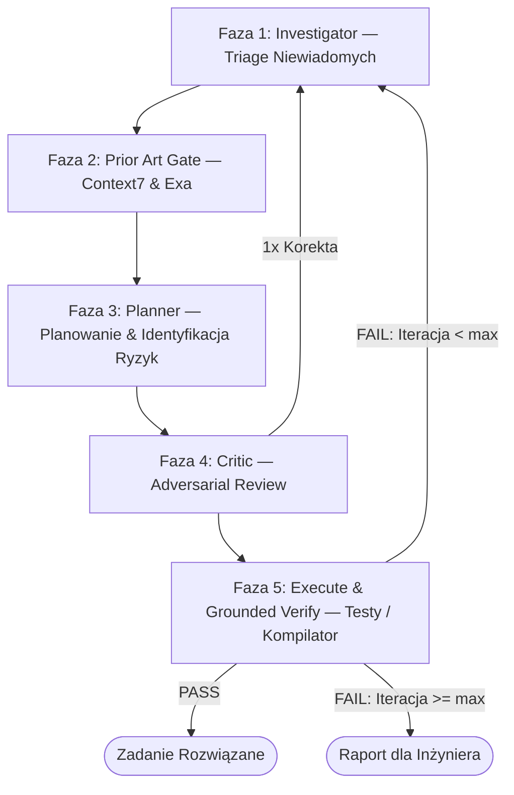

# kb-epistemic-solve — rozwiązywanie problemów programistycznych w pętli epistemicznej

## Cel
Rozwiązywanie złożonych problemów inżynierskich, refaktoryzacji i usuwania błędów z zachowaniem rygorystycznego modelowania niewiadomych, obowiązkowego badania stanu poprzedniego (Prior Art przez Context7/Exa) oraz bezwzględnego ugruntowania wykonawczego w testach.

## Kiedy użyć
- Gdy użytkownik wydaje polecenie: `"uruchom kb-epistemic-solve dla <zadanie>"`, `"rozwiąż problem X w pętli epistemicznej"`, `"przeprowadź refaktoryzację modułu Y z weryfikacją"`.
- W zadaniach o wysokim stopniu złożoności, wielomodułowych zależnościach lub ryzyku wystąpienia zjawiska *API drift*.

---

## Narzędzia i Serwery MCP
- **context7 MCP (`query-docs`, `resolve-library-id`):** Pobieranie aktualnej dokumentacji dla konkretnych wersji bibliotek w celu eliminacji halucynacji API.
- **exa MCP (`web_search_exa`, `get_code_context_exa`):** Semantyczne wyszukiwanie wzorców i fragmentów kodu w otwartych repozytoriach GitHub.
- **epistemic_runner.py (`python .agent/scripts/epistemic_runner.py`):** Zarządzanie plikiem stanu `state.json`, licznik budżetu i guardraile bezpieczeństwa.

---

## 5-Fazowy Protokół Wykonawczy

### Faza 1: Investigator (Zarządzanie Niewiadomymi)
1. Zainicjuj stan zadania: `python .agent/scripts/epistemic_runner.py init <TASK_ID> "<GOAL>"`
2. Wypisz stwierdzenia w pamięci roboczej:
   - Przypisz etykiety: `verified` (wymaga źródła: plik:linia), `inferred` (wniosek z faktów), `assumed` (założenie).
   - Zidentyfikuj maksymalnie 2 kluczowe niewiadome blokujące planowanie.
3. Wykonaj **maksymalnie 1 celowane wywołanie narzędziowe** (odczyt pliku lub schematu), aby wyjaśnić najważniejszą niewiadomą.
4. **ZAKAZ:** Na tym etapie nie wolno modyfikować plików źródłowych.

### Faza 2: Prior Art Gate (Brama Stanu Poprzedniego)
1. **Wymóg konieczny:** Sprawdź czy problem nie został już rozwiązany:
   - Sprawdź lokalną bazę `20_Patterns/` w Vaultie.
   - Odpytaj Context7 o metody bieżącej wersji używanej biblioteki.
   - Odpytaj Exa o wzorce w GitHubie dla niszowych algorytmów.
2. Zapisz wnioski w sekcji `prior_art_findings`.

### Faza 3: Planner (Planowanie z Identyfikacją Założeń)
1. Sformułuj plan w postaci atomowych, uporządkowanych kroków.
2. **Obowiązkowy ostatni krok planu:** Zdefiniuj jawnie:
   > *"Plan opiera się na kluczowym założeniu Z. Jeśli Z jest fałszywe, plan zawiedzie w punkcie P."*

### Faza 4: Adversarial Critic (Krytyka Oskarżycielska)
1. Przyjmij postawę surowego recenzenta (Staff Engineer / Security Auditor):
   - Czy plan nie ignoruje prostszego rozwiązania z biblioteki standardowej?
   - Jakie komponenty upstream/downstream mogą ulec uszkodzeniu?
   - Jaki konkretny test jednostkowy musi powstać, aby zweryfikować poprawkę?
2. Jeśli wykryto krytyczną lukę poznawczą: cofnij zadanie do Fazy 1 (dopuszczalne maksymalnie 1 raz w pętli).

### Faza 5: Execute & Grounded Verify (Wdrożenie i Testy)
1. Zastosuj zmiany w plikach źródłowych.
2. **Bezwzględny warunek sukcesu:** Uruchom fizyczny test/linter w środowisku za pomocą:
   `python .agent/scripts/epistemic_runner.py test "<test_command>" <state_file>`
3. Jeśli test zwróci `PASS` $\to$ Zakończ zadanie sukcesem.
4. Jeśli test zwróci `FAIL` $\to$ Wstrzyknij log błędu jako fakt `verified` i ponów cykl od Fazy 1 (o ile nie wyczerpano budżetu `max_iterations = 3`).

---

## Guardrails i Ograniczenia
- **Maksymalny budżet:** 3 iteracje pętli, 10 wywołań narzędziowych na zadanie.
- **Brak deklaratywnego sukcesu:** Nigdy nie uznawaj zadania za ukończone na podstawie własnej narracji tekstu bez zielonego wyniku kompilatora/testu.
- **Bezpieczeństwo:** Komendy destrukcyjne (`rm -rf`, `drop table`, `force push`) są automatycznie blokowane przez `epistemic_runner.py`.
