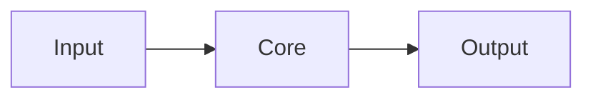

<!-- AI-INSTRUCTIONS
Głęboka analiza to ROZSZERZONY format library.md dla ważnych narzędzi.
Używaj gdy:
- Narzędzie jest kandydatem na `verdict: adopt`
- Decyzja wpływa na architekturę projektu
- Chcesz zrozumieć internals, nie tylko API

Reguły:
1. depth_level: surface (~30min) / standard (~2h) / deep (~1 dzień) / exhaustive (~kilka dni)
2. time_invested: ile REALNIE spędziłeś, np. "3h"
3. Po zakończeniu: stwórz/zaktualizuj notatkę library.md z wynikami
4. Sekcja "Internals" — NIE kopiuj kodu źródłowego. Opisz architekturę wewnętrzną
5. Sekcja "Plan adopcji" — konkretne kroki, nie ogólniki
-->

# Deep Analysis: <% tp.file.title %>

## 1. Cel analizy
<!-- Jedno zdanie: po co to badasz? Jaki problem chcesz rozwiązać? -->

## 2. Architektura na wysokim poziomie
<!-- Diagram Mermaid jeśli możliwy. Główne moduły, przepływ danych. -->


## 3. Core API — co naprawdę używasz
<!-- Przegląd publicznego API. Grupowanie po use-case, nie po module. -->

### 3.1 Use case: Główne zastosowanie
```ts
```

## 4. Internals — jak to działa pod spodem
<!-- Architektura wewnętrzna. Algorytmy, struktury danych, tradeoffs. NIE kopiuj kodu źródłowego — opisz własnymi słowami. -->

## 5. Ekosystem i integracje
| Integracja | Status | Uwagi |
|-----------|--------|-------|
<!-- Z czym się łączy? Jakie pluginy/extensions? -->

## 6. Performance i limity
<!-- Benchmarki (własne lub cudze). Znane limity. Kiedy zaczyna się łamać? -->

## 7. Dojrzałość i zdrowie projektu
| Metryka | Wartość | Ocena |
|---------|---------|-------|
| GitHub stars | | |
| Ostatni release | | |
| Open issues | | |
| Częstotliwość commitów | | |
| Sponsoring / funding | | |
| Breaking changes w ostatnim roku | | |

## 8. Verdict
<!-- Format: adopt / trial / assess / hold / avoid + uzasadnienie 2-3 zdania -->

## 9. Plan adopcji
<!-- Jeśli verdict = adopt lub trial: konkretne kroki.
     1. Gdzie wstawić w istniejącym projekcie?
     2. Co trzeba wymienić?
     3. Jaki jest plan rollback?
     4. Ile to zajmie? -->

## 10. Otwarte pytania
<!-- Co jeszcze nie wiesz? Co wymaga dalszego badania? -->
- 

## Źródła
- 
