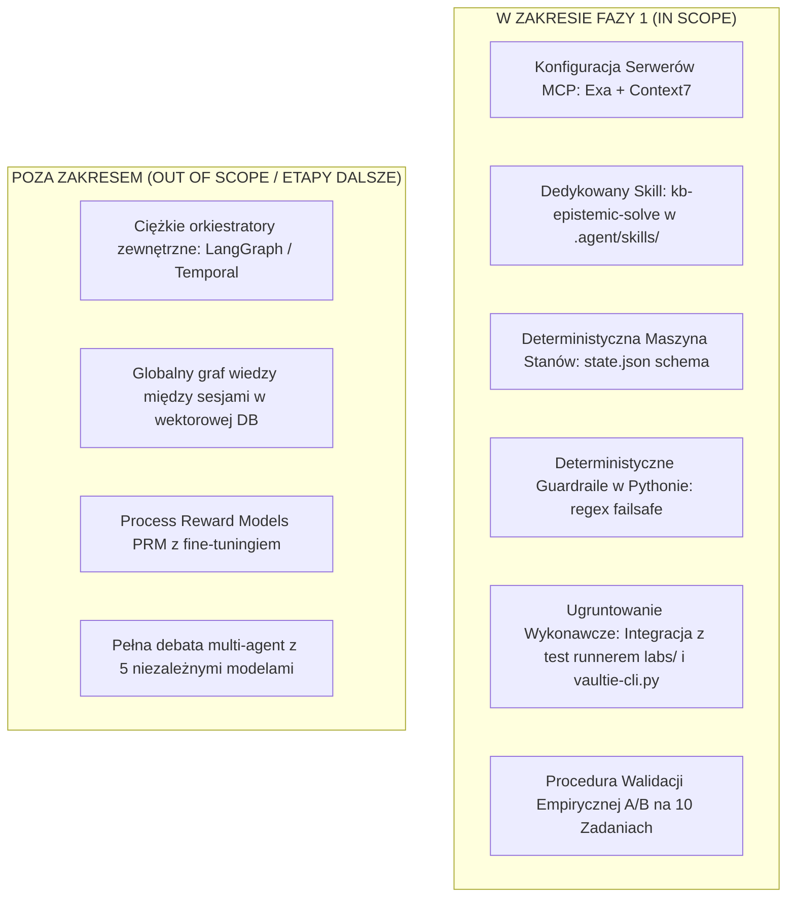
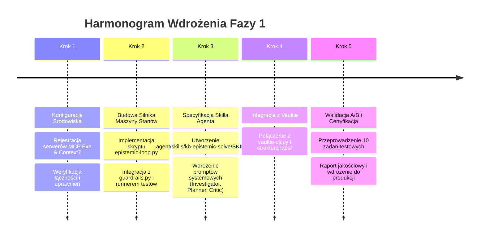

# Propozycja Realizacji Fazy 1: Wdrożenie Ekosystemu Epistemicznego Agenta Kodującego

> [!IMPORTANT]
> **Cel propozycji:** Uruchomienie produkcyjnego, pragmatycznego podsystemu wnioskowania epistemicznego (Tier 1 MVP z elementami Tier 2) w środowisku lokalnym użytkownika. Propozycja definiuje pełny plan wdrożeniowy, konfigurację narzędziową MCP, architekturę maszyny stanów, specyfikację dedykowanego skilla `.agent/skills/kb-epistemic-solve/`, rygorystyczne kryteria zaliczenia (Definition of Done) oraz scenariusz walidacji benchmarkowej.

---

## 1. Zakres i Granice Fazy 1 (Scope & Boundaries)



---

## 2. Architektura Komponentów i Środowiska

### 2.1. Warstwa Narzędziowa (Protokół MCP)
Wdrożenie dwóch kluczowych serwerów MCP w konfiguracji agenta (`mcp_config.json` / ustawienia IDE):

1. **Exa MCP (`https://mcp.exa.ai/mcp`)**
   - Narzędzia aktywne: `web_search_exa`, `get_code_context_exa` (lub `web_search_advanced_exa`).
   - Zastosowanie: Semantyczne wyszukiwanie wzorców architektonicznych, bibliotek i rozwiązań na GitHubie oraz forach inżynierskich.
2. **Context7 MCP (`https://mcp.context7.com/mcp`)**
   - Narzędzia aktywne: `resolve-library-id`, `query-docs` (lub `@upstash/context7-mcp`).
   - Zastosowanie: Pobieranie aktualnej dokumentacji bibliotek dla konkretnych wersji, eliminacja zjawiska API drift.

### 2.2. Warstwa Stanu Roboczego Zadania (`.agent/state/` / `00_Inbox/_proposals/`)
Struktura pliku `state.json` generowanego na czas trwania zadania:
```json
{
  "task_id": "TASK-20260822-01",
  "goal": "string (precyzyjny cel inżynierski)",
  "facts": [
    {"statement": "string", "status": "verified", "source": "ścieżka_do_pliku:linia lub URL"}
  ],
  "hypotheses": [
    {"statement": "string", "status": "inferred", "evidence": "opis dowodu"}
  ],
  "unknowns": [
    {"question": "string", "why_it_matters": "string"}
  ],
  "dependencies": ["lista", "modułów", "upstream/downstream"],
  "prior_art_checked": true,
  "prior_art_findings": ["odnaleziony wzorzec 1", "cytowanie Context7 2"],
  "plan": ["krok 1", "krok 2"],
  "critique": ["wykryte ryzyko 1", "brakujący test 2"],
  "tests_added": ["test_nazwa"],
  "iteration": 1,
  "budget": {
    "max_iterations": 3,
    "max_tool_calls": 10
  }
}
```

---

## 3. Szczegółowy Plan Realizacji Krok po Kroku



### Krok 1: Konfiguracja Narzędziowa i Serwerów MCP
* **Zadanie 1.1:** Przygotowanie wpisów serwerów MCP w konfiguracji środowiska IDE (`antigravity` / `claude_desktop_config.json` / `mcp_config.json`).
* **Zadanie 1.2:** Uruchomienie testowych zapytań przez MCP (np. `resolve-library-id` dla TanStack Query v5 oraz wyszukiwanie semantyczne w Exa).
* **Zadanie 1.3:** Walidacja fallbacku w przypadku braku klucza API (tryb darmowy / rate limits).

### Krok 2: Implementacja Deterministycznej Pętli Kontrolnej i Maszyny Stanów
* **Zadanie 2.1:** Opracowanie modułu Pythona `.agent/scripts/epistemic_runner.py`:
  - Zarządzanie cyklem życia pliku stanu `state.json`.
  - Twardy licznik budżetu iteracji (`max_iterations = 3`, `max_tool_calls = 10`).
  - Deterministyczny walidator regex blokujący destrukcyjne polecenia powłoki (`rm -rf`, `drop table`, `git push --force`).
* **Zadanie 2.2:** Integracja z lokalnymi runnerami testów (np. `pytest`, `pnpm test`, `cargo test`, `python .agent/scripts/vaultie-cli.py check`).

### Krok 3: Opracowanie Skilla `.agent/skills/kb-epistemic-solve/`
* **Zadanie 3.1:** Utworzenie pliku `.agent/skills/kb-epistemic-solve/SKILL.md` definiującego rygorystyczny protokół postępowania agenta:
  - **Faza 1 (Investigator):** Ekstrakcja faktów, identyfikacja niewiadomych, blokada pisania kodu.
  - **Faza 2 (Prior Art Search):** Obowiązkowe przeszukanie `Context7` oraz lokalnej bazy `20_Patterns/` przed generacją planu.
  - **Faza 3 (Planner):** Generowanie atomowych kroków + wskazanie najsłabszego założenia.
  - **Faza 4 (Adversarial Critic):** Jednokrotny audyt oskarżycielski planu.
  - **Faza 5 (Execute & Verify):** Wdrożenie zmian i **bezwzględne wykonanie testów fizycznych**.

### Krok 4: Integracja z Systemem Certyfikacji Vaultie
* **Zadanie 4.1:** Rozszerzenie `vaultie-cli.py` o komendę `vaultie-cli.py epistemic-audit` weryfikującą obecność testów i kompletność wpisów `facts` (statusy `verified/inferred/assumed`).
* **Zadanie 4.2:** Podpięcie mechanizmu do weryfikacji laboratoriów w `labs/web-engineering/`.

### Krok 5: Procedura Walidacji Empirycznej A/B (Benchmark)
* **Zadanie 5.1:** Przeprowadzenie 10 zadań referencyjnych (5 zadań refaktoryzacji, 3 zadania integracji API, 2 zadania naprawy regresji).
* **Zadanie 5.2:** Pomiar wskaźników: Pass@1, narzut tokenów, czas wykonania, brak uszkodzeń modułów upstream.

---

## 4. Kryteria Zaliczenia (Definition of Done — DoD)

Faza 1 zostanie uznana za formalnie zakończoną i certyfikowaną, jeśli zostaną spełnione **wszystkie** poniższe warunki:

| Lp. | Obszar | Kryterium Zaliczenia (DoD) | Metoda Weryfikacji |
|---|---|---|---|
| **1** | **MCP Integration** | Serwery Exa i Context7 odpowiadają poprawnie na zapytania w czasie < 2.5s. | Zautomatyzowany test integracyjny JSON-RPC |
| **2** | **Skill Architecture** | Utworzono `.agent/skills/kb-epistemic-solve/SKILL.md` w pełni zgodny ze specyfikacją agenta. | Inspekcja pliku i audyt lintera skilli |
| **3** | **Budget Guardrails** | Pętla bezwarunkowo zatrzymuje się po 3 iteracjach lub 10 wywołaniach narzędzi; nie dochodzi do nieskończonych pętli. | Test jednostkowy symulacji błędu |
| **4** | **Safety Regex** | Próba wykonania komendy z denylisty (`rm -rf`, `drop table`, `force push`) jest natychmiast blokowana. | Zestaw testów bezpieczeństwa guardrails |
| **5** | **Grounded Verification** | Agent odmawia oznaczenia zadania jako rozwiązane bez zielonego wyniku kompilatora/testów. | Test scenariusza z celowo uszkodzonym testem |
| **6** | **Epistemic Labeling** | 100% wpisów o statusie `verified` posiada poprawne pole `source` wskazujące plik i linię lub URL. | Walidator schematu `state.json` |
| **7** | **A/B Benchmark** | Wskaźnik Pass@1 w teście 10 zadań osiąga co najmniej **80%** (minimum 8/10 zadań zaliczonych bez regresji). | Raport jakościowy z benchmarku |

---

## 5. Macierz Ryzyk i Strategia Wycofania (Rollback Plan)

| Identyfikator Ryzyka | Prawdopodobieństwo | Wpływ | Plan Mitygacji | Plan Awaryjny (Rollback) |
|---|---|---|---|---|
| **R1: Limit zapytań (Rate Limit) w Context7 / Exa** | Średnie | Średni | Zastosowanie lokalnego cache'owania odpowiedzi w `.agent/cache/` oraz fallbacku do wyszukiwania lokalnego w Vaultie. | Przełączenie na wewnętrzny moduł `20_Patterns/` |
| **R2: Wzrost latencji zadania (> 60s)** | Wysokie | Niskie | Ograniczenie fazy Investigator do 1 zapytania narzędziowego i pomijanie fazy Critic dla zadań trywialnych. | Wyłączenie kroku Critic w konfiguracji |
| **R3: Zanieczyszczenie pamięci (Context Pollution)** | Niskie | Wysokie | Ścisłe czyszczenie i kompresja wyjść narzędziowych przed dodaniem do promptu (max 500 tokenów na log). | Reset pliku stanu zadania (`state.json`) |

---

## 6. Wymagane Zasoby i Zależności

1. **Środowisko Uruchomieniowe:** Python 3.10+ (dostępny w systemie), `pnpm` / `node`.
2. **Klucze API (Opcjonalne/Rekomendowane):**
   - `EXA_API_KEY` (opcjonalny, dostępny free tier na start),
   - `CONTEXT7_API_KEY` (dostępny darmowy free tier bez klucza z niższymi limitami).
3. **Pliki i Skille w Repozytorium:**
   - `.agent/skills/kb-epistemic-solve/`
   - `.agent/scripts/epistemic_runner.py`
   - `00_Inbox/_proposals/`

---

## 7. Decyzja i Kolejne Kroki

Po formalnym zatwierdzeniu niniejszej propozycji:
1. Przenosimy wyekstrahowaną wiedzę do kanonicznych notatek `10_Libraries/`, `20_Patterns/`, `30_Decisions/` i `50_Concepts/`.
2. Przechodzimy bezpośrednio do realizacji Kroków 1–3 (Scaffold skilla, skrypt kontrolera, konfiguracja MCP).
