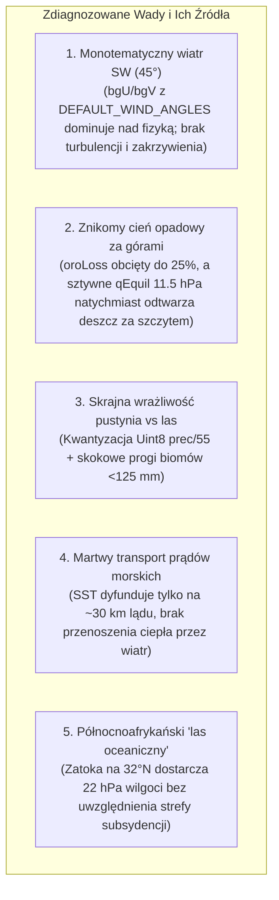
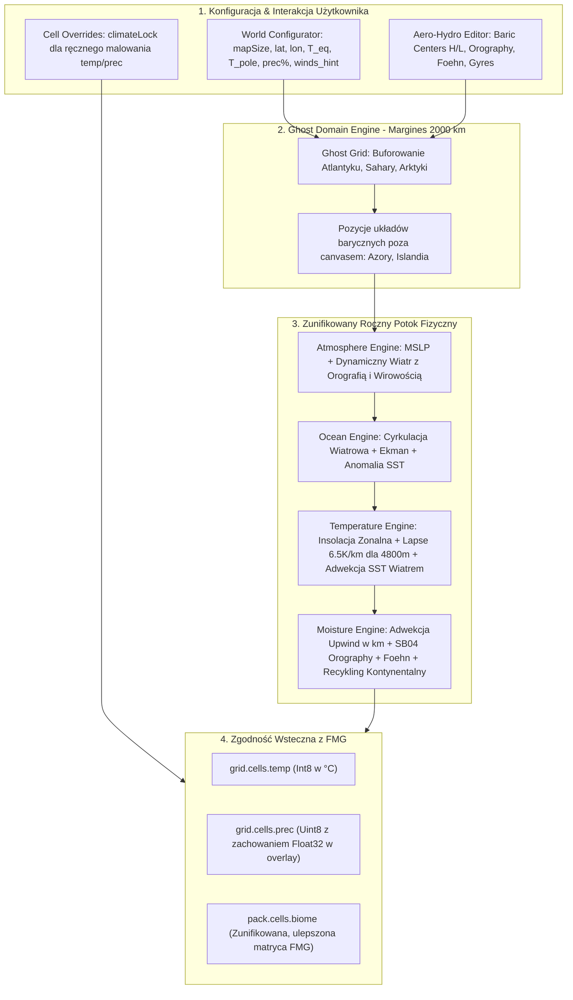

# Fizyczny i Dynamiczny Model Klimatu Aero-Hydro 3.0

> **Dokumentacja Projektowa i Analiza Techniczna** dla silnika klimatu w `labs/Fantasy-Map-Generator-experimental`.  
> Opracowana na podstawie analizy mapy referencyjnej **Fate** (`Fate 2026-08-30-18-29.map`) oraz ustaleń projektowych:
> 1. **Brak zbędnej wielosezonowości** — jednolity, wysokowydajny roczny potok fizyczny z poprawnym bilansem aridyczności i kontynentalności.
> 2. **Dynamiczny, chaotyczny wiatr dostosowujący się do rzeźby terenu** — strzałki w UI to tylko ogólna sugestia tendencji planetarnej; wiatr reaguje na układy baryczne, grzbiety górskie, doliny (Venturi) i synoptyczną wirowość.
> 3. **Wysokie szczyty alpejskie ($4800\text{ m}$)** — realny spadek termiczny ($-31.2^\circ\text{C}$ na $h=100$), rygorystyczne opady orograficzne i głęboki cień zawietrzny (Foehn).
> 4. **Ujednolicony system biomów FMG** — zachowanie spójnej, pojedynczej warstwy biomów FMG (rozszerzonej o strefowość wysokościową i termiczną) bez zbędnych nakładek Köppena w UI.
> 5. **Jednostki fizyczne (km / mi)**, **domena rozszerzona (Ghost Domain)** oraz **pełna kompatybilność wsteczna z plikami `.map`**.

---

## 1. Analiza Diagnozy i Przyczyn Wad Obecnego Silnika



### 1.1 Wiatry wiejące w jednym kierunku (Obraz 3)
* **W kodzie:** W `atmosphere-engine.ts`, strefa umiarkowana 30–60°N ma na stałe przypisany kąt `DEFAULT_WIND_ANGLES[1] = 45°` (zwrot na NE $\rightarrow$ wiatr z SW). Składowa tła `bgU, bgV` (3.8–6.2 m/s) jest sztywno dodawana do każdej komórki, całkowicie zagłuszając gradienty ciśnienia.
* **Rozwiązanie 3.0:** Wskaźnik wiatru w World Configuratorze traktujemy jako **słabą tendencję tła (Background Drift)**. Właściwy wiatr wynika z **gradientu ciśnienia MSLP**, **opływania rzeźby terenu (deflekcja grzbietowa i efekt Venturiego)** oraz **synoptycznej wirowości (szum wirowy / fale Rossby'ego)**, dając naturalny, organiczny chaos i krzywiznę linii prądu.

### 1.2 Brak cienia opadowego za górami (Obrazy 1 i 3)
* **W kodzie:** W `moisture-advection-engine.ts`, ubytek wilgoci przy wznoszeniu jest sztucznie zlimitowany: `oroLoss = Math.min(wAscent * 0.04, 0.25)`. Po przekroczeniu grzbietu (`dz < 0`), algorytm miesza wilgoć z `qEquil = 11.5 hPa`, co natychmiast przywraca opad ~700 mm/rok na zawietrznej.
* **Rozwiązanie 3.0:** Zastosowanie prawa zachowania masy i modelu **Smitha i Barstada (2004)**: wznoszenie skrapla wilgoć proporcjonalnie do pionowej prędkości ($\Delta q = -P_{oro}$). Przy zstępowaniu powietrze ogrzewa się suchoadiabatycznie ($\Gamma_d = 9.8\text{ K/km}$), a spadek wilgotności względnej ($RH < 30\%$) wywołuje **zjawisko fenowe (Foehn)** i głęboki cień opadowy na 100–400 km.

### 1.3 Nagły przeskok całego kontynentu w pustynię przy obniżeniu opadów
* **W kodzie:** Dzielenie przez 55 i zaokrąglenie do `Uint8` sprawia, że 1 prec = 55 mm, 2 = 110 mm. W `biomes-generator.ts` próg 125 mm (prec $\le 2$) drastycznie odcina lasy i trawy, zmieniając je w pustynię.
* **Rozwiązanie 3.0:** Płynna, ciągła funkcja bilansu wilgoci $P / PET$ (stosunek opadu do ewapotranspiracji potencjalnej Penmana–Monteitha), zapewniająca płynne strefy: las $\rightarrow$ zadrzewienia $\rightarrow$ step/preria $\rightarrow$ półpustynia $\rightarrow$ pustynia.

### 1.4 Brak wpływu prądów morskich na klimat lądu
* **W kodzie:** W `ocean-engine.ts`, anomalia SST modyfikuje ląd wyłącznie przez `propagateSstToLand` (2 iteracje dyfuzji na ~25–30 km).
* **Rozwiązanie 3.0:** Ciepły prąd ogrzewa morską masę powietrza, która jest **adwekowana przez wiatr na odległość 800–1500 km w głąb lądu** (łagodzący wpływ oceanu w strefie nawietrznej).

---

## 2. Pomiary i Kalibracja na Mapie Fate (`Fate 2026-08-30-18-29.map`)

| Parametr Mapy | Wartość w pliku Fate | Odpowiednik Fizyczny / Geograficzny |
|---|---|---|
| **Wymiary Canvas** | $3800 \times 2850\text{ px}$ | — |
| **Siatka komórek** | $365 \times 274$ komórek | Średnia komórka: $\Delta x \approx 9.73\text{ km}$, $\Delta y \approx 9.69\text{ km}$ ($pole \approx 94.3\text{ km}^2$) |
| **Skala linijki** | `distanceScale = 0.93 km/px` | Szerokość: $3534.0\text{ km}$ ($2195.9\text{ mi}$), Wysokość: $2650.5\text{ km}$ ($1646.9\text{ mi}$) |
| **Szerokości geogr.** | $\text{latN} = 53.6^\circ\text{N}$, $\text{latS} = 29.7^\circ\text{N}$ | Rozpiętość $23.9^\circ \times 111.13\text{ km/}^\circ = \mathbf{2656.1\text{ km}}$ (zgodność: **99.8%**) |
| **Długości geogr.** | $\text{lonW} = 5.4^\circ\text{E}$, $\text{lonE} = 37.3^\circ\text{E}$ | Rozpiętość $31.9^\circ$ (od Holandii/Renu po wschodnią Polskę/Ukrainę i Deltę Nilu) |
| **World Configurator** | $\text{mapSize} = 13.3\%$, $\text{lat} = 23.3$, $\text{lon} = 43.5$ | Meridian globu: $19\,929\text{ km}$ ($99.6\%$ południka Ziemi) |
| **Termika globu** | Równik: $27^\circ\text{C}$, Biegun N: $-12^\circ\text{C}$ | Hamburg: $T_{ann} \approx 8.7^\circ\text{C}$, Rzym: $T_{ann} \approx 15.5^\circ\text{C}$, Kair: $T_{ann} \approx 22.5^\circ\text{C}$ |

```
                              5.4°E (Holandia / Alpy Zach.)          37.3°E (Ukraina / Lewant)
   53.6°N +--------------------------------------------------------------------+ 53.6°N
          |  [Hamburg / Dania / Bałtyk Płd.]            [Polska Północno-Wsch.]|  (T_ann ~8.7°C)
          |                                                                    |
   41.7°N |  [Morze Tyrreńskie / Rzym]                  [Grecja / Morze Egejskie]|  (T_ann ~15.5°C)
          |                                                                    |
   29.7°N +--------------------------------------------------------------------+ 29.7°N
          |  [Pustynia Libijska / Zach. Egipt]          [Delta Nilu / Kair]    |  (T_ann ~22.5°C)
                              5.4°E                                   37.3°E
```

> **Wniosek:** Główne ośrodki baryczne sterujące Europą leżą w **domenie rozszerzonej (Ghost Domain)**:
> - **Niż Islandzki** (~64°N, 19°W): leży **2720 km na zachód i 1170 km na północ poza mapą**.
> - **Wyż Azorski** (~38.5°N, 28°W): leży **3720 km na zachód poza mapą**.

---

## 3. Równania Matematyczne i Mechaniki Fizyczne

### 3.1 Termodynamika Pary Wodnej (Clausius–Clapeyron / Magnus)
Maksymalna pojemność wilgoci w powietrzu przy temperaturze $T$ [°C]:
$$e_s(T) = 6.112 \cdot \exp\left( \frac{17.67 \cdot T}{T + 243.5} \right) \quad [\text{hPa}]$$

### 3.2 Opad Orograficzny, Cień Zawietrzny i Zjawisko Fenowe (Smith & Barstad 2004)
1. **Wymuszenie pionowe:**
   $$w_{ascent} = \max\left(0, \, \vec{V} \cdot \nabla z\right) \quad [\text{m/s}]$$
2. **Kondensacja:**
   $$P_{oro} = C_{oro} \cdot w_{ascent} \cdot q \cdot \rho_{air} \quad [\text{mm/rok}]$$
3. **Ubytek wilgoci w strefie grzbietowej:**
   $$\Delta q = - \frac{P_{oro}}{|\vec{V}| \cdot \tau_{cloud}}$$
   gdzie $\tau_{cloud} \approx 1000\text{ s}$, co daje strefę znoszenia deszczu $L_{spill} \approx 10\text{--}15\text{ km}$.
4. **Zstępowanie i Foehn:** Gdy $\vec{V} \cdot \nabla z < 0$, powietrze ogrzewa się o $\Delta T = \Gamma_d \cdot |\Delta z|$ ($\Gamma_d = 9.8\text{ K/km}$), a wilgotność względna spada drastycznie ($RH < 30\%$), tworząc suchy i ciepły cień opadowy.

### 3.3 Dynamiczny Wiatr z Szumem Synoptycznym i Rzeźbą Terenu
Wektor wiatru na komórce:
$$\vec{V} = \vec{V}_{geostrophic}(\nabla P_{MSLP}) + \vec{V}_{drift}(\text{winds\_hint}) + \vec{V}_{vorticity}(\text{CurlNoise}) + \vec{V}_{orography}(\nabla z)$$
- **Deflekcja graniowa:** Wiatr omija strome ściany skalne wzdłuż poziomicy: $\vec{V}_{\perp} \rightarrow \vec{V}_{\parallel}$.
- **Efekt Venturiego:** Przyspieszenie w przełęczach i przewężeniach dolinnych o $+25\text{--}50\%$.
- **Szum synoptyczny:** Dynamiczna wirowość $\nabla \times \vec{\psi}$ zapobiega równoległym „liniom z linijki”, wprowadzając naturalną krzywiznę i meandrowanie strug.

### 3.4 Skala Wysokościowa Szczytów ($4800\text{ m}$)
- $h = 20 \rightarrow 0\text{ m}$ (poziom morza),
- $h = 50 \rightarrow 1485\text{ m}$ (wyżyny / średnie góry),
- $h = 70 \rightarrow 2720\text{ m}$ (piętro subalpejskie / regla górnego),
- $h = 100 \rightarrow \mathbf{4800\text{ m}}$ (szczyty alpejskie, Mont Blanc).
- Przy $\Gamma = 6.5\text{ K/km}$, spadek temperatury na szczycie $h=100$ wynosi $\Delta T = -31.2^\circ\text{C}$, co na szerokości 45°N ($T_{sea} \approx 13.7^\circ\text{C}$) daje temperaturę szczytową **$-17.5^\circ\text{C}$** i gwarantuje obecność lodowców górskich (`Montane glaciers`).

---

## 4. Architektura Potoku Aero-Hydro 3.0



---

## 5. Zgodność Wsteczna i Edytowalność

1. **Bezpośrednia edycja:**
   - World Configurator: T równik/bieguny, `mapSize`, szerokość/długość geograficzna, mnożnik `prec%`, wskaźniki kierunku wiatru `winds[6]`.
   - Aero-Hydro Editor: bezpośrednie dodawanie/przesuwanie centrów High/Low, zmiana ciśnienia (hPa), promienia (km) i siły orografii/foehna.
   - Pędzel (Paint tool): flaga `cells.climateLock[i]` zapobiegająca nadpisywaniu ręcznie zmienionych komórek.
2. **Pośrednia edycja (algorytmiczna):**
   - Pozycje układów barycznych poza canvasem generowane automatycznie na podstawie szerokości geograficznej.
   - Strzałki wiatru w UI modyfikują pole ciśnienia i tendencję tła bez niszczenia lokalnej aerodynamiki.
3. **Zgodność z plikami `.map`:**
   - Tablice `grid.cells.temp` (Int8), `grid.cells.prec` (Uint8), `pack.cells.biome` (Uint8) zachowują identyczny format pamięciowy i format zapisu/odczytu.
   - Nowe pola fizyczne (`pressure`, `windU`, `windV`, `sstAnomaly`, `moisture`) są serializowane w sekcji `options.atmosphere` jako nakładki opcjonalne.

---

## 6. Źródła i Literatura Naukowa

1. **Smith, R.B. & Barstad, I. (2004).** *A Linear Theory of Orographic Precipitation.* Journal of the Atmospheric Sciences, 61(12), 1377–1391. [DOI: 10.1175/1520-0469(2004)061<1377:ALTOOP>2.0.CO;2](https://doi.org/10.1175/1520-0469(2004)061<1377:ALTOOP>2.0.CO;2)
2. **van der Ent, R.J. & Savenije, H.H.G. (2011).** *Length and time scales of atmospheric moisture recycling.* Atmospheric Chemistry and Physics, 11, 1853–1863. [DOI: 10.5194/acp-11-1853-2011](https://doi.org/10.5194/acp-11-1853-2011)
3. **Alduchov, O.A. & Eskridge, R.E. (1996).** *Improved Magnus Form Approximation of Saturation Vapor Pressure.* Journal of Applied Meteorology, 35(4), 601–609.
4. **Stull, R. (2017).** *Practical Meteorology: An Algebra-based Survey of Atmospheric Science.* University of British Columbia, Ch. 11 (General Circulation & Planetary Winds).
5. **Stommel, H. (1948).** *The Westward Intensification of Wind-Driven Ocean Currents.* Transactions, American Geophysical Union, 29(2), 202–206.
6. **ICAO (1993).** *Manual of the ICAO Standard Atmosphere.* International Civil Aviation Organization (Lapse Rate 6.5 °C/km).
7. **Würsch, M. & Sprenger, M. (2015).** *Swiss and Austrian Foehn Studies: The Role of Upstream Moisture and Downstream Warming.* Q. J. R. Meteorol. Soc.
