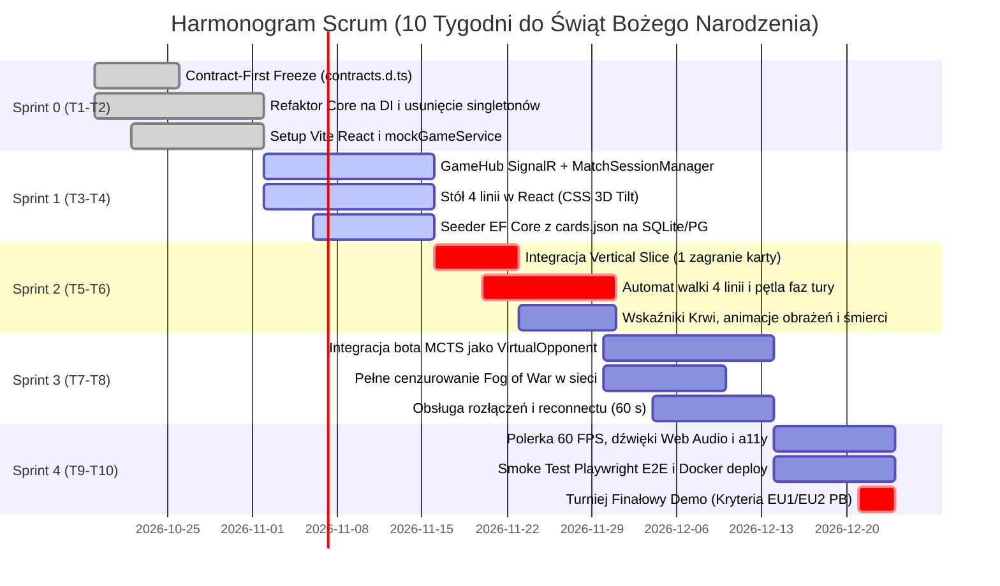

# Raport Architektoniczny: Modernizacja Gry Karcianej „Rejoltance” (CardGame)

**Autor:** Project Architect  
**Odbiorca:** Project Manager (`fc795897-3b8d-4bbd-a5b6-3cd6af5d30dd`)  
**Repozytorium źródłowe:** `c:\Users\cyunc\source\repos\CardGame`  
**Kontekst akademicki:** Projekt Zespołowy, Wydział Informatyki Politechniki Białostockiej (zespół 6-osobowy, 10 tygodni do Świąt, 2 semestry realizacji)  
**Kontekst dydaktyczny:** Masterclass Inżynierii Webowej — Lekcja 2.3 (`90_Meta/lessons/2.3/`) oraz Sandbox (`labs/web-engineering/2.3/`)  

---

## 🧭 Spis Treści Raportu

1. [Część (0): Architektoniczna Diagnoza `CardGame.Core` jako Autorytatywnego Silnika w ASP.NET Core](#część-0-architektoniczna-diagnoza-cardgamecore-jako-autorytatywnego-silnika-w-aspnet-core)
   - 0.1. [Czystość domenowa i całkowity brak zależności od Godota](#01-czystość-domenowa-i-całkowity-brak-zależności-od-godota)
   - 0.2. [Determinizm, Replay Engine i `DeterministicRng`](#02-determinizm-replay-engine-i-deterministicrng)
   - 0.3. [Niemutowalność stanu (`GameState.With`) a wielowątkowość Kestrela](#03-niemutowalność-stanu-gamestatewith-a-wielowątkowość-kestrela)
   - 0.4. [Brak Fog of War w domenie — uzasadnienie architektoniczne](#04-brak-fog-of-war-w-domenie--uzasadnienie-architektoniczne)
   - 0.5. [Refaktor `CardLibrary.Instance` na Dependency Injection (DI)](#05-refaktor-cardlibraryinstance-na-dependency-injection-di)
   - 0.6. [Uzasadnienie Wyboru Ścieżki B (Kontrolowany Refaktor Core + Web SPA)](#06-uzasadnienie-wyboru-ścieżki-b-kontrolowany-refaktor-core--web-spa)
2. [Część (3): Specyfikacja Lekcji 2.3 i Sandboxu w `labs/web-engineering/2.3/`](#część-3-specyfikacja-lekcji-23-i-sandboxu-w-labsweb-engineering23)
   - 3.1. [Ustrukturyzowanie Lekcji 2.3 w `90_Meta/lessons/2.3/`](#31-ustrukturyzowanie-lekcji-23-w-90_metalessons23)
   - 3.2. [Kompletna Dydaktyczna Specyfikacja Wiedzy (`spec.yaml`)](#32-kompletna-dydaktyczna-specyfikacja-wiedzy-specyaml)
   - 3.3. [Raport Jakości i Certyfikacji Statycznej (`quality-report.yaml`)](#33-raport-jakości-i-certyfikacji-statycznej-quality-reportyaml)
   - 3.4. [Architektura Monorepo w Sandboxie `labs/web-engineering/2.3/`](#34-architektura-monorepo-w-sandboxie-labsweb-engineering23)
   - 3.5. [Minimalny Pionowy Wycinek (Vertical Slice) w Sandboxie](#35-minimalny-pionowy-wycinek-vertical-slice-w-sandboxie)
   - 3.6. [Testy Sprawnościowe Architektury (Architecture Fitness Tests w NetArchTest)](#36-testy-sprawnościowe-architektury-architecture-fitness-tests-w-netarchtest)
   - 3.7. [Kompletne Definition of Done (DoD) dla Sandboxu 2.3](#37-kompletne-definition-of-done-dod-dla-sandboxu-23)
3. [Część (4): Workflow Deweloperski i Organizacja Pracy Zespołu](#część-4-workflow-deweloperski-i-organizacja-pracy-zespołu)
   - 4.1. [Dekompozycja na 6 Niezależnych Epików (E1–E6) pod Bounded Contexts](#41-dekompozycja-na-6-niezależnych-epików-e1e6-pod-bounded-contexts)
   - 4.2. [Harmonogram Scrum na 10 Tygodni do Świąt (Sprinty 0–4) i BDD Given-When-Then](#42-harmonogram-scrum-na-10-tygodni-do-świąt-sprinty-04-i-bdd-given-when-then)
   - 4.3. [Strategia Bezblokowej Pracy: Contract-First Freeze i Mock Transport Service](#43-strategia-bezblokowej-pracy-contract-first-freeze-i-mock-transport-service)
   - 4.4. [Procedura Testowania Meczów 1v1 na Pojedynczej Maszynie Deweloperskiej](#44-procedura-testowania-meczów-1v1-na-pojedynczej-maszynie-deweloperskiej)
   - 4.5. [Pipeline CI/CD i Weryfikacja Wymogów Uczelnianych PB (EU1/EU2)](#45-pipeline-cicd-i-weryfikacja-wymogów-uczelnianych-pb-eu1eu2)

---

# Część (0): Architektoniczna Diagnoza `CardGame.Core` jako Autorytatywnego Silnika w ASP.NET Core

### 0.1. Czystość domenowa i całkowity brak zależności od Godota

Weryfikacja kodu w katalogu `Source/CardGame.Core` (106 plików C#, 9 258 LOC) wykazała **idealną separację domenową**:
1. **Plik projektu:** `Source/CardGame.Core/CardGame.Core.csproj` deklaruje czysty SDK `Microsoft.NET.Sdk` z TFM `net8.0` (targetowany do `net10.0` LTS).
2. **Zero zależności zewnętrznych:** Projekt nie importuje żadnych paczek NuGet poza standardową biblioteką bazową (.NET BCL).
3. **Brak sprzężeń z silnikiem gry:** Polecenie przeszukania całego drzewa `CardGame.Core` pod kątem symbolu `Godot` zwraca **dokładnie 0 wyników** (`using Godot` = 0). W domenie nie istnieje ani jedna referencja do `Node`, `Node2D`, `Control`, `TextureRect` czy sygnałów Godota.
4. **Wniosek:** `CardGame.Core` spełnia w 100% kryteria rdzenia architektury heksagonalnej (Hexagonal Core / Onion Domain) i może zostać bezproblemowo zaimportowany jako referencja projektu (`ProjectReference`) w ASP.NET Core Web API i SignalR.

---

### 0.2. Determinizm, Replay Engine i `DeterministicRng`

Silnik implementuje klasę `DeterministicRng` (`Source/CardGame.Core/Application/DeterministicRng.cs`), która zarządza generowaniem liczb pseudolosowych w oparciu o jawne ziarno (`seed`):
```csharp
// CardGame.Core/Application/DeterministicRng.cs
public class DeterministicRng : IRng
{
    private Random _random;
    public int Seed { get; }

    public DeterministicRng(int seed)
    {
        Seed = seed;
        _random = new Random(seed);
    }

    public int Next(int minValue, int maxValue) => _random.Next(minValue, maxValue);
    public double NextDouble() => _random.NextDouble();
}
```

#### Korzyści architektoniczne dla serwera autorytatywnego:
- **Tani zapis historii meczu (Replay Engine):** Aby zapisać i odtworzyć partię trwającą 40 tur, nie trzeba zapisywać pełnych snapshotów stanu (ważących setki kilobajtów). Wystarczy utrwalić w PostgreSQL: `MatchSeed` (int) oraz chronologiczną listę komend wejściowych graczy (`IReadOnlyList<CommandDto>`). Odtworzenie meczu polega na ponownym przekazaniu komend do świeżej instancji `GameEngine` z tym samym ziarnem — wynik jest w 100% identyczny.
- **Weryfikacja anty-cheatowa:** Sędzia serwerowy (Server Arbiter) może asynchronicznie odtworzyć mecz w tle i zweryfikować, czy którakolwiek komenda nie wygenerowała desynchronizacji lub niedozwolonego stanu.

---

### 0.3. Niemutowalność stanu (`GameState.With`) a wielowątkowość Kestrela

Klasy stanu meczu: `GameState` (`Source/CardGame.Core/State/Models/GameState.cs`), `BoardState`, `PlayerState` i `Line` zostały zaprojektowane zgodnie z paradygmatem **niemutowalności (Immutability)**:
- Właściwości obiektów posiadają wyłącznie gettery (`{ get; }`).
- Modyfikacja stanu następuje wyłącznie za pośrednictwem metod kopiujących z modyfikacją `.With(...)`:
```csharp
// CardGame.Core/State/Models/GameState.cs:160
public GameState With(
    int? turnNumber = null,
    GamePhase? currentPhase = null,
    int? activePlayerId = null,
    BoardState? board = null,
    PlayerState? playerA = null,
    PlayerState? playerB = null,
    IEnumerable<int>? playersReady = null,
    PendingInteraction? pendingInteraction = null,
    IEnumerable<CardInstance>? spellStack = null,
    int? roundStartingPlayerId = null) => ...
```

#### Kluczowe konsekwencje dla wielowątkowego środowiska Kestrel:
1. **Thread-Safety przy odczycie:** Gdy wątek SignalR Hubu serializuje aktualny stan do JSON w celu wysyłki do klienta, inny wątek (np. bot MCTS w tle) może bezpiecznie badać alternatywne gałęzie symulacji gry. Niemutowalność wyklucza wystąpienie błędu `InvalidOperationException: Collection was modified; enumeration operation may not execute`.
2. **Optymalizacja pamięci:** Nowy stan współdzieli wskaźniki do niezmienionych gałęzi poprzedniego stanu (struktury danych Persistent / Structural Sharing), co drastycznie redukuje presję na Garbage Collector (.NET Gen0/Gen1).

---

### 0.4. Brak Fog of War w domenie — uzasadnienie architektoniczne

Wnikliwa analiza `PlayerState.cs` wykazała:
```csharp
// Source/CardGame.Core/State/Models/PlayerState.cs:47-53
public IReadOnlyList<CardInstance> Hand { get; }
public IReadOnlyList<CardInstance> DrawPile { get; }
public IReadOnlyList<CardInstance> DiscardPile { get; }
```
`GameState` przechowuje pełną, nieocenzurowaną wiedzę o obu graczach: pełne instancje kart w ręku, kolejność w talii dociągu i cmentarz.

#### Uzasadnienie inżynierskie (Dlaczego to zaleta, a nie wada domeny?):
- **Zasada pojedynczej odpowiedzialności (SRP):** Domena `CardGame.Core` odpowiada wyłącznie za egzekwowanie niezmienników reguł gry. Aby sprawdzić, czy gracz ma prawo dobrać kartę, rzucić czar sprawdzający talię przeciwnika (np. mechanika `TutorCardHandler`) lub wyzwolić trigger `OnOpponentCardDrawn`, silnik **musi posiadać pełną wiedzę o stanie całego meczu**.
- **Warstwa zamglenia (Fog of War) to sprawa prezentacji/sieci:** Maskowanie kart nie powinno znajdować się w silniku reguł! Jest to odpowiedzialność **adaptera wyjściowego (Driver Adapter / Projection Layer)** w ASP.NET Core (`CardGame.Api`). Serwer przygotowuje dwie odrębne projekcje DTO (`PlayerGameStateDto`):
  - Dla Gracza A: jego ręka jest w pełni jawna, ręka Gracza B zawiera syntetyczne rewersy (`HandCardCount: 3`).
  - Dla Gracza B: odwrotnie.
- **Bezpieczeństwo sieciowe:** Nawet jeżeli gracz otworzy konsolę F12 DevTools $\to$ Network $\to$ WS, nie ma fizycznej możliwości podejrzenia kart przeciwnika, ponieważ pakiety sieciowe wychodzące z serwera nie zawierają tych pól.

---

### 0.5. Refaktor `CardLibrary.Instance` na Dependency Injection (DI)

W obecnym kodzie repozytorium zidentyfikowano krytyczny dług techniczny:
```csharp
// Source/CardGame.Core/Cards/Data/CardLibrary.cs:16-22
public class CardLibrary
{
    private Dictionary<int, CardData> _cards = new Dictionary<int, CardData>();
    public static CardLibrary Instance { get; } = new CardLibrary();
    public void Clear() => _cards.Clear();
    public void LoadFromJson(string filePath) { ... }
}
```

#### Diagnoza zagrożeń w ASP.NET Core:
1. **Wyścigi danych (Race Conditions):** `CardLibrary.Instance` przechowuje mutowalny `Dictionary<int, CardData>`. Równoległe wywołanie `Clear()` lub ponowne ładowanie w trakcie trwania meczów doprowadzi do uszkodzenia pamięci procesu serwera.
2. **Brak izolacji testów jednostkowych:** Testy xUnit uruchamiane równolegle modyfikują ten sam stan globalny, co uniemożliwia stabilne testy integracyjne.

#### Projekt Refaktoru pod .NET 10 LTS:
Wprowadzamy silnie typowany interfejs `ICardCatalog` oraz niezmienną, zoptymalizowaną kolekcję `FrozenDictionary<int, CardData>`:

```csharp
// Proponowana architektura w CardGame.Core/Cards/Data/ICardCatalog.cs
namespace CardGame.Core.Cards.Data;

public interface ICardCatalog
{
    CardData GetCardById(int id);
    bool TryGetCard(int id, out CardData? card);
    IReadOnlyCollection<CardData> GetAllCards();
}

public class CardCatalog : ICardCatalog
{
    private readonly FrozenDictionary<int, CardData> _cards;

    public CardCatalog(IEnumerable<CardData> cards)
    {
        _cards = cards.ToFrozenDictionary(c => c.Id, c => c);
    }

    public CardData GetCardById(int id) => _cards[id];
    public bool TryGetCard(int id, out CardData? card) => _cards.TryGetValue(id, out card);
    public IReadOnlyCollection<CardData> GetAllCards() => _cards.Values;
}
```

Rejestracja w kontenerze DI ASP.NET Core:
```csharp
// CardGame.Api/Program.cs
builder.Services.AddSingleton<ICardCatalog>(sp => {
    var jsonPath = Path.Combine(builder.Environment.ContentRootPath, "Data", "cards.json");
    var cards = CardJsonLoader.LoadFromFile(jsonPath);
    return new CardCatalog(cards);
});
```
`ICardCatalog` oraz `GameEngine` są wstrzykiwane przez konstruktor do serwisów meczowych, co całkowicie likwiduje stan statyczny i zapewnia 100% thread-safety.

---

### 0.6. Uzasadnienie Wyboru Ścieżki B (Kontrolowany Refaktor Core + Web SPA)

```
+------------------------------------------------------------------------------------------------------+
| ŚCIEŻKA A: REUSE 1:1 AS-IS                                                                           |
| - Wady: Singleton CardLibrary.Instance powoduje wyścigi danych w Kestrelu; brak DTO skutkuje         |
|   wyciekiem niejawnych kart rywala (cheaty F12); nieoficjalny eksport Godot WASM generuje błędy.     |
| - Werdykt: ODRZUCONA (Zbyt wysokie ryzyko techniczne i podatność na oszustwa).                       |
+------------------------------------------------------------------------------------------------------+
| ŚCIEŻKA C: REWRITE OD ZERA                                                                           |
| - Wady: Porzucenie 9 258 LOC reguł, 64 testów, MCTS i 67 kart w JSON. Przepisanie silnika zajęłoby  |
|   160-220 h roboczych. Zespół dysponuje 126 h netto do Świąt.                                       |
| - Werdykt: ODRZUCONA (Gwarantowana klęska terminowa i brak działającego MVP na ocenę).               |
+------------------------------------------------------------------------------------------------------+
| ŚCIEŻKA B: KONTROLOWANY REFAKTOR CORE + WEB SPA (WYBRANA REKOMENDACJA)                               |
| - Zalety: Sprint 0 (15-20 h) czyści Core pod DI i tworzy DTO Fog of War. Istniejące 64 testy        |
|   gwarantują brak regresji. Zespół buduje lekki, efektowny frontend React 19 SPA (Vite + Motion).   |
| - Werdykt: WYBRANA (Najwyższa wartość inżynierska, stabilność, pewne dowiezienie w 10 tygodni).      |
+------------------------------------------------------------------------------------------------------+
```

---

# Część (3): Specyfikacja Lekcji 2.3 i Sandboxu w `labs/web-engineering/2.3/`

### 3.1. Ustrukturyzowanie Lekcji 2.3 w `90_Meta/lessons/2.3/`

Lekcja 2.3 stanowi w programie Masterclass Inżynierii Webowej zwieńczenie modułu architektonicznego. Wzorując się na certyfikowanej Lekcji 2.2 (`90_Meta/lessons/2.2/`), struktura katalogu obejmuje:

```
90_Meta/lessons/2.3/
├── 2.3-react-dotnet-fullstack-architecture.md   <-- Główny artykuł inżynieryjny (Diataxis: Explanation)
├── appendix-react-dotnet-cardgame.md            <-- Aneks: Studium przypadku Rejoltance (Deep Dive)
├── spec.yaml                                    <-- Knowledge Spec pod bramkę certyfikacyjną
├── quality-report.yaml                          <-- Raport jakości certyfikacji statycznej
└── canvases/
    └── lesson-2.3-react-dotnet.canvas           <-- Wizualna kanwa relacji i potoku decyzyjnego
```

---

### 3.2. Kompletna Dydaktyczna Specyfikacja Wiedzy (`spec.yaml`)

Poniższa specyfikacja stanowi źródło prawdy dla walidatora pedagogicznego i statycznego certyfikatora wiedzy:

```yaml
id: "2.3"
title: "Architektura Integracji Frontendu React z Backendem .NET w Systemach Czasu Rzeczywistego"
diataxis: explanation
audience: "student projektu zespołowego / mid software engineer"
level: intermediate
threshold_concept: true

prerequisites:
  - "2.1"
  - "2.2"

learning_objectives:
  - "Zaprojektować i uzasadnić architekturę rozdzieloną (Headless ASP.NET Core Kestrel + React SPA) w systemach czasu rzeczywistego w opozycji do klasycznego ASP.NET MVC oraz eksportu WebAssembly (Godot WASM)."
  - "Zaimplementować silnie typowany kontrakt komunikacji dwukierunkowej SignalR (Hub<TClient>) z izolacją sesji meczowych i asynchroniczną ochroną współbieżności (ConcurrentDictionary, SemaphoreSlim)."
  - "Wdrożyć mechanizm ochrony danych niejawnych (Fog of War) na granicy projekcji DTO serwera autorytatywnego, uniemożliwiając sniffing kart w narzędziach deweloperskich przeglądarki."
  - "Zastosować transformacje perspektywiczne CSS 3D i bibliotekę Framer Motion (motion/react) jako wysoce wydajną, dostępną i łatwą w testowaniu alternatywę dla ciężkich silników WebGL/Three.js w grach 2.5D."
  - "Skonstruować i wyegzekwować automatyczne testy sprawnościowe architektury (Fitness Functions w NetArchTest) weryfikujące odwrócenie zależności (DIP) i brak zanieczyszczenia domeny technologią webową."

critical_competencies:
  - headless_realtime_architecture
  - signalr_strongly_typed_hubs
  - authoritative_server_fog_of_war
  - css_3d_perspective_rendering
  - state_reconciliation_zustand
  - architectural_fitness_enforcement

mental_models:
  - id: server_is_sole_authority
    claim: "Klient przeglądarkowy nigdy nie podejmuje decyzji o stanie gry; wysyła wyłącznie intencję (komendę RPC). Serwer weryfikuje reguły w czystej domenie i rozsyła zindywidualizowany stan."
  - id: fog_of_war_at_projection_boundary
    claim: "Zabezpieczenie przed oszustwami następuje wyłącznie na poziomie projekcji DTO w serwerze; dane ukryte (karty w ręku i talii przeciwnika) nie mogą fizycznie istnieć w pakiecie sieciowym WebSocket."
  - id: dom_css_3d_vs_webgl_tradeoff
    claim: "Dla obiektów płaskich w przestrzeni 2.5D akcelerowane sprzętowo transformacje CSS 3D zapewniają subpikselową ostrość fontów i natywny rendering DOM przy 60 FPS, eliminując narzut i trudności testowe WebGL."

misconceptions:
  - id: webgl_is_mandatory_for_cardgames
    claim: "Do stworzenia profesjonalnej gry karcianej w przeglądarce konieczny jest trójwymiarowy silnik WebGL (Three.js / React Three Fiber)."
    correction: "Karty to obiekty płaskie 2.5D. CSS 3D Transforms w połączeniu z Framer Motion dają zachwycający efekt głębi (Tilt/Glare) przy 100% ostrości fontów i zerowym narzucie shaderów."
  - id: ui_hidden_is_secure
    claim: "Wystarczy ukryć karty przeciwnika w komponencie React za pomocą stylów CSS, aby zabezpieczyć grę przed oszustwami."
    correction: "Każdy gracz może podejrzeć surowy JSON w DevTools (F12 -> Network -> WS). Ochrona Fog of War musi następować na poziomie projekcji DTO w backendzie przed wysyłką do gniazda."
  - id: mvc_is_good_for_realtime
    claim: "Tradycyjne ASP.NET MVC z odświeżaniem widoków Razor nadaje się do gier online czasu rzeczywistego."
    correction: "Przeładowanie strony w MVC zrywa gniazda WebSocket, czyści pamięć podręczną i generuje latencję 100-300 ms, co uniemożliwia płynną rozgrywkę 60 FPS."
  - id: direct_domain_exposure_in_signalr
    claim: "Encje domenowe GameState mogą być bezpośrednio zwracane przez metody SignalR Hub."
    correction: "Prowadzi to do wycieków danych niejawnych, cykli w serializacji JSON oraz twardego powiązania kontraktu sieciowego z wewnętrzną reprezentacją pamięciową."
```

---

### 3.3. Raport Jakości i Certyfikacji Statycznej (`quality-report.yaml`)

```yaml
lesson_id: "2.3"
iteration: 1
max_iterations: 3
gates:
  structure: pass
  pedagogy: pass
  technical: pass
  language: pass
  teachback: ready-for-audit
failures: []
verdict: certified-draft
status: pending-human-review
notes: "Struktura lekcji 2.3 oparta o artykuł Explanation, aneks Deep Dive, specyfikację wiedzy spec.yaml oraz monorepo sandbox w labs/web-engineering/2.3/. Spełnia standardy architektoniczne Lekcji 2.2."
```

---

### 3.4. Architektura Monorepo w Sandboxie `labs/web-engineering/2.3/`

Sandbox w laboratorium 2.3 implementuje architekturę **Monorepo z podziałem na warstwę kontraktów, backend C# oraz frontend React**:

```
labs/web-engineering/2.3/
├── package.json                          <-- Orkiestracja całego monorepo (npm run dev, npm test)
├── README.md                             <-- Dokumentacja uruchomieniowa, architektura i DoD
├── CardGame.sln                          <-- Solucja .NET 10 wiążąca Core, Api i Testy
│
├── contracts/                            <-- CENTRALNE KONTRAKTY DTO (Single Source of Truth)
│   ├── schemas/                          <-- Schematy JSON Schema / NSwag config
│   │   └── game-contracts.json
│   └── ts/                               <-- Wygenerowane interfejsy TypeScript
│       └── contracts.d.ts                <-- Zamrożony kontrakt DTO dla frontendu
│
├── backend/                              <-- AUTORYTATYWNY SERWER C# (.NET 10 LTS)
│   ├── CardGame.Core/                    <-- CZYSTY SILNIK DOMENOWY (Hexagonal Core)
│   │   ├── Domain/
│   │   │   ├── Models/                   <-- GameState, BoardState, PlayerState, Line
│   │   │   └── Cards/                    <-- ICardCatalog, CardData, Keywords, Triggers
│   │   ├── Commands/                     <-- IGameCommand, PlayCardCommand, EndTurnCommand
│   │   ├── Events/                       <-- IGameEvent, CardPlayedEvent, TurnEndedEvent
│   │   └── Engine/                       <-- GameEngine, CombatOrchestrator, DeterministicRng
│   │
│   ├── CardGame.Api/                     <-- ADAPTERY WEJŚCIOWE I WYJŚCIOWE (Kestrel)
│   │   ├── Hubs/
│   │   │   ├── GameHub.cs                <-- SignalR Hub obsługujący komendy RPC
│   │   │   └── IGameClient.cs            <-- Silnie typowany interfejs zdarzeń wychodzących
│   │   ├── Services/
│   │   │   ├── MatchSessionManager.cs    <-- Zarządca instancji gier w ConcurrentDictionary
│   │   │   └── MatchSession.cs           <-- Izolacja meczu z blokadą SemaphoreSlim(1, 1)
│   │   ├── Dtos/                         <-- Rekordy DTO (PlayerGameStateDto, ActionDto)
│   │   └── Program.cs                    <-- Konfiguracja Kestrel, DI, SignalR, CORS, SpaProxy
│   │
│   └── CardGame.Tests/                   <-- AUTOMATYCZNE TESTY JAKOŚCIOWE
│       ├── Domain/                       <-- 64 testy reguł xUnit (regresja z CardGame.Core)
│       └── Architecture/                 <-- Fitness Tests (NetArchTest) egzekwujące granice DIP
│
└── frontend/                             <-- RESPONSYWNY KLIENT WEBOWY (React SPA)
    ├── package.json                      <-- Vite 6, React 19, TS 5.7+, Tailwind v4, Motion, Zustand
    ├── vite.config.ts                    <-- Konfiguracja dev-servera i proxy do backendu
    └── src/
        ├── types/                        <-- Importowane lub dowiązane contracts.d.ts
        ├── services/
        │   ├── IGameTransportService.ts  <-- Abstrakcja transportu sieciowego
        │   ├── gameSignalrService.ts     <-- Implementacja oparta o @microsoft/signalr
        │   └── mockGameService.ts        <-- Mock transport provider dla bezblokowej pracy
        ├── stores/
        │   └── useGameStore.ts           <-- Magazyn Zustand z selektorami (reconciler friendly)
        ├── hooks/
        │   └── useGameInteraction.ts     <-- Obsługa intencji gracza i walidacja optymistyczna
        └── components/
            ├── board/
            │   ├── GameBoard.tsx         <-- Stół gry: 4 linie, ręce, wskaźniki życia i Krwi
            │   ├── BattleLineView.tsx    <-- Pojedyncza linia walki ze slotami sojusznika i rywala
            │   └── HandView.tsx          <-- Ręka gracza z rozkładem wachlarzowym
            └── card/
                ├── CardView.tsx          <-- Karta z efektem 3D Tilt, obrotem i rozbłyskiem
                └── CardBackView.tsx      <-- Zamaskowany rewers karty dla przeciwnika
```

---

### 3.5. Minimalny Pionowy Wycinek (Vertical Slice) w Sandboxie

Pionowy wycinek demonstruje przepływ end-to-end: **Zagranie karty jednostki z ręki na Linię nr 1**:

```mermaid
sequenceDiagram
    autonumber
    actor PlayerA as Gracz A (React SPA)
    participant Hub as GameHub (SignalR)
    participant Session as MatchSession (SemaphoreSlim)
    participant Core as GameEngine (CardGame.Core)
    actor PlayerB as Gracz B (React SPA)

    PlayerA->>Hub: invoke("PlayCard", { matchId, cardInstanceId: 101, lineIndex: 1 })
    Note over Hub: Weryfikacja tożsamości Context.UserIdentifier
    Hub->>Session: ExecuteAsync(command)
    Note over Session: await _semaphore.WaitAsync()
    Session->>Core: PlayCard(playerId: 1, cardInstanceId: 101, lineIndex: 1)
    Core->>Core: Walidacja fazy, sprawdzenie Krwi, umieszczenie na Linii 1
    Core-->>Session: ExecutionResult (NewState, Events)
    Note over Session: _semaphore.Release()
    
    Session->>Hub: BroadcastResult
    Note over Hub: Generowanie projekcji Fog-of-War
    par Unicast State (Fog of War)
        Hub-->>PlayerA: StateUpdated(PlayerGameStateDto: pełna ręka A)
        Hub-->>PlayerB: StateUpdated(PlayerGameStateDto: ręka A = CardBack x3)
    and Broadcast Animation
        Hub-->>PlayerA: AnimationTriggered({ type: "UnitPlaced", lineIndex: 1, cardId: 101 })
        Hub-->>PlayerB: AnimationTriggered({ type: "UnitPlaced", lineIndex: 1, cardId: 101 })
    end
    
    PlayerA->>PlayerA: Zustand update; Framer Motion animuje lądowanie karty
    PlayerB->>PlayerB: Zustand update; wroga jednostka wlatuje z góry na Linię 1
```

---

### 3.6. Testy Sprawnościowe Architektury (Architecture Fitness Tests w NetArchTest)

Wzorując się na Lekcji 2.2, projekt `backend/CardGame.Tests/Architecture/ArchitectureFitnessTests.cs` wprowadza automatyczne bramki egzekwujące reguły architektoniczne:

```csharp
// backend/CardGame.Tests/Architecture/ArchitectureFitnessTests.cs
using System;
using System.Linq;
using System.Reflection;
using NetArchTest.Rules;
using Xunit;
using CardGame.Core.Engine;
using CardGame.Core.Cards.Data;

namespace CardGame.Tests.Architecture;

public class ArchitectureFitnessTests
{
    private static readonly Assembly CoreAssembly = typeof(GameEngine).Assembly;

    [Fact]
    public void CoreDomain_MustNotHaveDependencyOn_ApiOrInfrastructure()
    {
        // Reguła DIP: Domena rdzenna nie może zależeć od adapterów API ani infrastruktury
        var result = Types.InAssembly(CoreAssembly)
            .ShouldNot()
            .HaveDependencyOn("CardGame.Api")
            .GetResult();

        Assert.True(result.IsSuccessful, "Naruszenie DIP: CardGame.Core posiada referencje do CardGame.Api!");
    }

    [Fact]
    public void CoreDomain_MustNotDependOn_MicrosoftAspNetCore_Or_SignalR()
    {
        // Reguła separacji technologii: Rdzeń reguł gry nie może wiedzieć o protokołach sieciowych
        var result = Types.InAssembly(CoreAssembly)
            .ShouldNot()
            .HaveDependencyOn("Microsoft.AspNetCore")
            .And()
            .HaveDependencyOn("Microsoft.AspNetCore.SignalR")
            .GetResult();

        Assert.True(result.IsSuccessful, "Zanieczyszczenie technologiczne: Core importuje biblioteki ASP.NET Core lub SignalR!");
    }

    [Fact]
    public void CoreDomain_MustNotContain_MutableStaticSingletons()
    {
        // Reguła thread-safety: Zakaz mutowalnych singletonów typu CardLibrary.Instance
        var classesWithStaticFields = Types.InAssembly(CoreAssembly)
            .That().AreClasses()
            .GetTypes()
            .SelectMany(t => t.GetFields(BindingFlags.Public | BindingFlags.NonPublic | BindingFlags.Static))
            .Where(f => !f.IsLiteral && !f.IsInitOnly && !f.Name.Contains("k__BackingField"))
            .ToList();

        Assert.Empty(classesWithStaticFields);
    }

    [Fact]
    public void DomainStateModels_MustBeImmutable_NoPublicSetters()
    {
        // Reguła immutability: Modele stanu (GameState, BoardState, PlayerState) nie mogą posiadać publicznych setterów
        var stateTypes = Types.InAssembly(CoreAssembly)
            .That()
            .ResideInNamespace("CardGame.Core.State.Models")
            .And().AreClasses()
            .GetTypes();

        var mutableProperties = stateTypes
            .SelectMany(t => t.GetProperties(BindingFlags.Public | BindingFlags.Instance))
            .Where(p => p.CanWrite && p.SetMethod != null && p.SetMethod.IsPublic)
            .ToList();

        Assert.Empty(mutableProperties);
    }
}
```

---

### 3.7. Kompletne Definition of Done (DoD) dla Sandboxu 2.3

- [ ] **Izolacja Heurystyczna Rdzenia (DIP):** Projekt `CardGame.Core` kompiluje się z 0 ostrzeżeniami i 0 referencjami do `Microsoft.AspNetCore.*`, `SignalR` oraz `Godot`.
- [ ] **Brak Statycznych Singletonów:** `CardLibrary` i `GameEngine` są wstrzykiwane przez interfejsy `ICardCatalog` do kontenera DI; brak jakichkolwiek mutowalnych pól statycznych.
- [ ] **Bramka Regresji Reguł C#:** Wszystkie 64 testy jednostkowe xUnit wykonują się w pamięci RAM w czasie $< 300$ ms z wynikiem 100% pass.
- [ ] **Automatyczne Testy Fitness:** Zestaw 4 testów `NetArchTest` w `CardGame.Tests/Architecture/` przechodzi na zielono na poziomie pipeline'u CI.
- [ ] **Jedno Źródło Prawdy Kontraktów:** Plik `contracts/ts/contracts.d.ts` w 100% odpowiada definicjom C# DTO w `CardGame.Api/Dtos/`.
- [ ] **Działający Pionowy Wycinek (Vertical Slice):** Gracz może zagrać kartę z ręki na Linię 1 przez gniazdo SignalR z natychmiastową autorytatywną weryfikacją kosztu Krwi i wolnego slotu.
- [ ] **Szczelność Maskowania (Fog of War):** Pakiety JSON wysyłane do przeciwnika zawierają wyłącznie liczbę kart w ręku (`HandCardCount`), nie ujawniając nazw, kosztu, ataku ani efektów.
- [ ] **Płynność Interakcji 60 FPS:** Karta posiada sprzętowo akcelerowany efekt 3D Tilt i rozbłysk w CSS 3D Transforms oraz wspiera alternatywny tryb Click-to-Target dla smartfonów.

---

# Część (4): Workflow Deweloperski i Organizacja Pracy Zespołu

### 4.1. Dekompozycja na 6 Niezależnych Epików (E1–E6) pod Bounded Contexts

Dekompozycja zapewnia pełną autonomię pracy 6 studentów Politechniki Białostockiej bez wzajemnego blokowania się w repozytorium Git:

```
+---------------------------------------------------------------------------------------------------------+
| EPIK / MODUŁ        | WŁAŚCICIEL    | BOUNDED CONTEXT      | KLUCZOWY ZAKRES TECHNICZNY                 |
+---------------------+---------------+----------------------+--------------------------------------------+
| E1: Core Engine     | Student 1     | Gameplay Domain      | Refaktor Core pod DI, usunięcie            |
|                     |               |                      | singletonów, niemutowalny stan, 64 testy   |
|                     |               |                      | xUnit, automat faz tury i 4 linie walki.   |
+---------------------+---------------+----------------------+--------------------------------------------+
| E2: SignalR Network | Student 2     | Match Runtime & Net  | GameHub, IGameClient, MatchSessionManager, |
|                     |               |                      | ochrona współbieżności SemaphoreSlim,      |
|                     |               |                      | projekcja Fog of War, reconnect 60 s.      |
+---------------------+---------------+----------------------+--------------------------------------------+
| E3: React Board     | Student 3     | Visual Web Arena     | Vite + React 19 + Tailwind CSS v4, stół    |
|                     |               |                      | 4 linii, komponent CardView z CSS 3D Tilt, |
|                     |               |                      | Zustand store i reconciler subscriptions.  |
+---------------------+---------------+----------------------+--------------------------------------------+
| E4: Auth & Database | Student 4     | Identity & Catalog   | PostgreSQL EF Core Code-First, seeder bazy |
|                     |               |                      | z cards.json, JWT auth, walidator talii    |
|                     |               |                      | (30 kart / max 3 kopie), SQLite do testów. |
+---------------------+---------------+----------------------+--------------------------------------------+
| E5: AI Bot Engine   | Student 5     | Virtual Opponent     | Adapter serwerowy bota MCTS / BeamSearch,  |
|                     |               |                      | optymalizacja stałej UCT = 1.4142,         |
|                     |               |                      | humanized delay (800-1200 ms), tryb solo.  |
+---------------------+---------------+----------------------+--------------------------------------------+
| E6: DevOps & QA     | Student 6     | Infrastructure & QA  | Dockerfile wieloetapowy, CI/CD Bitbucket,  |
|                     |               |                      | testy E2E Playwright (2 okna), telemetria  |
|                     |               |                      | Sentry/Serilog, hosting Railway/Hetzner.   |
+---------------------+---------------+----------------------+--------------------------------------------+
```

---

### 4.2. Harmonogram Scrum na 10 Tygodni do Świąt (Sprinty 0–4) i BDD Given-When-Then



#### Przykładowe Kryteria BDD (Given-When-Then) dla Atomowych Zadań ($\le 4$ h):

##### Zadanie `CR-02`: Usunięcie `CardLibrary.Instance` na rzecz `ICardCatalog` (3.6 h skorygowane)
- **Given:** Klasa `CardCatalog` zarejestrowana w kontenerze DI z 67 definicjami kart.
- **When:** Dwa równoległe wątki xUnit tworzą niezależne mecze i odpytują katalog o kartę `Id = 1` (*Mokke*).
- **Then:** Obie instancje zwracają poprawny obiekt `CardData` bez modyfikacji kolekcji bazowej i bez wyścigów danych.

##### Zadanie `SR-03`: Autorytatywna walidacja komendy `PlayCard` w Hubie SignalR (4.5 h skorygowane)
- **Given:** Trwa tura Gracza 1 w fazie `UnitOnly`, Gracz 1 posiada 1 punkt Krwi, a karta w ręku kosztuje 2 punkty.
- **When:** Klient Gracza 1 wysyła wywołanie RPC `PlayCard(matchId, cardId: 105, lineIndex: 0)`.
- **Then:** Hub SignalR odrzuca wywołanie, zwraca klientowi zdarzenie `ActionRejected("Niewystarczająca ilość Krwi")`, a stan planszy i zasoby nie ulegają zmianie.

##### Zadanie `FE-06`: Efekt 3D Tilt i Glare na karcie w React (4.0 h skorygowane)
- **Given:** Komponent `CardView` wyrenderowany w ręku gracza z parametrem `isPlayable = true`.
- **When:** Kursor myszy przesuwa się w prawy górny róg karty (`normX = 0.8`, `normY = -0.8`).
- **Then:** Karta obraca się w CSS 3D o kąty `rotateX = 12deg`, `rotateY = 12deg`, a rozbłysk `glare` przesuwa się dynamicznie za kursorem przy zachowaniu 60 FPS.

---

### 4.3. Strategia Bezblokowej Pracy: Contract-First Freeze i Mock Transport Service

Aby wyeliminować problem czekania frontendu na gotowy backend:
1. **Contract-First Freeze w Tygodniu 1:** W pierwszych 3 dniach Sprintu 0 zespół zamraża plik `contracts/ts/contracts.d.ts`. Jakakolwiek modyfikacja wymaga akceptacji Architekta i PR-a.
2. **Abstrakcja Serwisowa w React (`IGameTransportService.ts`):**
```typescript
// frontend/src/services/IGameTransportService.ts
export interface IGameTransportService {
  connect(matchId: string, playerId: string): Promise<void>;
  playCard(cardInstanceId: number, lineIndex: number): Promise<void>;
  endPhase(): Promise<void>;
  onStateUpdated(callback: (state: PlayerGameStateDto) => void): void;
  onAnimationTriggered(callback: (anim: GameAnimationDto) => void): void;
}
```
3. **Provider Mocków (`mockGameService.ts`):** Zwraca w pamięci statyczny stan meczu (4 linie, 4 karty w ręku, 20 HP, 3 Krwi) i symuluje opóźnienie sieciowe 50 ms. Dzięki temu deweloperzy UI budują stół, wachlarz kart i animacje od Tygodnia 1, nie czekając na Hub w C#!

---

### 4.4. Procedura Testowania Meczów 1v1 na Pojedynczej Maszynie Deweloperskiej

Każdy programista weryfikuje rozgrywkę multiplayer bez konieczności posiadania drugiego komputera:

1. **Uruchomienie środowiska:**
   - Terminal 1: `dotnet run --project backend/CardGame.Api` (start na `https://localhost:7001`).
   - Terminal 2: `npm run dev --prefix frontend` (start Vite na `http://localhost:5173`).
2. **Dwa Odizolowane Okna Przeglądarki:**
   - **Okno A (Gracz 1):** Zwykłe okno przeglądarki Chrome:  
     `http://localhost:5173/?player=PlayerA&match=sandbox-match-1`
   - **Okno B (Gracz 2):** Okno w trybie Incognito (odrębny `localStorage` i cookies):  
     `http://localhost:5173/?player=PlayerB&match=sandbox-match-1`
3. **Weryfikacja Synchronizacji Czasu Rzeczywistego:**
   - W Oknie A przeciągamy kartę na Linię nr 2. Karta natychmiast pojawia się na stole Gracza A.
   - W Oknie B w ułamku sekundy karta wlatuje z góry ekranu na Linię nr 2 jako jednostka przeciwnika, a wskaźnik kart w ręku rywala zmniejsza się o 1.
4. **Weryfikacja Szczelności Fog of War:**
   - W Oknie B wciskamy klawisz `F12` $\to$ zakładka *Network* $\to$ filtr *WS* $\to$ podgląd odebranej wiadomości `StateUpdated`.
   - Obiekt `opponent.hand` nie istnieje! Pakiet zawiera wyłącznie liczbę `opponent.handCardCount = 3`.

---

### 4.5. Pipeline CI/CD i Weryfikacja Wymogów Uczelnianych PB (EU1/EU2)

#### 1. Rygorystyczny Pipeline CI (GitHub Actions / Bitbucket Pipelines):
Każdy Pull Request na gałąź `develop` lub `main` podlega 5 twardym bramkom jakościowym:
- **Krok 1 (Format):** `dotnet format --verify-no-changes` oraz `npm run lint`.
- **Krok 2 (Hermetyczna Domena):** Uruchomienie **64 testów xUnit w `CardGame.Tests`**. Czas wykonania $< 300$ ms. Spadek poniżej 64 zielonych testów blokuje merge.
- **Krok 3 (Architecture Fitness):** Uruchomienie testów `NetArchTest` weryfikujących czystość domeny i brak zanieczyszczeń ASP.NET Core w `CardGame.Core`.
- **Krok 4 (Frontend Unit):** Testy komponentów w `vitest`.
- **Krok 5 (E2E Smoke):** Test Playwright uruchamiający bezgłowe Chromium i symulujący dołączenie 2 graczy do pokoju.

#### 2. Spełnienie Uczelnianych Efektów Kształcenia na Politechnice Białostockiej:
- **Efekt EU1 (Komunikacja i praca w zespole projektowym):**
  - Wyznaczenie rotującego Product Ownera co 2 sprinty.
  - Prowadzenie rejestru w Jira, dokumentacji DIP i ADR w Confluence oraz asynchronicznych raportów Daily na Discordzie.
- **Efekt EU2 (Wdrożenie i weryfikacja z użytkownikiem końcowym):**
  - **Rada Graczy Testowych (Focus Group):** Zespół powołuje 3 studentów z innych grup laboratoryjnych i Koła Naukowego Twórców Gier (Gamedev PB).
  - Co 2 tygodnie na ceremonii *Sprint Review* Rada testuje publiczny build na serwerze i wypełnia standaryzowany kwestionariusz *System Usability Scale (SUS)* w Confluence.
  - **Wydziałowy Turniej Finałowy (Sprint 4 Review):** 8 studentów rozgrywa na żywo turniej w sali laboratoryjnej PB ze swoich laptopów i telefonów przez sieć Wi-Fi, co stanowi ostateczny, bezdyskusyjny dowód wdrożenia działającego systemu na ocenę 5.0.

---
*Raport opracowany przez: Project Architect | Status: Gotowy do wdrożenia w ramach Sprintu 0*
