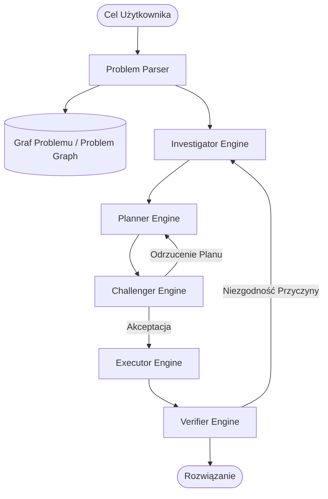

# Analiza 00-Index: Paradygmat Epistemicznego Agenta Kodującego

> [!NOTE]
> Niniejszy dokument stanowi rygorystyczną, szczegółową analizę założeń manifestu `00-Index.md`, otwierającego dokumentację koncepcji **Epistemic Coding Agent**. Analiza dekonstruuje postulowane mechanizmy, wyjaśnia aparaturę pojęciową, zestawia koncepcję z aktualnym stanem wiedzy (SOTA 2025/2026) oraz odnosi ją do ekosystemu Vaultie i wielorepozytoryjnych środowisk inżynierskich.

---

## 1. Wyjaśnienie Pojęć i Aparatury Epistemicznej

Aby w pełni zrozumieć wagę i ryzyka związane z projektem, konieczne jest precyzyjne zdefiniowanie pojęć fundamentalnych, których nadużywa się w literaturze agentowej:

### 1.1. Epistemiczność w Kontekście Agentów LLM (Epistemic Agency)
* **Pojęcie:** Epistemologia to dział filozofii badający naturę wiedzy, jej źródła, granice i uzasadnienie. W uczeniu maszynowym i systemach agentowych **agent epistemiczny** to taki, który posiada wewnętrzny model własnego stanu wiedzy i niewiedzy (*metapoznanie / metacognition*).
* **Różnica względem agenta naiwnego (Reaktywnego / ReAct):** Standardowy agent ReAct (Reasoning + Acting) otrzymuje cel (np. *"Popraw błąd autoryzacji"*), natychmiast generuje jednoetapową hipotezę i wykonuje narzędzia (grep/replace). Nie zadaje sobie pytania: *"Czego fundamentalnie nie wiem o tym systemie?", "Jakie ukryte założenia przyjmuję?", "Czy to, co widzę, jest przyczyną czy tylko objawem?"*.
* **Działanie epistemiczne:** Aktywne podejmowanie kroków (np. inspekcja kodu, wyszukiwanie w dokumentacji, zapytania o stan architektury) nie po to, by bezpośrednio zmienić kod, lecz po to, by **zredukować entropię (niepewność) co do przestrzeni problemu** przed podjęciem jakichkolwiek działań wykonawczych.

### 1.2. Ekspansja Causalno-Zależnościowa (Causal & Dependency Expansion)
* **Zasada:** *"Naprawienie komponentu X nic nie da, jeśli uszkodzony jest komponent Y, od którego X zależy"*.
* **Mechanizm:** Zamiast traktować plik ze zgłoszonym błędem jako odizolowaną wyspę, agent musi dynamicznie mapować graf zależności wywołań (call graph), przepływ danych (data flow) oraz kontrakty API. Jeśli błąd występuje w module `TokenValidator`, agent epistemiczny bada generator klucza `KeyStore`, mechanizm rotacji oraz stan bazy sesji `SessionDB`.

### 1.3. Rozpoznanie Stanu Poprzedniego (Prior Art Search)
* **Mechanizm:** Zanim agent zacznie wymyślać własne, często ułomne i redundantne rozwiązania ("inventing the wheel"), ma obowiązek przeszukać istniejącą bazę wiedzy, repozytorium pod kątem istniejących bibliotek pomocniczych, a także sieć (GitHub issues, RFC, oficjalną dokumentację wersji) w celu identyfikacji sprawdzonych wzorców inżynierskich.

---

## 2. Pierwotna Propozycja: 6-Silnikowa Architektura i Jej Anatomia

Dokument `00-Index.md` odwołuje się do pierwotnego projektu (wygenerowanego w podejściu czysto koncepcyjnym), który postulował budowę skomplikowanego, 6-silnikowego potoku:

### Elementy Składowe Pierwotnego Modelu:
1. **Problem Parser:** Moduł rozbijający prompt użytkownika na atomowe stwierdzenia faktograficzne i hipotezy.
2. **Problem Graph (Graf Problemu):** Sieć relacji przyczynowo-skutkowych, drzewo zależności i węzły niepewności.
3. **Investigator Engine:** Silnik eksplorujący nieznane zmienne i przeszukujący źródła zewnętrzne.
4. **Planner Engine:** Silnik syntetyzujący plan wielokrokowy.
5. **Challenger Engine:** Silnik oskarżycielski (Adversarial Critic), szukający dziur logicznych w planie.
6. **Executor Engine:** Silnik modyfikujący kod źródłowy.
7. **Verifier Engine:** Silnik weryfikujący, czy usunięto źródłową przyczynę, a nie tylko objaw.
8. **Numeryczne wskaźniki pewności (Confidence Scores):** Wartości zmiennoprzecinkowe (np. $c = 0.94$), sterujące przejściami w pętli.

---

## 3. Wiwisekcja Krytyczna: Inżynieria vs. Science-Fiction

Dokument `00-Index.md` słusznie identyfikuje ten podział jako kluczowy. Przyjrzyjmy się szczegółowo, dlaczego bezkrytyczne wdrażanie pierwotnego modelu jest błędem inżynierskim:

### 3.1. Pułapka "Dressed-up Prompting" (Przebranych Promptów)
W systemach jednoukładowych lub opartych na jednym modelu bazowym (np. GPT-4o, Claude 3.5 Sonnet, Gemini 1.5 Pro) podział na 6 oddzielnych "silników" jest w rzeczywistości **6-krotnym wywołaniem tego samego modelu z różnymi promptami systemowymi**. 
* **Wspólne martwe punkty (Shared Blind Spots):** Jeśli model bazowy ma lukę poznawczą dotyczącą subtelności protokołu HTTP/2 lub asynchroniczności w danym języku, rola `Planner` wygeneruje błędny plan, a rola `Challenger` (będąca tym samym modelem) najczęściej nie dostrzeże tego błędu, skupiając się na powierzchownej składni.
* **Lawinowa utrata kontekstu (Context Serialization Overhead):** Przekazywanie stanu pomiędzy 6 agentami wymaga ciągłej serializacji do formatów tekstowych/JSON, co gubi niuanse i zwiększa zużycie tokenów o 300–600% bez proporcjonalnego wzrostu jakości (Pass@1).

### 3.2. Fikcja Numerycznej Kalibracji Prawdopodobieństwa
Prompt nakazujący modelowi: *"Zwróć confidence_score od 0.0 do 1.0"* nie produkuje prawdopodobieństwa bayesowskiego. LLM generuje tokeny odpowiadające statystycznemu rozkładowi tekstów, w których pewny siebie programista pisze `"confidence: 0.95"`. Z punktu widzenia teorii decyzji jest to **wartość nieskalibrowana (uncalibrated pseudo-metric)**, która nie może stanowić warunku stopu pętli sterującej.

### 3.3. Brak Ugruntowania Wykonawczego (Grounding Deficit)
Najcięższym grzechem pierwotnej koncepcji jest próba rozwiązania problemu halucynacji i błędnego planowania za pomocą *większej ilości narracji tekstowej*. Z badań wynika jednoznacznie: **1 rzeczywiste uruchomienie testu jednostkowego lub kompilatora daje więcej twardego sygnału epistemicznego niż 10 rund autorefleksji LLM**.

---

## 4. Koncepcja "Trzeźwej Rekonstrukcji" (Critical Rebuild)

Manifest `00-Index.md` proponuje zwrot ku twardej inżynierii systemów agentowych:
1. **Redukcja liczby ról:** Ograniczenie stałych ról do pary Generator-Krytyk (lub Generator-Weryfikator), z opcjonalnym podziałem na różne rodziny modeli (np. Claude do planowania, Gemini/GPT do weryfikacji).
2. **Kategoryczne etykiety epistemiczne zamiast liczb:** Zastąpienie liczb trójstanową klasyfikacją prawdy:
   - `verified` — podparte wynikiem testu, wyjściem kompilatora, odczytem z pliku lub oficjalną dokumentacją.
   - `inferred` — logiczny wniosek wyprowadzony z faktów, obarczony ryzykiem błędu indukcyjnego.
   - `assumed` — założenie robocze, wymagające weryfikacji przed wdrożeniem.
3. **Twarde limity budżetowe (Budgets & Guardrails):** Deterministyczny warunek stopu w kodzie interpretera (max 3 iteracje, max 10 zapytań narzędziowych).
4. **Prawdziwe narzędzia zewnętrzne:** Podłączenie protokołu MCP (Model Context Protocol), wyszukiwarek semantycznych (Exa), indeksów dokumentacji (Context7) oraz parserów AST/LSP kodu lokalnego.

---

## 5. Odniesienie do Środowiska Vaultie i Projektów Użytkownika

Implementacja tego paradygmatu w środowisku użytkownika przynosi konkretne implikacje operacyjne:

| Wyzwanie w Środowisku Użytkownika | Odpowiedź Naiwna (Zwykły Agent) | Rozwiązanie Epistemiczne (Zgodne z Indexem) |
|---|---|---|
| **Złożona Baza Wiedzy (Vaultie: 10_..50_)** | Nadpisywanie notatek, tworzenie duplikatów, halucynowanie nieistniejących pojęć. | Wymóg przeszukania `90_Meta/hot.md` i `_index.md`, audyt kanwy, etykietowanie powiązań jako `verified`/`inferred`. |
| **Wielorepozytoryjność i Nowe Projekty** | Próba pisania kodu w ciemno na podstawie nazwy frameworka. | Badanie drzewa katalogów, ekstrakcja wersji z `package.json`/`Cargo.toml`, ugruntowanie w Context7 dla zgodności wersji. |
| **Eksploracja Webu i Cross-Domain** | Zwykłe zapytanie Google zwracające blogposty SEO. | Semantyczne wyszukiwanie Exa, ekstrakcja dokumentacji przez Firecrawl/Tavily z weryfikacją cytowań. |

---

## 6. Podsumowanie Wstępne

Dokument `00-Index.md` stanowi bardzo dojrzałą diagnozę problemu. Nie neguje on wartości samego myślenia epistemicznego, lecz odrzuca jego pseudonaukowe, "przegadane" implementacje na rzecz pragmatycznego rusztowania (scaffolding), w którym deterministyczny kod Pythona zarządza niedeterministycznym modelem językowym.
