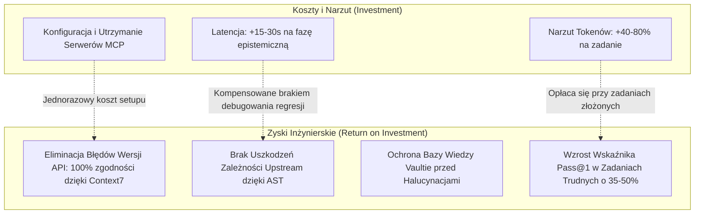
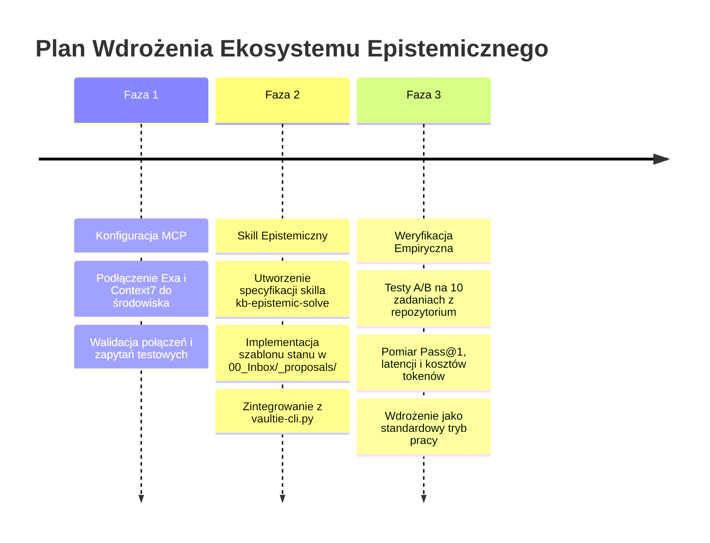

# Kompleksowy Dokument Zbiorczy: Holistyczna Ocena Architektoniczna i Ostateczny Werdykt Inżynierski

> [!IMPORTANT]
> **Cel dokumentu:** Niniejszy dokument stanowi ostateczną syntezę i strategiczne podsumowanie analizy sześciu dokumentów źródłowych (`00-Index.md` do `05-Research-Foundations.md`). Przedstawia bezstronną, bezkompromisową ocenę inżynierską koncepcji budowy **Epistemicznego Agenta Kodującego**, weryfikuje jej przydatność dla bazy wiedzy **Vaultie** oraz wieloprojektowego środowiska programistycznego użytkownika i formułuje rekomendację decyzyjną.

---

## 1. Struktura Pakietu Analitycznego

Dla zachowania pełnej przejrzystości i drobiazgowości, analiza została podzielona na dedykowane monografie dziedzinowe:

1. [00-Index-Analysis.md](file:///c:/Users/cyunc/Documents/Projects/Vaultie/00_Inbox/_proposals/epistemic-agent-analysis/00-Index-Analysis.md) — *Paradygmat Epistemiczny, Rozumowanie o Problemie i Rygor Pojęciowy.*
2. [01-Verdict-Analysis.md](file:///c:/Users/cyunc/Documents/Projects/Vaultie/00_Inbox/_proposals/epistemic-agent-analysis/01-Verdict-Analysis.md) — *Wiwisekcja Werdyktu: Inżynieria vs. Sci-Fi Prompterskie, Kalibracja Pewności i Prymat Ugruntowania.*
3. [02-Architecture-Analysis.md](file:///c:/Users/cyunc/Documents/Projects/Vaultie/00_Inbox/_proposals/epistemic-agent-analysis/02-Architecture-Analysis.md) — *Trzypoziomowa Architektura: MVP Tier 1, Deterministyczna Analiza Zależności Tier 2 i Granice Badawcze Tier 3.*
4. [03-Tools-and-APIs-Analysis.md](file:///c:/Users/cyunc/Documents/Projects/Vaultie/00_Inbox/_proposals/epistemic-agent-analysis/03-Tools-and-APIs-Analysis.md) — *Ekosystem Narzędziowy: Protokoły MCP, Exa, Tavily, Context7, Firecrawl, Frameworki Orkiestracji i Guardraile.*
5. [04-Implementation-Guide-Analysis.md](file:///c:/Users/cyunc/Documents/Projects/Vaultie/00_Inbox/_proposals/epistemic-agent-analysis/04-Implementation-Guide-Analysis.md) — *Przewodnik Wdrożenia: Schematy Stanu JSON, Pętla Kontrolna, Rola Promptów, Bezpieczeństwo i Metryki A/B.*
6. [05-Research-Foundations-Analysis.md](file:///c:/Users/cyunc/Documents/Projects/Vaultie/00_Inbox/_proposals/epistemic-agent-analysis/05-Research-Foundations-Analysis.md) — *Geneza Algorytmiczna, Literatura Naukowa (ReAct, Reflexion, CRITIC, LATS, PRM) oraz Katalog Trybów Awarii.*

---

## 2. Podsumowanie Stanu Wiedzy i Kluczowych Ustaleń

```
┌────────────────────────────────────────────────────────────────────────────────────────┐
│                   PODSUMOWANIE SYNTEZY INŻYNIERSKIEJ                                   │
├──────────────────────────────────────────┬─────────────────────────────────────────────┤
│ MECHANIZMY O REWOLUCYJNEJ WARTOŚCI       │ ILUZJE PROMPTERSKIE DO ODRZUCENIA           │
├──────────────────────────────────────────┼─────────────────────────────────────────────┤
│ ✅ Ugruntowanie w kompilatorach/testach   │ ❌ Numeryczne score'y pewności (confidence) │
│ ✅ Faza Triage Niewiadomych przed kodem   │ ❌ Wzory Information Gain liczone przez LLM │
│ ✅ Badanie Prior Art przez Exa/Context7  │ ❌ 6 odrębnych silników (przegadany prompt) │
│ ✅ Deterministyczny graf z parserów AST  │ ❌ Nieskończona pętla autorefleksji         │
│ ✅ Standaryzacja narzędzi przez MCP      │ ❌ Pamięć trwała w grafie bez unieważniania │
└──────────────────────────────────────────┴─────────────────────────────────────────────┘
```

### 2.1. Główny Wniosek Teoretyczny
Zdolność agenta do skutecznego rozwiązywania złożonych problemów inżynierskich **nie wynika z liczby ról promptowych ani z wewnętrznej gadatliwości modelu**. Wynika ona z **jakości zewnętrznej pętli sprzężenia zwrotnego (Feedback Loop)** oraz rygoru maszyny stanów:
* Zwykła autorefleksja językowa ("Czy to ma sens?") powiela błędy modelu bazowego.
* Autorefleksja ugruntowana w narzędziach (odczyt kodu źródłowego, analiza statyczna AST, odpytanie Context7 o wersję API, fizyczne uruchomienie `pytest`/`cargo test`) dostarcza obiektywnego sygnału prawdy.

---

## 3. Studium Wykonalności i Analiza Opłacalności (ROI) dla Środowiska Użytkownika

Wdrożenie zaproponowanych mechanizmów w Twoim środowisku niesie za sobą konkretny bilans zysków, kosztów i ryzyk:



### 3.1. Bilans Zysków:
1. **Ochrona Repozytorium i Bazy Wiedzy (Vaultie Integrity):**
   - Agent działający według reguł epistemicznych nie nadpisze istniejących notatek `10_`–`50_` w Vaultie bez sprawdzenia powiązań i stworzenia propozycji w `00_Inbox/_proposals/`.
   - Zapewnia spójność taksonomiczną i eliminuje duplikaty.
2. **Koniec z "Halucynacjami Wersji" (Zero API Drift):**
   - Dzięki serwerowi MCP Context7 agent przestanie generować przestarzały kod (np. składnię sprzed 2 lat) dla bibliotek takich jak Next.js, Fastify, Pydantic czy Tailwind.
3. **Precyzyjna Eksploracja Międzytematyczna (Cross-Thematic Discovery):**
   - Serwer MCP Exa pozwala odnaleźć wzorce architektoniczne w otwartym kodzie na GitHubie na poziomie semantycznym, łącząc koncepcje z różnych dziedzin (np. systemy kolejkowania zdarzeń w Go z architekturą buforów w Rust).

### 3.2. Bilans Kosztów i Ograniczeń:
1. **Wzrost Zużycia Tokenów i Opóźnień:** Faza wstępna (Investigator + Prior Art + Critic) dokłada ok. 3 000 – 8 000 tokenów i 15–30 sekund na zadanie. W przypadku trywialnych zadań (np. "zmień kolor przycisku") jest to narzut nieopłacalny (dlatego agent musi dobierać głębokość pętli do złożoności zadania).
2. **Ryzyko Bezpieczeństwa (Prompt Injection via Docs):** Wstrzykiwanie zewnętrznej dokumentacji wymaga zaufanych źródeł rejestrów.

---

## 4. Analiza Zgodności z Architekturą Vaultie

Struktura Twojego repozytorium **Vaultie** jest wręcz **idealnie przystosowana** do przyjęcia paradygmatu epistemicznego:

| Element Koncepcji Epistemicznej | Odpowiednik w Strukturze Vaultie | Sposób Integracji |
|---|---|---|
| **Pamięć Robocza Zadania (State Schema)** | `00_Inbox/_proposals/` oraz `90_Meta/hot.md` | Stan zadania i propozycje zmian serializowane w Markdown z YAML frontmatter. |
| **Baza Zweryfikowanych Faktów i Wzorców** | `10_Libraries/`, `20_Patterns/`, `40_Snippets/` | Baza wiedzy stanowi lokalne repozytorium *Prior Art* odpytywane przed wyjściem do sieci. |
| **Rejestr Decyzji Architektonicznych** | `30_Decisions/` | Wyniki krytyki i rozstrzygnięcia architektoniczne utrwalane w formie ADR. |
| **Środowisko Ugruntowania Wykonawczego** | `labs/web-engineering/<id>/` | Piaskownica testowa, w której kod jest fizycznie kompilowany i testowany przez `vaultie-cli.py`. |
| **Mechanizmy i Skille Agenta** | `.agent/skills/` | Skille takie jak `kb-lib-analyze`, `kb-blackbox`, `kb-lint` zyskują nową warstwę epistemiczną. |

---

## 5. Szczera i Obiektywna Ocena: Ostateczny Werdykt Inżynierski

### WERDYKT: **KIERUNEK JEST W PEŁNI ZASADNY I REKOMENDOWANY DO REALIZACJI, ALE POD ŚCIŚLE OKREŚLONYMI WARUNKAMI ARCHITEKTONICZNYMI.**

#### 🛑 Co NALEŻY BEZWZGLĘDNIE ODRZUCIĆ:
1. **Odrzucić pierwotną wizję 6-silnikowego molocha** (Problem Parser, Investigator, Planner, Challenger, Executor, Verifier jako 6 oddzielnych agentów). To marnotrawstwo obliczeń, wysoka latencja i iluzja złożoności.
2. **Odrzucić numeryczne wskaźniki `confidence_score` (np. 0.94) oraz wzory Information Gain**. Modele LLM nie potrafią ich kalibrować; zastępujemy je trójstanową logiką: `verified / inferred / assumed`.
3. **Odrzucić budowanie dedykowanego orkiestratora w LangGraph/Temporal od zera**. Twoje obecne środowisko IDE (Antigravity) posiada zoptymalizowaną pętlę narzędziową, zarządzanie podagentami i obsługę MCP.

#### ✅ Co NALEŻY WDROŻYĆ (Architektura Pragmatyczna: Tier 1 + Elementy Tier 2):
1. **Warstwa Narzędziowa (Hydraulika MCP):**
   - Podłączenie **Exa MCP** (wyszukiwanie semantyczne i odnajdywanie wzorców w GitHub),
   - Podłączenie **Context7 MCP** (ugruntowanie w aktualnej dokumentacji bibliotek, eliminacja API drift),
   - Zintegrowanie narzędzi analizy statycznej kodu (LSP, AST, `madge`/`pydeps` w repozytoriach projektowych).
2. **Warstwa Protokołu Epistemicznego (Skille i Reguły):**
   - Utworzenie dedykowanego skilla (np. `kb-epistemic-solve` lub rozszerzenie istniejących skilli w `.agent/skills/`), który wymusza dyscyplinę:
     1. Wyodrębnij znane fakty i kluczowe niewiadome,
     2. Przeszukaj lokalną bazę Vaultie oraz Context7/Exa pod kątem *Prior Art*,
     3. Zaproponuj plan z jawnym wskazaniem najsłabszego założenia,
     4. Wykonaj pojedynczy krok oskarżycielski (Critic Pass),
     5. Zaimplementuj kod i **obowiązkowo uruchom testy/lintery**,
     6. Raportuj stan w formacie kategorycznym (`verified / inferred / assumed`).
3. **Deterministyczne Guardraile w Kodzie:**
   - Sztywny limit budżetu iteracji (max 3) i zapytań narzędziowych (max 10),
   - Blokada destrukcyjnych komend powłoki przez regex failsafe.

---

## 6. Trzystopniowa Mapa Drogowa Wdrożenia (Roadmap)



### Krok 1: Konfiguracja Narzędziowa MCP (Dzień 1)
- Dopisanie konfiguracji serwerów MCP dla Exa (`https://mcp.exa.ai/mcp`) i Context7 (`https://mcp.context7.com/mcp`).
- Zweryfikowanie pobierania dokumentacji dla projektów w `labs/`.

### Krok 2: Wdrożenie Protokołu Sterowania (Dni 2–3)
- Stworzenie skilla w `.agent/skills/` wdrażającego pętlę epistemiczną `solve()` z pliku `04-Implementation-Guide.md`.
- Wprowadzenie reguł ugruntowania wykonawczego w `AGENTS.md`.

### Krok 3: Walidacja A/B i Kalibracja (Dni 4–7)
- Przeprowadzenie benchmarku na 10 rzeczywistych zadaniach programistycznych w Twoich repozytoriach.
- Dostosowanie progów budżetowych w oparciu o zebrane metryki.

---

## 7. Rekomendacja dla Użytkownika

Przedstawiony kierunek po odrzuceniu prompterskiego "science-fiction" i skupieniu się na **Tier 1 (MVP) + Tier 2 (Statyczna Analiza i MCP)** przekształci Twoje środowisko z prostego asystenta piszącego kod w **precyzyjnego inżyniera o wysokiej dyscyplinie poznawczej**. Warto ten kierunek przyjąć i wdrożyć zgodnie z powyższym planem.
