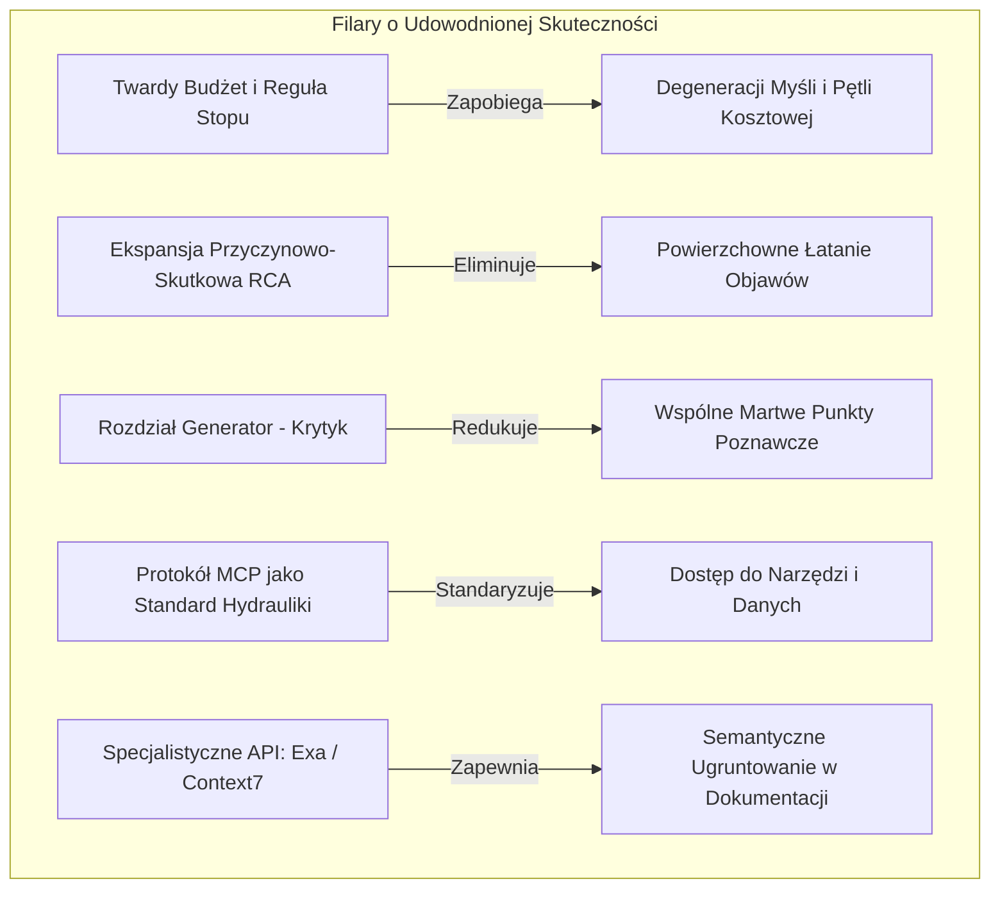
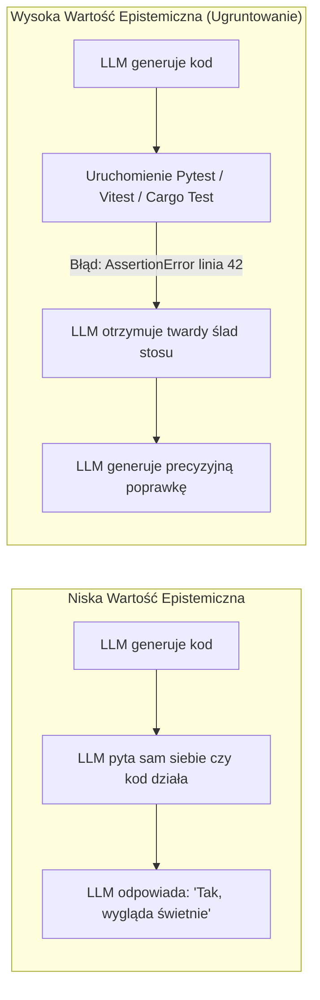

# Analiza 01-Verdict: Wiwisekcja Werdyktu — Co Działa Naprawdę, a Co Jest Iluzją

> [!NOTE]
> Niniejszy dokument stanowi dogłębną analizę techniczną i krytyczną zawartości pliku `01-Verdict.md`. Weryfikuje on podział na mechanizmy o udowodnionej skuteczności inżynierskiej oraz koncepcje będące jedynie "przebranym promptingiem" (dressed-up prompting). Każdy mechanizm zostaje rozłożony na czynniki pierwsze pod kątem teorii prawdopodobieństwa, architektury systemów rozproszonych oraz praktyki inżynierii oprogramowania.

---

## 1. Twierdzenia Prawdziwe: Co Przetrwało Rygor Inżynierski

Dokument `01-Verdict.md` wyróżnia pięć filarów, które posiadają twarde uzasadnienie w badaniach i praktyce wdrożeniowej:



### 1.1. Twardy Budżet Dochodzeniowy i Deterministyczna Reguła Stopu (Investigation Budget & Stopping Rule)
* **Problem Teoretyczny:** W iteracyjnych procesach wnioskowania modeli językowych występuje zjawisko **Degeneracji Myśli (Degeneration of Thought / Self-Refine Collapse)**. Badania nad architekturami refleksyjnymi (m.in. Shinn et al., Reflexion 2023; Huang et al., 2024) wykazują, że model pozostawiony w pętli bez sztywnego kryterium zewnętrznego po 3–4 iteracjach zaczyna:
  1. Zapętlać się wokół nieistotnych detali syntaktycznych,
  2. Zaśmiecać okno kontekstowe własnymi wcześniejszymi hipotezami (Memory / Context Pollution),
  3. Obniżać trafność końcowego rozwiązania (Pass@k spada wraz ze wzrostem liczby nieugruntowanych iteracji krytyki).
* **Rozwiązanie Inżynierskie:** Warunek stopu nie może zależeć od "decyzji" LLM. Musi być twardo zaimplementowany w kodzie sterującym:
  $$\text{Kryterium Stopu} = (\text{Iteracje} \ge N_{\max}) \lor (\text{Liczba Zapytań Tool} \ge K_{\max}) \lor (\text{Testy Jednostkowe} = \text{PASS})$$

### 1.2. Ekspansja Przyczynowo-Skutkowa (Causal & Root Cause Analysis)
* **Istota Mechanizmu:** W inżynierii niezawodności oprogramowania (SRE - Site Reliability Engineering) znana jest zasada: *objaw rzadko jest przyczyną*. Jeśli żądanie HTTP kończy się błędem 500 w kontrolerze, naprawienie sprawdzania `null` w kontrolerze jedynie zamaskuje fakt, że pula połączeń bazy danych wyczerpuje się w warstwie infrastruktury.
* **Zastosowanie w Agencie:** Wymuszenie na agencie etapu *„Przed napisaniem kodu wymień wszystkie komponenty upstream i downstream, od których zależy działanie tej funkcji”*.

### 1.3. Rozdział Ról: Generator i Krytyk (Dual-Role Reflection)
* **Dlaczego to działa:** Gdy pojedynczy model generuje rozwiązanie, a następnie w tym samym wątku pytany jest *"Czy to rozwiązanie jest poprawne?"*, działa pod wpływem **błędu konfirmacji (confirmation bias)** wynikającego z mechanizmu atencji (tokeny wygenerowanego wcześniej planu dominują w kontekście).
* **Mechanizm Separacji:** Wymuszenie wygenerowania krytyki w odrębnym wywołaniu, z promptem o orientacji oskarżycielskiej (*Adversarial Prompting*) lub przy użyciu innego modelu bazowego (np. Generator: Claude Sonnet, Krytyk: Gemini 1.5 Pro / GPT-4o).

### 1.4. Protokół MCP (Model Context Protocol) jako Standard Integracji
* **Stan Faktyczny (2025/2026):** Protokół MCP (stworzony przez Anthropic, adoptowany przez cały ekosystem open-source i komercyjny) stał się uniwersalnym standardem komunikacji klient-serwer dla agentów AI.
* **Korzyść:** Zamiast pisać ad-hoc integracje dla każdego narzędzia w Pythonie/Node, podłącza się serwery MCP obsługujące JSON-RPC przez `stdio` lub `streamable-http` (SSE).

### 1.5. Nowoczesne API Wyszukiwania i Dokumentacji (Exa, Tavily, Context7, Firecrawl)
* **Exa (dawniej Metaphor):** Wyszukiwanie oparte na wektorach semantycznych (embeddings trenowane na linkach i cytowaniach), potrafiące odnaleźć repozytoria i fragmenty kodu na podstawie opisu ich funkcjonalności.
* **Context7 (Upstash):** Kluczowe narzędzie rozwiązujące problem halucynacji wersji API (API drift). Zamiast polegać na wiedzy modelu z daty odcięcia treningu, Context7 pobiera aktualną dokumentację i sygnatury metod dla konkretnej wersji biblioteki wskazanej w projekcie.

---

## 2. Demaskowanie Iluzji: "Dressed-up Prompting" (Przebrany Prompting)

Poniższe elementy pierwotnego projektu zostały w `01-Verdict.md` bezlitośnie i słusznie obalone jako pseudonauka prompterska:

```
┌────────────────────────────────────────────────────────────────────────┐
│                        FIKCJA vs. RZECZYWISTOŚĆ                        │
├──────────────────────────────────┬─────────────────────────────────────┤
│ ILUZJA PROMPTERSKA               │ RZECZYWISTOŚĆ INŻYNIERSKA           │
├──────────────────────────────────┼─────────────────────────────────────┤
│ "Confidence: 0.94"               │ Uncalibrated token generation       │
│ Wzór Information Gain (liczbowy) │ Niesprawdzalna zgadywanka wag       │
│ 6 oddzielnych "silników"         │ 6x ten sam LLM + 5x większy rachunek│
│ 6-miesięczny graf problemu w DB  │ Szum, halucynacje i brak spójności  │
└──────────────────────────────────┴─────────────────────────────────────┘
```

### 2.1. Numeryczne Wskaźniki Pewności (Confidence Scores: 0.94, 0.73...)
* **Matematyczna Wiwisekcja Błędu:** Prawdziwe prawdopodobieństwo bayesowskie $P(\text{Poprawność} \mid \text{Dowody})$ wymaga skalibrowanego rozkładu a posteriori. Modele LLM generujące tekst generują liczbę `"0.94"` nie na podstawie wyliczenia prawdopodobieństwa, lecz na podstawie wzorca językowego: jak brzmi asertywna odpowiedź eksperta.
* **Problem ECE (Expected Calibration Error):** Współczesne badania (np. Kadavath et al., *Language Models (Mostly) Know What They Know*, 2022; OpenAI calibration reports) wskazują, że werbalna samoocena modeli charakteryzuje się ogromnym błędem nadmiernej pewności siebie (overconfidence bias).
* **Rozwiązanie Prawidłowe:** Kategoryczne etykiety epistemiczne oparte na weryfikowalnym pochodzeniu danych:
  - `verified`: Podparte twardym dowodem (np. kod statusu HTTP 200, test jednostkowy zakończony sukcesem, linia z pliku źródłowego `src/auth.ts:45`).
  - `inferred`: Wniosek dedukcyjny lub indukcyjny z faktów `verified`.
  - `assumed`: Założenie a priori, które musi zostać zweryfikowane przed wdrożeniem zmian.

### 2.2. Wzór na Przyrost Informacji (Information Gain Formula)
Pierwotny projekt proponował sterowanie zapytaniami za pomocą wzoru:
$$\text{Score} = \frac{P(\text{Zmiana Planu}) \times \text{Konsekwencja} \times \text{Niepewność}}{\text{Koszt Wyszukiwania}}$$

* **Dlaczego to nie działa w praktyce:** Wszystkie cztery zmienne w liczniku i mianowniku są wymyślane przez ten sam model w jednej chwili. Wprowadzenie wzoru arytmetycznego tworzy fałszywe poczucie dyscypliny inżynierskiej.
* **Prawidłowe Zastosowanie:** Wykorzystanie koncepcji **jakościowego rankingu porządkowego (Ordinal Triage)**. Prompt pyta: *"Wymień 3 największe niewiadome i wskaż tę jedną, której wyjaśnienie najbardziej zmieniłoby kierunek naszych prac"*. To proste, uczciwe i skuteczne.

### 2.3. Inflacja 6 Silników (The 6-Engine Inflation)
* **Ekonomia i Opóźnienia:** Każde dodatkowe wywołanie LLM w sekwencji synchronicznej dokłada 3–15 sekund opóźnienia i konsumuje od 2 000 do 10 000 tokenów.
* **Multi-Agent Compute Overhead:** Z badań nad debatą wieloagentową (Multi-Agent Debate, Liang et al., 2023; Du et al., 2023) wynika, że systemy 5-6 agentowe zużywają **200%–500% więcej obliczeń**, nie przynosząc statystycznie istotnej poprawy wyników w zadaniach programistycznych w porównaniu z dobrze zorkiestrowaną pętlą Generator + Twardy Weryfikator Środowiskowy.

### 2.4. Persystencja "Grafu Problemu" na 6 Miesięcy w Przód
* **Problem Nieaktualności Wiedzy (Knowledge Staleness):** Repozytoria kodu żyją. Funkcje są refaktoryzowane, zależności aktualizowane, architektura ewoluuje.
* **Erozja Pamięci Długoterminowej:** Zapisywanie wniosków agenta do globalnego grafu wiedzy bez automatycznego unieważniania (cache invalidation) prowadzi do sytuacji, w której za 3 miesiące agent podejmuje decyzje w oparciu o nieistniejący stan kodu.
* **Prawidłowe Podejście:** Pamięć robocza ustrukturyzowana jako plik Markdown/JSON **w ramach jednego zadania/sesji**. Pamięć między sesjami powinna być budowana w oparciu o rzeczywiste artefakty repozytorium (README, ADR w `30_Decisions/`, testy, specyfikacje OpenAPI), a nie abstrakcyjny graf halucynacji agenta.

---

## 3. Fundamentalna Korekta: Ugruntowanie Wykonawcze Ponad Werbalną Refleksję

To najważniejsza teza dokumentu `01-Verdict.md` i całej współczesnej inżynierii agentowej:

$$\text{Wartość Informacyjna: } \text{Kompilator / Test Suite / AST} \gg \text{Autorefleksja LLM}$$



Gdy model rozmawia sam ze sobą, działa w zamkniętej przestrzeni własnych wag statystycznych. Dopiero kontakt ze środowiskiem zewnętrznym (wykonanie kodu, analiza statyczna typów TypeScript/Rust, odpowiedź serwera HTTP) dostarcza **obiektywnego sygnału zwrotnego (Ground Truth Feedback)**.

---

## 4. Tańsza, Lepsza Alternatywa dla Środowiska Użytkownika

Zamiast pisać od zera gigantyczny framework orkiestracyjny (typu 10 tysięcy linii w LangGraph):
1. **Wykorzystać natywnego agenta (Antigravity / Claude Code / Cursor):** Posiadają one zoptymalizowaną pętlę narzędziową, zarządzanie oknem kontekstu i strumieniowaniem.
2. **Dodać serwery MCP:** Podłączyć Exa (do wyszukiwania semantycznego), Context7 (do dokumentacji) oraz lokalne narzędzia repozytorium.
3. **Zbudować wyspecjalizowany Skill / Workflow:** Wymusić w promptach systemowych i protokołach operacyjnych dyscyplinę epistemiczną:
   - Zidentyfikuj niewiadome przed rozpoczęciem edycji,
   - Zweryfikuj aktualną dokumentację biblioteki,
   - Wygeneruj plan i poddaj go krytyce,
   - **Warunek konieczny:** Uruchom testy i lintery przed zakończeniem zadania.

---

## 5. Wnioski Końcowe

Werdykt przedstawiony w `01-Verdict.md` jest w 100% trafny pod względem inżynieryjnym i poparty najnowszymi badaniami empirycznymi. Odrzuca iluzoryczną złożoność na rzecz deterministycznego ugruntowania w narzędziach i środowisku wykonawczym.
