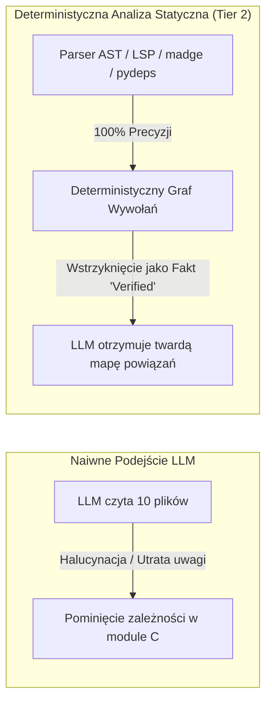

# Analiza 02-Architecture: Trzypoziomowa Architektura Epistemiczna

> [!NOTE]
> Niniejszy dokument stanowi dogłębną analizę techniczną propozycji architektonicznej zawartej w `02-Architecture.md`. Rozbija strukturę na trzy warstwy wdrożeniowe (Tier 1: MVP, Tier 2: Deterministyczna Ekspansja Zależności, Tier 3: Ekosystem Badawczy), oceniając stopień ich złożoności, koszty tokenowe, odporność na awarie oraz przydatność w wieloprojektowym środowisku inżynierskim.

---

## 1. Wizualizacja i Dekonstrukcja Poziomów Architektonicznych

Architektura została ustrukturyzowana w sposób inkrementalny, co stanowi wzorcową praktykę inżynierii oprogramowania (odrzucenie podejścia "Big Bang"):

```mermaid
graph TB
    subgraph "Tier 1: MVP (Dni / Natychmiastowe)"
        T1_Inv[Investigator Pass: Niewiadome + 1x Tool] --> T1_Plan[Planner Pass: Kroki + Ryzyka]
        T1_Plan --> T1_Crit[Critic Pass: Weryfikacja Założeń]
        T1_Crit -->|1x Rewizja| T1_Plan
        T1_Crit --> T1_Exec[Execute: Zmiana Kodu]
        T1_Exec --> T1_Test[Uruchomienie Testów / Kompilatora]
        T1_Test -->|Pass| T1_Done([Sukces])
        T1_Test -->|Fail: 1x Pętla Naprawcza| T1_Inv
    end

    subgraph "Tier 2: Zaawansowana Inżynieria (Tygodnie)"
        T2_AST[Statyczna Analiza Kodu: LSP / madge / pydeps] -->|Deterministyczny Graf Wywołań| T1_Plan
        T2_Search[Mandatory Prior Art: Exa + Context7] -->|Zweryfikowane Wzorce| T1_Plan
        T2_Notes[Task Problem Notes: Markdown State] -->|Pamięć Zadania| T1_Inv
    end

    subgraph "Tier 3: Horyzont Badawczy (Miesiące / Eksperyment)"
        T3_PRM[Process Reward Models PRM800K]
        T3_Mem[Cross-Session Knowledge Graph]
        T3_MAD[Multi-Agent Debate: Różne Rodziny Modeli]
    end

    Tier 1 -.->|Ewolucja w razie wąskich gardeł| Tier 2
    Tier 2 -.->|Tylko dla krytycznych operacji| Tier 3
```

---

## 2. Analiza Tier 1: Pragmatyczny MVP

Tier 1 to minimalny system spełniający postulaty epistemiczne przy zerowym długu technologicznym.

### 2.1. Anatomia Przepływu Sterowania w Tier 1
1. **Faza Dochodzeniowa (Investigator Pass):**
   - **Wejście:** Cel zdefiniowany przez użytkownika (`goal`).
   - **Działanie:** Model nie generuje kodu. Przeprowadza triage poznawczy: wypisuje fakty znane (`facts`) oraz fundamentalne niewiadome (`unknowns`). Jeśli niewiadoma blokuje planowanie (np. *"Jaka jest struktura tabeli `users`?"* lub *"Jakie są reguły walidacji w tym repozytorium?"*), agent wykonuje **dokładnie jedną turę narzędziową** (np. odczyt pliku schema, wyszukanie w Exa/Context7).
2. **Faza Planowania (Planner Pass):**
   - Tworzy uporządkowaną listę kroków.
   - **Wymóg konieczny:** Ostatni punkt planu musi jawnie definiować: *"Na jakim kluczowym założeniu opiera się ten plan i co się stanie, jeśli to założenie jest fałszywe?"*.
3. **Faza Krytyki Oskarżycielskiej (Critic Pass):**
   - Uruchamiana w odrębnym kontekście (idealnie z inną temperaturą lub innym promptem systemowym).
   - Krytyk weryfikuje: (a) Czy istnieje prostsze rozwiązanie z biblioteki standardowej?, (b) Czego nie przetestowaliśmy?, (c) Jakie testy muszą powstać przed wdrożeniem?
   - **Maksymalnie jeden powrót** do fazy planowania, aby uniknąć nieskończonej pętli.
4. **Faza Wykonania i Ugruntowanej Weryfikacji (Execute & Grounded Verify):**
   - Wdrożenie zmian w kodzie.
   - **Fizyczne uruchomienie testów:** `pytest`, `npm test`, `cargo check`, lintery.
   - Jeśli testy zakończą się błędem: dokładnie **jedna próba naprawcza**, w której log błędu jest wstrzykiwany jako fakt `verified`. W przypadku kolejnego niepowodzenia — natychmiastowe przekazanie kontroli programiście z pełnym raportem stanu.

### 2.2. Model Stanu w Tier 1
Stan nie wymaga bazy wektorowej ani grafowej. Jest to pojedynczy plik `state.json` lub `state.md` w katalogu zadania, zawierający listę faktów, hipotez i limitów budżetowych.

---

## 3. Analiza Tier 2: Deterministyczna Ekspansja Zależności

Tier 2 rozwiązuje fundamentalną słabość modeli LLM: **niezdolność do bezbłędnego śledzenia rozległych grafów wywołań w dużych bazach kodu**.



### 3.1. Narzędzia Analizy Statycznej jako Twarde Źródło Prawdy
Zamiast prosić LLM o zgadywanie: *"Które pliki importują ten moduł?"*, Tier 2 integruje wyspecjalizowane narzędzia inżynierskie:
* **Dla TypeScript/JavaScript:** `madge --json`, `ts-morph` lub natywny Language Server Protocol (LSP).
* **Dla Pythona:** `pydeps`, `ast` / `jedi` / `pyright`.
* **Dla Rusta / Go:** `cargo check --message-format=json`, `go vet`, `gopls`.

Wynik analizy statycznej jest przekazywany do planera jako bezsporny fakt (`status: verified`), co całkowicie eliminuje błędy pominięcia powiązanych modułów podczas refaktoryzacji.

### 3.2. Obowiązkowe Badanie Stanu Poprzedniego (Mandatory Prior Art Search)
Przed wprowadzeniem nowego algorytmu lub biblioteki agent musi wykonać sprawdzenie w:
1. `Context7` — czy biblioteka, z której korzystamy, posiada już wbudowaną metodę rozwiązującą dany problem w bieżącej wersji.
2. `Exa Code Search` — jak społeczność open-source rozwiązuje ten problem w produkcyjnych repozytoriach.
3. Notatkach wzorców w Vaultie (`20_Patterns/`).

---

## 4. Analiza Tier 3: Poziom Badawczy — Granice i Zagrożenia

Dokument `02-Architecture.md` wyraźnie ostrzega przed przedwczesnym budowaniem elementów Tier 3. Przeanalizujmy, dlaczego są one ryzykowne:

### 4.1. Globalny Graf Wiedzy Między Sesjami (Cross-Session Knowledge Graph)
* **Złożoność:** Wymaga zaawansowanych mechanizmów unieważniania pamięci podręcznej (Cache Invalidation), rozwiązywania sprzeczności epistemicznych (np. Notatka A mówi: *"Używamy biblioteki X w wersji 2"*, a commit sprzed godziny zmigrował do wersji 3) oraz odporności na degradację wektorową.
* **Rekomendacja:** Zastąpić go wersjonowanymi w Git plikami Markdown (czyli dokładnie strukturą Vaultie: `10_Libraries/`, `20_Patterns/`, `30_Decisions/`).

### 4.2. Process Reward Models (PRM)
* **Pojęcie:** Model oceniający prawdopodobieństwo sukcesu każdego pojedynczego kroku w drzewie rozumowania (np. PRM800K od OpenAI, modele z rodziny DeepSeek/Qwen).
* **Bariera Wejścia:** Wymaga potężnej infrastruktury inferencyjnej i specjalistycznego fine-tuningu. W codziennej pracy programistycznej rolę PRM z powodzeniem pełni kompilator i suite testów jednostkowych.

### 4.3. Pełna Debata Wieloagentowa (Multi-Agent Debate)
* **Zastosowanie:** Uzasadniona wyłącznie w scenariuszach wysokiego ryzyka (np. automatyczny deploy na produkcję, migracja danych w bazie o wielkości terabajtów, audyt bezpieczeństwa smart contractu).
* **Koszt:** 3–5-krotny wzrost kosztu tokenów i opóźnienia dochodzące do minut.

---

## 5. Wytyczne Negatywne: Czego Kategorycznie Nie Budować

Dokument ustanawia 3 rygorystyczne zakazy inżynierskie:
1. **Zakaz używania nieskalibrowanych liczb pewności (No Fake Probability):** Żadnych pól `confidence: 0.85`. Stosujemy wyłącznie etykiety `verified / inferred / assumed`.
2. **Zakaz pętli bez ograniczeń (No Uncapped Loops):** Każdy proces dochodzeniowy musi posiadać sztywny licznik w kodzie bazowym (`max_iterations`, `max_tool_calls`).
3. **Zakaz pisania orkiestratora od zera (No Reinventing the Harness):** Nie tworzymy nowego potwora w Pythonie, jeśli środowisko IDE (Antigravity) lub agent CLI (Claude Code) posiada już wbudowane zarządzanie podagentami i protokołem MCP.

---

## 6. Wnioski Architektoniczne dla Projektu Vaultie

Dla repozytorium Vaultie i projektów użytkownika rekomendowana ścieżka to **natychmiastowe wdrożenie Tier 1 wzbogaconego o elementy Tier 2**:
* Wykorzystanie wbudowanych mechanizmów subagentów i narzędzi MCP w środowisku Antigravity,
* Oparcie walidacji na `vaultie-cli.py` oraz linterach testów w `labs/`,
* Integracja Exa i Context7 jako serwerów MCP dla bieżącej pracy badawczej i programistycznej.
