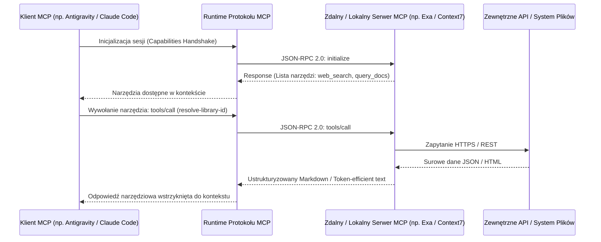
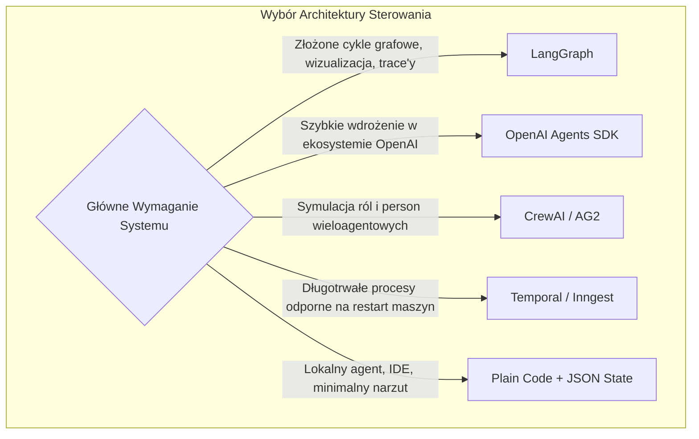

# Analiza 03-Tools-and-APIs: Ekosystem Narzędziowy, Protokół MCP i Integracja API

> [!NOTE]
> Niniejszy dokument stanowi kompleksową analizę infrastruktury narzędziowej przedstawionej w `03-Tools-and-APIs.md`. Dokonuje wnikliwego przeglądu protokołu Model Context Protocol (MCP), silników wyszukiwania i indeksowania (Exa, Tavily, Context7, Firecrawl), porównuje frameworki orkiestracji wieloagentowej oraz analizuje mechanizmy filtrów bezpieczeństwa (Guardrails) pod kątem ochrony przed destrukcyjnymi poleceniami i wstrzykiwaniem promptów (Prompt Injection).

---

## 1. Architektura Protokołu MCP (Model Context Protocol)

Protokół MCP, wprowadzony przez firmę Anthropic i zaadaptowany powszechnie w branży (m.in. przez Cursor, Claude Code, VS Code, Windsurf oraz Antigravity), stanowi kluczową warstwę standaryzacji komunikacji między modelami językowymi a narzędziami zewnętrznymi.



### 1.1. Warstwa Transportowa MCP: stdio vs. SSE (streamable-http)
1. **Transport `stdio` (Standard Input/Output):**
   - **Zasada działania:** Klient agenta uruchamia proces lokalny (np. binarkę Node.js / Pythona) jako proces potomny i przesyła wiadomości JSON-RPC przez standardowe wejście/wyjście.
   - **Zalety:** Maksymalne bezpieczeństwo (brak ekspozycji portów sieciowych), brak narzutu sieciowego, pełna izolacja uprawnień użytkownika lokalnego.
   - **Przykłady:** Narzędzia operacji na plikach, lokalne serwery bazodanowe SQLite, serwery git.
2. **Transport `SSE / streamable-http` (Server-Sent Events przez HTTPS):**
   - **Zasada działania:** Klient łączy się ze zdalnym endpointem HTTP, utrzymując jednokierunkowy strumień SSE dla powiadomień oraz wysyłając zapytania POST dla wywołań metod.
   - **Zalety:** Brak konieczności instalowania zależności Node/Python lokalnie, centralne zarządzanie kluczami API po stronie dostawcy (np. `https://mcp.exa.ai/mcp`).
   - **Wady i Ryzyka:** Zależność od łącza internetowego, potencjalne opóźnienia sieciowe (RTT).

---

## 2. Szczegółowa Wiwisekcja Silników Wyszukiwania i Dokumentacji

```
┌────────────────────────────────────────────────────────────────────────────────────────┐
│                        MACIERZ PORÓWNAWCZA SILNIKÓW DANYCH                             │
├───────────────┬──────────────────────────┬────────────────────────┬────────────────────┤
│ Narzędzie     │ Typ Podstawowy           │ Kluczowa Przewaga      │ Zastosowanie       │
├───────────────┼──────────────────────────┼────────────────────────┼────────────────────┤
│ **Exa**       │ Semantic Neural Search   │ Wyszukiwanie kodu i    │ Badanie wzorców,   │
│               │ (wektorowe embeddings)   │ głęboka semantyka zapytań│ prior-art, GitHub│
├───────────────┼──────────────────────────┼────────────────────────┼────────────────────┤
│ **Context7**  │ Version-specific Docs    │ Precyzyjna zgodność    │ Eliminacja API     │
│               │ Grounding (Upstash)      │ wersji biblioteki      │ drift & halucynacji│
├───────────────┼──────────────────────────┼────────────────────────┼────────────────────┤
│ **Tavily**    │ Agent-First Web RAG      │ Szybka synteza faktów  │ Bieżące fakty      │
│               │                          │ i ekstrakcja treści    │ i weryfikacja web  │
├───────────────┼──────────────────────────┼────────────────────────┼────────────────────┤
│ **Firecrawl** │ Deep Crawler & Parser    │ Zamiana dynamicznych   │ Indeksowanie całych│
│               │ (SPA/JS to Markdown)     │ stron w czysty MD      │ portali i speców   │
└───────────────┴──────────────────────────┴────────────────────────┴────────────────────┘
```

### 2.1. Exa (dawniej Metaphor) — Wyszukiwanie Semantyczne i Kodowe
* **Mechanizm Działania:** W odróżnieniu od klasycznych wyszukiwarek leksykalnych (opartych na BM25 / TF-IDF jak Google czy Bing), Exa wykorzystuje modele transformatorowe trenowane na strukturze powiązań hipertekstowych w sieci. Zapytanie traktowane jest jako predykcja zdania kończącego link (link prediction).
* **Narzędzia MCP:**
  - `web_search_exa`: Wyszukiwanie ogólne z filtrowaniem domenowym i datowym.
  - `get_code_context_exa`: Wyszukiwanie specyficznych fragmentów kodu, sygnatur funkcji i implementacji w otwartych repozytoriach.
* **Konfiguracja w kliencie MCP:**
  ```json
  {
    "mcpServers": {
      "exa": {
        "type": "streamable-http",
        "url": "https://mcp.exa.ai/mcp?tools=web_search_exa,get_code_context_exa"
      }
    }
  }
  ```

### 2.2. Context7 (Upstash) — Eliminacja Zjawiska "API Drift"
* **Problem "API Drift":** Modele językowe podczas pisania kodu dla Next.js 15, Pydantic v2 czy Tailwind CSS v4 często generują składnię sprzed 2 lat (np. `getServerSideProps` w Next.js zamiast Server Components, lub metody Pydantic v1 `.dict()` zamiast `.model_dump()`).
* **Architektura Context7:**
  1. `resolve-library-id`: Mapuje potoczną nazwę biblioteki (np. `"tailwind"`, `"drizzle-orm"`) na kanoniczny identyfikator biblioteki w repozytorium dokumentacji (np. `/drizzle-team/drizzle-orm`).
  2. `query-docs`: Pobiera ściśle dopasowane fragmenty dokumentacji z oficjalnego źródła, uwzględniając budżet tokenów zadany przez agenta.
* **Aspekt Bezpieczeństwa (Vulnerability Analysis):**
  - Badania bezpieczeństwa ekosystemu MCP (np. raporty dotyczące ataku *ContextCrush* z 2025/2026) wykazały, że dynamiczne wstrzykiwanie dokumentacji do kontekstu agenta może stanowić wektor ataku typu *Indirect Prompt Injection* (jeśli złośliwy pakiet umieści w swojej dokumentacji instrukcje przejmujące agenta).
  - **Środek zaradczy:** Ograniczenie źródeł dokumentacji do zweryfikowanych bibliotek z oficjalnych rejestrów (npm, PyPI, crates.io).

### 2.3. Tavily — Zoptymalizowany Silnik dla Potoków RAG
* **Zasada Działania:** Tavily optymalizuje zapytania agenta, wykonując równolegle wyszukiwanie, scraping, usuwanie elementów zbędnych (reklamy, nawigacja, stopki) i zwracając ustrukturyzowany ekstrakt faktograficzny.
* **Zastosowanie:** Doskonale sprawdza się w scenariuszach, gdy agent potrzebuje szybkiej, jednoetapowej odpowiedzi na pytanie faktograficzne (np. *"Jaki jest aktualny stabilny numer wersji biblioteki X?"*).

### 2.4. Firecrawl — Przetwarzanie i Crawling Głęboki
* **Mechanizm Działania:** Oparty na silnikach bezgłowych przeglądarek (Headless Chrome) potrafi renderować strony oparte na React/Vue/Angular, omijać zabezpieczenia botów i konwertować całe drzewa podstron do czystego formatu Markdown z zachowaniem tabel i bloków kodu.
* **Zastosowanie:** Idealne narzędzie w fazie wstępnej (Ingestion / Scraping) przy tworzeniu nowych lekcji w Vaultie lub indeksowaniu niszowej specyfikacji technicznej.

---

## 3. Analiza Frameworków Orkiestracji: Czy Warto Budować w Oparciu o Framework?

Dokument `03-Tools-and-APIs.md` dokonuje bardzo trafnego przeglądu platform orkiestracyjnych:



### 3.1. LangGraph vs. Plain Code
* **LangGraph:**
  - *Zalety:* Elegancki model grafowy (węzły jako funkcje, krawędzie jako warunki przejścia), wbudowana persystencja punktów kontrolnych (Checkpointers w SQLite/Postgres), natywne wsparcie dla interwencji człowieka (Human-in-the-Loop).
  - *Wady:* Potężny narzut zależności (LangChain ecosystem overhead), sztywny schemat stanu, stroma krzywa uczenia, wysokie ryzyko migracji przy zmianach wersji.
* **Plain Code (Czysty Kod Pythona / TypeScriptu):**
  - *Zalety:* Zero zewnętrznych frameworków, deterministyczna pętla `while`/`for`, stan zapisywany do czytelnego pliku `.json` lub `.md`, łatwość debugowania zwykłym debuggerem (`pdb` / VS Code).
  - *Werdykt:* Dla poziomu Tier 1 i integracji z lokalnym środowiskiem Vaultie **Plain Code jest rozwiązaniem bezkonkurencyjnym**.

---

## 4. Architektura Filtrów Bezpieczeństwa (Guardrails)

Agent posiadający uprawnienia do uruchamiania poleceń w powłoce systemowej (PowerShell / Bash) musi posiadać deterministyczną warstwę zabezpieczeń, niezależną od woli modelu językowego.

### 4.1. Deterministyczna Blokada Komend Destrukcyjnych (Regex Denylist)
Model decyzyjny nie może być "proszony" w prompcie: *"Proszę, nie kasuj bazy danych"*. Przed każdym wywołaniem narzędzia powłoki (`run_command`), kod kontrolera musi przepuścić ciąg znaków przez walidator wyrażeń regularnych:

```python
import re

DESTRUCTIVE_PATTERNS = [
    r"\brm\s+-(?:r|f|rf|fr)\b",          # Usuwanie rekursywne plików
    r"\bdrop\s+table\b",                 # SQL DROP
    r"\bdrop\s+database\b",              # SQL DROP DB
    r"\bgit\s+push\s+.*--force\b",       # Nadpisywanie historii git
    r"\bformat\s+[c-z]:\b",              # Formatowanie dysków Windows
    r"\bRemove-Item\s+.*-Recurse\b"      # PowerShell usunięcie rekursywne
]

def validate_command_safety(command: str) -> bool:
    """Zwraca False, jeśli komenda wymaga bezwzględnego zatwierdzenia przez człowieka."""
    for pattern in DESTRUCTIVE_PATTERNS:
        if re.search(pattern, command, re.IGNORECASE):
            return False
    return True
```

### 4.2. Zasada "Fail-Safe Over False Positives"
W systemach bezpieczeństwa agentów dopuszcza się fałszywe alarmy (False Positives — zatrzymanie nieszkodliwej komendy i zapytanie człowieka), ponieważ koszt pojedynczego błędu krytycznego (False Negative — np. usunięcie repozytorium lub utrata danych) jest nieakceptowalny.

---

## 5. Wnioski i Rekomendacje Wdrożeniowe dla Środowiska Użytkownika

1. **Konfiguracja MCP w IDE:** Skonfigurować dwa serwery MCP:
   - `Exa MCP` — dla wyszukiwania semantycznego kodu i wzorców open-source,
   - `Context7 MCP` — dla weryfikacji aktualnych wersji bibliotek i API.
2. **Rezygnacja z Ciężkich Frameworków:** Sterowanie procesem epistemicznym należy oprzeć na strukturze skilli agenta (w katalogu `.agent/skills/`) oraz skryptach pomocniczych w Pythonie, bez wprowadzania LangGraph.
3. **Audyt Narzędziowy:** Wprowadzenie prostego walidatora komend w skryptach transakcyjnych repozytorium.
