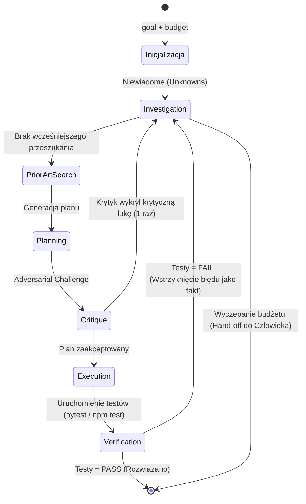

# Analiza 04-Implementation-Guide: Wdrażanie Pętli Epistemicznej i Schematów Stanu

> [!NOTE]
> Niniejszy dokument stanowi szczegółową wiwisekcję inżynierską przewodnika implementacji `04-Implementation-Guide.md`. Analizuje strukturę maszyny stanów, format serializacji wiedzy roboczej, konstrukcję promptów systemowych dla ról poznawczych, mechanikę ugruntowania w testach oraz metodykę walidacji empirycznej (A/B testing) przed dopuszczeniem systemu do pracy produkcyjnej.

---

## 1. Architektura Maszyny Stanów (State Machine Architecture)

Przewodnik implementacji odrzuca skomplikowane relacyjne bazy danych i silniki grafowe na rzecz **płaskiego, deterministycznego pliku stanu zadania (`state.json`)**.



### 1.1. Schemat Stanu Danych (State Schema JSON)
Poniższa struktura stanowi minimalny, a zarazem kompletny model pamięci roboczej zadania:

```json
{
  "goal": "Naprawa błędu utraty sesji po restarcie kontenera",
  "facts": [
    {
      "statement": "Klucz szyfrowania sesji jest generowany losowo w funkcji main()",
      "status": "verified",
      "source": "src/auth/session.go:28"
    }
  ],
  "hypotheses": [
    {
      "statement": "Każdy restart kontenera unieważnia ciasteczka sesyjne z powodu zmiany klucza",
      "status": "inferred",
      "evidence": "Logi aplikacji wykazują błąd 'signature mismatch' po restarcie"
    }
  ],
  "unknowns": [
    {
      "question": "Czy klucz sesyjny może być pobierany ze zmiennej środowiskowej SESSION_SECRET?",
      "why_it_matters": "Jeśli tak, rozwiązaniem jest konfiguracja Secret w k8s bez ingerencji w architekturę bazodanową"
    }
  ],
  "dependencies": ["auth-module", "k8s-secret", "redis-session-store"],
  "prior_art_checked": true,
  "prior_art_findings": [
    "Wzorzec 12-factor App: Konfiguracja w zmiennych środowiskowych",
    "Notatka w bazie wiedzy: 20_Patterns/stateless-session-auth.md"
  ],
  "plan": [
    "1. Dodaj odczyt zmiennej SESSION_SECRET w pliku session.go z fallbackiem do błędu przy braku klucza",
    "2. Zaktualizuj plik .env.example i manifesty k8s",
    "3. Napisz test jednostkowy weryfikujący stabilność klucza między instancjami"
  ],
  "critique": [
    "Plan zakłada, że SESSION_SECRET ma minimalną długość 32 bajtów — brak walidacji entropii klucza",
    "Należy dodać test sprawdzający zachowanie aplikacji przy pustej zmiennej"
  ],
  "tests_added": ["TestSessionKeyPersistence", "TestSessionKeyValidation"],
  "iteration": 1,
  "budget": {
    "max_iterations": 3,
    "max_tool_calls": 10
  }
}
```

### 1.2. Zasada Ścisłego Etykietowania Epistemicznego
* **Brak Numerycznych Atrybutów:** Zgodnie z wnioskami z `01-Verdict.md`, w schemacie nie występuje pole `"confidence": 0.87`.
* **Determinizm Źródeł:** Każdy wpis w tablicy `facts` o statusie `verified` **musi** posiadać pole `source` wskazujące plik i linię, numer commitu, URL dokumentacji lub wyjście procesu systemowego. Brak źródła automatycznie degraduje status faktu do `inferred` lub `assumed`.

---

## 2. Pętla Sterująca (The Control Loop) — Analiza Algorytmiczna

Pętla sterująca zaimplementowana w funkcji `solve()` charakteryzuje się trzema właściwościami matematyczno-inżynierskimi:

```python
def solve(goal: str, budget: dict) -> dict:
    state = initialize_state(goal, budget)

    for iteration in range(budget["max_iterations"]):
        state["iteration"] = iteration

        # 1. FAZA DOCHODZENIOWA (Triage Niewiadomych)
        if state["unknowns"]:
            state = investigate(state)

        # 2. OBOWIĄZKOWE BADANIE STANU POPRZEDNIEGO
        if not state.get("prior_art_checked"):
            state = search_prior_art(state)

        # 3. GENEROWANIE PLANU DZIAŁANIA
        plan = generate_plan(state)

        # 4. KRYTYKA OSKARŻYCIELSKA (Jednorazowa rewizja)
        critique = challenge_plan(plan, state)
        if critique["requires_more_investigation"] and iteration < budget["max_iterations"] - 1:
            state["unknowns"].extend(critique["new_unknowns"])
            continue

        # 5. EGZEKUCJA W KODZIE
        execution_result = execute_changes(plan)

        # 6. TWARDA WERYFIKACJA WYKONAWCZA
        test_result = run_real_tests(execution_result)
        if test_result.passed:
            return {"status": "solved", "state": state, "result": execution_result}
        else:
            # Wstrzyknięcie rzeczywistego błędu jako fakt
            state["facts"].append({
                "statement": f"Błąd weryfikacji: {test_result.error_summary}",
                "status": "verified",
                "source": "test_runner"
            })

    return {
        "status": "budget_exhausted",
        "state": state,
        "message": "Osiągnięto limit budżetu. Wymagana decyzja inżyniera."
    }
```

### Kluczowe Cechy Pętli:
1. **Gwarancja Zatrzymania (Halting Guarantee):** Pętla `for` posiada sztywny zakres `range(budget["max_iterations"])`. Nie ma możliwości wystąpienia pętli nieskończonej (*Turing Halting Problem* rozwiązany przez deterministyczny budżet).
2. **Prior-Art Gate:** Faza planowania nie może się rozpocząć, jeśli flaga `prior_art_checked` ma wartość `False`.
3. **Deterministyczny Sygnał Końcowy:** Wyjście ze statusem `solved` jest możliwe **wyłącznie** po otrzymaniu statusu `passed` z fizycznego uruchomienia testów (`test_result.passed`).

---

## 3. Analiza System Promptów dla Trzech Ról Poznawczych

Konstrukcja promptów systemowych została zaprojektowana w taki sposób, aby zminimalizować interferencję stylów poznawczych:

```
┌────────────────────────────────────────────────────────────────────────┐
│                   SPECJALIZACJA PROMPTÓW SYSTEMOWYCH                   │
├─────────────────┬──────────────────────────────────────────────────────┤
│ Rola            │ Mandat Epistemiczny                                  │
├─────────────────┼──────────────────────────────────────────────────────┤
│ **Investigator**│ Zero kodu. Wyłącznie identyfikacja niewiadomych,     │
│                 │ kategoryzacja faktów i 1 ukierunkowane wywołanie tool│
├─────────────────┼──────────────────────────────────────────────────────┤
│ **Planner**     │ Generowanie sekwencji kroków. Wymóg wskazania        │
│                 │ najbardziej ryzykownego założenia ukrytego           │
├─────────────────┼──────────────────────────────────────────────────────┤
│ **Critic**      │ Postawa oskarżycielska. Poszukiwanie prostszych      │
│                 │ rozwiązań, braków w testach i niezbadanych zależności│
└─────────────────┴──────────────────────────────────────────────────────┘
```

### 3.1. Investigator System Prompt
Prompt nakazuje modelowi przyjęcie postawy sceptycznej:
- Zakazuje proponowania zmian w plikach.
- Zobowiązuje do klasyfikowania stwierdzeń jako `verified`, `inferred` lub `assumed`.
- Nakazuje uszeregowanie pytań według kryterium: *"Która odpowiedź najbardziej zmieni architekturę planu?"*.

### 3.2. Planner System Prompt
Prompt wymusza dyscyplinę kroków atomowych:
- Każdy krok musi być jednoznaczny i weryfikowalny.
- Ostatni punkt planu musi brzmieć: *"Ryzyko i założenia ukryte"*.

### 3.3. Critic System Prompt
Prompt stawia model w roli surowego Senior Architekta / Security Leadera:
- *"Dlaczego ten plan może zawieść w środowisku rozproszonym/produkcyjnym?"*
- *"Czy ten sam problem można rozwiązać przy użyciu 5 linii kodu biblioteki standardowej zamiast 100 linii nowego kodu?"*
- *"Jaki konkretny test wykaże regresję, jeśli plan jest błędny?"*

---

## 4. Rygor Ewaluacji: Procedura Testów A/B

Najważniejszą rekomendacją z punktu 7 dokumentu `04-Implementation-Guide.md` jest **konieczność empirycznego udowodnienia wyższości systemu nad podejściem jednoprzebiegowym (Single-pass Baseline)**.

### Metodyka Pomiaru:
1. **Zestaw Testowy:** Wybór 15 rzeczywistych zadań z historii repozytorium (np. rozwiązane bugi, refaktoryzacje, nowe integracje API).
2. **Warunki Porównania:**
   - *Grupa Kontrolna (Baseline):* Zwykły agent ReAct (jednoetapowy prompt: "Napraw ten błąd").
   - *Grupa Badawcza (Epistemic Agent Tier 1):* Pętla z podziałem Investigator → Prior Art → Planner → Critic → Execute → Tests.
3. **Mierzone Metryki:**
   - **Pass@1 (Rozwiązanie za pierwszym podejściem):** Czy kod przeszedł suite testów bez interwencji człowieka?
   - **Regresje Zależności (Upstream Regressions):** Czy agent uszkodził komponent powiązany?
   - **Zużycie Tokenów (Token Overhead):** Średni koszt zadania w USD/tokenach.
   - **Czas Wykonania (Latency):** Czas do uzyskania zweryfikowanego commita.

Jeśli wzrost wskaźnika Pass@1 nie rekompensuje wzrostu kosztu tokenów i latencji, system należy uprościć.

---

## 5. Wnioski dla Implementacji w Środowisku Użytkownika

Przewodnik wdrożeniowy `04-Implementation-Guide.md` dostarcza gotowy, kompletny schemat, który można zaimplementować w repozytorium Vaultie jako:
* Zestaw reguł w `.agent/skills/kb-epistemic-solve/`,
* Skrypt walidacyjny w Pythonie (np. rozszerzenie `vaultie-cli.py`),
* Zintegrowane szablony stanu w `00_Inbox/_proposals/`.
