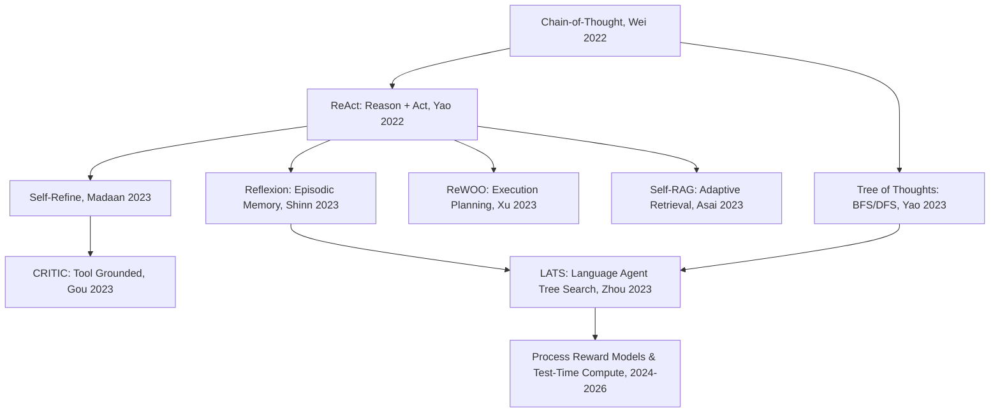

# Analiza 05-Research-Foundations: Geneza Algorytmiczna i Literatura Naukowa

> [!NOTE]
> Niniejszy dokument stanowi rygorystyczne studium literatury naukowej z zakresu systemów autonomicznych agentów LLM (lata 2022–2026), do której odwołuje się plik `05-Research-Foundations.md`. Wyjaśnia formalne podstawy algorytmiczne (ReAct, Reflexion, CRITIC, Self-RAG, Tree of Thoughts, LATS, PRM), demaskuje nowomowę marketingową oraz dokonuje wnikliwej analizy znanych w literaturze trybów awarii (Failure Modes).

---

## 1. Mapowanie Nowomowy na Kanon Literatury Naukowej

Jedną z największych wartości dokumentu `05-Research-Foundations.md` jest przywrócenie właściwych nazw akademickich dla koncepcji, które autorzy pierwotnych propozycji próbowali przedstawić jako „rewolucyjne nowości”:

```
┌────────────────────────────────────────────────────────────────────────┐
│                   MAPOWANIE NA LITERATURĘ AKADEMICKĄ                   │
├───────────────────────────────┬────────────────────────────────────────┤
│ Wymyślony Termin              │ Kanoniczny Algorytm w Literaturze AI   │
├───────────────────────────────┼────────────────────────────────────────┤
│ "Challenger Pass"             │ Self-Refine / Reflexion / CRITIC       │
│ `rank_by_information_gain()`  │ Self-Ask / Bayesian Active Learning    │
│ "Verification Agent"          │ Grounded Execution / PRM (Reward Model)│
│ "Problem Graph"               │ Causal Root-Cause Analysis (SRE/AST)   │
│ "Dependency Expansion"        │ Static Call-Graph Analysis (LSP/AST)   │
└───────────────────────────────┴────────────────────────────────────────┘
```

---

## 2. Ewolucja Paradygmatów Rozumowania Agentowego (2022–2026)

Poniższe drzewo genealogiczne ilustruje ewolucję systemów agentowych od prostego promptingu do zaawansowanych drzew przeszukiwań:



### 2.1. ReAct (Reasoning + Acting, Yao et al., 2022)
* **Zasada działania:** Przeplatanie kroków generowania myśli (*Thought: muszę sprawdzić zawartość pliku X*) z akcjami narzędziowymi (*Action: read_file(X)*) oraz obserwacjami (*Observation: zawartość pliku*).
* **Zaleta:** Dynamiczna adaptacja do bieżących wyników narzędzi.
* **Wada:** Pamięć podręczna szybko ulega nasyceniu; brak wbudowanej refleksji nad całościową strategią.

### 2.2. Reflexion (Shinn et al., NeurIPS 2023)
* **Innowacja:** Wprowadzenie **pamięci epizodycznej (Episodic Reflection Memory)**. Gdy agent nie zrealizuje celu (np. test jednostkowy zwróci błąd), nie zaczyna zadania od nowa, lecz generuje werbalną autorefleksję (*"Mój poprzedni plan zawiódł, ponieważ założyłem, że funkcja zwraca tablicę, a zwracała wskaźnik"*).
* **Wyniki Empiryczne:** Wzrost skuteczności z 67% do 88% na benchmarku HumanEval.

### 2.3. CRITIC (Gou et al., ICLR 2024)
* **Innowacja:** **Krytyka ugruntowana zewnętrznie**. W odróżnieniu od Self-Refine (gdzie model krytykuje sam siebie bez narzędzi), CRITIC weryfikuje swoje hipotezy, uruchamiając kompilator, interpreter kodu lub wyszukiwarkę internetową.
* **Kluczowy Wniosek:** Ugruntowanie w narzędziach eliminuje zjawisko "ślepych plamek poznawczych" (Shared Blind Spots).

### 2.4. Self-RAG (Self-Reflective Retrieval-Augmented Generation, Asai et al., 2023)
* **Innowacja:** Model uczy się emitować specjalne tokeny kontrolne wskazujące, kiedy *należy* pobrać dokumentację (`[Retrieve]`), kiedy pobrana treść jest trafna (`[IsREL]`), a kiedy odpowiedź jest w pełni poparta faktami (`[IsSUP]`).

### 2.5. Tree of Thoughts (ToT) oraz LATS (Language Agent Tree Search)
* **ToT (Yao et al., 2023):** Umożliwia eksplorację wielu alternatywnych ścieżek rozumowania w strukturze drzewa z wykorzystaniem algorytmów przeszukiwania w głąb (DFS) lub wszerz (BFS).
* **LATS (Zhou et al., 2023/2024):** Unifikacja ToT, ReAct i Reflexion z algorytmem Monte Carlo Tree Search (MCTS). Każdy węzeł drzewa to stan środowiska, ewaluowany przez funkcję wartości i zasilany informacją zwrotną z wykonania kodu.
* **Cena Obliczeniowa:** LATS i ToT zużywają od **10x do 50x więcej tokenów** niż klasyczny ReAct.

### 2.6. Process Reward Models (PRM) i Test-Time Compute (2025/2026 Frontier)
* **Koncepcja:** Zamiast oceniać wyłącznie wynik końcowy (Outcome Reward Model — ORM), model nagradzający (PRM, np. PRM800K) ocenia każdy pojedynczy krok rozumowania w skali od 0 do 1.
* **Zastosowanie w Inżynierii:** Umożliwia wczesne odcinanie błędnych gałęzi drzewa rozumowania (*pruning*) przed wykonaniem kosztownych operacji edycji kodu.

---

## 3. Szczegółowa Wiwisekcja Trybów Awarii (Failure Modes)

Wdrażając architekturę agentową, inżynier musi znać typowe pułapki systemów bazujących na LLM:

```
┌────────────────────────────────────────────────────────────────────────┐
│                        KATALOG TRYBÓW AWARII                           │
├───────────────────────────────┬────────────────────────────────────────┤
│ Tryb Awarii                   │ Skutek i Mechanizm Destrukcji          │
├───────────────────────────────┼────────────────────────────────────────┤
│ **Degeneration of Thought**   │ Zapadanie się w błędne koło krytyki;   │
│                               │ wzmacnianie pierwotnego błędu          │
├───────────────────────────────┼────────────────────────────────────────┤
│ **Context Pollution**         │ Zaśmiecenie okna kontekstu nieudanymi  │
│                               │ próbami i długimi logami               │
├───────────────────────────────┼────────────────────────────────────────┤
│ **Memory Poisoning**          │ Zapisanie nieprawdziwego faktu do      │
│                               │ bazy wiedzy jako 'prawdy objawionej'   │
├───────────────────────────────┼────────────────────────────────────────┤
│ **Multi-Agent Compute Tax**   │ 3-5x wyższy koszt bez wzrostu Pass@1   │
├───────────────────────────────┼────────────────────────────────────────┤
│ **Overthinking / Dilution**   │ Generowanie dziesiątek zbędnych zapytań│
│                               │ i gubienie głównego celu zadania       │
└───────────────────────────────┴────────────────────────────────────────┘
```

### 3.1. Degeneracja Myśli (Degeneration of Thought)
* **Mechanizm:** Gdy model w fazie autorefleksji uzna za błąd coś, co w rzeczywistości było poprawne, w kolejnych iteracjach zaczyna psuć działający kod. Atencja modelu skupia się na własnym negatywnym komentarzu, tworząc spiralę halucynacji.
* **Ochrona:** Ograniczenie liczby rund krytyki do 1 i wymóg weryfikacji przez kompilator.

### 3.2. Zaśmiecenie Kontekstu (Context / Memory Pollution)
* **Mechanizm:** Jeśli do kontekstu agenta wrzucimy pełny zrzut 1000 linii logu błędu ze stosem wywołań oraz całe pliki HTML ze scrapingu, model traci zdolność skupienia atencji na krytycznych regułach biznesowych (*Lost in the Middle phenomenon*).
* **Ochrona:** Agresywna kompresja logów narzędziowych i wstrzykiwanie tylko atomowych podsumowań faktów.

### 3.3. Zatrrucie Pamięci Długoterminowej (Memory Poisoning)
* **Mechanizm:** Jeśli agent po rozwiązaniu zadania zapisze w globalnej bazie wiedzy notatkę: *"Biblioteka X nie obsługuje asynchroniczności"*, wszystkie przyszłe sesje agenta będą działały pod wpływem tej nieprawdziwej tezy.
* **Ochrona:** Zakaz automatycznego zapisu do kanonicznej bazy wiedzy (`10_`–`50_` w Vaultie) bez jawnej akceptacji programisty (propozycje w `00_Inbox/_proposals/`).

---

## 4. Praktyczna Hierarchia Wartości Inżynierskiej

Dokument `05-Research-Foundations.md` formułuje precyzyjną regułę priorytetyzacji mechanizmów według ich udowodnionej wartości:

$$1. \text{ Ugruntowanie w Narzędziach (Testy/LSP/Search)} > 2. \text{ Pojedynczy Krytyk} > 3. \text{ Twardy Budżet} > 4. \text{ Multi-Agent / Pamięć Trwała}$$

1. **Ugruntowanie Wykonawcze (Najwyższy Priorytet):** Testy, lintery, TypeScript, kompilatory dają twardy sygnał prawdy.
2. **Pojedynczy Przebieg Krytyka:** Tani i wysoce skuteczny sposób na wyłapanie grubych błędów logicznych.
3. **Deterministyczny Budżet:** Bezwzględnie konieczny do zatrzymania pętli kosztowych.
4. **Złożona Debata Wieloagentowa i Grafy Wiedzy:** Opcje wysokokosztowe, dopuszczalne wyłącznie po empirycznym wykazaniu niewystarczalności poziomów niższych.
