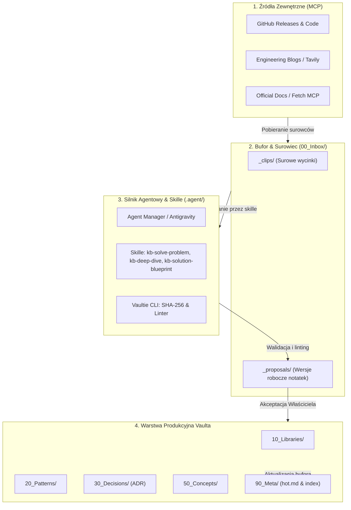

# Blueprint Ekosystemu Agentowego dla Inżynieryjnego Vaulta (Vaultie 2026)

## 1. Cel Analizy i Kontekst

Celem niniejszego dokumentu jest zdefiniowanie docelowej architektury orkiestracji agentów AI (Google Antigravity / Claude Code) zintegrowanej z inżynieryjnym „Second Brainem” w Obsidianie (**Vaultie**).

Dokument odpowiada na pytania:
1. Jakie wzorce i scenariusze agentowe istnieją już na rynku (np. Fabric, MCP, Auto-Research) i co z nich wyciągnąć?
2. Jak rozszerzyć 3 kluczowe przepływy (Problem X -> Wzorzec, Temat Y -> Deep Dive, Rozwiązanie Z -> Blueprint & ADR)?
3. Skąd czerpać rzetelną wiedzę inżynieryjną?
4. Co i dlaczego powinno trafiać do produkcyjnych warstw Vaulta (`10_Libraries` do `50_Concepts`), a co powinno zostać odrzucone?

---

## 2. Przegląd i Analiza Ryynkowych Wzorców (State of the Art 2026)

### 2.1 Ryynkowe Wzorce & Frameworki

| Wzorzec / Narzędzie | Kluczowa koncepcja | Jak adaptujemy w Vaultie? |
|---|---|---|
| **Daniel Miessler's Fabric** | Wersjonowane, tekstowe wzorce (*Patterns*) czytane ze standardowego wejścia i składane w łańcuchy (*pipelines*). | Skille w `.agent/skills/` działają jako czyste skrypty Prompt-as-Code. Wynik wywołania jednego skilla (`kb-scout`) może stanowić surowiec dla kolejnego (`kb-lib-analyze`). |
| **Model Context Protocol (MCP)** | Standaryzowany interfejs połączeniowy z dyskiem, GitHubem, wyszukiwarkami i przeglądarką. | Konfiguracja `.agent/mcp.json` z obsługą serwerów `github`, `tavily` oraz `fetch`. |
| **Self-Improving Heartbeat Loop** | Cykliczny agent działający w tle (cron), który skanuje surowe wpisy, deduplikuje notatki i aktualizuje graf połączeń. | Skill [kb-scout.md](file:///c:/Users/cyunc/Documents/Projects/Vaultie/.agent/skills/kb-scout.md) oraz dedykowany skrypt integralności `python3 .agent/scripts/vaultie-cli.py lint`. |
| **Nygard ADR & Y-Statement** | Ustrukturyzowane notatki decyzji architektonicznych zawierające uzasadnienie i negatywne konsekwencje. | Szablony `tpl-comparison.md` i `tpl-decision.md` wspierane przez skill `kb-solution-blueprint`. |

---

## 3. Architektura Przepływu Danych i Orkiestracji Agentów

Architektura opiera się na 4-warstwowym modelu przetwarzania z gwarancją izolacji danych surowych od warstwy produkcyjnej:

---

## 4. Trzy Rdzenne Scenariusze Badawcze w Vaultie

### 🔹 Scenariusz 1: Problem X — Wyszukiwanie Wzorców & Implementacji (`kb-solve-problem`)
* **Problem:** Szukamy sposobu na rozwiązanie problemu (np. *synchroniczna edycja nieskończonego canvasa przy dużym obciążeniu*).
* **Komponenty:** `github MCP` (szukanie w Open Source), `tavily MCP` (blogi technologiczne), skill `kb-solve-problem`, szablon `tpl-pattern.md`.
* **Wynik:** Wyekstrahowany, agnostyczny wzorzec z opisem pułapek (*anti-patterns*) zapisany w `00_Inbox/_proposals/tpl-pattern-<slug>.md`.

### 🔹 Scenariusz 2: Temat Y — Głęboka Analiza / Deep Dive (`kb-deep-dive`)
* **Problem:** Chcemy dokładnie zrozumieć wewnętrzne mechanizmy działania biblioteki lub koncepcji (np. *Zustand internals*, *Reaktywność w Svelte 5*).
* **Komponenty:** `fetch MCP` (pobieranie docsów), `github MCP` (źródła core), skill `kb-deep-dive`, szablon `tpl-deep-analysis.md`.
* **Wynik:** Notatka zawierająca diagram Mermaid, analizę API, wydajności oraz sekcję *Gotchas* i *Jak to zastosuję w kodzie*.

### 🔹 Scenariusz 3: Rozwiązanie Z — Projektowanie Architektury, Komponentów i ADR (`kb-solution-blueprint`)
* **Problem:** Budujemy nowe rozwiązanie i musimy wybrać komponenty, przeanalizować ryzyka i alternatywy (np. *React Flow vs JointJS vs Natywny Canvas*).
* **Komponenty:** `tavily MCP`, skill `kb-solution-blueprint`, szablony `tpl-comparison.md` oraz `tpl-decision.md`.
* **Wynik:** Macierz porównawcza technologii + formalny wpis ADR (Architecture Decision Record) z formatem Y-Statement.

---

## 5. Poszerzenie Zapytania (Inquiry Expansion): Co Jeszcze Rozważyć?

Podczas budowy inżynieryjnego systemu wiedzy warto wprowadzić 4 dodatkowe mechanizmy wspierające:

### 1. Pętla Walidacji Statycznej (Feedback Loop Linting)
Po wygenerowaniu propozycjinotatki przez agenta, skrypt `python3 .agent/scripts/vaultie-cli.py lint` automatycznie sprawdzający:
- Obowiązkowy frontmatter YAML (`type`, `title`, `created`, `updated`, `up`).
- Poprawność składniową wiki-linków `[[notatka]]`.
- Czy notatka nie tworzy sierot (*orphans*).

### 2. Wykresy i Tablice Wizualne (Canvas & Mermaid Generation)
Każda złożona notatka architektoniczna powinna zawierać diagram sekwencji lub architektury w formacie **Mermaid** oraz opcjonalnie powiązaną tablicę wizualną w formacie **Obsidian Canvas** (`90_Meta/canvases/<nazwa>.canvas`).

### 3. Technologiczny Radar Vaulta (Tech Radar Integration)
Automatyczna kompilacja stanu dojrzałości bibliotek z `10_Libraries/` na podstawie pola `verdict`:
- `adopt` (rekomendowane do użycia w projektach),
- `trial` (przetestowane w labach),
- `assess` (w fazie badania),
- `hold` / `avoid` (odradzane lub przestarzałe).

### 4. Zabezpieczenie przed Halucynacjami Kodowymi (Verified Code Snippets)
Wszystkie snippety trafiające do `40_Snippets/` muszą posiadać flagę `verified: true` oraz wersję języka/biblioteki. Kod bez zweryfikowanego uruchomienia nie może trafić do produkcyjnej warstwy vaulta.

---

## 6. Skąd Czerpać Wiedzę (Rzetelne Źródła dla Agentów)?

Aby zapobiec zanieczyszczaniu vaulta niskiej jakości treściami z internetu, agent powinien odpytywać wyłącznie zweryfikowane źródła:

1. **Oficjalne blogi inżynieryjne firm z czołówki tech:**
   - Linear Engineering Blog, Figma Engineering, Uber Engineering, Vercel Blog, Cloudflare Blog, Supabase Blog.
2. **GitHub Releases & Top Repositories (via GitHub MCP):**
   - Śledzenie wydań bibliotek używanych w projektach oraz dyskusji w Issues/PR.
3. **ThoughtWorks Technology Radar:**
   - Obserwacja trendów branżowych i zmian statusu narzędzi (*Adopt / Trial / Assess / Hold*).
4. **Agregatory Społeczności Inżynieryjnej:**
   - Hacker News (posty z progowaniem >100 punktów), Reddit `r/softwarearchitecture`, `r/programming`.

---

## 7. Taksonomia i Kryteria Przynależności Notatek do Vaulta

Notatka **Musi Odpowiadać** na pytania: *„Co to jest?”, „Jak to działa pod spodem?”, „Kiedy tego NIE używać?”* oraz przede wszystkim **„JAK TO ZASTOSUJĘ W KODZIE?”**.

### Macierz Kwalifikacji Notatek:

| Rodzaj Materiału | Czy trafia do Vaulta? | Gdzie trafia? | Uzasadnienie |
|---|---|---|---|
| Wyjaśnienie mechanizmu biblioteki + przykład kodu API | ✅ TAK | `10_Libraries/` | Bezpośrednia wartość inżynieryjna w codziennym kodowaniu. |
| Uniwersalny wzorzec architektoniczny (np. Optimistic UI) | ✅ TAK | `20_Patterns/` | Zwiększa jakość projektowania systemów niezależnie od języka. |
| Wybór technologii i uzasadnienie w projekcie (ADR) | ✅ TAK | `30_Decisions/` | Dokumentuje przesłanki biznesowe i techniczne decyzji. |
| Przetestowany, działający fragment kodu | ✅ TAK | `40_Snippets/` | Oszczędza czas przy powtarzalnych zadaniach (`verified: true`). |
| Notatka edukacyjna / koncepcyjna (np. WBS, RACI) | ✅ TAK | `50_Concepts/` | Buduje fundamenty wiedzy teoretycznej i menedżerskiej. |
| Surowy artykuł z sieci / transkrypcja z wideo | ⚠️ TYLKO JAKO SUROWIEC | `00_Inbox/_clips/` | Surowiec do przetrawienia. Nie jest gotową notatką. |
| Pamiętnik, luźne myśli, felietony publicystyczne | ❌ NIE | Odrzucone | Vaultie to inżynieryjna baza wiedzy, a nie dziennik osobisty. |

---

## 8. Rekomendowany Plan Adopcji i Następne Kroki

1. **Zatwierdzenie niniejszego Blueprinta:** Przeniesienie wniosków do struktury vaulta.
2. **Przetestowanie Skilli na Realnym Problemie:** Uruchomienie skilla [kb-solve-problem.md](file:///c:/Users/cyunc/Documents/Projects/Vaultie/.agent/skills/kb-solve-problem.md) dla konkretnego wyzwania architektonicznego.
3. **Utrzymanie Czystości Vaulta:** Wykorzystanie `python3 .agent/scripts/vaultie-cli.py lint` po każdym zbiorczym przetwarzaniu materiałów.

---
*Źródła i Odnośniki:*
- [[AGENTS.md]] — Manual Operacyjny Vaulta
- [[90_Meta/_index]] — Główna Mapa Treści Vaultie
- [[Decisions MOC]] — Mapa Decyzji Architektonicznych
