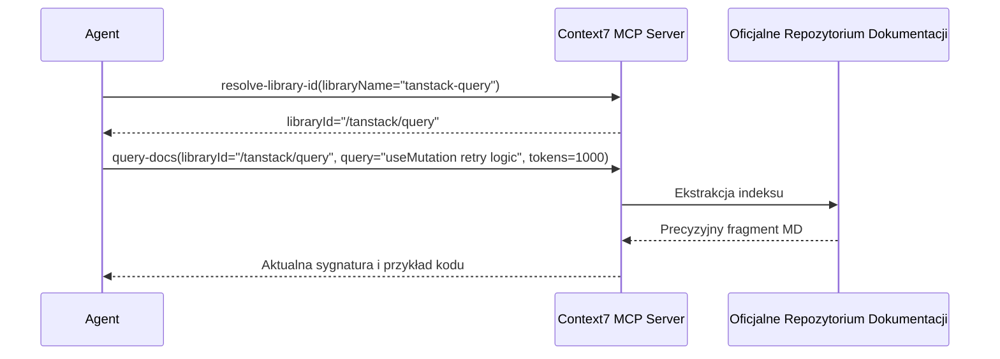

# Context7 (Upstash)

> [!NOTE]
> **Werdykt:** Niezbędne narzędzie inżynierskie eliminujące problem halucynacji wersji (API drift). Zamiast polegać na wiedzy modelu z daty treningu, dostarcza aktualną, wersjonowaną dokumentację i przykłady bezpośrednio do okna kontekstu agenta.

## 1. Problem: API Drift i Halucynacje Wersji

Modele LLM podczas generowania kodu często używają przestarzałych API (np. nieistniejące metody z wcześniejszych wydań pakietów npm/PyPI) lub mieszają składnię różnych wersji (np. Pydantic v1 vs v2, Next.js Pages vs App Router). 

Context7 rozwiązuje ten problem w dwóch krokach:
1. Mapuje nazwę pakietu na kanoniczny identyfikator biblioteki.
2. Pobiera oficjalną, zaktualizowaną dokumentację dla wskazanej wersji z limitem budżetu tokenów.

---

## 2. API i Dostępne Narzędzia MCP



### Narzędzia:
* `resolve-library-id`: Wyszukuje bibliotekę i zwraca kanoniczne ID (np. `/vercel/next.js`, `/tailwindlabs/tailwindcss`).
* `query-docs` / `get-library-docs`: Zwraca ustrukturyzowane fragmenty dokumentacji z oficjalnego źródła.

---

## 3. Konfiguracja i Integracja

### Opcja Zdalna (Hosted SSE):
```json
{
  "mcpServers": {
    "context7": {
      "type": "streamable-http",
      "url": "https://mcp.context7.com/mcp"
    }
  }
}
```

### Opcja Lokalna (NPM / stdio):
```bash
npx -y @upstash/context7-mcp
```

---

## 4. Dobre Praktyki i Gotchas

1. **Walidacja Argumentów:** Narzędzie `resolve-library-id` wymaga precyzyjnych parametrów tekstowych. Błędy formatu zwracają kod błędu JSON-RPC `-32602`.
2. **Budżet Tokenów:** Zawsze należy przekazywać parametr określający maksymalną liczbę tokenów dokumentacji (zalecane: 800–1500 tokenów), aby nie zanieczyścić kontekstu.

---

## Powiązane Notatki
- Standard MCP: [[mcp-protocol]]
- Wyszukiwarka Exa: [[exa-search]]
- Wzorzec Pętli: [[epistemic-reasoning-loop]]
- Decyzja Architektoniczna: [[2026-08-22-epistemic-coding-agent-architecture]]
