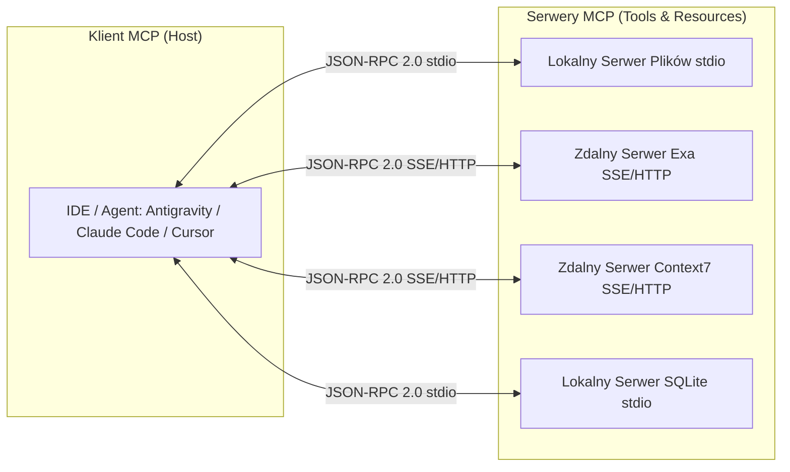

# Model Context Protocol (MCP)

> [!NOTE]
> **Werdykt:** Branżowy standard (de facto) warstwy hydrauliki narzędziowej dla systemów agentowych. Zapewnia ustrukturyzowany, bezpieczny i jednolity interfejs JSON-RPC 2.0 łączący modele LLM z zasobami lokalnymi i zdalnymi API.

## 1. Architektura i Zasada Działania

Protokół MCP oddziela logikę decyzyjną agenta od szczegółów implementacyjnych narzędzi. Klient (IDE / Asystent) łączy się z serwerami MCP eksponującymi 3 typy zasobów:
1. **Tools (Narzędzia):** Wywoływalne funkcje z deklaratywnym schematem wejścia/wyjścia (JSON Schema).
2. **Resources (Zasoby):** Pasywne dane odczytywane przez model (np. zawartość plików, tabele bazy danych, logi).
3. **Prompts (Szablony Promptów):** Wbudowane przepływy konwersacyjne i instrukcje systemowe.



---

## 2. Modele Transportowe

| Typ Transportu | Mechanizm | Zastosowanie | Zalety | Wady |
|---|---|---|---|---|
| **`stdio`** | Standardowe wejście/wyjście procesu potomnego (subproces OS) | Lokalne narzędzia systemu plików, git, bazy SQLite | Maksymalne bezpieczeństwo, zero opóźnień sieciowych | Wymaga lokalnego środowiska wykonawczego (Node/Python) |
| **`streamable-http / SSE`** | Server-Sent Events przez HTTPS + POST | Zdalne serwery wyszukiwarek (Exa, Context7, Firecrawl) | Brak konieczności instalowania zależności, centralne API | Zależność od łącza sieciowego, latencja RTT |

---

## 3. Przykładowa Konfiguracja Klienta

```json
{
  "mcpServers": {
    "exa": {
      "type": "streamable-http",
      "url": "https://mcp.exa.ai/mcp?tools=web_search_exa,get_code_context_exa"
    },
    "context7": {
      "type": "streamable-http",
      "url": "https://mcp.context7.com/mcp"
    }
  }
}
```

---

## 4. Zagadnienia Bezpieczeństwa (Security & Sandboxing)

* **Indirect Prompt Injection:** Zewnętrzne serwery MCP zwracające treści z sieci mogą zawierać złośliwe instrukcje próbujące przejąć sterowanie agentem (*Jailbreak via RAG*).
* **Mitigacja:** 
  1. Stosowanie deterministycznych filtrów regex (Guardrails) na poziomie klienta przed wywołaniem niebezpiecznych poleceń powłoki.
  2. Ograniczenie narzędzi zapisu do zaufanych ścieżek roboczych.

---

## Powiązane Notatki
- Decyzja Architektoniczna: [[2026-08-22-epistemic-coding-agent-architecture]]
- Serwer Context7: [[context7]]
- Serwer Exa Search: [[exa-search]]
- Wzorzec Pętli: [[epistemic-reasoning-loop]]
