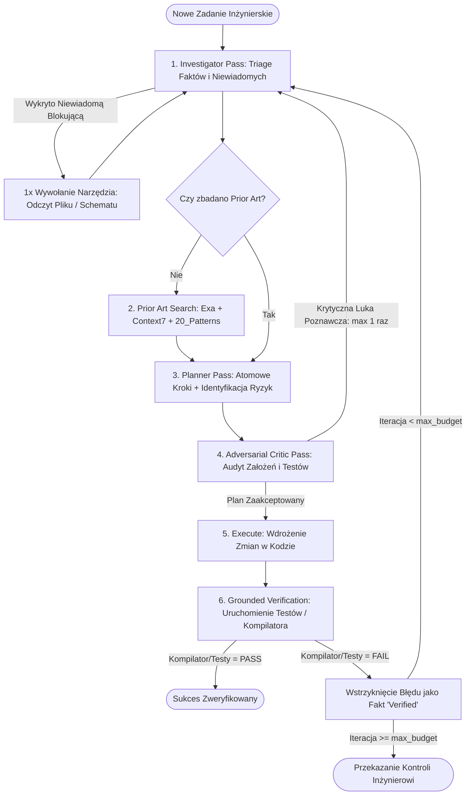

# Wzorzec Inżynierski: Pętla Wnioskowania Epistemicznego (Epistemic Reasoning Loop)

## 1. Definicja i Problem

Standardowy wzorzec agenta (ReAct) charakteryzuje się bezpośrednim sprzężeniem: *Cel $\to$ Modyfikacja Kodu $\to$ Sukces (Deklaratywny)*. Prowadzi to do:
- Łatania powierzchownych objawów zamiast przyczyn źródłowych,
- Halucynowania nieistniejących metod i bibliotek,
- Braku świadomości ukrytych założeń architektonicznych.

**Wzorzec Pętli Epistemicznej** wprowadza rygorystyczny podział procesu poznawczego na fazy: **Zarządzanie Niewiadomymi (Triage) $\to$ Badanie Stanu Poprzedniego (Prior Art) $\to$ Planowanie z Identyfikacją Ryzyka $\to$ Krytyka Oskarżycielska $\to$ Fizyczne Ugruntowanie Wykonawcze**.

---

## 2. Diagram Przepływu Sterowania



---

## 3. Kluczowe Zasady Wzorca

### 3.1. Zasada Kategoryzacji Faktów (Epistemic Labeling)
Wszelkie informacje w pamięci roboczej agenta muszą być kategoryzowane według 3 stanów:
- `verified` — podparte twardym dowodem (ścieżka pliku i linia, wyjście procesu kompilatora, kod HTTP 200).
- `inferred` — logiczny wniosek wyprowadzony z faktów zweryfikowanych.
- `assumed` — założenie a priori, wymagające weryfikacji przed zatwierdzeniem kodu.

### 3.2. Prior-Art Gate (Brama Stanu Poprzedniego)
Agent nie ma prawa generować nowej implementacji algorytmu lub integracji bez wcześniejszego sprawdzenia:
1. Czy w repozytorium lub bazie wiedzy (`20_Patterns/`) istnieje już sprawdzony wzorzec,
2. Czy biblioteka zewnętrzna (w Context7) posiada już gotową funkcję rozwiązującą ten problem w bieżącej wersji.

### 3.3. Grounded Verification (Ugruntowanie Wykonawcze)
Zadanie jest uznane za zrealizowane **wyłącznie** po otrzymaniu statusu zakończenia sukcesem (exit code 0) z fizycznego uruchomienia zestawu testów jednostkowych, integracyjnych lub lintera. Deklaracja słowna modelu ("Kod wygląda poprawnie") nie ma żadnej wartości dowodowej.

---

## 4. Przykładowa Implementacja Maszyny Stanów (Python)

```python
from dataclasses import dataclass, field
from typing import List, Dict, Literal

EpistemicStatus = Literal["verified", "inferred", "assumed"]

@dataclass
class Fact:
    statement: str
    status: EpistemicStatus
    source: str

@dataclass
class TaskState:
    goal: str
    facts: List[Fact] = field(default_factory=list)
    unknowns: List[str] = field(default_factory=list)
    plan: List[str] = field(default_factory=list)
    iteration: int = 0
    max_iterations: int = 3
    prior_art_checked: bool = False

    def can_proceed_to_execution(self) -> bool:
        return self.prior_art_checked and len(self.plan) > 0 and self.iteration < self.max_iterations
```

---

## 5. Zastosowanie w Środowisku Vaultie

Wzorzec ten stanowi rdzeń operacyjny dla:
- Skilli realizujących zadania programistyczne (`kb-epistemic-solve`),
- Walidacji laboratoriów w `labs/web-engineering/`,
- Tworzenia nowych notatek bibliotek (`10_Libraries/`) po wcześniejszym zbadaniu stanu API.

---

## Powiązane Notatki
- Decyzja Architektoniczna: [[2026-08-22-epistemic-coding-agent-architecture]]
- Koncepcja Metapoznania: [[epistemic-agency]]
- Narzędzie Context7: [[context7]]
- Narzędzie Exa Search: [[exa-search]]
- Standard MCP: [[mcp-protocol]]
