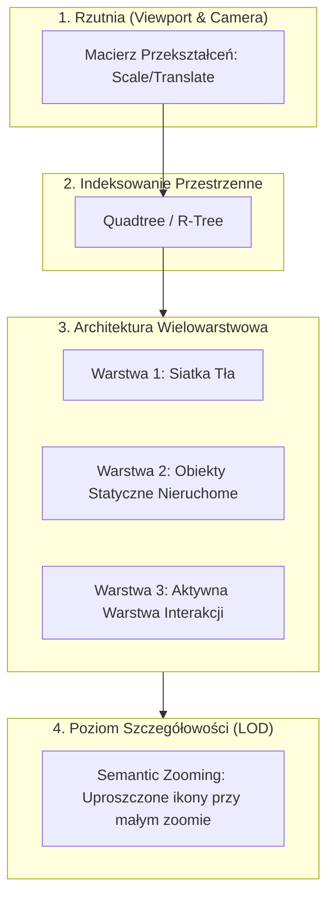

<!-- AI-INSTRUCTIONS
Instrukcje dotyczące szablonu wzorca Infinite Canvas:
- Zachowaj ogólny i uniwersalny charakter architektoniczny (niezależny od konkretnej biblioteki).
- Uwzględnij porównanie silników (DOM/SVG vs Canvas 2D vs WebGL), indeksowanie przestrzenne (Quadtree/R-Tree) oraz warstwowanie.
-->

# Architektura Nieskończonego Pola (Infinite Canvas Architecture)

Wzorzec architektoniczny projektowania aplikacji graficznych i edytorów diagramów umożliwiający swobodne przesuwanie (panning), powiększanie (zooming) oraz manipulację obiektami na dwuwymiarowej płaszczyźnie o nieograniczonych rozmiarach.

## Problem

Aplikacje typu edytory UML, tablice koncepcyjne (Miro, Figma, tldraw) oraz edytory przepływów muszą obsługiwać od kilkudziesięciu do setek tysięcy interaktywnych obiektów. Standardowe podejście oparte na niedostosowanym drzewie DOM przeglądarki szybko doprowadza do drastycznego spadku płynności (latencji renderowania i reakcji na zdarzenia myszy) przy skalowaniu skali wykresu.

## Rozwiązanie Architektoniczne

Projekt czystego silnika nieskończonego pola opiera się na 5 filarach:

### 1. Model Renderowania — Zestawienie Technologii

| Technologia | Model Renderowania | Granica Wydajności | Najlepsze Zastosowanie |
|---|---|---|---|
| **DOM / HTML + SVG** (React Flow, Svelte Flow) | Retained Mode (Drzewo DOM) | ~1 000 – 2 000 obiektów | Bogate w UI, aktywne formularze w węzłach, dostępność ARIA |
| **Engine / SVG Wrapper** (JointJS, GoJS) | Retained / Hybrid | ~5 000 – 10 000 obiektów | Standardowe edytory schematów, zaawansowany routing krawędzi |
| **Canvas 2D** (Konva.js, Fabric.js, tldraw) | Immediate Mode (Scene Graph) | ~10 000 – 50 000 obiektów | Interaktywne tablice, edytory rysunkowe, wysoka wydajność |
| **WebGL / WebGPU** (PixiJS, Three.js) | GPU Immediate Mode | > 100 000 obiektów | Zbiory gigantycznych danych, wizualizacje sieciowe i 3D |

### 2. Indeksowanie Przestrzenne i Culling (Spatial Indexing)
Aby uniknąć przeliczania pozycji każdego obiektu przy każdym ruchu myszy, przestrzeń jest dzielona za pomocą struktur takich jak **Quadtree** lub **R-tree**. Przy renderowaniu klatki silnik odpytuje indeks tylko o obiekty przecinające się z aktualnym okienkiem rzutni (`Bounding Box Frustum Culling`).

### 3. Warstwowanie Kanwy (Multi-layer Canvas Rendering)
W silnikach Canvas 2D stosuje się fizyczny podział na niezależne warstwy:
- **Warstwa Tła:** Rysowanie siatki i punktów orientacyjnych (przeliczana tylko przy zmianie skali/skoku).
- **Warstwa Główna:** Statyczne węzły i połączenia rzutni.
- **Warstwa Wierzchnia (Overlay):** Wyłącznie aktualnie przeciągany obiekt, ramka zaznaczenia oraz wskaźniki myszy współtwórców (gwarantuje 60 FPS podczas przeciągania).

### 4. Poziomy Szczegółowości (Level of Detail - LOD)
Gdy skala rzutni spada poniżej określonego progu (Zoom < 30%), złożone komponenty (np. formularze klas UML, teksturki) zastępowane są prostymi prostokątami, ograniczając liczbę operacji rysujących.

## Pułapki i Gotchas

- **Problem Utraty Precyzji (Floating Point Precision):** Przy skrajnych przesunięciach rzutni (koordynaty > $10^6$) precyzja zmiennoprzecinkowa może powodować drżenie obiektów. Stosuje się wówczas współrzędne względne względem kamery.
- **Zsynchronizowany Stan Współbieżny:** W edytorach kolaboracyjnych stan kanwy powinien być zarządzany przez bezkonfliktowe typy danych (**CRDT**, np. `Yjs` lub `Automerge`).

## Odnośniki
- Biblioteki: [[react-flow]], [[jointjs]]
- Decyzja ADR: [[2026-08-06-diagramming-engine-react-flow-vs-jointjs]]
