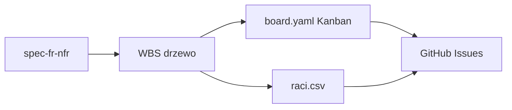

# Wzorzec: WBS + RACI + Kanban dla zespołu studenckiego

> **Problem:** Po lekcji 1.1 masz spec FR/NFR, ale zespół nie wie *kto co robi*, *w jakiej kolejności* i *jak uniknąć* równoległego grzebania w pięciu zadaniach naraz.

---

## Kiedy stosować

- Zespół **3–5 osób**, projekt **2-semestralny**, spec [`spec-fr-nfr.md`](labs/web-engineering/1.1/spec-fr-nfr.md) gotowy.
- **Nie stosuj** przy solo PoC (48 h) — wystarczy lista TODO + WIP=1.

---

## Rozwiązanie (3 artefakty)

### 1. WBS — dekompozycja scope

| Poziom | Nazwa | Reguła |
|---|---|---|
| L1 | Deliverable | 1 moduł = grupa FR MUST |
| L2 | Work Package | spójny zestaw techniczny |
| L3 | Task | **≤ 16 h**, INVEST, risk multiplier |

**Risk multipliers:** ×1.2 znany stack · ×1.5 nowe API/ORM · ×2.0 PoC/custom.

**Critical path:** najdłuższy łańcuch zależności — opóźnienie tu = opóźnienie MVP.

### 2. RACI — jedna osoba Accountable

| Rola | Znaczenie |
|---|---|
| R | Wykonuje |
| A | **Dokładnie 1** — odpowiada za wynik |
| C | Konsultowany |
| I | Informowany |

**Anti-pattern:** `A` = „cały zespół” → nikt nie odpowiada.

### 3. Kanban — WIP limit

- Kolumny: Backlog → Ready → In Progress → Review → Done.
- **WIP:** max 1–2 zadania/osobę w `In Progress`.
- Etykiety: `kind/*`, `area/*`, `effort/*` (zgodnie z roadmapą 1.2).
- Bufor **15–20%** czasu na dług techniczny.

---

## Metodyka (werdykt uczelniany)

| Metodyka | Kiedy |
|---|---|
| **Kanban + WIP** | Default — nieregularny czas studentów |
| **Shape Up** | Jasne semestralne cykle + twarde „co nie robimy” |
| **Scrum** | Tylko gdy zespół chce sprintów i ma stałe sloty |

Unikać **Scrum Theater** (ceremonie bez DoD i WIP).

---

## Powiązane

- Lekcja: [[1.2/1.2-wbs-raci]]
- Lab: `labs/web-engineering/1.2/`
- Wzorzec zespołu 6–10 os.: [[peer-accountability-buddy-system]]
- Poprzednia: [[1.1-ideation-fr-nfr]]
- Następna: [[1.3/1.3-repo-monorepo-git-workflow]]
