# Wybór silnika dla edytora diagramów UML na nieskończonym polu

## Kontekst i Wymagania

Celem projektu jest zbudowanie nowoczesnego, wysoko wydajnego edytora schematów i diagramów UML (z możliwością tworzenia klas, relacji, sekwencji) na płaszczyźnie **nieskończonego pola (infinite canvas)**.

Kluczowe wymagania systemu:
1. **Wysoka interaktywność i dostosowanie UI:** Węzły klas UML zawierają złożony interfejs (metody, właściwości, ikony typów, rozwijalne listy).
2. **Wydajność skali:** Płynna praca w rzutni (60 FPS przy przesuwaniu/przybliżaniu) na kanwie zawierającej od kilkuset do kilku tysięcy obiektów.
3. **Ekosystem React:** Zintegrowanie silnika ze stosem React/TypeScript aplikacji.
4. **Koszt i Licencja:** Preferencja rozwiązań Open Source lub o przejrzystym modelu opłat.

---

## Analiza Porównawcza i Macierz Oceny

Rozważono 5 czołowych technologii na rynku:
1. **React Flow (@xyflow/react)** — podejście DOM/JSX.
2. **JointJS (wraz z React Wrapperem)** — podejście silnikowe SVG (MVC).
3. **Konva.js (react-konva)** — silnik 2D Canvas z własnym Scene Graph.
4. **tldraw** — nowoczesna biblioteka nieskończonej tablicy z wbudowaną kolaboracją.
5. **GoJS** — dojrzały, komercyjny silnik dla diagramów enterprise.

### Macierz Kryteriów Oceniacza

| Kryterium | React Flow | JointJS Wrapper | Konva.js | tldraw | GoJS |
|---|---|---|---|---|---|
| **Model Renderowania** | DOM / HTML + SVG | Engine / SVG | Canvas 2D | Canvas 2D / HTML | Canvas 2D / HTML |
| **DX w React (Szybkość tworzenia UI)** | 🟢 Wybitna (Natywny JSX) | 🟡 Średnia (Szablony SVG) | 🟢 Dobra (Komponenty Konva) | 🟢 Dobra | 🔴 Trudna (Specyficzne API) |
| **Wydajność 10k Węzłów** | 🟡 Wymaga Wirtualizacji | 🟢 Wysoka (Stabilna) | 🟢 Bardzo Wysoka | 🟢 Bardzo Wysoka | 🟢 Ekstremalna |
| **Pętla Zoom-Out (Wszystko w rzutni)** | 🔴 Spadek FPS bez LOD | 🟢 Dobra | 🟢 Bardzo Dobra | 🟢 Bardzo Dobra | 🟢 Bardzo Dobra |
| **Wsparcie dla UML & Routing** | 🟡 Podstawowy (Dagre/Elk) | 🟢 Zaawansowany | 🔴 Własny algorytm | 🟡 Podstawowy | 🟢 Gotowy (Kompletny) |
| **Dostępność (A11y & Keyboard)** | 🟢 Bardzo Dobra (ARIA) | 🟡 Podstawowa | 🔴 Wymaga pracy ręcznej | 🟢 Dobra | 🟡 Podstawowa |
| **Model Licencyjny / Koszt** | 🟢 MIT (Open Source) | 🟡 Core MIT / Wrapper Free (Rappid $) | 🟢 MIT | 🟢 Licencja BSL / Commercial | 🔴 Komercyjna ($$$) |

---

## Porównanie Architektoniczne

```mermaid
graph TD
    subgraph RF ["Podejście React Flow (DOM/JSX)"]
        RF_State[Stan React / Zustand] -->|Re-render Component| RF_DOM[Drzewo DOM: HTML div + SVG edges]
        RF_DOM -->|Browser Paint| RF_Screen[Ekran]
    end

    subgraph JJS ["Podejście JointJS (Engine/SVG)"]
        JJS_Model[Graph Model: Backbone/Core] -->|Event Trigger| JJS_Paper[Paper View: Pure SVG Engine]
        JJS_Paper -->|DOM Update| JJS_Screen[Ekran]
        JJS_React[React Wrapper] <-->|Sync Props| JJS_Model
    end

    subgraph KNV ["Podejście Canvas 2D (Konva / tldraw)"]
        KNV_State[Stan Aplikacji] -->|Scene Graph| KNV_Canvas[Immediate Canvas 2D Context]
        KNV_Canvas -->|GPU Rasterization| KNV_Screen[Ekran]
    end
```

---

## Uzasadnienie Wyboru i Rekomendacja Architektoniczna

### Decyzja
Do realizacji edytora diagramów UML na nieskończonym polu wybieramy **rozwiązanie dwuetapowe (Hybrydowe z rekomendacją początkową dla React Flow z architekturą LOD)**:

1. **Faza 1 (Standardowy edytor do 2 000 obiektów):** **React Flow (@xyflow/react)**
   - *Dlaczego:* Umożliwia najszybsze zbudowanie bogatego, czytelnego interfejsu dla klas UML (z przyciskami, edycją inline typów pól i metod) bez konieczności pisania niestandardowych rendererów SVG. Daje natywne wsparcie dla dostępności i integrację z systemem designu.
   - *Mitigacja wydajności:* Obowiązkowe użycie `onlyRenderVisibleElements={true}`, memoizacja `React.memo` dla kafelków klas oraz implementacja uproszczonych widoków węzłów przy Zoom Out < 35%.

2. **Faza 2 (W przypadku wymogu skali > 10 000 obiektów):** Przejście na **Konva.js / tldraw** lub **JointJS**
   - Jeśli wymagania biznesowe wymuszą wyświetlanie gigantycznych struktur UML (powyżej 10 000 obiektów w jednej rzutni), rdzeń renderowania zostanie migrowany na silnik Canvas 2D (**Konva.js** lub silnik **tldraw**), zachowując model danych odseparowany w warstwie logiki.

---

## Powiązane Notatki
- Biblioteka React Flow: [[react-flow]]
- Biblioteka JointJS: [[jointjs]]
- Wzorzec Architektoniczny: [[infinite-canvas-architecture]]
