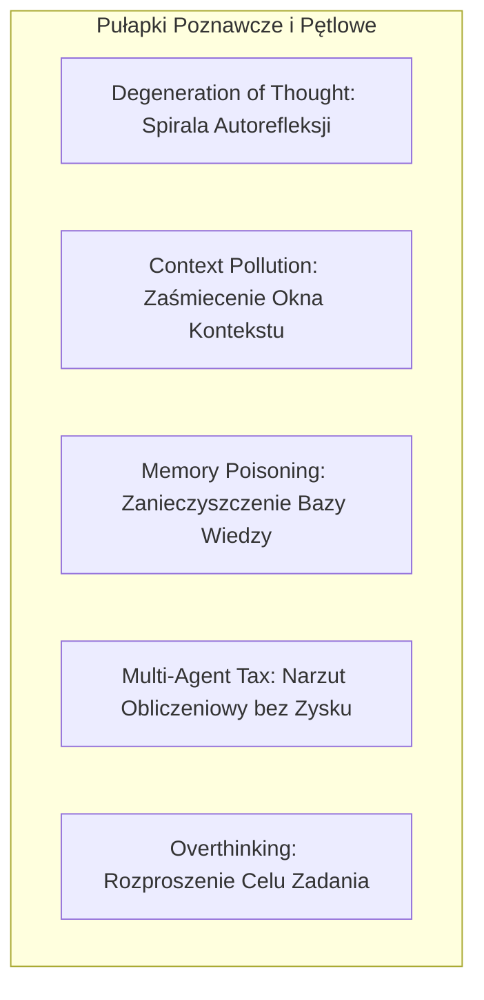

# Katalog Trybów Awarii i Pułapek Behawioralnych w Systemach Agentów LLM

## 1. Wprowadzenie

Budowa autonomicznych systemów agentowych opartych na modelach językowych (LLM) wiąże się z występowaniem powtarzalnych, udokumentowanych w literaturze naukowej trybów awarii (Failure Modes). Zrozumienie ich mechanizmów jest warunkiem koniecznym do zaprojektowania skutecznych filtrów i zabezpieczeń (Guardrails).

---

## 2. Kluczowe Tryby Awarii

### 2.1. Degeneracja Myśli (Degeneration of Thought / Self-Refine Collapse)
* **Mechanizm:** W architekturach z wielokrotną pętlą samokrytyki (np. model krytykuje i poprawia swój własny kod przez 5–10 rund), model po 3. iteracji zaczyna samoutwierdzać się w fałszywych wnioskach lub naprawiać elementy, które były w 100% poprawne.
* **Mitygacja:** Ograniczenie liczby rund krytyki do 1 i wymóg weryfikacji przez kompilator lub testy jednostkowe.

### 2.2. Zaśmiecenie Kontekstu (Context / Attention Pollution)
* **Mechanizm:** Wstrzyknięcie do okna kontekstu pełnych, 1000-wierszowych zrzutów logów błędów, surowego HTML ze stron internetowych lub długich śladów stosu powoduje degradację uwagi modelu (*Lost in the Middle phenomenon*). Model traci zdolność przestrzegania reguł biznesowych zawartych w prompcie systemowym.
* **Mitygacja:** Rygorystyczna kompresja logów narzędziowych i wyciąganie jedynie zwięzłych ekstraktów faktograficznych (max 500 tokenów).

### 2.3. Zanieczyszczenie Pamięci Długoterminowej (Memory Poisoning)
* **Mechanizm:** Jeśli agent po pojedynczej nieudanej próbie zapisze do trwałego grafu wiedzy lub bazy notatek fałszywy wniosek (np. *"Biblioteka X nie wspiera asynchroniczności"*), wszystkie przyszłe sesje w repozytorium będą działały pod wpływem tego błędu.
* **Mitygacja:** Zakaz automatycznego zapisu do kanonicznych warstw bazy wiedzy (`10_`–`50_` w Vaultie) bez jawnej akceptacji inżyniera. Zapis roboczy wyłącznie w `00_Inbox/_proposals/`.

### 2.4. Narzut Obliczeniowy Wielu Agentów (Multi-Agent Compute Tax)
* **Mechanizm:** Podział zadania na 5–6 oddzielnych agentów (np. Investigator, Planner, Challenger, Executor, Verifier, Auditor) przy użyciu tego samego modelu bazowego zwiększa zużycie tokenów o 300–600% i latencję o minuty, nie przynosząc statystycznie istotnego wzrostu skuteczności (Pass@1). Wynika to z faktu, że agenci ci dzielą te same martwe punkty poznawcze (*Shared Blind Spots*).
* **Mitygacja:** Redukcja potoku do pary Generator-Krytyk lub stosowanie zróżnicowanych rodzin modeli (np. Claude + Gemini / GPT).

### 2.5. Nadmierne Rozmyślanie i Rozproszenie (Overthinking & Exploration Dilution)
* **Mechanizm:** Agent poinstruowany o "konieczności zbadania każdego powiązania" generuje 30 zapytań wyszukiwania i analizuje poboczne wątki, zapominając o realizacji głównego celu zadania zadanego przez użytkownika.
* **Mitygacja:** Twardy budżet zapytań narzędziowych (np. max 10 wywołań) i hierarchia ważności niewiadomych (Triage).

---

## Powiązane Notatki
- Sprawczość Epistemiczna: [[epistemic-agency]]
- Wzorzec Pętli: [[epistemic-reasoning-loop]]
- Decyzja Architektoniczna: [[2026-08-22-epistemic-coding-agent-architecture]]
