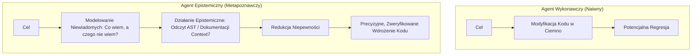

# Sprawczość Epistemiczna i Metapoznanie w Systemach Agentów AI

## 1. Czym Jest Sprawczość Epistemiczna (Epistemic Agency)?

W teorii poznania i sztucznej inteligencji **sprawczość epistemiczna** to zdolność autonomicznego systemu do aktywnego modelowania, monitorowania i regulowania własnego stanu wiedzy i niewiedzy (*metapoznanie / metacognition*).

W odróżnieniu od agentów czysto wykonawczych (które traktują każde polecenie jako bezpośredni sygnał do modyfikacji środowiska), agent epistemiczny podejmuje **działania epistemiczne (epistemic actions)** — akcje, których celem nie jest zmiana stanu świata, lecz **redukcja entropii (niepewności) w wewnętrznym modelu problemu**.

---

## 2. Problem Kalibracji Pewności (Confidence Calibration)

Kluczowym wyzwaniem w modelach językowych (LLM) jest rozróżnienie pomiędzy **asertywnością językową** a **rzeczywistym prawdopodobieństwem matematycznym**:

### 2.1. Expected Calibration Error (ECE)
Współczesne modele autoregresyjne cierpią na wysoki błąd kalibracji werbalnej. Gdy model wypisuje w tekście: `"Jestem pewien na 95%, że ta funkcja zadziała"`, jego rzeczywista trafność w trudnych zadaniach często nie przekracza 50–60%. Wynika to z faktu, że LLM generuje słowa imitujące styl pewnego siebie eksperta, a nie wynik rozkładu prawdopodobieństwa a posteriori.

### 2.2. Kategoryczna Logika Epistemiczna zamiast Liczb
W inżynierii agentowej zastępuje się nieskalibrowane wartości liczbowe (`0.95`) trójstanową klasyfikacją prawdy:

$$\text{Stan Epistemiczny} \in \{\text{verified}, \text{inferred}, \text{assumed}\}$$

1. **`verified` (Zweryfikowany):** Fakt poparty twardym, zewnętrznym dowodem empirycznym (np. log kompilatora, pomyślny test jednostkowy, odczyt konkretnej linii kodu).
2. **`inferred` (Wnioskowany):** Hipoteza wyprowadzona drogą dedukcji lub indukcji z faktów zweryfikowanych, obarczona ryzykiem błędu logicznego.
3. **`assumed` (Założony):** Robocze założenie a priori, które **musi** zostać zweryfikowane przed wdrożeniem kodu na produkcję.

---

## 3. Ugruntowanie Wykonawcze (Grounded Execution)

Prawdziwa sprawczość epistemiczna wymaga ugruntowania w środowisku fizycznym lub deterministycznym (Grounding). Informacja zwrotna z kompilatora, interpretera lub suity testów jednostkowych stanowi **zewnętrzne źródło prawdy (Ground Truth)**, przełamujące zamknięty obieg halucynacji autorefleksyjnych modelu.

---

## Powiązane Notatki
- Wzorzec Inżynierski: [[epistemic-reasoning-loop]]
- Tryby Awarii Agentów: [[agentic-failure-modes]]
- Decyzja Architektoniczna: [[2026-08-22-epistemic-coding-agent-architecture]]
- Standard MCP: [[mcp-protocol]]
