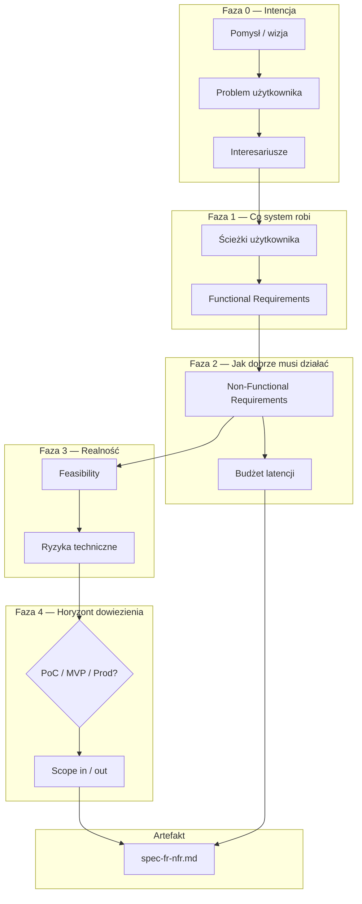
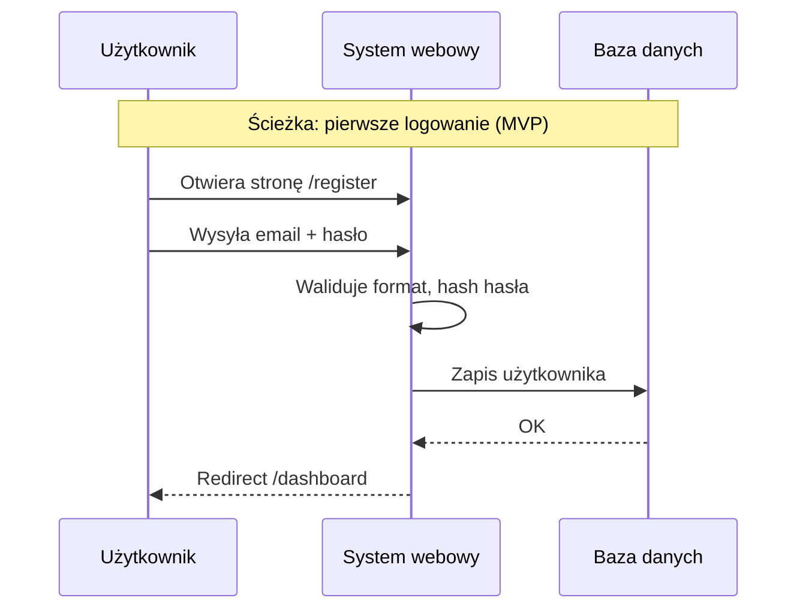
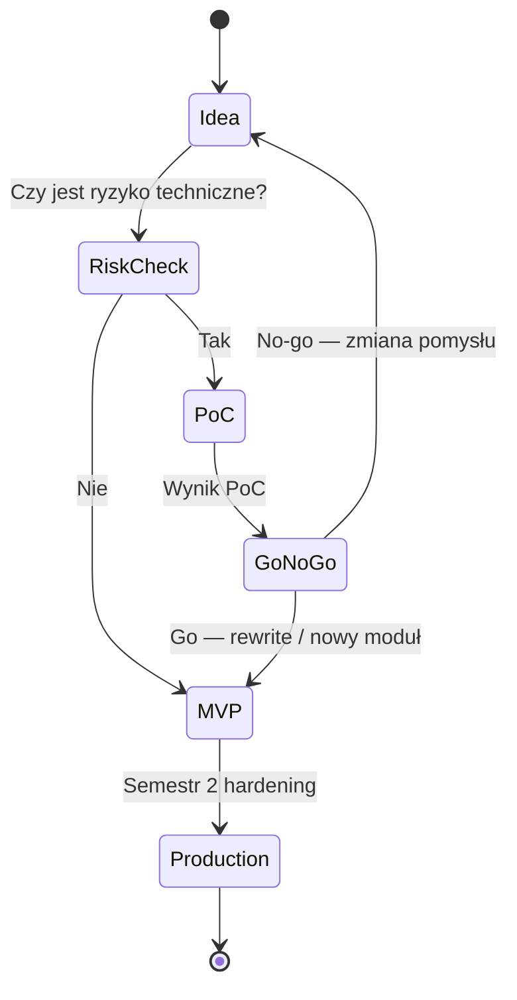

# Lekcja 1.1 — Od pomysłu do specyfikacji inżynierskiej

> **Cel lekcji:** Po przeczytaniu i wypełnieniu ćwiczeń potrafisz przekształcić luźny pomysł w dokument specyfikacji z FR, NFR, budżetem latencji i świadomą decyzją PoC/MVP/Production — zanim napiszesz pierwszą linię kodu.
> **Pakiet:** ta notatka + [[lesson-1.1-ideation-fr-nfr.canvas]] + szablony w `90_Meta/lessons/1.1/`
> **Następna lekcja po zaliczeniu Blackbox:** [[web-engineering-roadmap#1.2 — WBS, Metodyki i RACI|1.2 WBS / RACI]]

---

## Spis treści

1. [Mapa mentalna — jak elementy się łączą](#1-mapę-mentalna--jak-elementy-się-łączą)
2. [Faza 0: Pomysł i problem](#2-faza-0-pomysł-i-problem)
3. [Functional Requirements (FR)](#3-functional-requirements-fr)
4. [Non-Functional Requirements (NFR)](#4-non-functional-requirements-nfr)
5. [PoC, MVP, Production — osobno, potem porównanie](#5-poc-mvp-production--osobno-potem-porównanie)
6. [Feasibility — czy to da się zrobić w 2 semestry](#6-feasibility--czy-to-da-się-zrobić-w-2-semestry)
7. [Typowe błędne przekonania (Misconceptions)](#7-typowe-błędne-przekonania-misconceptions)
8. [Chain of Action — procedura postępowania](#8-chain-of-action--procedura-postępowania)
9. [Pod maską: latencja, dostępność, obciążenie](#9-pod-maską-latencja-dostępność-obciążenie)
10. [Ćwiczenie: wypełnij specyfikację](#10-ćwiczenie-wypełnij-specyfikację)
11. [Przykład kompletny (projekt uczelniany)](#11-przykład-kompletny-projekt-uczelniany)
12. [Jak używać kanwy i szablonów](#12-jak-używać-kanwy-i-szablonów)
13. [Blackbox — quiz weryfikacyjny](#13-blackbox--quiz-weryfikacyjny)
14. [Źródła](#14-źródła)

---

## 1. Mapa mentalna — jak elementy się łączą

Inżynierski start projektu webowego **nie zaczyna się od Reacta ani Postgresa**. Zaczyna się od odpowiedzi na pytanie: *jaki problem rozwiązujemy, dla kogo, na jakich warunkach jakościowych i w jakim horyzoncie dowiezienia*.

Poniższy przepływ to **logiczna kolejność pracy**, nie kolejność plików w repo:



### Co z czego wynika (reguły łączenia)

| Element | Odpowiada na | Źródło / wejście | Wpływa na |
|---|---|---|---|
| **Problem** | Dlaczego w ogóle budujemy system? | rozmowa z użytkownikiem, promotor, rynek | zakres FR (co musi być, żeby problem zniknął) |
| **FR** | Co system **robi**? | problem + ścieżki użytkownika | backlog, API, ekrany, testy akceptacyjne |
| **NFR** | **Jak dobrze** to robi? | oczekiwania UX, uczelnia, bezpieczeństwo | architektura, baza, CI, monitoring |
| **Feasibility** | Czy zespół/zasoby/czas wystarczą? | FR+NFR + skille zespołu | obcięcie scope, PoC przed MVP |
| **PoC/MVP/Prod** | Jaki **poziom dojrzałości** dowozimy kiedy? | feasibility + deadline semestru | jakość kodu, testy, security |
| **Latency budget** | Ile ms może „zjeść” każdy warstwa? | NFR wydajnościowe | wybór SSR/CSR, indeksy DB, cache |

**Typowy błąd:** skakanie od pomysłu do diagramu architektury. Architektura (lekcja 2.2) **powinna wynikać** z NFR i scope — nie odwrotnie.

---

## 2. Faza 0: Pomysł i problem

### 2.1. Pomysł ≠ produkt

**Pomysł** to zdanie typu: „Aplikacja do zarządzania projektami studenckimi z AI”.
**Problem** to: „Zespół 4 osób gubi decyzje architektoniczne w Discordzie i nie ma jednego miejsca prawdy przed oddaniem semestru”.

Bez problemu nie wiesz:
- kto jest użytkownikiem (student? promotor? obaj?),
- co jest MUST HAVE vs nice-to-have,
- jak zmierzysz sukces.

### 2.2. Szablon problem statement (wypełnij przed FR)

```markdown
## Problem Statement

**Użytkownik:** [konkretna rola, np. student 3 roku, zespół 4 osób]

**Kontekst:** [kiedy/gdzie ma ból, np. 2-semestralny projekt inżynierski]

**Ból:** [co jest frustrujące / kosztowne / ryzykowne dziś]

**Obecne obejście:** [Excel, WhatsApp, brak systemu — to też konkurencja]

**Sukces wygląda tak:** [mierzalny efekt, np. „promotor widzi ADR i demo bez instalacji”]
```

### 2.3. Interesariusze (kto wpływa na FR i NFR)

| Interesariusz | Typowo wpływa na | Przykład wymagania |
|---|---|---|
| **Użytkownik końcowy** | FR, UX NFR | „Mogę dodać zadanie w < 3 kliknięć” |
| **Promotor / uczelnia** | FR formalne, NFR docs | „Dokumentacja architektury w repo” |
| **Zespół dev** | Feasibility, scope | „Jeden stack: TS + Postgres” |
| **Operator (Ty na demo)** | NFR ops | „Deploy jednym kliknięciem z CI” |

Każdy FR powinien dać się przypisać do **co najmniej jednego** interesariusza. Osierocone FR („bo fajnie”) to sygnał scope creep.

### 2.4. Metody pozyskiwania wymagań i Cechy Dobrej Specyfikacji (SRS)

Skąd analityk/inżynier pozyskuje wymagania:
1. **Wywiady i Obserwacja:** Pytania otwarte + obserwacja realnej pracy (wykrywa niewyartykułowane błędy).
2. **Próbkowanie Dokumentów (Document Sampling):**
   - *Analiza jakościowa:* badanie struktury formularzy, pól i reguł biznesowych.
   - *Analiza ilościowa:* badanie częstotliwości napływu dokumentów i średnich wartości.
   - *Uwaga / Ryzyko:* Dokumentacja formalna często różni się od rzeczywistej praktyki pracowników.
3. **Karty CRC (Class-Responsibility-Collaborator):** Prosta metoda kartowa określająca dla każdego pojęcia *Klasę*, jej *Odpowiedzialności* (co wie i robi) oraz *Współpracowników* (z kim się komunikuje) przed rysowaniem diagramów UML.

> [!CHECKLIST]
> **8 Cech Dobrej Specyfikacji Wymagań (SRS):**
> 1. **Jednoznaczna (Unambiguous):** Tylko jedna interpretacja dla wszystkich odbiorców.
> 2. **Kompletna (Complete):** Pokrywa skrajne przypadki (edge cases) i błędy.
> 3. **Spójna (Consistent):** Wymagania nie wykluczają się nawzajem.
> 4. **Weryfikowalna (Verifiable):** Istnieje pomiar lub test jednoznacznie potwierdzający spełnienie.
> 5. **Możliwa do realizacji (Feasible):** Do zrobienia w czasie i budżecie zespołu.
> 6. **Uporządkowana (Prioritized):** Posiada priorytety MoSCoW.
> 7. **Modyfikowalna (Modifiable):** Unikalne ID ułatwiające edycję bez naruszania struktury.
> 8. **Śledzalna (Traceable):** Każde wymaganie ma znane pochodzenie i powiązanie z kodem/testem.

---

## 3. Functional Requirements (FR)

### 3.1. Definicja

**Functional Requirement (FR)** opisuje **zachowanie systemu** — funkcję, którą system musi wykonać, widoczną z perspektywy użytkownika lub integracji.

- **Dobry FR:** testowalny, jednoznaczny, bez technologii (na tym etapie).
- **Zły FR:** „System będzie szybki” — to NFR, nie FR.
- **Zły FR:** „Użyjemy Reacta” — to decyzja techniczna (ADR), nie FR.

### 3.2. Format FR (ID + priorytet + kryterium akceptacji)

```markdown
### FR-001: Rejestracja użytkownika
- **Priorytet:** MUST (MVP)
- **Opis:** Użytkownik tworzy konto podając email i hasło.
- **Kryterium akceptacji:**
  - Po poprawnej rejestracji użytkownik widzi dashboard.
  - Email duplikat → komunikat błędu bez ujawniania czy konto istnieje.
- **Interesariusz:** student (użytkownik)
```

**Priorytety (MoSCoW — zasady i algorytm wyboru):**

Zamiast kierować się intuicją („wszystko wydaje się ważne”), zastosuj **Test Ścieżki Krytycznej (Critical Path Test)**:

1. **MUST (Max 60% budżetu czasu MVP):**
   - *Test:* Czy bez tej funkcji użytkownik uderza w ścianę i **nie jest w stanie** zrealizować głównego celu biznesowego? Czy istnieje JAKIEKOLWIEK obejście manualne?
   - *Zasada:* Jeśli brak funkcji blokuje całą ścieżkę i nie ma obejścia → MUST. (Np. brak możliwości zapisania formularza).
2. **SHOULD (~20-30% budżetu):**
   - *Test:* Funkcja przynosi wielką wartość, ale **istnieje manualne obejście** (*workaround*).
   - *Przykład:* Automat wysyłający maile z powiadomieniem. Obejście w MVP: użytkownik sam odświeża stronę lub widzi status na liście.
3. **COULD (~10% budżetu):**
   - *Test:* „Wodotrysk” ułatwiający życie, ale nieikreślający sukcesu.
   - *Przykład:* Zmiana motywu (Dark/Light mode), eksport danych do PDF (zamiast tabeli HTML).
4. **WON'T (0% budżetu — celowa blokada):**
   - *Test:* Pomysł fajny, ale **świadomie odrzucony** na obecny semestr. Zapisany w dokumentacji chroni zespół przed wymyślaniem nowych funkcji w trakcie sprintu (*scope creep*).

| Priorytet | Kryterium decyzyjne | Limit budżetu czasowego | Przykład w 2 semestrach |
|---|---|---|---|
| **MUST** | Brak obejścia manualnego, blokada ścieżki | **≤ 60%** dostępnego czasu | Semestr 1 — rdzeń MVP |
| **SHOULD** | Istnieje obejście, ale funkcja jest ważna | **20–30%** dostępnego czasu | Semestr 1 koniec / S2 start |
| **COULD** | Miły dodatek (wodotrysk) | **≤ 10%** dostępnego czasu | Semestr 2 jeśli zostanie czas |
| **WON'T** | Świadomie wycięte | **0%** (Out of Scope) | Zapisane — blokada scope creep |

### 3.3. Od FR do ścieżek użytkownika (User Journey)

FR nie powstają z powietrza — wyciągasz je ze **ścieżek**:



Każdy krok sekwencji → potencjalny FR lub pod-FR.
Kroki „Waliduje”, „Hash” → później NFR bezpieczeństwa + implementacja (lekcja 3.3, 5.1).

### 3.4. Granice systemu (Scope In / Out)

Przy każdym FR warto dopisać **Out of Scope** — co **świadomie nie** robimy w tym horyzoncie:

```markdown
### Out of Scope (MVP)
- Logowanie OAuth Google (WON'T w S1 — tylko email/hasło)
- Aplikacja mobilna natywna (WON'T — tylko PWA/responsive web)
- Płatności (WON'T)
```

To łączy się z lekcją 1.2 (WBS): WON'T nie trafia na tablicę zadań.

---

## 4. Non-Functional Requirements (NFR)

### 4.1. Definicja

**NFR** opisuje **jakość** działania systemu — wydajność, bezpieczeństwo, dostępność, skalowalność, utrzymywalność, zgodność prawną.

FR mówi: „Użytkownik widzi listę zamówień”.
NFR mówi: „Lista ładuje się w ≤ 300 ms (p95) przy 50 równoczesnych użytkownikach na demo”.

> [!IMPORTANT]
> **Częsty błąd: Mylenie NFR z walidacją i regułami biznesowymi**
> - **Walidacja / Reguła biznesowa:** „Pole ilość musi być liczbą całkowitą `Integer >= 1` i mieć przycisk +1” → to jest **opis interfejsu i reguła biznesowa FR** (Co system robi / przyjmuje).
> - **NFR:** „Formularz waliduje i zwraca odpowiedź w czas p95 ≤ 150 ms, a dane są przesyłane wyłącznie szyfrowanym kanałem HTTPS (TLS 1.3)” → to jest **NFR** (Jak dobrze system to robi).

### 4.2. Kategorie NFR (checklist inżynierska)

Zamiast traktować NFR jako abstrakcyjną listę haseł, podziel je na 3 jasne filary decyzyjne:

| Filar NFR | Co opisuje | Przykłady metryk i decyzji | Wpływ na kod |
|---|---|---|---|
| **1. Bezpieczeństwo & Dane** *(Zero tolerancji)* | Ochrona tożsamości, danych osobowych i integralności DB | Argon2id/bcrypt, HTTPS, walidacja IDOR, transakcje DB | Brak haseł w plaintext, `WHERE user_id = :id` w zapytaniach SQL, TLS |
| **2. Wydajność & UX** *(Elastyczne z budżetem)* | Szybkość odpowiedzi i odczucie płynności interfejsu | latencja p95 ≤ 300 ms, RWD, czas budowania widoku | Indeksy SQL, ograniczenie wielkości paczki JS, kompresja obrazów |
| **3. Infrastruktura & Ops** *(Maksymalnie odchudzone w MVP)* | Odporność na awarie, kopie zapasowe, monitoring | Dostępność 99%, backup dzienny, logi w konsoli | Single-instance Docker, `pg_dump`, ustrukturyzowany `logger.info()` |

### 4.3. Format NFR (mierzalny i testowalny)

```markdown
### NFR-PERF-001: Czas odpowiedzi listy zamówień
- **Kategoria:** Wydajność
- **Metryka:** Latencja endpointu GET /api/orders
- **Cel:** p95 ≤ 300 ms przy 50 RPS (symulacja k6)
- **Pomiar:** Middleware logujący czas + test obciążeniowy przed demo
- **Powiązane FR:** FR-012 (lista zamówień)
```

**Reguła SMART dla NFR:** Specific, Measurable, Achievable, Relevant, Time-bound (deadline semestru).

### 4.4. Powiązanie FR ↔ NFR (macierz traceability)

| FR | NFR | Dlaczego powiązane |
|---|---|---|
| FR-012 Lista zamówień | NFR-PERF-001 p95 ≤ 300 ms | Użytkownik oczekuje szybkiej listy |
| FR-012 Lista zamówień | NFR-SEC-003 tylko własne zamówienia | IDOR — cudze zamówienia to bug security |
| FR-001 Rejestracja | NFR-SEC-001 hash Argon2id | Hasła w plaintext = dyskwalifikacja na review |

Macierz traceability wklejasz do `spec-fr-nfr.md` — promotor i Ty widzicie, że każde FR ma „jakość”.

---

## 5. PoC, MVP, Production — osobno, potem porównanie

### 5.1. Proof of Concept (PoC)

**Po co:** zdejmujesz **jedną** techniczną niewiadomą zanim zbudujesz cały produkt.

**Przykłady PoC w projekcie webowym:**
- Czy zewnętrzne API X pozwala na 100 req/min z waszego IP?
- Czy algorytm layoutu diagramu działa płynnie na 500 węzłach w React Flow?
- Czy PostgreSQL pgvector wystarczy na wasz przypadek wyszukiwania?

**Cechy PoC:**
- Kod **jednorazowy** (throwaway) — może być brzydki.
- Brak testów, brak UI produkcyjnego.
- Czas: **1–2 tygodnie max** w ramach semestru.
- Wynik: notatka „działa / nie działa / warunki” + decyzja go/no-go.

**PoC ≠ MVP.** PoC nie trafia do promotora jako „gotowa aplikacja”.

### 5.2. Minimum Viable Product (MVP) — Taksonomia decyzji

**Po co:** najmniejszy zestaw **FR MUST**, który pozwala **użytkownikowi** zweryfikować wartość, a zespołowi dowieźć działający system bez zajechania się.

Zamiast losowo wybierać co robimy w MVP, stosujemy **3-poziomowy podział wymagań jakościowych**:

#### 🔴 KATEGORIA 1: ZARZĄDZANIE DANYMI I BEZPIECZEŃSTWO (Zero Pobłażliwości / Core Baseline)
*Błędy w tej kategorii powodują wycieki danych, podatności OWASP i konieczność całkowitego przepisywania bazy.*

1. **Szyfrowanie haseł & AuthN:** Brak haseł w tekście jawnym.
   - *W kodzie:* Użyj sprawdzonych bibliotek (`argon2id` / `bcrypt`) lub gotowej usługi auth (Supabase/Firebase/NextAuth). Nigdy nie pisz własnej funkcji szyfrującej.
2. **Autoryzacja i ochrona przed IDOR (AuthZ):**
   - *W kodzie:* Każdy endpoint pobierający/modyfikujący dane musi sprawdzać tożsamość właściciela: `WHERE id = :id AND user_id = :current_user_id`. Użytkownik A nie może podejrzeć danych użytkownika B zmieniając ID w URL.
3. **Szyfrowanie połączeń (HTTPS/TLS):** Cały ruch w sieci idzie po TLS 1.3.
   - *W MVP:* Darmowy certyfikat SSL z Vercel / Cloudflare / Let's Encrypt.
4. **Walidacja wejścia (SQLi / XSS):**
   - *W kodzie:* Zawsze używaj parametrów w zapytaniach SQL (Prepared Statements / ORM jak Prisma/Drizzle). Nigdy nie sklejaj SQL stringami (`"SELECT * FROM users WHERE name = " + input`).
5. **Integralność danych:** Klucze obce (`FOREIGN KEY`) i transakcje DB przy operacjach wielokrokowego zapisu.

#### 🟡 KATEGORIA 2: WYDAJNOŚĆ I INTERFEJS (Elastyczne z budżetem)
*Płynność jest ważna, ale w MVP nie potrzebujesz latencji sub-milisekundowych ani rozbudowanych animacji.*

1. **Budżet latencji:**
   - *W MVP:* p95 ≤ 800 ms (wystarczy poprawny indeks w bazie SQL na kluczach obcych `CREATE INDEX ON orders(user_id)`). W pełnej produkcji celujesz w p95 ≤ 200 ms.
2. **Responsywność i UX:**
   - *W MVP:* Interfejs czytelny na desktopie i mobile (RWD). Pełne wsparcie dla czytników ekranowych (WCAG 2.2 AA) i zaawansowane micro-animations przenosisz do Semestru 2.

#### 🟢 KATEGORIA 3: INFRASTRUKTURA I OPERACJE (Maksymalnie odchudzone w MVP)
*Skalowanie i klastry kosztują czas i pieniądze — wycinamy je w MVP do absolutnego minimum.*

1. **Dostępność (High Availability):**
   - *W MVP:* Umiarkowane 99% (pojedyncza instancja Docker / VPS / PaaS). Awaria serwera na 15 minut podczas poprawki jest dopuszczalna. Brak klastrowania i multi-regionu.
2. **Kopie zapasowe (Disaster Recovery):**
   - *W MVP:* Ręczny skrypt `pg_dump` lub automatyczny prosty backup raz dziennie przed demo. Brak zaawansowanego Point-in-Time Recovery (PiTR).
3. **Monitoring i Logowanie:**
   - *W MVP:* Logowanie zdarzeń do standardowego wyjścia konsoli (`console.log` / `pino`) w formacie JSON z czasem trwania `duration_ms`. Brak klastra Grafana + Prometheus.

> [!CAUTION]
> **Pamiętaj o rozróżnieniu:**
> - Wycięcie dodatkowych funkcji (np. Ulubione, Powiadomienia Push) → to okrajanie zakresem **FR (Scope OUT / MoSCoW WON'T)**.
> - Wycięcie klastrowania DB czy obniżenie normy p95 → to okrajanie **NFR operacyjnego**.

### 5.3. Production-Ready

**Po co:** system przetrwa **obciążenie, ataki i czas** — nie tylko jedno demo.

**Cechy (cel Semestr 2 / koniec projektu):**
- Pełna lista FR MUST + większość SHOULD.
- NFR: security checklist (lekcja 5.1), CI/CD (7.1), logi/trace (7.2), backup DB.
- Testy automatyczne blokujące merge.
- Dokumentacja ADR (8.1).

**Production-Ready ≠ „idealny”** — to **świadomy komplet** kontroli jakości na waszą skalę.

### 5.4. Analiza porównawcza (Vs)

| Kryterium                  | PoC                             | MVP                               | Production-Ready                                |
| -------------------------- | ------------------------------- | --------------------------------- | ----------------------------------------------- |
| **Pytanie walidacyjne**    | Czy da się technicznie?         | Czy użytkownik chce?              | Czy przeżyje ruch i ataki?                      |
| **Odbiorca wyniku**        | Zespół dev                      | Użytkownik + promotor             | Operator + promotor + (ewentualnie) użytkownicy |
| **Jakość kodu**            | Throwaway OK                    | Refaktorowalny                    | Testy, review, CI                               |
| **NFR**                    | Pominiete lub 1 metryka         | Częściowe (perf + basic security) | Pełny zestaw na skalę projektu                  |
| **Typowy czas (uczelnia)** | 1–2 tygodnie                    | 4–8 tygodni (S1)                  | Cały S2 + domknięcie S1                         |
| **Antypattern**            | PoC jako kod bazowy bez rewrite | MVP bez NFR security              | „Production” bez testów i backupu               |

### 5.5. Werdykt — kiedy co wybrać

| Sytuacja | Decyzja |
|---|---|
| Nieznane API / algorytm / limity licencyjne | **PoC najpierw** (1–2 tyg.), potem MVP od zera lub rewrite |
| Znany stack, jasny problem użytkownika | **Od razu MVP** (bez PoC) |
| Koniec Semestru 1 | **MVP demo** + lista NFR na S2 |
| Koniec Semestru 2 | **Production-Ready checklist** spełniona w stopniu uzgodnionym z promotorem |
| **Unikać** | Wgranie kodu PoC na serwer demo jako „produkt” → **Prototype in Production** |



---

## 6. Feasibility — czy to da się zrobić w 2 semestry

### 6.1. Trzy filary feasibility

1. **Techniczna:** czy zespół zna stack lub nauczy się w czasie (realnie: 1–2 nowe technologie max naraz).
2. **Czasowa:** suma effort FR MUST ≤ dostępne osobogodziny − 20% bufor.
3. **Organizacyjna:** czy promotor akceptuje scope (web vs desktop, liczba integracji).

> [!NOTE]
> **Decyzja architektoniczna: COTS (Gotowe komponenty) vs Custom Code**
> Przy ocenie Feasibility często decydujesz, czy pisać kod od zera, czy użyć **COTS (Commercial Off-The-Shelf)** / bibliotek zewnętrznych:
> - **Zalety COTS:** Drastyczne skrócenie czasu dowiezienia (time-to-market), niski koszt początkowy.
> - **Wady i ryzyka (Vendor Lock-in & Glue Code):** Narzut na pisanie „kodu klejącego” (*glue code*) łączącego niedopasowane interfejsy, uzależnienie od zewnętrznego dostawcy, nadmiarowość oraz ryzyko konfliktów wersji przy aktualizacji.

### 6.2. Szybka kalkulacja czasu i Mnożniki Ryzyka (Risk Multiplier)

Wzór na realnie dostępne godziny zespołu:

```
Dostępne_godziny = liczba_osób × tygodni × dni_tyg × godzin_dziennie × 0.7 (bufor na spotkania/błędy)
                   np. 4 osoby × 15 tyg × 3 dni × 3h × 0.7 ≈ 378 godzin (ok. 47 osobodni w S1)
```

**Mnożnik Ryzyka (Jak estymować poszczególne FR):**

Podstawowa estymacja zadania (np. 10 godzin) musi zostać pomnożona przez **współczynnik niewiadomej technicznej**:

| Poziom ryzyka | Sytuacja techniczna | Mnożnik | Przykład |
|---|---|---|---|
| 🟢 **Niskie** | Znany stack, standardowe CRUD, gotowy tutorial | **× 1.2** | Formularz logowania w Supabase/Next.js |
| 🟡 **Średnie** | Nowa biblioteka dla zespołu lub nowa baza | **× 1.5** | Pierwsze użycie pgvector lub Tailwind CSS |
| 🔴 **Wysokie** | Zewnętrzne API bez certyfikowanego SDK, algorytm własny | **× 2.0** | Integracja nieznanego API uczelnianego, customowy parser |

`Realny_Czas_FR = Estymacja_Bazowa × Mnożnik_Ryzyka`

*Zasada Feasibility:* Jeśli suma `Realny_Czas_FR (MUST)` przekracza **80% dostępnych godzin** → **musisz** uprościć wymagania lub przenieść funkcje do SHOULD/WON'T.

### 6.3. Sygnały „scope za duży”

- Więcej niż **3 główne moduły domenowe** w MVP (np. chat + płatności + CRM + AI).
- Wymóg **realtime + mobile native + offline** w jednym MVP.
- Integracja z **>2 zewnętrznymi API** bez PoC każdego.

**Remedium:** przenieś moduły do SHOULD/WON'T; jeden moduł = jeden vertical slice (lekcja 8.3).

---

## 7. Typowe błędne przekonania (Misconceptions)

W procesie zamiany pomysłu na specyfikację architektoniczną junior inżynierowie i zespoły studenckie często wpadają w pułapki pojęciowe. Oto 4 najważniejsze błędne przekonania zidentyfikowane w Knowledge Spec:

> [!WARNING]
> **1. NFR to walidacja pola formularza lub reguła biznesowa UI**
> - **Błędne przekonanie:** Myślenie, że zapis "Ilość musi być > 0" lub "Hasło musi mieć 8 znaków i znak specjalny" to NFR.
> - **Prawda inżynierska:** To są **reguły walidacji FR** (co system przyjmuje/robi). NFR to metryki jakościowe środowiska runtime, np.: *"Formularz przetwarza i zwraca walidację w czasie p95 ≤ 150 ms pod obciążeniem 50 RPS, a dane przesyłane są TLS 1.3"*.

> [!WARNING]
> **2. Kod PoC można wypchnąć na produkcję / demo promotora bez rewrite**
> - **Błędne przekonanie:** "Skoro wczoraj na skrypcie PoC udało się połączyć z API i pobrać dane, to wystarczy dołożyć UI w React i mamy MVP".
> - **Prawda inżynierska:** PoC służy wyłącznie do walidacji ryzyka technicznego (kod typu *throwaway*). Próba zbudowania produktu na fundamencie PoC (*Prototype in Production*) prowadzi do braku testowalności, podatności security i długu architektonicznego.

> [!WARNING]
> **3. Średnia latencji (AVG) wystarczy do określenia SLO i budżetu wydajności**
> - **Błędne przekonanie:** "Przetestowaliśmy endpoint i średni czas odpowiedzi wynosi 99 ms — wydajność jest super".
> - **Prawda inżynierska:** Czas odpowiedzi sieci nie ma rozkładu normalnego. Kilka bardzo szybkich zapytań z cache zaniża średnią, ukrywając zapytania zacinające się na 5 sekund. Budżet UX opisuje się percentylem **p95**, a stany skrajne kontroluje **p99**.

> [!WARNING]
> **4. W MVP wolno okroić fundamenty bezpieczeństwa dla szybszego demo**
> - **Błędne przekonanie:** "Żeby zdążyć na pierwsze demo, zapiszemy hasła w plaintext / użyjemy prostego MD5 i pominiemy sprawdzanie AuthZ per obiekt".
> - **Prawda inżynierska:** Okrawać w MVP wolno NFR infrastrukturalne (np. 99% availability zamiast HA, ręczny backup) oraz zakresem FR SHOULD/COULD. **Baseline security (Argon2id, HTTPS, ochrona przed IDOR i SQLi) musi wynosić 100% od pierwszego dnia**.

---

## 8. Chain of Action — procedura postępowania

Poniższa tabela stanowi procedurę decyzyjną (*Chain of Action*) łączącą sygnały z projektu z konkretną akcją inżynierską. Używaj jej jako checklisty podczas przeglądu specyfikacji i decyzji architektonicznych:

| Sytuacja w projekcie | Objaw / Identyfikator | Akcja inżynierska (Procedura) | Dlaczego / Uzasadnienie |
|---|---|---|---|
| **Nowy pomysł na projekt** | Zespół od razu rysuje schemat bazy lub wyklikuje UI w React | Wypełnij Problem Statement (§2.2), zidentyfikuj interesariuszy i ułóż granicę Scope In/Out | Bez zdefiniowanego problemu i użytkownika każdy FR wydaje się krytyczny (brak kryterium odrzucenia). |
| **Formułowanie wymagań** | Zapisy w specyfikacji typu *"System będzie szybki, bezpieczny i intuicyjny"* | Rozbij opisy na mierzalne FR (z kryteriami akceptacji) oraz NFR według reguły SMART (metryka, cel, pomiar) | Wymagania niemierzalne są nieweryfikowalne — sprzyjają konfliktom i uniemożliwiają odbiór projektu. |
| **Wysokie ryzyko techniczne** | Wymóg użycia nieznanego API, nowej bazy (np. vector DB) lub własnego algorytmu | Zaplanuj 1–2 tygodniowy sprint PoC (kod throwaway) z jasną bramką Go/No-Go | PoC izoluje i waliduje ryzyko przed podjęciem zobowiązania do budowy MVP. |
| **Groźba opóźnienia semestralnego** | Suma estymacji funkcji MUST przekracza 80% dostępnych godzin zespołu | Przeprowadź Critical Path Test: przenieś funkcje z manualnym obejściem do SHOULD lub WON'T | MUST może stanowić max 60% czasu; brak bufora (20–30%) gwarantuje opóźnienia i niską jakość kodu. |
| **Presja na okrojenie NFR w MVP** | Zespół szuka oszczędności czasu i rozważa pominięcie hashowania haseł lub AuthZ | Zachowaj 100% NFR Security Baseline; okrój NFR Ops (np. availability 99%, ręczny `pg_dump`) | Dziury w bezpieczeństwie dyskwalifikują projekt inżynierski; brak klastrowania HA na demo jest dopuszczalny. |
| **Ustalanie budżetu latencji** | Przyjmowanie losowych czasów odpowiedzi bez podziału na komponenty | Zdefiniuj cel w percentylu (p95 ≤ 300 ms) i stwórz Latency Budget rozbijający ms na Sieć, Backend, DB i JSON | Podział budżetu na warstwy pozwala zidentyfikować przewidywane wąskie gardło przed napisaniem kodu. |

---

## 9. Pod maską: latencja, dostępność, obciążenie

NFR wydajnościowe muszą być **mierzalne**. Poniżej mechanika, która stoi za liczbami w specyfikacji.

### 7.1. Percentyle latencji (p50, p95, p99)

Załóżmy 1000 requestów do `GET /api/orders` z czasami (ms): posortuj je rosnąco od najszybszego do najwolniejszego.

| Percentyl | Nazwa / Pojęcie | Intuicja i zastosowanie |
|---|---|---|
| **p50** | **Mediana** | 50% requestów jest szybszych niż ta wartość. Pokazuje odczucie „średniego” (typowe ścieżki) użytkownika. |
| **p95** | **Budżet UX** | 95% requestów jest szybszych niż ta wartość. To **główny wskaźnik jakościowy (SLO)** w systemach webowych — mierzy wrażenia większości bez wliczania 5% skrajnych piko-awarii. |
| **p99** | **Ogon (Tail Latency)** | 99% requestów szybszych, 1% wolniejszych. Mierzy stan skrajny/najgorszy — zatrzymanie Garbage Collectora (GC spike), cold start funkcji serverless, zacięcie na blokadzie bazy danych. |

> [!NOTE]
> **Dlaczego średnia (AVG / Mean) całkowicie kłamie w sieci:**
> Dystrybucja czasów odpowiedzi w sieci **nie jest liniowa (brak rozkładu normalnego)**.
> - Wyobraź sobie 990 zapytań trwających **50 ms** i 10 zapytań zacinających się na **5000 ms**.
> - **Średnia (AVG):** `(990*50 + 10*5000) / 1000 = 99.5 ms` (wygląda dobrze, ale ukrywa fakt, że niektórzy czekają 5 sekund!).
> - **Inny przypadek:** Dużo wolnych zapytań i kilka wyjątkowo szybkich zagnieżdżonych w cache zaniży średnią.
> - **Mediana (p50):** 50 ms. **p95:** 50 ms. **p99:** 5000 ms.
> Domyślnie budżet NFR piszemy dla **p95** (gwarancja jakości UX) oraz kontrolujemy **p99** (wykrywanie anomali architektonicznych).

**Jak zbierać (później w kodzie):** middleware z timerem + histogram (Prometheus, OpenTelemetry) lub log JSON z polem `duration_ms` i agregacja offline.

### 7.2. Latency budget (suma warstw) — jak go utworzyć i zmierzyć w kodzie

**Latency budget** to tabela: endpoint → ile ms może zużyć każda warstwa, żeby zmieścić się w NFR.

Przykład dla NFR: **p95 ≤ 300 ms** na `GET /api/orders`:

| Warstwa | Budżet (ms) | Co tu się dzieje | Jak zmierzyć w praktyce |
|---|---|---|---|
| **Sieć** (Client ↔ Server) | 30 ms | TLS handshakes, DNS, Round-Trip Time | DevTools → Network Tab (TTFB minus czas serwera) / `curl -w "%{time_connect}"` |
| **Backend** (Auth + Handler) | 80 ms | JWT verify, sprawdzanie praw, mapowanie DTO | Middleware timery (np. Express/Fastify/Next.js z `console.time()`) |
| **ORM + SQL** | 120 ms | Wykonanie zapytania bazy + parsowanie | Postgres `EXPLAIN ANALYZE` / Prisma query logging |
| **Serializacja JSON** | 20 ms | `JSON.stringify()` dużej tablicy | Benchmark Node.js / V8 Profiler |
| **Bufor / Margines** | 50 ms | Kolejkowanie zapytań, pauzy GC | Zostawiony zapas na piki obciążenia |
| **Suma** | **300 ms** | Musi być ≤ NFR | Szybsze niż 300 ms = sukces |

> [!TIP]
> **Praktyczny trick inżynierski: Nagłówek `Server-Timing`**
> Zamiast zgadywać ile trwało wykonanie zapytań w bazie, backend może zwracać w nagłówku HTTP:
> `Server-Timing: db;dur=110, auth;dur=25`
> Przeglądarka w zakładce Chrome DevTools (Timing Tab) sama narysuje kolorowy wykres pokazywania latencji poszczególnych warstw Twojego backendu!

### 7.3. RPS (Requests Per Second)

Szacunek obciążenia na demo / obronę:

```
RPS ≈ (użytkownicy_aktywni × akcje_na_minutę) / 60

Przykład: 50 użytkowników demo, 6 akcji/min (klik, scroll, refresh)
RPS ≈ (50 × 6) / 60 = 5 RPS średnio, piki ×3–5 → planuj 15–25 RPS
```

To wpływa na NFR skalowalności i decyzję o cache (lekcja 4.2).

### 7.4. Dostępność (Availability) — przelicznik praktyczny

Wzór na dostępność:

```
Availability = MTBF / (MTBF + MTTR)

MTBF = Mean Time Between Failures (średni czas pracy bez awarii)
MTTR = Mean Time To Repair (średni czas naprawy awarii)
```

**Co dziewiątki oznaczają w praktyce i co musisz zbudować:**

| Dostępność | Dopuszczalny niedostępność w miesiącu | Architektura wymagana do osiągnięcia | Projekt uczelniany / MVP |
|---|---|---|---|
| **99% ("dwie dziewiątki")** | **~7.2 godziny / miesiąc** | Single VPS / Docker container. Awaria i ręczny restart jest OK. | **Wystarczający cel w MVP** |
| **99.9% ("trzy dziewiątki")** | **~43 minuty / miesiąc** | Auto-restart procesów (Systemd / Docker `restart: always`), prosty healthcheck. | Wystarczający na produkcję S2 |
| **99.99% ("cztery dziewiątki")** | **~4.3 minuty / miesiąc** | Architektura HA: min. 2 instancje serwera, Load Balancer, klastrowana baza DB. | **Za drogie / skomplikowane na MVP** |

### 7.5. SLO vs SLA

| Termin | Znaczenie | W projekcie uczelnianym |
|---|---|---|
| **SLO** (Service Level Objective) | Wewnętrzny cel zespołu, np. p95 < 300 ms | Zapisujesz w spec-fr-nfr.md |
| **SLA** (Service Level Agreement) | Umowa z klientem z karami | Rzadko — chyba że projekt komercyjny |

Promotorowi pokazujesz **SLO** i jak je mierzysz (Lighthouse, k6, logi).

---

## 10. Ćwiczenie: wypełnij specyfikację

### Krok po kroku (90–120 min)

1. **15 min** — Problem statement (sekcja 2.2).
2. **25 min** — Lista FR (min. 8: 5 MUST, 2 SHOULD, 1 WON'T) + Out of Scope.
3. **20 min** — NFR (min. 5: perf, security, 1 inna kategoria) — wszystkie mierzalne.
4. **15 min** — Macierz FR↔NFR.
5. **10 min** — Decyzja PoC/MVP/Prod + uzasadnienie 3 zdaniami.
6. **15 min** — Latency budget dla 2 kluczowych endpointów ([[latency-budget-template]]).
7. **10 min** — Feasibility: czy FR MUST mieści się w ~47 osobodniach S1?

**Pliki do wypełnienia:**
- [[spec-fr-nfr-template]] — główny dokument specyfikacji
- [[latency-budget-template]] — budżety ms per warstwa

Po wypełnieniu: zapisz jako `00_Inbox/_proposals/spec-<nazwa-projektu>.md` lub trzymaj w `90_Meta/lessons/1.1/` do review.

---

## 11. Przykład kompletny (projekt uczelniany)

Pełny wzorcowy case: [[worked-example-student-project]] — system **„VaultCollab”** (zarządzanie projektem zespołowym + ADR + demo).

Skrót logiczny:

| Etap | Decyzja w przykładzie |
|---|---|
| Problem | Zespół gubi decyzje i nie ma jednego demo deploy |
| FR MUST | Auth, projekty, zadania, ADR markdown, publiczny link demo |
| NFR | p95 API 300 ms; HTTPS; OWASP baseline; docs w repo |
| PoC | Nie — stack znany (TS+Postgres+React) |
| MVP | Koniec S1: auth + projekty + 1 ADR + deploy |
| Production | S2: testy CI, rate limit, backup, a11y podstawowa |

---

## 12. Jak używać kanwy i szablonów

### 12.1. Obsidian Canvas

Otwórz: **`90_Meta/canvases/lesson-1.1-ideation-fr-nfr.canvas`**

Kanwa ma **7 stref** (od lewej do prawej = od pomysłu do artefaktu):

1. **Pomysł / Problem** — start dyskusji zespołu
2. **Interesariusze** — kto wpływa na wymagania
3. **FR** — co budujemy
4. **NFR** — jak dobrze
5. **Feasibility / PoC-MVP-Prod** — decyzje horyzontu
6. **Latency budget** — liczby ms
7. **spec-fr-nfr.md** — output do repo

**Ćwiczenie na kanwie:** duplikuj węzeł tekstowy „Twój projekt” i wypełnij każdą strefę sticky-note style w Obsidianie (edycja węzła text).

### 12.2. Szablony Markdown

| Plik | Kiedy używać |
|---|---|
| [[spec-fr-nfr-template]] | Główny deliverable lekcji — wersjonuj w repo od tygodnia 1 |
| [[latency-budget-template]] | Gdy masz NFR-PERF — uzupełnij przed lekcją 2.1 (rendering) i 4.1 (SQL) |
| [[worked-example-student-project]] | Reference gdy utkniesz — nie kopiuj 1:1 |

### 12.3. Powiązanie z dalszymi lekcjami

| Element z 1.1 | Użyjesz w lekcji |
|---|---|
| FR MUST | 1.2 WBS — dekompozycja zadań |
| NFR security | 3.3 Auth, 5.1 OWASP |
| NFR perf / latency budget | 2.1 Rendering, 4.1 Postgres, 7.2 CWV |
| PoC/MVP decyzja | 8.3 harmonogram 2 semestrów |
| spec-fr-nfr.md | 8.1 Docs-as-Code, ADR odnoszą się do FR/NFR |

---

## 13. Blackbox — quiz weryfikacyjny

Po przeczytaniu lekcji i wypełnieniu szablonu (choćby draft) odpowiedz **własnymi słowami** na 4 pytania. Próg zaliczenia: **≥3/4** zgodnie z rubryką.

### Pytania

1. **Podaj przykład FR i odpowiadającego NFR dla funkcji „lista zamówień”.**
   *Rubryka zaliczenia:* FR opisuje zachowanie (co widzi/robi użytkownik); NFR jest mierzalny (ms, %, RPS); nie mylisz FR z technologią.

2. **Dlaczego kod PoC nie powinien iść na produkcję (demo promotora jako „gotowiec”) bez rewrite?**
   *Rubryka:* wymieniasz throwaway quality, brak testów/security, antypattern Prototype in Production; PoC waliduje ryzyko, nie produkt.

3. **Jak obliczysz p95 latency i po co osobno p99?**
   *Rubryka:* sortowanie próbek / histogram; p95 = budżet UX; p99 = ogon (GC, cold start); średnia jest niewystarczająca — wyjaśniasz dlaczego.

4. **Kiedy świadomie obniżysz NFR w MVP? Podaj 2 przykłady NFR okrojonych i 1 którego NIE okroisz.**
   *Rubryka:* obniżasz HA/multi-region/a11y pełne; **nie** obniżasz baseline security (hash haseł, HTTPS, authz).

### Po zaliczeniu

1. Przenieś spec do `00_Inbox/_proposals/concept-project-initiation-fr-nfr.md` (propozycja do `50_Concepts/`).
2. Oznacz w [[web-engineering-roadmap]] postęp: lekcja 1.1 ✓.
3. Przejdź do lekcji **1.2**.

---

## 14. Źródła

| Źródło | Co wyciągnięto |
|---|---|
| [Google SRE Book — SLIs, SLOs, SLAs](https://sre.google/sre-book/service-level-objectives/) | Percentyle, SLO vs SLA, error budget mindset |
| [roadmap.sh/full-stack](https://roadmap.sh/full-stack) | Kolejność: fundamenty przed frameworkiem — spec przed kodem |
| IEEE / SWEBOK (Requirements) | FR vs NFR, traceability (koncepcje) |
| [[web-engineering-roadmap#1.1]] | Szkielet lekcji masterclass v3 |
| Scrimba / Bytepane curricula 2026 | Fazowanie projektów przed stackiem |

---

*Lekcja 1.1 — Masterclass Inżynierii Webowej · Vaultie · 2026-08-07*
