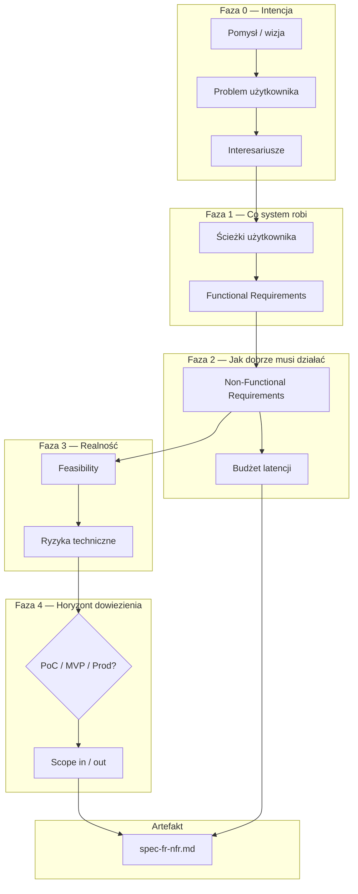
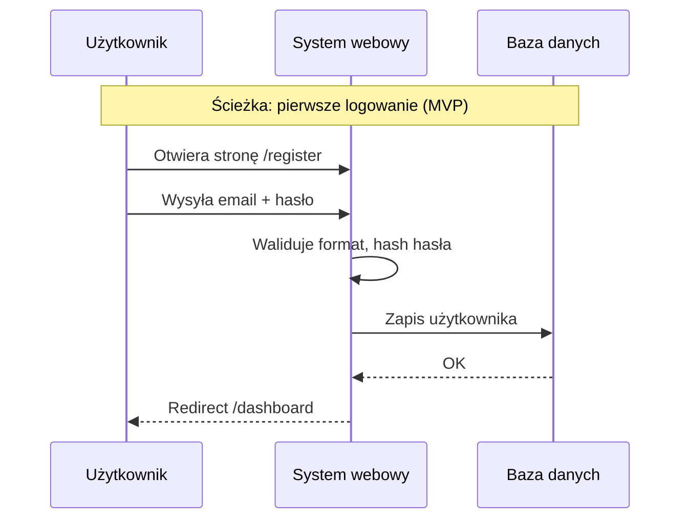
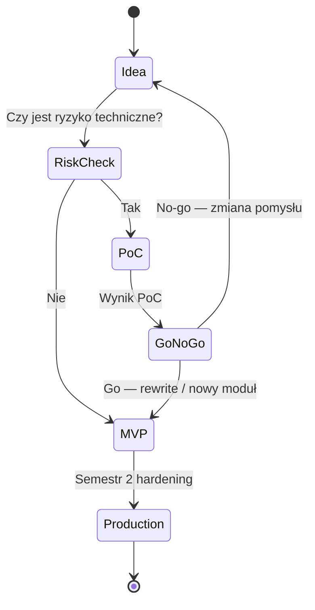

# Lekcja 1.1 — Od pomysłu do specyfikacji inżynierskiej

> **Cel lekcji:** Po przeczytaniu i wypełnieniu ćwiczeń potrafisz przekształcić luźny pomysł w dokument specyfikacji z FR, NFR, budżetem latencji i świadomą decyzją PoC/MVP/Production — zanim napiszesz pierwszą linię kodu.
> **Pakiet:** ta notatka + [[lesson-1.1-ideation-fr-nfr.canvas]] + szablony w `90_Meta/lessons/1.1/`
> **Następna lekcja po zaliczeniu Blackbox:** [[web-engineering-roadmap#1.2 — WBS, Metodyki i RACI|1.2 WBS / RACI]]

---

## Spis treści

1. [Mapa mentalna — jak elementy się łączą](#1-mapę-mentalna--jak-elementy-się-łączą)
2. [Faza 0: Pomysł i problem](#2-faza-0-pomysł-i-problem)
3. [Functional Requirements (FR)](#3-functional-requirements-fr)
4. [Non-Functional Requirements (NFR)](#4-non-functional-requirements-nfr)
5. [PoC, MVP, Production — osobno, potem porównanie](#5-poc-mvp-production--osobno-potem-porównanie)
6. [Feasibility — czy to da się zrobić w 2 semestry](#6-feasibility--czy-to-da-się-zrobić-w-2-semestry)
7. [Pod maską: latencja, dostępność, obciążenie](#7-pod-maską-latencja-dostępność-obciążenie)
8. [Ćwiczenie: wypełnij specyfikację](#8-ćwiczenie-wypełnij-specyfikację)
9. [Przykład kompletny (projekt uczelniany)](#9-przykład-kompletny-projekt-uczelniany)
10. [Jak używać kanwy i szablonów](#10-jak-używać-kanwy-i-szablonów)
11. [Blackbox — quiz weryfikacyjny](#11-blackbox--quiz-weryfikacyjny)
12. [Źródła](#12-źródła)

---

## 1. Mapa mentalna — jak elementy się łączą

Inżynierski start projektu webowego **nie zaczyna się od Reacta ani Postgresa**. Zaczyna się od odpowiedzi na pytanie: *jaki problem rozwiązujemy, dla kogo, na jakich warunkach jakościowych i w jakim horyzoncie dowiezienia*.

Poniższy przepływ to **logiczna kolejność pracy**, nie kolejność plików w repo:



### Co z czego wynika (reguły łączenia)

| Element | Odpowiada na | Źródło / wejście | Wpływa na |
|---|---|---|---|
| **Problem** | Dlaczego w ogóle budujemy system? | rozmowa z użytkownikiem, promotor, rynek | zakres FR (co musi być, żeby problem zniknął) |
| **FR** | Co system **robi**? | problem + ścieżki użytkownika | backlog, API, ekrany, testy akceptacyjne |
| **NFR** | **Jak dobrze** to robi? | oczekiwania UX, uczelnia, bezpieczeństwo | architektura, baza, CI, monitoring |
| **Feasibility** | Czy zespół/zasoby/czas wystarczą? | FR+NFR + skille zespołu | obcięcie scope, PoC przed MVP |
| **PoC/MVP/Prod** | Jaki **poziom dojrzałości** dowozimy kiedy? | feasibility + deadline semestru | jakość kodu, testy, security |
| **Latency budget** | Ile ms może „zjeść” każdy warstwa? | NFR wydajnościowe | wybór SSR/CSR, indeksy DB, cache |

**Typowy błąd:** skakanie od pomysłu do diagramu architektury. Architektura (lekcja 2.2) **powinna wynikać** z NFR i scope — nie odwrotnie.

---

## 2. Faza 0: Pomysł i problem

### 2.1. Pomysł ≠ produkt

**Pomysł** to zdanie typu: „Aplikacja do zarządzania projektami studenckimi z AI”.
**Problem** to: „Zespół 4 osób gubi decyzje architektoniczne w Discordzie i nie ma jednego miejsca prawdy przed oddaniem semestru”.

Bez problemu nie wiesz:
- kto jest użytkownikiem (student? promotor? obaj?),
- co jest MUST HAVE vs nice-to-have,
- jak zmierzysz sukces.

### 2.2. Szablon problem statement (wypełnij przed FR)

```markdown
## Problem Statement

**Użytkownik:** [konkretna rola, np. student 3 roku, zespół 4 osób]

**Kontekst:** [kiedy/gdzie ma ból, np. 2-semestralny projekt inżynierski]

**Ból:** [co jest frustrujące / kosztowne / ryzykowne dziś]

**Obecne obejście:** [Excel, WhatsApp, brak systemu — to też konkurencja]

**Sukces wygląda tak:** [mierzalny efekt, np. „promotor widzi ADR i demo bez instalacji”]
```

### 2.3. Interesariusze (kto wpływa na FR i NFR)

| Interesariusz | Typowo wpływa na | Przykład wymagania |
|---|---|---|
| **Użytkownik końcowy** | FR, UX NFR | „Mogę dodać zadanie w < 3 kliknięć” |
| **Promotor / uczelnia** | FR formalne, NFR docs | „Dokumentacja architektury w repo” |
| **Zespół dev** | Feasibility, scope | „Jeden stack: TS + Postgres” |
| **Operator (Ty na demo)** | NFR ops | „Deploy jednym kliknięciem z CI” |

Każdy FR powinien dać się przypisać do **co najmniej jednego** interesariusza. Osierocone FR („bo fajnie”) to sygnał scope creep.

---

## 3. Functional Requirements (FR)

### 3.1. Definicja

**Functional Requirement (FR)** opisuje **zachowanie systemu** — funkcję, którą system musi wykonać, widoczną z perspektywy użytkownika lub integracji.

- **Dobry FR:** testowalny, jednoznaczny, bez technologii (na tym etapie).
- **Zły FR:** „System będzie szybki” — to NFR, nie FR.
- **Zły FR:** „Użyjemy Reacta” — to decyzja techniczna (ADR), nie FR.

### 3.2. Format FR (ID + priorytet + kryterium akceptacji)

```markdown
### FR-001: Rejestracja użytkownika
- **Priorytet:** MUST (MVP)
- **Opis:** Użytkownik tworzy konto podając email i hasło.
- **Kryterium akceptacji:**
  - Po poprawnej rejestracji użytkownik widzi dashboard.
  - Email duplikat → komunikat błędu bez ujawniania czy konto istnieje.
- **Interesariusz:** student (użytkownik)
```

**Priorytety (MoSCoW — używaj konsekwentnie):**

| Priorytet | Znaczenie | W 2 semestrach |
|---|---|---|
| **MUST** | Bez tego produkt nie ma sensu | Semestr 1 — rdzeń MVP |
| **SHOULD** | Ważne, ale można przesunąć | Semestr 1 koniec / S2 start |
| **COULD** | Miło mieć | Semestr 2 jeśli zostanie czas |
| **WON'T** | Świadomie nie robimy | Zapisane — chroni przed scope creep |

### 3.3. Od FR do ścieżek użytkownika (User Journey)

FR nie powstają z powietrza — wyciągasz je ze **ścieżek**:



Każdy krok sekwencji → potencjalny FR lub pod-FR.
Kroki „Waliduje”, „Hash” → później NFR bezpieczeństwa + implementacja (lekcja 3.3, 5.1).

### 3.4. Granice systemu (Scope In / Out)

Przy każdym FR warto dopisać **Out of Scope** — co **świadomie nie** robimy w tym horyzoncie:

```markdown
### Out of Scope (MVP)
- Logowanie OAuth Google (WON'T w S1 — tylko email/hasło)
- Aplikacja mobilna natywna (WON'T — tylko PWA/responsive web)
- Płatności (WON'T)
```

To łączy się z lekcją 1.2 (WBS): WON'T nie trafia na tablicę zadań.

---

## 4. Non-Functional Requirements (NFR)

### 4.1. Definicja

**NFR** opisuje **jakość** działania systemu — wydajność, bezpieczeństwo, dostępność, skalowalność, utrzymywalność, zgodność prawną.

FR mówi: „Użytkownik widzi listę zamówień”.
NFR mówi: „Lista ładuje się w ≤ 300 ms (p95) przy 50 równoczesnych użytkownikach na demo”.

> [!IMPORTANT]
> **Częsty błąd: Mylenie NFR z walidacją i regułami biznesowymi**
> - **Walidacja / Reguła biznesowa:** „Pole ilość musi być liczbą całkowitą `Integer >= 1` i mieć przycisk +1” → to jest **opis interfejsu i reguła biznesowa FR** (Co system robi / przyjmuje).
> - **NFR:** „Formularz waliduje i zwraca odpowiedź w czas p95 ≤ 150 ms, a dane są przesyłane wyłącznie szyfrowanym kanałem HTTPS (TLS 1.3)” → to jest **NFR** (Jak dobrze system to robi).

### 4.2. Kategorie NFR (checklist)

| Kategoria | Przykładowe NFR | Kiedy dotyczy projektu uczelnianiego |
|---|---|---|
| **Wydajność** | p95 API < 200 ms; LCP < 2.5 s | Zawsze — promotor zauważy „mulenie” |
| **Dostępność (Availability)** | 99% w oknie demo (nie 99.99% jak bank) | MVP: umiarkowane; S2: backup |
| **Bezpieczeństwo** | Hasła Argon2/bcrypt; HTTPS; OWASP checklist | MUST od pierwszego logowania |
| **Skalowalność** | 100 użytkowników równolegle | Realistyczne dla uczelni |
| **Utrzymywalność** | Testy CI; ADR; docs w repo | MUST od S1 tygodnia 3+ |
| **Użyteczność / a11y** | WCAG 2.2 AA dla kluczowych ekranów | SHOULD w S2 |
| **Zgodność** | RODO — minimalny zakres danych | Jeśli dane osobowe |

### 4.3. Format NFR (mierzalny)

```markdown
### NFR-PERF-001: Czas odpowiedzi listy zamówień
- **Kategoria:** Wydajność
- **Metryka:** Latencja endpointu GET /api/orders
- **Cel:** p95 ≤ 300 ms przy 50 RPS (symulacja k6)
- **Pomiar:** Middleware logujący czas + test obciążeniowy przed demo
- **Powiązane FR:** FR-012 (lista zamówień)
```

**Reguła SMART dla NFR:** Specific, Measurable, Achievable, Relevant, Time-bound (deadline semestru).

### 4.4. Powiązanie FR ↔ NFR (macierz traceability)

| FR | NFR | Dlaczego powiązane |
|---|---|---|
| FR-012 Lista zamówień | NFR-PERF-001 p95 ≤ 300 ms | Użytkownik oczekuje szybkiej listy |
| FR-012 Lista zamówień | NFR-SEC-003 tylko własne zamówienia | IDOR — cudze zamówienia to bug security |
| FR-001 Rejestracja | NFR-SEC-001 hash Argon2id | Hasła w plaintext = dyskwalifikacja na review |

Macierz traceability wklejasz do `spec-fr-nfr.md` — promotor i Ty widzicie, że każde FR ma „jakość”.

---

## 5. PoC, MVP, Production — osobno, potem porównanie

### 5.1. Proof of Concept (PoC)

**Po co:** zdejmujesz **jedną** techniczną niewiadomą zanim zbudujesz cały produkt.

**Przykłady PoC w projekcie webowym:**
- Czy zewnętrzne API X pozwala na 100 req/min z waszego IP?
- Czy algorytm layoutu diagramu działa płynnie na 500 węzłach w React Flow?
- Czy PostgreSQL pgvector wystarczy na wasz przypadek wyszukiwania?

**Cechy PoC:**
- Kod **jednorazowy** (throwaway) — może być brzydki.
- Brak testów, brak UI produkcyjnego.
- Czas: **1–2 tygodnie max** w ramach semestru.
- Wynik: notatka „działa / nie działa / warunki” + decyzja go/no-go.

**PoC ≠ MVP.** PoC nie trafia do promotora jako „gotowa aplikacja”.

### 5.2. Minimum Viable Product (MVP)

**Po co:** najmniejszy zestaw **FR MUST**, który pozwala **użytkownikowi** zweryfikować wartość.

**Cechy MVP (projekt 2-semestralny — Semestr 1):**
- FR MUST zrealizowane end-to-end (frontend → backend → DB).
- NFR **świadomie okrojone:** np. brak multi-region HA, prosty deploy, rzadszy backup.
- Kod **refaktorowalny** — to fundament na Semestr 2, ale nie „production bank grade”.
- Demo dla promotora: jedna ścieżka „happy path” + obsługa głównych błędów.

> [!WARNING]
> **Świadome okrajanie NFR vs Bezpieczeństwo:**
> - **Co MOŻNA okroić w NFR MVP:** High Availability (zamiast 99.99% wystarczy 99%), czas latencji (np. p95 ≤ 800 ms zamiast 200 ms), brak automatycznego auto-scalingu, ręczny backup zamiast ciągłego point-in-time recovery, ograniczone wsparcie dla accessibility (a11y).
> - **Czego BEZWARUNKOWO NIE WOLNO okroić (Security Baseline):** Bezpieczny hash haseł (Argon2id/bcrypt), autoryzacja (Authz - ochrona przed IDOR), szyfrowanie w locie (HTTPS/TLS) oraz ochrona przed prostym SQL Injection / XSS. Złamanie tego baseline-u tworzy krytyczny dług technologiczny.
> - **Nie myl okrajania NFR z okrajaniem FR!** Rezygnacja z dodatkowych funkcji (np. ulubione, prognoza pogody) to obcinanie zakresem **FR (Scope OUT)**, a nie zmiana NFR.

**MVP ma odpowiadać:** „Czy użytkownik **chce** z tego korzystać?” — nie „czy algorytm istnieje?” (to PoC).

### 5.3. Production-Ready

**Po co:** system przetrwa **obciążenie, ataki i czas** — nie tylko jedno demo.

**Cechy (cel Semestr 2 / koniec projektu):**
- Pełna lista FR MUST + większość SHOULD.
- NFR: security checklist (lekcja 5.1), CI/CD (7.1), logi/trace (7.2), backup DB.
- Testy automatyczne blokujące merge.
- Dokumentacja ADR (8.1).

**Production-Ready ≠ „idealny”** — to **świadomy komplet** kontroli jakości na waszą skalę.

### 5.4. Analiza porównawcza (Vs)

| Kryterium                  | PoC                             | MVP                               | Production-Ready                                |
| -------------------------- | ------------------------------- | --------------------------------- | ----------------------------------------------- |
| **Pytanie walidacyjne**    | Czy da się technicznie?         | Czy użytkownik chce?              | Czy przeżyje ruch i ataki?                      |
| **Odbiorca wyniku**        | Zespół dev                      | Użytkownik + promotor             | Operator + promotor + (ewentualnie) użytkownicy |
| **Jakość kodu**            | Throwaway OK                    | Refaktorowalny                    | Testy, review, CI                               |
| **NFR**                    | Pominiete lub 1 metryka         | Częściowe (perf + basic security) | Pełny zestaw na skalę projektu                  |
| **Typowy czas (uczelnia)** | 1–2 tygodnie                    | 4–8 tygodni (S1)                  | Cały S2 + domknięcie S1                         |
| **Antypattern**            | PoC jako kod bazowy bez rewrite | MVP bez NFR security              | „Production” bez testów i backupu               |

### 5.5. Werdykt — kiedy co wybrać

| Sytuacja | Decyzja |
|---|---|
| Nieznane API / algorytm / limity licencyjne | **PoC najpierw** (1–2 tyg.), potem MVP od zera lub rewrite |
| Znany stack, jasny problem użytkownika | **Od razu MVP** (bez PoC) |
| Koniec Semestru 1 | **MVP demo** + lista NFR na S2 |
| Koniec Semestru 2 | **Production-Ready checklist** spełniona w stopniu uzgodnionym z promotorem |
| **Unikać** | Wgranie kodu PoC na serwer demo jako „produkt” → **Prototype in Production** |



---

## 6. Feasibility — czy to da się zrobić w 2 semestry

### 6.1. Trzy filary feasibility

1. **Techniczna:** czy zespół zna stack lub nauczy się w czasie (realnie: 1–2 nowe technologie max naraz).
2. **Czasowa:** suma effort FR MUST ≤ dostępne osobogodziny − 20% bufor.
3. **Organizacyjna:** czy promotor akceptuje scope (web vs desktop, liczba integracji).

### 6.2. Szybka kalkulacja czasu (osobodni)

```
Dostępne = liczba_osób × tygodni × dni_tyg × godzin_dziennie × współczynnik_skupienia
         np. 4 × 15 × 3 × 3h × 0.7 ≈ 378 h ≈ 47 osobodni (Semestr 1)

FR MUST = suma estymacji zadań (po lekcji 1.2 WBS)
Jeśli FR MUST > 80% dostępnego czasu → obetnij SHOULD/WON'T lub uprość FR
```

### 6.3. Sygnały „scope za duży”

- Więcej niż **3 główne moduły domenowe** w MVP (np. chat + płatności + CRM + AI).
- Wymóg **realtime + mobile native + offline** w jednym MVP.
- Integracja z **>2 zewnętrznymi API** bez PoC każdego.

**Remedium:** przenieś moduły do SHOULD/WON'T; jeden moduł = jeden vertical slice (lekcja 8.3).

---

## 7. Pod maską: latencja, dostępność, obciążenie

NFR wydajnościowe muszą być **mierzalne**. Poniżej mechanika, która stoi za liczbami w specyfikacji.

### 7.1. Percentyle latencji (p50, p95, p99)

Załóżmy 1000 requestów do `GET /api/orders` z czasami (ms): posortuj je rosnąco od najszybszego do najwolniejszego.

| Percentyl | Nazwa / Pojęcie | Intuicja i zastosowanie |
|---|---|---|
| **p50** | **Mediana** | 50% requestów jest szybszych niż ta wartość. Pokazuje odczucie „średniego” (typowe ścieżki) użytkownika. |
| **p95** | **Budżet UX** | 95% requestów jest szybszych niż ta wartość. To **główny wskaźnik jakościowy (SLO)** w systemach webowych — mierzy wrażenia większości bez wliczania 5% skrajnych piko-awarii. |
| **p99** | **Ogon (Tail Latency)** | 99% requestów szybszych, 1% wolniejszych. Mierzy stan skrajny/najgorszy — zatrzymanie Garbage Collectora (GC spike), cold start funkcji serverless, zacięcie na blokadzie bazy danych. |

> [!NOTE]
> **Dlaczego średnia (AVG / Mean) całkowicie kłamie w sieci:**
> Dystrybucja czasów odpowiedzi w sieci **nie jest liniowa (brak rozkładu normalnego)**.
> - Wyobraź sobie 990 zapytań trwających **50 ms** i 10 zapytań zacinających się na **5000 ms**.
> - **Średnia (AVG):** `(990*50 + 10*5000) / 1000 = 99.5 ms` (wygląda dobrze, ale ukrywa fakt, że niektórzy czekają 5 sekund!).
> - **Inny przypadek:** Dużo wolnych zapytań i kilka wyjątkowo szybkich zagnieżdżonych w cache zaniży średnią.
> - **Mediana (p50):** 50 ms. **p95:** 50 ms. **p99:** 5000 ms.
> Domyślnie budżet NFR piszemy dla **p95** (gwarancja jakości UX) oraz kontrolujemy **p99** (wykrywanie anomali architektonicznych).

**Jak zbierać (później w kodzie):** middleware z timerem + histogram (Prometheus, OpenTelemetry) lub log JSON z polem `duration_ms` i agregacja offline.

### 7.2. Latency budget (suma warstw)

**Latency budget** to tabela: endpoint → ile ms może zużyć każda warstwa, żeby zmieścić się w NFR.

Przykład dla NFR: **p95 ≤ 300 ms** na `GET /api/orders`:

| Warstwa | Budżet (ms) | Co tu się dzieje |
|---|---|---|
| Sieć (client ↔ CDN/proxy) | 30 | TLS, DNS, RTT |
| Backend (auth + handler) | 80 | JWT verify, mapowanie DTO |
| ORM + SQL | 120 | query + mapowanie rows |
| Serializacja JSON | 20 | stringify |
| Bufor / margines | 50 | kolejka, GC spike |
| **Suma** | **300** | musi ≤ NFR |

Jeśli EXPLAIN ANALYZE pokazuje 400 ms samego SQL (lekcja 4.1) — **NFR jest złamane** bez indeksu lub zmiany zapytania, nieważne jak szybki jest React.

### 7.3. RPS (Requests Per Second)

Szacunek obciążenia na demo / obronę:

```
RPS ≈ (użytkownicy_aktywni × akcje_na_minutę) / 60

Przykład: 50 użytkowników demo, 6 akcji/min (klik, scroll, refresh)
RPS ≈ (50 × 6) / 60 = 5 RPS średnio, piki ×3–5 → planuj 15–25 RPS
```

To wpływa na NFR skalowalności i decyzję o cache (lekcja 4.2).

### 7.4. Dostępność (Availability)

```
Availability = MTBF / (MTBF + MTTR)

MTBF = Mean Time Between Failures (średni czas między awariami)
MTTR = Mean Time To Repair (średni czas naprawy)
```

**Przykład:** awaria co 30 dni (MTBF), naprawa 2 h (MTTR):

```
A = 30×24 / (30×24 + 2) ≈ 99.86%
```

Dla projektu uczelnianego **99% w oknie demo** (kilka godzin) często wystarczy — oznacza to plan: backup DB, healthcheck, prosty rollback (lekcja 7.3).

### 7.5. SLO vs SLA

| Termin | Znaczenie | W projekcie uczelnianym |
|---|---|---|
| **SLO** (Service Level Objective) | Wewnętrzny cel zespołu, np. p95 < 300 ms | Zapisujesz w spec-fr-nfr.md |
| **SLA** (Service Level Agreement) | Umowa z klientem z karami | Rzadko — chyba że projekt komercyjny |

Promotorowi pokazujesz **SLO** i jak je mierzysz (Lighthouse, k6, logi).

---

## 8. Ćwiczenie: wypełnij specyfikację

### Krok po kroku (90–120 min)

1. **15 min** — Problem statement (sekcja 2.2).
2. **25 min** — Lista FR (min. 8: 5 MUST, 2 SHOULD, 1 WON'T) + Out of Scope.
3. **20 min** — NFR (min. 5: perf, security, 1 inna kategoria) — wszystkie mierzalne.
4. **15 min** — Macierz FR↔NFR.
5. **10 min** — Decyzja PoC/MVP/Prod + uzasadnienie 3 zdaniami.
6. **15 min** — Latency budget dla 2 kluczowych endpointów ([[latency-budget-template]]).
7. **10 min** — Feasibility: czy FR MUST mieści się w ~47 osobodniach S1?

**Pliki do wypełnienia:**
- [[spec-fr-nfr-template]] — główny dokument specyfikacji
- [[latency-budget-template]] — budżety ms per warstwa

Po wypełnieniu: zapisz jako `00_Inbox/_proposals/spec-<nazwa-projektu>.md` lub trzymaj w `90_Meta/lessons/1.1/` do review.

---

## 9. Przykład kompletny (projekt uczelniany)

Pełny wzorcowy case: [[worked-example-student-project]] — system **„VaultCollab”** (zarządzanie projektem zespołowym + ADR + demo).

Skrót logiczny:

| Etap | Decyzja w przykładzie |
|---|---|
| Problem | Zespół gubi decyzje i nie ma jednego demo deploy |
| FR MUST | Auth, projekty, zadania, ADR markdown, publiczny link demo |
| NFR | p95 API 300 ms; HTTPS; OWASP baseline; docs w repo |
| PoC | Nie — stack znany (TS+Postgres+React) |
| MVP | Koniec S1: auth + projekty + 1 ADR + deploy |
| Production | S2: testy CI, rate limit, backup, a11y podstawowa |

---

## 10. Jak używać kanwy i szablonów

### 10.1. Obsidian Canvas

Otwórz: **`90_Meta/canvases/lesson-1.1-ideation-fr-nfr.canvas`**

Kanwa ma **7 stref** (od lewej do prawej = od pomysłu do artefaktu):

1. **Pomysł / Problem** — start dyskusji zespołu
2. **Interesariusze** — kto wpływa na wymagania
3. **FR** — co budujemy
4. **NFR** — jak dobrze
5. **Feasibility / PoC-MVP-Prod** — decyzje horyzontu
6. **Latency budget** — liczby ms
7. **spec-fr-nfr.md** — output do repo

**Ćwiczenie na kanwie:** duplikuj węzeł tekstowy „Twój projekt” i wypełnij każdą strefę sticky-note style w Obsidianie (edycja węzła text).

### 10.2. Szablony Markdown

| Plik | Kiedy używać |
|---|---|
| [[spec-fr-nfr-template]] | Główny deliverable lekcji — wersjonuj w repo od tygodnia 1 |
| [[latency-budget-template]] | Gdy masz NFR-PERF — uzupełnij przed lekcją 2.1 (rendering) i 4.1 (SQL) |
| [[worked-example-student-project]] | Reference gdy utkniesz — nie kopiuj 1:1 |

### 10.3. Powiązanie z dalszymi lekcjami

| Element z 1.1 | Użyjesz w lekcji |
|---|---|
| FR MUST | 1.2 WBS — dekompozycja zadań |
| NFR security | 3.3 Auth, 5.1 OWASP |
| NFR perf / latency budget | 2.1 Rendering, 4.1 Postgres, 7.2 CWV |
| PoC/MVP decyzja | 8.3 harmonogram 2 semestrów |
| spec-fr-nfr.md | 8.1 Docs-as-Code, ADR odnoszą się do FR/NFR |

---

## 11. Blackbox — quiz weryfikacyjny

Po przeczytaniu lekcji i wypełnieniu szablonu (choćby draft) odpowiedz **własnymi słowami** na 4 pytania. Próg zaliczenia: **≥3/4** zgodnie z rubryką.

### Pytania

1. **Podaj przykład FR i odpowiadającego NFR dla funkcji „lista zamówień”.**
   *Rubryka zaliczenia:* FR opisuje zachowanie (co widzi/robi użytkownik); NFR jest mierzalny (ms, %, RPS); nie mylisz FR z technologią.

3. **Dlaczego kod PoC nie powinien iść na produkcję (demo promotora jako „gotowiec”) bez rewrite?**
   *Rubryka:* wymieniasz throwaway quality, brak testów/security, antypattern Prototype in Production; PoC waliduje ryzyko, nie produkt.

4. **Jak obliczysz p95 latency i po co osobno p99?**
   *Rubryka:* sortowanie próbek / histogram; p95 = budżet UX; p99 = ogon (GC, cold start); średnia jest niewystarczająca — wyjaśniasz dlaczego.

5. **Kiedy świadomie obniżysz NFR w MVP? Podaj 2 przykłady NFR okrojonych i 1 którego NIE okroisz.**
   *Rubryka:* obniżasz HA/multi-region/a11y pełne; **nie** obniżasz baseline security (hash haseł, HTTPS, authz).

### Po zaliczeniu

1. Przenieś spec do `00_Inbox/_proposals/concept-project-initiation-fr-nfr.md` (propozycja do `50_Concepts/`).
2. Oznacz w [[web-engineering-roadmap]] postęp: lekcja 1.1 ✓.
3. Przejdź do lekcji **1.2**.

---

## 12. Źródła

| Źródło | Co wyciągnięto |
|---|---|
| [Google SRE Book — SLIs, SLOs, SLAs](https://sre.google/sre-book/service-level-objectives/) | Percentyle, SLO vs SLA, error budget mindset |
| [roadmap.sh/full-stack](https://roadmap.sh/full-stack) | Kolejność: fundamenty przed frameworkiem — spec przed kodem |
| IEEE / SWEBOK (Requirements) | FR vs NFR, traceability (koncepcje) |
| [[web-engineering-roadmap#1.1]] | Szkielet lekcji masterclass v3 |
| Scrimba / Bytepane curricula 2026 | Fazowanie projektów przed stackiem |

---

*Lekcja 1.1 — Masterclass Inżynierii Webowej · Vaultie · 2026-08-07*
