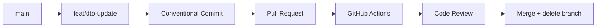

# Lekcja 1.3 — Repozytorium, Monorepo i Git Workflow

> **Cel lekcji:** Po tej notatce i labie potrafisz wybrać strukturę repozytorium (Monorepo vs Polyrepo) dla zespołu 3–5 osób, skonfigurować deterministyczny build z lockfile, ustawić lokalne hooki jakości (Husky + Conventional Commits) oraz zaprojektować nieobejrzalną bramkę CI — i wytłumaczyć, czemu hook lokalny ≠ CI.
> **Pakiet dydaktyczny:** ta notatka + [[lesson-1.3-repo-monorepo.canvas]] + lab `labs/web-engineering/1.3/`
> **Wymagania wstępne:** [[1.2/1.2-wbs-raci|Lekcja 1.2 — WBS, Metodyki i RACI]].
> **Następna lekcja po zaliczeniu Blackbox:** [[web-engineering-roadmap#1.4 — Definition of Done i Code Review|1.4 DoD & Code Review]]

---

## Spis treści

1. [Wprowadzenie i modele mentalne](#1-wprowadzenie-i-modele-mentalne)
2. [Monorepo vs Polyrepo](#2-monorepo-vs-polyrepo)
3. [Strategie gałęzi](#3-strategie-gałęzi)
4. [Git Submodules w architekturze Vaultie](#4-git-submodules-w-architekturze-vaultie)
5. [Lockfile i reprodukowalność builda](#5-lockfile-i-reprodukowalność-builda)
6. [Husky lokalnie vs CI na serwerze](#6-husky-lokalnie-vs-ci-na-serwerze)
7. [Kod / Lab 1.3 — worked example monorepo](#7-kod--lab-13--worked-example-monorepo)
8. [Typowe błędne przekonania (Misconceptions)](#8-typowe-błędne-przekonania-misconceptions)
9. [Chain of Action — procedura postępowania](#9-chain-of-action--procedura-postępowania)
10. [Ćwiczenie samodzielne (Lab DoD)](#10-ćwiczenie-samodzielne-lab-dod)
11. [Transfer wiedzy w nowym kontekście](#11-transfer-wiedzy-w-nowym-kontekście)
12. [Blackbox Quiz V1.3](#12-blackbox-quiz-v13)
13. [Kiedy NIE stosować monorepo / pełnego CI](#13-kiedy-nie-stosować-monorepo--pełnego-ci)
14. [Powiązane notatki i źródła](#14-powiązane-notatki-i-źródła)

---

## 1. Wprowadzenie i modele mentalne

Po WBS i RACI (1.2) zespół wie *co* budować i *kto* odpowiada. Lekcja 1.3 odpowiada na pytanie: *gdzie* trzymamy kod i *jak* bezpiecznie wprowadzamy zmiany bez **Piekła Wersjonowania Shared-Types (Multi-PR Hell)** oraz chronicznych konfliktów merge.

### Model mentalny 1: Monorepo jako jeden graf zależności (`monorepo_single_graph`)

> **Zasada:** Monorepo to nie folder z trzema niepowiązanymi projektami. To **jeden spójny graf zależności** zarządzany przez menedżer pakietów (pnpm workspaces, Turborepo, Nx), w którym zmiana interfejsu DTO w `packages/shared` i jej użycia w `apps/web` może trafić do `main` w **jednym atomowym commicie**.

### Model mentalny 2: Lockfile jako kontrakt wersji (`lockfile_truth_contract`)

> **Zasada:** Plik `pnpm-lock.yaml` (lub `package-lock.json`) to **nienaruszalny kontrakt wersji**. Komenda `pnpm install --frozen-lockfile` / `npm ci` instaluje dokładnie te same wersje co na maszynie kolegi i w CI. Brak lockfile w repo = build „u mnie działa”, u promotora nie.

### Model mentalny 3: Krótkie gałęzie, nie długie (`trunk_over_long_branches`)

> **Zasada:** Gałąź feature żyjąca 3 tygodnie bez merge do `main` kumuluje konflikty. **Feature Branch + PR** z życiem gałęzi ≤ 1–2 dni i mindsetem trunk-based (częste scalenia) redukuje Merge Hell. GitFlow z długożyjącym `develop` to narzut dla małego zespołu.

### Model mentalny 4: Hooki lokalne są doradcze (`local_hooks_are_advisory`)

> **Zasada:** Husky `pre-commit` poprawia Developer Experience (szybki lint na staged files), ale deweloper może je pominąć: `git commit --no-verify`. **Jedyna nieobejrzalna bramka** to potok CI na Pull Requeście w czystym kontenerze.

---

## 2. Monorepo vs Polyrepo

### 2.1 Polyrepo — wiele repozytoriów

Każdy moduł (`frontend`, `backend`, `shared-dto`) ma osobne repo Git.

- **Plus:** twarda izolacja dostępu, prostszy CI per repo.
- **Minus przy 3–5 osobach:** zmiana pola w shared DTO wymaga synchronizacji wersji paczki npm **albo** otwarcia 2–3 PR w różnych repozytoriach w tym samym czasie (*Multi-PR Hell*).

### 2.2 Monorepo — workspaces + atomowe commity

Struktura referencyjna (lab 1.3):

```text
project-root/
├── pnpm-workspace.yaml
├── package.json
├── pnpm-lock.yaml          # MUST commit
├── apps/
│   └── web/                # aplikacja kliencka
└── packages/
    └── shared/             # DTO / typy współdzielone
```

Zmiana `createUserDto` w `packages/shared` jest natychmiast widoczna w `apps/web` przez zależność `workspace:*` — bez publikacji do npm.

### Analiza Vs

| Kryterium | Monorepo | Polyrepo |
|---|---|---|
| Atomowe zmiany FE+BE / DTO | **Tak** — jeden PR | Trudne — multi-PR lub wersjonowanie paczki |
| Złożoność CI | Graf zależności (affected builds) | Prostsze per repo, trudniejsze e2e |
| Onboarding | Jeden `git clone` | Wiele clone + instrukcja sync |
| Zespół 2-sem., 3–5 osób | **Preferowany default** | Tylko przy twardym wymogu organizacji |

**Werdykt uczelniany:** Monorepo (pnpm workspaces) + Feature Branch + PR. Polyrepo tylko gdy dział IT wymusza osobne repozytoria **i** macie proces wersjonowania shared-types.

---

## 3. Strategie gałęzi

### 3.1 GitFlow

Gałęzie `main`, `develop`, `feature/*`, `release/*`, `hotfix/*`. Długożyjące gałęzie → częste konflikty merge, duży narzut ceremonii. **Nie** jest defaultem dla małego zespołu studenckiego.

### 3.2 Trunk-Based Development (TBD)

Krótkie gałęzie (≤ 24 h) lub bezpośrednie commity do `main`. Wymaga **feature flags** dla niedokończonych funkcji na produkcji.

### 3.3 Feature Branch + PR (default uczelniany)



### Analiza Vs — strategie gałęzi

| Kryterium | GitFlow | Trunk-Based | Feature Branch + PR |
|---|---|---|---|
| Konflikty merge | Częste | Rzadkie | Umiarkowane |
| Feature flags | Opcjonalne | **Wymagane** przy TBD | Pomocne |
| Projekt 2-sem. | Raczej nie | Idealny z flagami | **Default uczelniany** |

---

## 4. Git Submodules w architekturze Vaultie

Laboratorium kodu może być **osobnym repozytorium Git** osadzonym w vaultcie:

```bash
git submodule add https://github.com/org/vault-collab-lab.git labs/web-engineering/1.3/project
```

**Po co:** agent AI ma jednocześnie dostęp do notatek (`10_`–`50_`) i do kodu w `labs/`, a zespół zachowuje niezależną historię commitów i własny CI projektu.

**Uwaga:** submoduły wymagają świadomego `git submodule update --init` po klonowaniu vaulta — to koszt operacyjny, nie magiczna synchronizacja.

---

## 5. Lockfile i reprodukowalność builda

Lockfile rejestruje **dokładne wersje** (hash SHA) każdej zależności transytywnej.

| Komenda | Zachowanie | Gdzie |
|---|---|---|
| `pnpm install` | Może zaktualizować lockfile | Lokalnie po zmianie `package.json` |
| `pnpm install --frozen-lockfile` | **Nie** modyfikuje lockfile; FAIL jeśli niezgodność | **CI** |
| `npm ci` | Analog dla npm | CI |

**Dlaczego lockfile NIE trafia do `.gitignore`:** bez niego CI instaluje inne wersje niż deweloper — regresja „działało wczoraj”.

---

## 6. Husky lokalnie vs CI na serwerze

### 6.1 Lokalnie (Husky)

| Hook | Rola w lab 1.3 | Czas |
|---|---|---|
| `pre-commit` | `pnpm install --frozen-lockfile` + lint + test + build (szybki feedback) | sekundy–minuty |
| `commit-msg` | Walidacja Conventional Commits (`feat:`, `fix:`, …) | ms |

### 6.2 CI (GitHub Actions)

Potok w `labs/web-engineering/1.3/.github/workflows/ci.yml` uruchamia te same kroki w **czystym kontenerze Ubuntu** — bez możliwości `--no-verify`.

```yaml
# fragment — pełny plik w labie
- run: pnpm install --frozen-lockfile
- run: pnpm run lint
- run: pnpm run test
- run: pnpm run build
```

**Podział odpowiedzialności:**

| Kontrola | pre-commit | CI |
|---|---|---|
| Lint / format na staged | Tak | Tak (cały repo) |
| Testy jednostkowe | Tak (lab) | **Tak** |
| Testy e2e / security scan | Nie (za wolne) | **Tak** (docelowo) |
| Obejście `--no-verify` | Możliwe | **Niemożliwe** |

---

## 7. Kod / Lab 1.3 — worked example monorepo

Pełny scaffold: [`labs/web-engineering/1.3/`](../../labs/web-engineering/1.3/README.md)

**Dlaczego taka struktura:** `packages/shared` izoluje kontrakt DTO; `apps/web` konsumuje go przez `workspace:*` — symuluje realny FE bez publikacji paczki. Root `package.json` agreguje skrypty `lint`, `test`, `build` dla całego grafu.

**Weryfikacja atomowej zmiany DTO (krok po kroku):**

1. Edytuj `packages/shared/index.js` — dodaj pole `displayName`.
2. Użyj go w `apps/web/index.mjs`.
3. Uruchom `pnpm run build` z roota — oba pakiety budują się w jednym workspace.
4. Jeden commit: `feat: extend UserDto with displayName`.

**Kanwa:** [[lesson-1.3-repo-monorepo.canvas]] — przepływ branch → PR → CI.

---

## 8. Typowe błędne przekonania (Misconceptions)

> [!CAUTION]
> 1. **„Monorepo = wrzucenie kilku projektów do jednego folderu.”**  
>    *Fakt:* Bez workspaces i wspólnego grafu to tylko zły układ plików. Prawdziwe monorepo wymusza spójność typów przez menedżer pakietów.
>
> 2. **„Lockfile do .gitignore — każdy ma mieć najnowsze paczki.”**  
>    *Fakt:* Niszczy reprodukowalność. CI i produkcja muszą instalować identyczne drzewo zależności.
>
> 3. **„GitFlow to jedyny profesjonalny standard.”**  
>    *Fakt:* W zespole 3–5 osób generuje Merge Hell. Feature Branch + PR z krótkim życiem gałęzi jest praktyczniejszy.
>
> 4. **„Husky wystarczy — CI to duplikacja.”**  
>    *Fakt:* `--no-verify` omija hooki. CI jest autorytatywną bramką przed merge do `main`.

---

## 9. Chain of Action — procedura postępowania

| Sytuacja / objaw | Decyzja | Narzędzie | Dlaczego |
|---|---|---|---|
| Zmiana DTO wymaga FE + BE w tym samym tygodniu | Monorepo + jeden PR | pnpm workspaces, `packages/shared` | Atomowy commit; brak multi-PR |
| Różne wersje bibliotek u devów i w CI | Commit lockfile + `--frozen-lockfile` w CI | `pnpm-lock.yaml` | Determinizm builda |
| Bałagan w historii commitów | Enforce Conventional Commits | Husky `commit-msg` | Czytelny changelog, łatwy bisect |
| Dev omija pre-commit (`--no-verify`) | Twarda bramka na PR | GitHub Actions `ci.yml` | Nieobejrzalna weryfikacja |
| Projekt kodu ma własne repo, notatki w vaultcie | Submodule w `labs/` | `git submodule add` | Rozdzielenie historii Git |

---

## 10. Ćwiczenie samodzielne (Lab DoD)

W katalogu `labs/web-engineering/1.3/` wykonaj checklistę:

- [ ] `pnpm install --frozen-lockfile` kończy się bez błędu
- [ ] `pnpm run lint && pnpm run test && pnpm run build` — PASS
- [ ] Zmiana w `packages/shared` widoczna w `apps/web` bez `npm publish`
- [ ] Commit z niepoprawnym message (np. `quick fix`) — odrzucony przez `commit-msg` hook
- [ ] Commit poprawny: `feat: add lab verification step`
- [ ] Przeanalizuj `ci.yml`: które kroki są sekwencyjne, a które mogłyby być równoległe w większym monorepo (hint: tutaj jeden job `verify`)

Szczegóły: [`labs/web-engineering/1.3/README.md`](../../labs/web-engineering/1.3/README.md)

---

## 11. Transfer wiedzy w nowym kontekście

**Scenariusz:** Zespół 4-osobowy buduje aplikację do zarządzania inventory w magazynie. Backend (FastAPI) i frontend (React) mają wspólny model `InventoryItem`. Product Owner zmienia pole `sku` na wymagane.

**Zadanie transferowe (bez kopiowania przykładu UserDto):**

1. Uzasadnij Monorepo vs Polyrepo dla tego zespołu (max 5 zdań, odwołaj się do atomowości zmiany).
2. Napisz plan gałęzi: nazwa brancha, szacowany czas życia, kto robi review.
3. Wymień **dwie** kontrole tylko w CI (nie w pre-commit) i uzasadnij czas wykonania.
4. Opisz, co stanie się w CI, jeśli ktoś usunie `pnpm-lock.yaml` z repo, ale zostawi `package.json`.

---

## 12. Blackbox Quiz V1.3

Odpowiedz **własnymi słowami**, bez spoglądania do notatki.

1. **Po co lockfile w CI i czym różni się `pnpm install --frozen-lockfile` od zwykłego `pnpm install`?**
2. **Dlaczego polyrepo „boli” przy zmianie shared DTO między frontendem a backendem?**
3. **Czym trunk-based development różni się od GitFlow w praktyce merge (nie definicja z podręcznika)?**
4. **Co powinno być w `pre-commit`, a co wyłącznie w CI — i dlaczego?**

### Rubryka zaliczenia (próg ≥3/4)

| Pytanie | Musi paść w odpowiedzi |
|---|---|
| Q1 | Lockfile = reprodukowalność; frozen/ci nie modyfikuje lockfile; FAIL przy rozjazd z package.json; „u mnie działa” bez lockfile |
| Q2 | Multi-PR / wersjonowanie paczki npm; brak atomowego commitu; ryzyko rozjazdu wersji API między repo |
| Q3 | Krótkie gałęzie vs długie develop/feature; mniej konfliktów; feature flags przy TBD; GitFlow = więcej merge |
| Q4 | pre-commit = szybki lint/format (DX); CI = pełne testy, e2e, security; `--no-verify` omija hooki |

**Zaliczone:** ≥3 pytania z ewidentnym zrozumieniem + co najmniej jeden konkret z lekcji (np. `workspace:*`, frozen-lockfile, `--no-verify`). **Do poprawy:** ogólniki bez lockfile/monorepo/mechaniki CI.

---

## 13. Kiedy NIE stosować monorepo / pełnego CI

- **Projekt jednoosobowy PoC 48 h:** wystarczy jedno repo bez workspaces — nie buduj Turborepo graph dla demo.
- **Organizacja wymusza polyrepo:** nie walcz z polityką IT; zamiast tego ustal kontrakt wersji shared paczki i semver.
- **Brak runnerów CI (prywatny fork bez Actions):** hooki lokalne są lepsze niż nic, ale oznacz to jako **ryzyko** w spec projektu — brak nieobejrzalnej bramki.

---

## 14. Powiązane notatki i źródła

- **Nadrzędna roadmapa:** [[web-engineering-roadmap]]
- **Poprzednia lekcja:** [[1.2/1.2-wbs-raci|Lekcja 1.2 — WBS, Metodyki i RACI]]
- **Kanwa:** [[lesson-1.3-repo-monorepo.canvas]]
- **Lab:** `labs/web-engineering/1.3/`

| Źródło | Co wyciągnięto |
|---|---|
| [pnpm workspaces](https://pnpm.io/workspaces) | `workspace:*`, struktura monorepo |
| [Conventional Commits v1.0.0](https://www.conventionalcommits.org/) | Format `commit-msg` hook |
| [Trunk Based Development](https://trunkbaseddevelopment.com/) | Krótkie gałęzie, feature flags |
| Turborepo docs | Affected builds, graf CI (kontekst rozszerzenia) |
| [[web-engineering-roadmap#1.3]] | Szkielet lekcji masterclass v3 |
