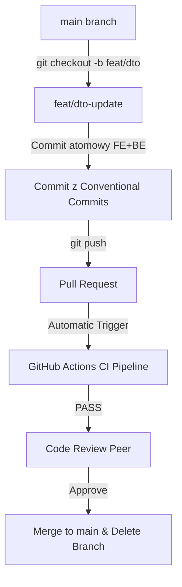

# Lekcja 1.3 — Repozytorium, Monorepo i Git Workflow

---

## 1. Wprowadzenie i Cele Dydaktyczne

Wybór struktury repozytorium oraz strategii zarządzania kodem (Git Workflow) stanowi kręgosłup bezpieczeństwa zmian w zespole inżynieryjnym. Błędna architektura repozytorium prowadzi do tzw. **Piekła Wersjonowania Shared-Types (Multi-PR Hell)** oraz chronicznych konfliktów przy scalaniu gałęzi (*Merge Hell*).

### Cele Dydaktyczne:
1. **Dekompozycja Strukturalna:** Zrozumienie różnic pomiędzy Monorepo a Polyrepo ze szczególnym uwzględnieniem atomowych zmian typów DTO.
2. **Strategia Gałęzi:** Wybór adekwatnego modelu pracy na gałęziach (Trunk-Based vs GitFlow vs Feature Branch + PR).
3. **Reprodukowalność w CI:** Zrozumienie roli plików `lockfile` (`pnpm-lock.yaml` / `package-lock.json`) i różnicy między `npm install` a `npm ci / --frozen-lockfile`.
4. **Submoduły Git w Baziach Wiedzy:** Zastosowanie wzorca *Git Submodules / External Projects* do integracji odizolowanych projektów inżynieryjnych wewnątrz vaulta.
5. **Tooling i Bezpieczeństwo CI:** Rola narzędzi lokalnych (Husky, lint-staged, Conventional Commits) oraz wykazanie, dlaczego bramki lokalne nie zastępują kontroli CI.

---

## 2. Struktura Repozytorium: Monorepo vs Polyrepo

### 2.1. Polyrepo (Wiele Repozytoriów)
W podejściu Polyrepo każdy moduł (np. `frontend`, `backend`, `shared-dto`) znajduje się w osobnym repozytorium Git.
- **Zalety:** Ścisła izolacja dostępu, niezależne potoki CI/CD.
- **Wady w zespole 3–5 osób:** Wyciągnięcie wspólnych struktur danych (Shared DTO) wymaga publikowania paczki do rejestru (np. npm) lub stosowania skomplikowanych symlinków. Zmiana jednego pola w API wymaga otwarcia i zsynchronizowania 3 osobnych Pull Requestów.

### 2.2. Monorepo (Jedno Repozytorium z Grafem Zależności)
Monorepo z wykorzystaniem nowoczesnych obszarów roboczych (`pnpm workspaces`, `Turborepo`, `Nx`) mieści cały kod w jednym repozytorium, zachowując jednak jasną strukturę modułową:

```
project-root/
├── pnpm-workspace.yaml
├── package.json
├── apps/
│   ├── web/ (Frontend React / Next.js)
│   └── api/ (Backend Node / Fastify / Nest)
└── packages/
    └── shared-dto/ (Wspólne interfejsy TypeScript & Zod Schemas)
```

- **Główna zaleta:** **Atomowe Zmiany (Atomic Commits)**. Modyfikacja interfejsu DTO w `packages/shared-dto` oraz jego wykorzystania w `apps/api` i `apps/web` odbywa się w **jednym commicie i jednym Pull Requeście**.
- **Wspólny Graf CI:** Narzędzia takie jak Turborepo budują graf zależności i wykonują testy tylko dla modułów zmodyfikowanych (*Affected Builds*).

---

## 3. Strategie Pracy z Gałęziami (Branching Strategies)

### 3.1. GitFlow
Tradycyjny model oparty na długożyjących gałęziach `main`, `develop`, `feature/*`, `release/*` oraz `hotfix/*`.
- **Problem:** Powoduje częste konflikty scalania (*Merge Hell*), gdy gałęzie feature żyją dłużej niż 3–4 dni. Nie pasuje do zwinnych zespołów i tworzy znaczny narzut zarządczy.

### 3.2. Trunk-Based Development (TBD)
Wszyscy deweloperzy commitują bezpośrednio do gałęzi głównej (`main` / `trunk`) lub używają bardzo krótkich gałęzi (żyjących < 24h).
- **Warunek:** Wymaga stosowania **Flagi Funkcjonalnych (Feature Flags)**, aby ukrywać niedokończony kod na produkcji bez blokowania wdrożeń.

### 3.3. Feature Branch + PR (Rekomendowany Kompromis Uczelniany)
Deweloperzy tworzą krótkie gałęzie tematyczne (`feat/auth-handler`, `fix/canvas-render`), a scalenie z `main` wymaga otwarcia Pull Requesta, przejścia automatycznych testów w CI oraz akceptacji w Code Review.



---

## 4. Git Submodules / External Projects w Architekturze Vaulta Wiedzy

W przypadku korzystania z bazy wiedzy Vaultie, laboratorium projektu kodowego (np. `labs/web-engineering/1.3/`) może stanowić jednocześnie niezależne repozytorium Git osadzone wewnątrz vaulta.

Służy do tego mechanizm **Git Submodules**:
```bash
# Dodanie zewnętrznego repozytorium projektu do katalogu labów wewnątrz vaulta
git submodule add https://github.com/twoja-organizacja/vault-collab-lab.git labs/web-engineering/1.3/project
```

### Korzyści dla Agenta i Inżyniera:
1. **Agent AI** wewnątrz Antigravity ma jednoczesny, bezpośredni dostęp do notatek inżynieryjnych (`10_`–`50_`) oraz do rzeczywistego kodu w `labs/`.
2. Dyskretne repozytorium projektu zachowuje własną historię commitów, gałęzie i potok CI/CD bez zanieczyszczania głównego drzewa vaulta.

---

## 5. Deterministyczny Build i Kontrakt Lockfile

Plik `lockfile` (`pnpm-lock.yaml`, `package-lock.json`, `yarn.lock`) rejestruje **dokładną sumę kontrolną SHA oraz drzewo zależności** dla każdej zainstalowanej biblioteki.

### Dlaczego ignorowanie lockfile to błąd w sztuce?
Gdy plik lockfile nie zostanie skommitowany, komenda `npm install` zainstaluje najnowsze wersje pakietów zgodne z zakresem SemVer (`^1.2.0`), co sprawia, że kod skompilowany dzisiaj na komputerze dewelopera A może przestać się kompilować jutro na serwerze CI lub komputerze dewelopera B (*"U mnie działa"*).

### Różnica między `install` a `frozen-lockfile` / `ci`:
- **`npm install` / `pnpm install`:** Może zaktualizować plik lockfile, jeśli w `package.json` zmieniły się zakresy wersji.
- **`npm ci` / `pnpm install --frozen-lockfile`:** **NIE MODYFIKUJE** pliku lockfile. Jeżeli lockfile jest niezgodny z `package.json`, proces w CI natychmiast wyrzuca błąd i przerywa build.

---

## 6. Lokalny Tooling Jakościowy vs Bramki CI

### 6.1. Lokalny Tooling (Husky & lint-staged)
Narzędzie **Husky** pozwala uruchamiać skrypty w momencie wykonywania akcji Git (np. `pre-commit`, `commit-msg`).

- **`pre-commit`:** Uruchamia `lint-staged`, czyli formatowanie (Prettier/Biome) i linter (ESLint) **wyłącznie na plikach dodanych do indeksu Git (`staged`)**, co trwa ułamki sekund.
- **`commit-msg`:** Weryfikuje format wiadomości commita zgodnie ze specyfikacją **Conventional Commits** (`feat:`, `fix:`, `docs:`, `refactor:`, `test:`).

### 6.2. Dlaczego Git Hooks nie zastępują CI?
Lokalny hook w Git wykonuje się na komputerze dewelopera i **może zostać łatwo pominięty** flagą:
```bash
git commit -m "szybka poprawka" --no-verify
```
Dlatego lokalne hooki służą wyłącznie do poprawy **Developer Experience (DX)**, a ostateczną, nieobejrzalną bramką bezpieczeństwa jest **potok CI w GitHub Actions / GitLab CI**, uruchamiający testy w czystym kontenerze.

---

## 7. Kod / Laboratorium Praktyczne (Lab 1.3)

Praktyczny scaffold monorepo oraz potoku CI znajduje się w katalogu [`labs/web-engineering/1.3/`](file:///c:/Users/cyunc/Documents/Projects/Vaultie/labs/web-engineering/1.3/).

### Przykładowy potok CI (`labs/web-engineering/1.3/.github/workflows/ci.yml`):
```yaml
name: CI Pipeline

on:
  push:
    branches: [main]
  pull_request:
    branches: [main]

jobs:
  verify:
    name: Lint, Test & Build
    runs-on: ubuntu-latest
    steps:
      - name: Checkout repository
        uses: actions/checkout@v4

      - name: Setup Node.js
        uses: actions/setup-node@v4
        with:
          node-version: 22

      - name: Install pnpm
        uses: pnpm/action-setup@v3
        with:
          version: 9

      - name: Install dependencies (frozen lockfile)
        run: pnpm install --frozen-lockfile

      - name: Run Linter & Formatter
        run: pnpm run lint

      - name: Run Tests
        run: pnpm run test

      - name: Build Packages & Apps
        run: pnpm run build
```

---

## 8. Typowe Pułapki i Błędne Przekonania (Misconceptions)

> [!CAUTION]
> 1. **"Monorepo to po prostu folder z kilkoma projektami bez wspólnych narzędzi."**  
>    *Fakt:* Monorepo bez obszarów roboczych (workspaces) i wspólnego grafu zależności to po prostu zły układ plików. Prawdziwe Monorepo wykorzystuje menedżer pakietów (pnpm/npm) do natychmiastowej weryfikacji typów shared-dto.
> 
> 2. **"Plik lockfile należy dodać do .gitignore, aby każdy deweloper miał najświeższe wersje bibliotek."**  
>    *Fakt:* Usunięcie lockfile niszczy reprodukowalność builda i prowadzi do awarii na środowiskach produkcyjnych.
> 
> 3. **"GitFlow to jedyny profesjonalny standard zarządzania kodem."**  
>    *Fakt:* GitFlow generuje ogromny narzut i konflikty w małych zespołach. W większości projektów łagodny *Feature Branch + PR* lub *Trunk-Based Development* jest znacznie wydajniejszy.
> 
> 4. **"Skoro skonfigurowaliśmy Husky lokalnie, to nie musimy uruchamiać lintera w CI."**  
>    *Fakt:* Deweloper może użyć flagi `--no-verify`. CI jest jedynym autorytatywnym weryfikatorem.

---

## 8. Tabela Decyzyjna (Chain of Action)

| Kontekst i Problem | Decyzja Inżynieryjna | Wykorzystane Narzędzie / Wzorzec | Uzasadnienie i Ochrona |
|---|---|---|---|
| Zmiana interfejsu DTO wymaga modyfikacji Frontendu i Backendu | Stosujemy Monorepo z pnpm workspaces | `apps/web` + `packages/shared-dto` | Atomowy commit; brak konieczności publikacji do npm |
| Różne wersje pakietów instalują się u deweloperów i w CI | Skommitowanie lockfile i wymóg `--frozen-lockfile` w CI | `pnpm-lock.yaml` / `npm ci` | 100% determinizmu i reprodukowalności kompilacji |
| Bałagan w historii commitów i brak czytelności zmian | Wdrożenie weryfikacji wiadomości commitów | Husky + `commit-msg` + Conventional Commits | Czytelny changelog i łatwe śledzenie regresji |
| Deweloper omija lokalne sprawdzanie kodu flagą `--no-verify` | Konfiguracja twardej bramki na Pull Requeście w CI | GitHub Actions workflow (`ci.yml`) | Nieobejrzalny audyt kodu przed scaleniem do `main` |

---

## 9. Podsumowanie & Quiz Sprawdzający

### Quiz (Odpowiedz na pytania i sprawdź zrozumienie):

1. **Pytanie:** Dlaczego w potokach CI stosuje się komendę `npm ci` lub `pnpm install --frozen-lockfile` zamiast zwykłego `npm install`?
   - *Odpowiedź:* Ponieważ `npm ci` / `--frozen-lockfile` rygorystycznie wymusza instalację dokładnych wersji zarejestrowanych w pliku lockfile i wyrzuca błąd, gdy lockfile jest niezgodny z `package.json`, gwarantując powtarzalność kompilacji.

2. **Pytanie:** W jakiej sytuacji architektura Monorepo przewyższa Polyrepo w zespole 4-osobowym?
   - *Odpowiedź:* Gdy zmiana modułu domenowego lub interfejsu API wymaga jednoczesnej aktualizacji kodu na Frontendzie i Backendzie. W Monorepo zmiana ta odbywa się w jednym atomowym commicie.

3. **Pytanie:** Czym różni się rola lokalnego git hooka (`pre-commit`) od potoku CI (`github-actions`)?
   - *Odpowiedź:* Local hook działa na komputerze dewelopera dla szybkiego feedbacku (DX), ale może zostać pominięty flagą `--no-verify`. Potok CI działa na serwerze i jest nieobejrzalną bramką jakości przed scaleniem do `main`.

---

## 📚 Źródła i Literatura

- **Turborepo & pnpm Workspaces documentation:** *Monorepo Architecture & Task Caching Standard*.
- **Conventional Commits Specification v1.0.0:** *Specification for adding human and machine readable meaning to commit messages*.
- **Trunk Based Development:** *trunkbaseddevelopment.com — High-velocity software delivery model*.
- **Git Submodules Documentation:** *Official Git Guide on Submodules & Nested Repositories*.
