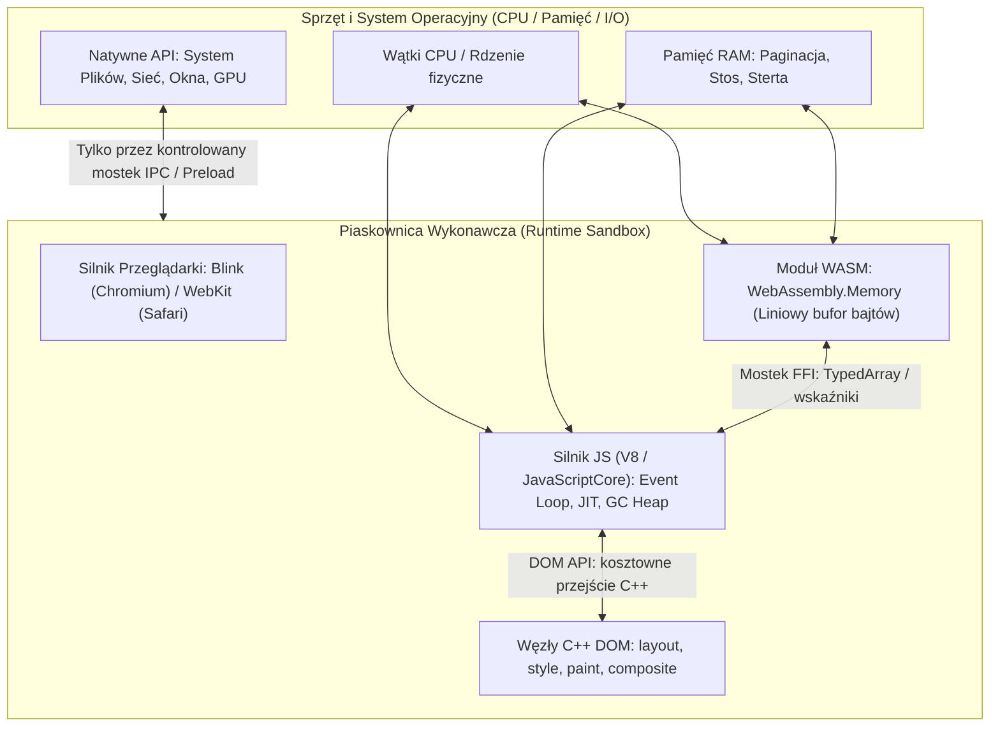
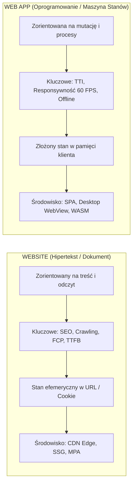
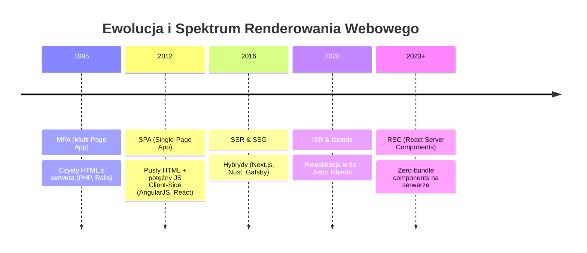
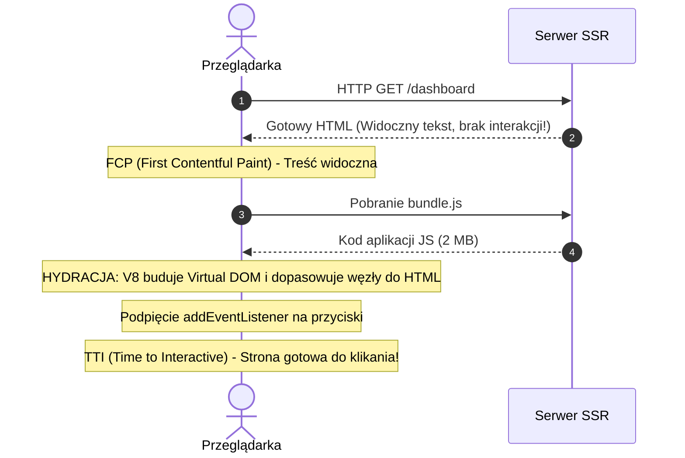
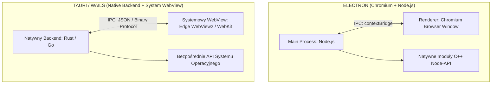
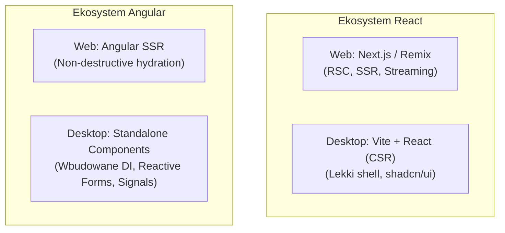
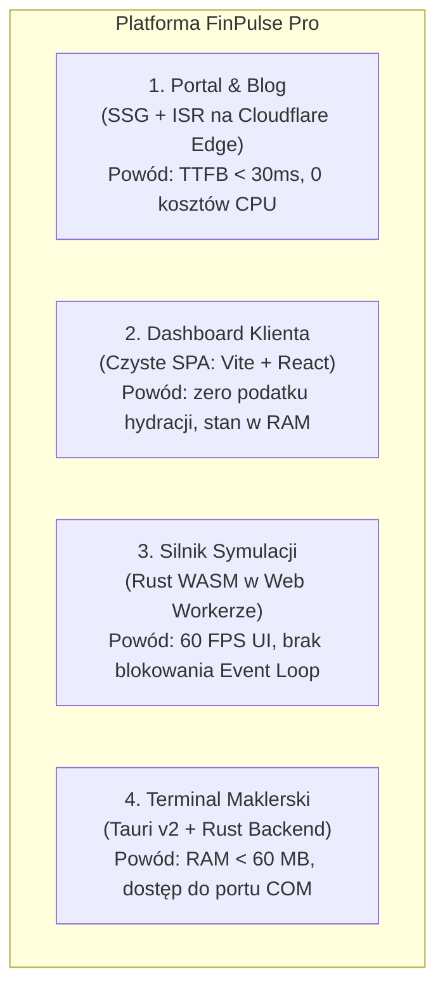

# Lekcja 2.1 — Website vs Web App, Paradygmaty Renderowania i Środowiska Wykonawcze

> **Cel dydaktyczny:** Po tej lekcji potrafisz inżynieryjnie sklasyfikować projekt (Website vs Web App), dobrać optymalny paradygmat renderowania (MPA, SPA, SSR, SSG, RSC, Islands) z uwzględnieniem podatku hydracji i metryk Core Web Vitals, ocenić opłacalność wdrożenia WebAssembly (WASM) pod kątem narzutu mostka FFI i izolacji w Web Workerach, wybrać środowisko desktopowe (Electron vs Tauri z Rustem vs Wails z Go) w oparciu o determinizm silnika i budżet zasobów oraz dobrać warstwę UI (React vs Angular) pod specyfikę danego runtime'u.
> **Pakiet dydaktyczny:** ta notatka + kanwa [[lesson-2.1-rendering-runtimes.canvas]] + lab `labs/web-engineering/2.1/` + specyfikacja `90_Meta/lessons/2.1/spec.yaml`.
> **Wymagania wstępne:** [[1.1-ideation-fr-nfr|Lekcja 1.1 — Ideation, Feasibility & Scope (FR / NFR)]].
> **Następna lekcja w roadmapie:** [[web-engineering-roadmap#2.2 — Paradygmaty Architektoniczne Systemów|2.2 Architektura Warstwowa, Hexagonalna i Modular Monolith]].

---

## Spis treści

1. [Wprowadzenie i Model Mentalny (Notional Machine)](#1-wprowadzenie-i-model-mentalny-notional-machine)
2. [Granica konceptualna: Website vs Web App i Dekompozycja Hybrydowa](#2-granica-konceptualna-website-vs-web-app-i-dekompozycja-hybrydowa)
3. [Spektrum paradygmatów renderowania i Macierz Core Web Vitals](#3-spektrum-paradygmatów-renderowania-i-macierz-core-web-vitals)
4. [Podatek hydracji (Hydration Tax), Mismatch i Wzorce Naprawy](#4-podatek-hydracji-hydration-tax-mismatch-i-wzorce-naprawy)
5. [WebAssembly (WASM): Pamięć liniowa, mostek FFI i Wielowątkowość](#5-webassembly-wasm-pamięć-liniowa-mostek-ffi-i-wielowątkowość)
6. [Desktop Web Runtimes: Electron vs Native WebView (Tauri & Wails)](#6-desktop-web-runtimes-electron-vs-native-webview-tauri--wails)
7. [Wzorce Implementacji i Anatomia Projektów Desktopowych](#7-wzorce-implementacji-i-anatomia-projektów-desktopowych)
8. [React i Angular w przekroju środowisk](#8-react-i-angular-w-przekroju-środowisk)
9. [Pełne Studium Przypadku (Worked Example): Platforma FinTech](#9-pełne-studium-przypadku-worked-example-platforma-fintech)
10. [Matryca doboru technologicznego (Do jakich projektów?)](#10-matryca-doboru-technologicznego-do-jakich-projektów)
11. [Chain of Action — Procedura audytu i wyboru](#11-chain-of-action--procedura-audytu-i-wyboru)
12. [Lab 2.1 — Trójstronny benchmark architektoniczny](#12-lab-21--trójstronny-benchmark-architektoniczny)
13. [Misconceptions i Typowe Antywzorce (Obalenie 6 Mitów)](#13-misconceptions-i-typowe-antywzorce-obalenie-6-mitów)
14. [Aktywność Generatywna (Predict Task)](#14-aktywność-generatywna-predict-task)
15. [Zadania Transferowe (Zastosowanie w Innym Kontekście)](#15-zadania-transferowe-zastosowanie-w-innym-kontekście)
16. [Blackbox Quiz V2.1](#16-blackbox-quiz-v21)
17. [Powiązane i Źródła](#17-powiązane-i-źródła)
18. [Aneks Techniczny: ASP.NET Core MVC, HTMX i Studium Projektu „Kuchnia u Cygana”](appendix-aspnet-mvc-kuchnia-cygana.md)

---

## 1. Wprowadzenie i Model Mentalny (Notional Machine)

Większość porażek architektonicznych w projektach fullstackowych nie wynika z błędów składniowych, lecz z **błędnego przypisania odpowiedzialności środowiskowej**. Architekt, który wybiera Next.js SSR dla wewnętrznego panelu ERP, skazuje firmę na niepotrzebne rachunki za serwery i podatki hydracji. Inżynier, który próbuje policzyć fizykę 100 000 cząstek w czystym JavaScript na głównym wątku, zamraża przeglądarkę do 0 FPS. Zespół, który wybiera Tauri pod aplikację korporacyjną bez weryfikacji wersji Safari u klientów na macOS, zderza się ze ścianą różnic w renderowaniu CSS.

Aby podejmować właściwe decyzje, musisz posiadać precyzyjną **maszynę pojęciową (Notional Machine)** tego, co dzieje się na styku sprzętu, systemu operacyjnego i silnika przeglądarki:



### Kluczowe aksjomaty maszyny pojęciowej:
1. **Wątek Główny (UI Main Thread) to wąskie gardło:** Renderowanie 60 FPS wymaga wyrobienia się z całą pracą (JavaScript, stylizacja, layout, paint) w budżecie **16.6 ms**. Każda pętla CPU trwająca > 50 ms to *Long Task*, który blokuje reakcję na kliknięcia użytkownika (niszcząc wskaźnik INP).
2. **Przejście JS <-> DOM to koszt granicy C++:** Węzły DOM nie są zwykłymi obiektami V8; to natywne struktury C++ silnika przeglądarki. Modyfikacja DOM przez pętlę JavaScriptu niesie koszt marshalingu i wyzwala ponowne przeliczenie stylów (*Recalculate Style*) oraz geometrii (*Reflow*).
3. **Pamięć WASM jest odizolowana od Garbage Collectora:** WASM nie potrafi zaalokować obiektu JavaScriptu ani dotknąć DOM bez wywołania funkcji pośredniczącej w JS. Z kolei JS nie może zajrzeć w wewnętrzne struktury WASM inaczej niż przez odczyt surowych bajtów w buforze `ArrayBuffer`.
4. **Desktop WebView to pożyczony proces:** W Tauri lub Wails Twoja aplikacja nie posiada własnego silnika. Działa w procesie dostarczonym przez system operacyjny. Błąd w silniku Safari na macOS użytkownika staje się błędem Twojej aplikacji, którego nie naprawisz aktualizacją kodu.

---

## 2. Granica konceptualna: Website vs Web App i Dekompozycja Hybrydowa

Współczesna inżynieria webowa cierpi na grzech zacierania granic między **dokumentem hipertekstowym** a **aplikacją stanową**. Wybór technologii bez zrozumienia tej różnicy prowadzi do dwóch skrajnych antywzorców:
1. *SPA dla bloga* — pobieranie 2 MB JavaScriptu, by wyświetlić tekst, niszcząc SEO i czas do pierwszego bajtu (TTFB/FCP).
2. *MPA dla edytora graficznego* — przeładowywanie całej strony przy każdej zmianie suwaka lub zaznaczenia.



### Porównanie fundamentów architektonicznych:

| Wymiar | Website (Strona / Portal) | Web Application (Aplikacja Webowa) |
|---|---|---|
| **Podstawowa jednostka** | Dokument (HTML Page, Artykuł, Widok katalogu) | Komponent / Maszyna stanów (Edytor, Pulpit, Koszyk) |
| **Model stanowy** | Bezstanowy na kliencie; stan w adresie URL (`/products?page=2`) | Ciągła maszyna stanów w RAM przeglądarki (Signals, Store) |
| **Średni czas sesji** | Krótki (30 s – 3 min), wysoki współczynnik odrzuceń | Długi (15 min – wiele godzin pracy ciągłej) |
| **Główny bottleneck** | Czas pierwszego wyrenderowania treści (**LCP / FCP**) | Opóźnienie reakcji na interakcję użytkownika (**INP / TTI**) |
| **Priorytet dystrybucji** | Globalny CDN na krawędzi sieci (Edge Caching) | Szybki transfer danych przez API (JSON, Protobuf, WebSockets) |
| **Wymóg indeksacji (SEO)** | Krytyczny (100% zawartości widoczne bez JS) | Znikomy lub zerowy (dostęp za ekranem logowania) |

### Rzeczywistość produkcyjna: Dekompozycja Strefowa (Route-Level Architecture Decomposition)

W rzeczywistych systemach komercyjnych podział rzadko bywa binarny. Nowoczesna platforma składa się z wielu stref funkcjonalnych. Poniższa tabela przedstawia dekompozycję wzorcowej platformy SaaS:

```text
                                  ┌──────────────────────────────┐
                                  │      DOMENA SYSTEMU          │
                                  └──────────────┬───────────────┘
                                                 │
                  ┌──────────────────────────────┴──────────────────────────────┐
                  ▼                                                             ▼
     ┌─────────────────────────┐                                   ┌─────────────────────────┐
     │   STREFA DOKUMENTU      │                                   │    STREFA APLIKACJI     │
     │   (Publiczna / Website) │                                   │    (Prywatna / Web App) │
     └────────────┬────────────┘                                   └────────────┬────────────┘
                  │                                                             │
       ┌──────────┴──────────┐                                       ┌──────────┴──────────┐
       ▼                     ▼                                       ▼                     ▼
┌──────────────┐      ┌──────────────┐                        ┌──────────────┐      ┌──────────────┐
│ Landing Page │      │ Blog / Docs  │                        │ Dashboard    │      │ Edytor / CAD │
│  (Czysty SSG)│      │  (ISR / CDN) │                        │  (SPA / CSR) │      │ (WASM + Wkr) │
└──────────────┘      └──────────────┘                        └──────────────┘      └──────────────┘
```

Złota zasada inżynierii: **Nie wybieraj jednego paradygmatu dla całego repozytorium.** Zastosuj architekturę wielostrefową (Multi-Zone / Route-Level Splitting) — strona główna i blog działają jako statyczny SSG/ISR na krawędzi sieci CDN, a pulpit użytkownika po zalogowaniu ładuje się jako wysoce zoptymalizowane SPA (CSR).

---

## 3. Spektrum paradygmatów renderowania i Macierz Core Web Vitals

Wybór technologii generowania kodu HTML to bezpośredni kompromis między **kosztem procesora serwera**, **rozmiarem transferu sieciowego**, **opóźnieniem pierwszej treści** a **płynnością interakcji**.



### Szczegółowa macierz porównawcza paradygmatów i Core Web Vitals:

| Paradygmat | TTFB (Czas do 1. bajtu) | FCP (Pierwsza treść) | LCP (Główna treść) | TTI / INP (Interakcja) | Koszt CPU serwera | Koszt Transferu |
|---|---|---|---|---|---|---|
| **MPA** (PHP/Django/Spring) | Średni (zależy od bazy) | **Błyskawiczny** | **Błyskawiczny** | **Błyskawiczny** (brak hydracji) | Średni (render per request) | Niski/Średni (sam HTML) |
| **SPA / CSR** (Vite + React/Ng) | **Błyskawiczny** (CDN statyczny) | Słaby (biały ekran) | Słaby (czeka na bundle JS) | Dobry (po załadowaniu) | **Zerowy** (hosting statyczny) | Wysoki (duży plik .js) |
| **SSR** (Node/Next.js) | Słaby/Średni (blokowany przez DB) | **Błyskawiczny** | Bardzo dobry | **Opóźniony** (podatek hydracji) | **Bardzo wysoki** (Node V8 per request) | **Bardzo wysoki** (HTML + stan JSON) |
| **SSG** (Astro/Next build) | **Błyskawiczny** (<30 ms z CDN) | **Błyskawiczny** | **Błyskawiczny** | **Błyskawiczny** (brak hydracji) | **Zerowy** (wypieczone pliki) | Minimalny |
| **ISR** (Stale-While-Revalidate) | **Błyskawiczny** (z cache CDN) | **Błyskawiczny** | **Błyskawiczny** | Zależny od wysp JS | Znikomy (regeneracja w tle) | Średni |
| **RSC** (React Server Comp.) | Średni (streaming chunków) | Bardzo dobry | Bardzo dobry | **Bardzo dobry** (mniej kodu na kliencie) | Wysoki (render serwerowy) | Zoptymalizowany (zero kodu JS serwera) |

### 1. MPA (Multi-Page Application)
- **Mechanika:** Każde kliknięcie w link wysyła pełne żądanie HTTP GET. Serwer odpytuje bazę, parsuje szablon (Blade, Thymeleaf, Razor) i zwraca gotowy, pełny strumień HTML.
- **Pod maską:** Przeglądarka niszczy stary kontekst DOM, czyści pamięć i parsuje nowy dokument od zera.
- **Kiedy stosować:** Klasyczne e-commerce oparte na SEO, portale informacyjne, serwisy o małej dynamice lokalnej.

### 2. SPA / CSR (Client-Side Rendering)
- **Mechanika:** Serwer zwraca identyczny, niemal pusty szkielet:
  ```html
  <div id="root"></div>
  <script src="/assets/bundle.js"></script>
  ```
- **Pod maską:** Przeglądarka pobiera kilkumegabajtowy plik JavaScript, silnik V8 kompiluje go, a framework (React, Angular, Vue) dynamicznie tworzy węzły DOM za pomocą `document.createElement()`. Nawigacja odbywa się przez przechwycenie zdarzeń kliknięcia i manipulację `history.pushState()`.
- **Kiedy stosować:** Panele administracyjne za logowaniem, aplikacje desktopowe (Tauri/Electron), systemy ERP/CRM.

### 3. SSR (Server-Side Rendering)
- **Mechanika:** Serwer Node/Bun uruchamia framework JS (np. `ReactDOMServer.renderToString()`) w momencie nadejścia żądania HTTP.
- **Pod maską:** Klient błyskawicznie otrzymuje pełny HTML z wypełnioną treścią, ale strona **nie jest jeszcze interaktywna**. Dopiero po dociągnięciu pliku JS następuje proces **Hydracji**.
- **Kiedy stosować:** Strony wymagające natychmiastowego SEO z danymi zmieniającymi się per request (np. giełda, dynamiczne profile użytkowników).

### 4. SSG (Static Site Generation) & ISR (Incremental Static Regeneration)
- **Mechanika (SSG):** W procesie `build` generator parsuje markdown/API i wypieka statyczne pliki `.html` na dysk. Hosting na S3/Cloudflare Pages kosztuje ułamki centów.
- **Mechanika (ISR):** Serwer serwuje statyczny plik z cache CDN, ale w tle (*stale-while-revalidate*) sprawdza ważność danych. Jeśli minął `revalidate: 60`, generuje nową stronę bez blokowania użytkownika.
- **Kiedy stosować:** Dokumentacje, blogi, katalogi produktów z rzadko zmieniającą się ofertą.

### 5. RSC (React Server Components) — Pod maską wire formatu
W tradycyjnym SSR kod komponentu trafia do przeglądarki, by zrekonstruować Virtual DOM. W RSC komponenty serwerowe **nigdy nie są wysyłane do przeglądarki w paczce JavaScript**.
- **Mechanika Wire Format:** Serwer generuje strumień tekstowo-binarny opisujący strukturę wirtualną:
  ```text
  M1:{"id":"./src/Button.client.tsx","chunks":["client1"],"name":"Button"}
  J0:["$","div",null,{"className":"card","children":[["$","h1",null,{"children":"Raport Finansowy"}],["$","$L1",null,{"onClick":"$F1"}]]}]
  ```
- **Dlaczego to przełom?** Komponent serwerowy może zaimportować bibliotekę parsowania Markdown ważącą 500 KB lub wykonać zapytanie SQL bezpośrednio do PostgreSQL (`db.query()`). Do klienta dociera tylko wynik JSON/RSC Payload ważący 2 KB. Klient wplata nowe węzły w istniejące drzewo DOM bez utraty fokusu w polach formularzy!

### 6. Architektura Wyspowa (Islands Architecture / Astro)
Zamiast traktować stronę jako jednolitą aplikację JS, architektura wyspowa generuje w 100% statyczny HTML, w którym wyznaczone fragmenty stanowią niezależne „wyspy” interaktywności:
```astro
---
import StaticHeader from './Header.astro';
import InteractiveCart from './Cart.tsx';
---
<StaticHeader /> <!-- 0 bajtów JS w przeglądarce! -->
<main>Treść artykułu (Czysty HTML)</main>
<InteractiveCart client:visible /> <!-- Hydratowany TYLKO po przescrollowaniu! -->
```

---

## 4. Podatek hydracji (Hydration Tax), Mismatch i Wzorce Naprawy

**Hydracja** to proces ożywiania statycznego HTML-a nadesłanego przez serwer SSR:



### Trzy inżynieryjne koszty hydracji (The Hydration Tax):
1. **Podwójny transfer danych (Data Doubling):** Serwer musi wysłać wyrenderowany HTML **oraz** ten sam stan w formacie JSON (`<script id="__NEXT_DATA__">`), aby klient mógł odtworzyć identyczny stan pamięci.
2. **Zużycie procesora na urządzeniach mobilnych:** Smartfon budżetowy musi sparować każdy węzeł DOM z odpowiadającym mu komponentem Virtual DOM. W tym czasie kliknięcia w menu są ignorowane lub generują lag (wysoki wskaźnik INP).
3. **Hydration Mismatch Crash:**
   Jeśli na serwerze wyrenderujesz:
   ```tsx
   <span>{typeof window !== 'undefined' ? 'Klient' : 'Serwer'}</span>
   // lub: <span>{new Date().toLocaleTimeString()}</span>
   ```
   Serwer wygeneruje inny ciąg znaków niż klient. Reconciler zgłasza błąd `Hydration failed because the initial UI does not match` i w trybie ratunkowym niszczy wygenerowany HTML, wymuszając pełny, kosztowny re-render od zera po stronie klienta.

> [!TIP]
> **Jak całkowicie wyeliminować Podatek Hydracji w systemach Back-office / ERP?**  
> Zobacz dedykowane studium przypadku w aneksie: [[appendix-aspnet-mvc-kuchnia-cygana|Appendix 2.1 — Paradygmat ASP.NET Core MVC, Architektura Hypermedia (HTMX) oraz Samokrytyczne Studium Projektu „Kuchnia u Cygana”]], gdzie omówiono, jak połączenie klasycznego ASP.NET MVC z biblioteką HTMX pozwala uzyskać responsywność SPA przy zerowym podatku hydracji i zerowym narzucie wirtualnego DOM.

### Produkcyjne wzorce zapobiegania i naprawy Hydration Mismatch:

#### Wzorzec 1: Dwuetapowy montaż (Mount Gating)
```tsx
export function ClientTimestamp() {
  const [isMounted, setIsMounted] = useState(false);

  useEffect(() => {
    setIsMounted(true); // Wykona się wyłącznie po zamontowaniu na kliencie
  }, []);

  if (!isMounted) {
    return <span className="skeleton">Ładowanie czasu...</span>; // Tożsame z serwerem!
  }

  return <span>{new Date().toLocaleTimeString()}</span>;
}
```

#### Wzorzec 2: Izolacja w komponencie czysto klienckim z wyłączonym SSR
W Next.js / React:
```tsx
import dynamic from 'next/dynamic';

const DynamicWalletConnector = dynamic(
  () => import('./WalletConnector'),
  { ssr: false } // Serwer wstawia pusty placeholder, zero mismatchu!
);
```

### Nieniszcząca Hydracja (Non-destructive Hydration w Angular v17+)
Tradycyjny React podczas hydracji weryfikuje węzły, a przy błędzie potrafi wyczyścić cały kontener DOM i stworzyć go na nowo (*Destructive fallback*).
Nowoczesny **Angular (v17+)** wprowadził **Non-destructive Hydration**:
- W wygenerowanym HTML-u kompilator Angulara umieszcza specjalne komentarze-kotwice (np. `<!--s1-->`, `<!--s2-->`).
- Silnik klienta nie niszczy ani nie zastępuje węzłów DOM; po prostu przechodzi po drzewie i bezpośrednio podpina listenery zdarzeń pod istniejące elementy.

### Streaming SSR i Selective Hydration z React Suspense
Zamiast czekać na wyrenderowanie całej strony, nowoczesny serwer wysyła szkielet natychmiast za pomocą HTTP Chunked Transfer Encoding:
```tsx
<Layout>
  <Sidebar /> <!-- Gotowy natychmiast -->
  <Suspense fallback={<TableSkeleton />}>
    <HeavyOrdersTable /> <!-- Streamowany i hydratowany asynchronicznie po pobraniu danych z bazy -->
  </Suspense>
</Layout>
```

---

## 5. WebAssembly (WASM): Pamięć liniowa, mostek FFI i Wielowątkowość

WebAssembly to standard W3C wprowadzający binarny format kodu wykonywalnego o wydajności bliskiej natywnej (Near-Native Performance), działający w tej samej bezpiecznej piaskownicy co JavaScript.

### Model Maszyny i Pamięć Liniowa:
* WASM nie operuje na obiektach JavaScriptu ani na strukturach Garbage Collectora.
* Cała pamięć WASM to **jeden ciągły blok bajtów: `WebAssembly.Memory`** (odpowiadający `ArrayBuffer` w JS).
* Program w Rust/C++ widzi tę pamięć jako przestrzeń adresową wskaźników (heap/stack).

```text
Przeglądarka (JS Runtime)                     Moduł WebAssembly (C++/Rust)
┌────────────────────────────────┐            ┌──────────────────────────────┐
│  Obiekty JS (V8 Heap)          │            │  Wykonywalny kod binarny     │
│  DOM: <div>, <canvas>          │            │  Brak GC / Ścisłe typy       │
│  Event Loop                    │            │  Maszyna stosowa (Wasm Core) │
└───────────────┬────────────────┘            └──────────────┬───────────────┘
                │                                            │
                ▼                                            ▼
      ┌─────────────────────────────────────────────────────────────┐
      │          WebAssembly.Memory (Pamięć Liniowa)               │
      │  [ 0x00 | 0x01 | 0x02 | 0x03 | ... | 0xFFFFFFFF ]          │
      │         Współdzielony bufor ArrayBuffer (TypedArray)        │
      └─────────────────────────────────────────────────────────────┘
```

### Narzut Mostka (The Bridge Latency Collapse):
WASM **nie potrafi bezpośrednio modyfikować drzewa DOM**. Aby zmienić tekst w `<h1>`, musi wywołać funkcję JavaScriptu przez mostek glue code.

```rust
// Przykład Rust (wasm-bindgen)
#[wasm_bindgen]
pub fn process_data(input: &str) -> String {
    // 1. JS kopiuje string do pamięci liniowej WASM (alokacja + UTF-8 encode)
    // 2. WASM przetwarza bajty wewnątrz pamięci liniowej
    // 3. JS czyta wskaźnik, dekoduje UTF-8 z pamięci liniowej i tworzy obiekt String w V8
    format!("Processed: {}", input)
}
```

> [!WARNING]
> **Prawo Mostka WASM:** Jeśli Twoja funkcja wykonuje się szybciej niż czas potrzebny na skopiowanie argumentów przez mostek JS/WASM (kilkadziesiąt nanosekund na proste typy, mikrosekundy na obiekty/stringi), **użycie WASM drastycznie spowolni Twoją aplikację względem czystego JIT JavaScriptu!**

### Architektura Wielowątkowa: WASM w Web Workerach

> [!CAUTION]
> **Złota reguła wątków:** Wykonywanie ciężkich obliczeń WASM na wątku głównym (Main UI Thread) **zamraża Event Loop przeglądarki**! Użytkownik doświadcza zacięcia kursora, braku reakcji na scroll i komunikatu „Strona nie odpowiada”.

Prawidłowy produkcyjny wzorzec separacji:
```text
┌───────────────────────────────────┐               ┌─────────────────────────────────────┐
│      MAIN THREAD (UI & DOM)       │               │      BACKGROUND WEB WORKER          │
│                                   │               │                                     │
│  - Obsługa zdarzeń myszy i gestów │               │  - Moduł WebAssembly (Rust/C++)     │
│  - Interfejs w React / Tailwind   │               │  - Ciężkie pętle macierzowe / CAD   │
│  - Renderowanie Canvas / WebGL    │               │  - Brak blokowania klatek 60 FPS    │
└─────────────────┬─────────────────┘               └──────────────────┬──────────────────┘
                  │                                                    │
                  │   postMessage(data) [lub SharedArrayBuffer]        │
                  └────────────────────────────────────────────────────┘
```

### Studium przypadku architektury Figmy:
Figma to najbardziej spektakularny sukces inżynieryjny WebAssembly:
1. **Silnik Renderujący (C++ / WASM):** Cała geometria wektorowa, obliczenia sceny, operacje boolowskie na ścieżkach i silnik układu tekstu są napisane w C++ i skompilowane do WASM.
2. **Warstwa Wyświetlania:** Zamiast tysięcy węzłów DOM `<div>`, Figma renderuje całą scenę bezpośrednio na elemencie `<canvas>` za pomocą WebGL.
3. **Interfejs Użytkownika:** Paski narzędzi, menu boczne i okna dialogowe to lekka nakładka w React / TypeScript, operująca na zwykłym DOM.

---

## 6. Desktop Web Runtimes: Electron vs Native WebView (Tauri & Wails)

Przeniesienie technologii webowych na pulpit komputera zdominowały dwa paradygmaty: **Własny wbudowany silnik (Electron)** oraz **Wypożyczenie silnika systemowego (Tauri, Wails)**.



### Szczegółowa macierz porównawcza:

| Parametr architektoniczny | Electron 34+ | Tauri v2 (Rust + TS) | Wails v2/v3 (Go + TS) |
|---|---|---|---|
| **Silnik UI (Renderer)** | **Wbudowany Chromium** (Blink/V8) | **Systemowy WebView**: WebView2 (Win), WebKit (macOS), WebKitGTK (Linux) | **Systemowy WebView**: WebView2 (Win), WebKit (macOS), WebKitGTK (Linux) |
| **Backend systemowy** | Node.js (V8 runtime) | Skompilowany kod binarny **Rust** | Skompilowany kod binarny **Go** |
| **Rozmiar instalatora** | **85 – 150 MB** | **4 – 15 MB** | **10 – 25 MB** |
| **Zużycie RAM (pusta appka)** | **180 – 350 MB** | **25 – 60 MB** | **35 – 80 MB** |
| **Determinizm stylów i CSS** | **100% identyczny** na każdym systemie | Różny (WebKit na macOS ma inne gotchas niż Edge na Windows) | Różny (WebKit na macOS ma inne gotchas niż Edge na Windows) |
| **Bezpieczeństwo IPC** | `contextIsolation`, `sandbox`, preload | Ścisły model uprawnień (*Capabilities & Scopes*) w JSON | Bezpośrednie generowane bindingi metod struktury Go |
| **Współbieżność backendu** | Jednowątkowy Event Loop (Worker Threads) | Pełna współbieżność Rusta (Tokio / Rayon) | Goroutines i kanały Go |
| **Czas kompilacji** | Natychmiastowy (brak kompilacji natywnej) | Długi (kompilacja LLVM Rusta, borrow checker) | Błyskawiczny (kompilator Go słynie z prędkości) |

### Druga strona medalu: Dlaczego Electron NIE umarł? (VS Code, Slack, Discord)
Początkujący inżynierowie patrzą wyłącznie na rozmiar binarki i zużycie RAM, ogłaszając „śmierć Electrona”. Profesjonalne zespoły inżynieryjne w Microsoft czy Discord wybierają Electrona z twardych powodów biznesowych:
1. **Determinizm silnika (Brak pułapki WebKit):** W Tauri na macOS silnikiem jest WebKit (Safari). WebKit posiada inne błędy w obsłudze Flexboxa, brak wsparcia dla niektórych nowych API Canvas/WebGL oraz inne zachowanie pasków przewijania niż Blink na Windowsie. Zespół musi utrzymywać dwa zestawy stylów i testować aplikację na każdym OS z osobna. W Electronie Chromium 132 działa **dokładnie tak samo** na Windowsie 10, macOS Sequoia i Ubuntu.
2. **Odporność na aktualizacje OS:** W Tauri aktualizacja systemu macOS lub Windows może zaktualizować silnik WebView i zepsuć działanie aplikacji u klienta bez Twojej wiedzy. W Electronie to Ty decydujesz, kiedy zaktualizować wersję Chromium.
3. **Ekosystem natywnych bibliotek Node-API (C++):** Jeśli Twoja aplikacja integruje się ze skanerami medycznymi, kartami przechwytywania wideo HDMI lub mikserami audio, w Node.js masz setki przetestowanych bibliotek C++. W Tauri musisz napisać lub przepisać te bindingi w Rust.

### Model Bezpieczeństwa Tauri v2: Capabilities & Scopes
W Tauri v2 bezpieczeństwo opiera się na deklaratywnym pliku uprawnień (np. `src-tauri/capabilities/default.json`):
```json
{
  "identifier": "main-capability",
  "windows": ["main"],
  "permissions": [
    "core:default",
    {
      "identifier": "fs:allow-read-text-file",
      "allow": [{ "path": "$APPDATA/**" }]
    }
  ]
}
```
Nawet jeśli złośliwy skrypt XSS przejmie warstwę wizualną aplikacji, próba odczytania pliku `C:\Windows\System32` lub `/etc/passwd` zostanie zablokowana na poziomie jądra Rusta, ponieważ aplikacja nie posiada uprawnienia do tego zakresu dysku!

---

## 7. Wzorce Implementacji i Anatomia Projektów Desktopowych

### A. Wzorzec Tauri v2 (Rust + React/TS)

*Plik backendu `src-tauri/src/main.rs`:*
```rust
#[tauri::command]
fn calculate_hash(file_path: String) -> Result<String, String> {
    // Błyskawiczne haszowanie w Rust bez blokowania UI
    Ok(format!("SHA256-HASH-FOR-{}", file_path))
}

fn main() {
    tauri::Builder::default()
        .invoke_handler(tauri::generate_handler![calculate_hash])
        .run(tauri::generate_context!())
        .expect("error while running tauri application");
}
```

*Wywołanie we frontendzie React (`src/App.tsx`):*
```tsx
import { invoke } from '@tauri-apps/api/core';

export function FileHasher() {
  const handleHash = async () => {
    const result = await invoke<string>('calculate_hash', { filePath: '/etc/hosts' });
    console.log('Hash z Rusta:', result);
  };
  return <button onClick={handleHash}>Oblicz Hash w Rust</button>;
}
```

---

### B. Wzorzec Wails v2 (Go + React/TS)

*Plik `app.go` (Czyste struktury Go):*
```go
package main

import "fmt"

type App struct {}

func (a *App) ProcessTransaction(amount float64) string {
    return fmt.Sprintf("Transakcja %.2f PLN zaksięgowana w Go", amount)
}
```
Wails generuje automatycznie pliki `d.ts` w katalogu `frontend/wailsjs/go/main/App.js`:
```tsx
import { ProcessTransaction } from '../wailsjs/go/main/App';

async function run() {
  const msg = await ProcessTransaction(250.50);
  alert(msg);
}
```

---

### C. Wzorzec Electron (Bezpieczny ContextBridge)

*NIGDY nie włączaj `nodeIntegration: true`!*
*Plik `src/preload/index.ts`:*
```typescript
import { contextBridge, ipcRenderer } from 'electron';

contextBridge.exposeInMainWorld('api', {
  readSystemLogs: () => ipcRenderer.invoke('get-system-logs')
});
```

*Plik `src/main/index.ts` (Proces główny Node):*
```typescript
import { app, BrowserWindow, ipcMain } from 'electron';
import fs from 'node:fs/promises';

ipcMain.handle('get-system-logs', async () => {
  return await fs.readFile('C:\\app.log', 'utf-8');
});
```

---

### D. Wzorzec WASM: Kompilacja Rusta do pamięci przeglądarki

*Plik `src/lib.rs` (Obliczenia macierzowe w Rust):*
```rust
use wasm_bindgen::prelude::*;

#[wasm_bindgen]
pub fn compute_heavy_physics(iterations: u32) -> f64 {
    let mut val = 1.0;
    for i in 1..iterations {
        val = (val * 1.0001).sin() + (i as f64).sqrt();
    }
    val
}
```
Kompilacja: `wasm-pack build --target web`.

---

## 8. React i Angular w przekroju środowisk

Wybór frameworka UI (React vs Angular) diametralnie zmienia swoje konsekwencje w zależności od tego, czy celem jest **serwerowy Web (SSR)**, czy **lokalna aplikacja desktopowa (WebView / Electron)**.



### 1. React w architekturze systemowej:
* **Na Webie:** Pełna dominacja paradygmatu RSC (Next.js App Router). Komponenty wykonują się na serwerze blisko bazy danych, redukując rozmiar JavaScriptu pobieranego przez użytkownika.
* **Na Desktopie (Tauri / Wails / Electron):** **Faworyt wydajnościowy**. Ponieważ na desktopie nie mamy serwera pośredniczącego (wszystko uruchamia się lokalnie jako pliki statyczne `file://` lub `localhost`), budujemy aplikację czystym Vite (`vite build`). React daje minimalny narzut startowy (Cold Start poniżej 100 ms). Biblioteki headless (Radix, Tailwind) pozwalają stworzyć interfejs nie do odróżnienia od natywnej aplikacji macOS/Windows.

### 2. Angular w architekturze systemowej:
* **Na Webie:** Zintegrowana platforma enterprise z wbudowanym SSR i nieniszczącą hydracją.
* **Na Desktopie (Tauri / Electron):**
  Nowoczesny Angular (v17–v19+) dzięki **Signals** i trybowi **Zoneless** (`provideExperimentalZonelessChangeDetection()`) wyeliminował historyczne mikroprzycięcia `zone.js`.
  
#### Kluczowy atut: Wzorzec Dependency Injection (DI) dla Desktopu
Gdy tworzysz aplikację, która ma działać zarówno jako portal w przeglądarce, jak i aplikacja w Tauri, Angular pozwala na całkowitą izolację widoków od warstwy transportowej:

```typescript
// 1. Zdefiniowanie abstrakcyjnego kontraktu
export abstract class OrderService {
  abstract getOrders(): Observable<Order[]>;
}

// 2. Implementacja dla Webu (HTTP REST API)
@Injectable()
export class HttpOrderService implements OrderService {
  constructor(private http: HttpClient) {}
  getOrders() { return this.http.get<Order[]>('/api/orders'); }
}

// 3. Implementacja dla Desktopu (Tauri IPC Bridge)
@Injectable()
export class TauriIpcOrderService implements OrderService {
  getOrders() {
    return from(invoke<Order[]>('get_local_orders'));
  }
}

// 4. Rejestracja w konfiguracji aplikacji (app.config.ts)
export const appConfig: ApplicationConfig = {
  providers: [
    {
      provide: OrderService,
      useClass: environment.isDesktop ? TauriIpcOrderService : HttpOrderService
    }
  ]
};
```
Komponenty widoku wstrzykują `OrderService` i **nie wiedzą**, czy dane pochodzą z internetu, czy z procesu w Rust!

---

## 9. Pełne Studium Przypadku (Worked Example): Platforma FinTech

Aby zobaczyć, jak wszystkie te klocki łączą się w spójny organizm architektoniczny, przeanalizujmy projekt nowoczesnej platformy inwestycyjnej **FinPulse Pro**:

### Wymagania projektowe:
1. **Publiczny Portal Ofertowy i Blog:** Musi być natychmiast indeksowany przez Google, ładować się w < 0.5s na całym świecie.
2. **Pulpit Klienta Indywidualnego:** Dostępny w przeglądarce za logowaniem; historia portfela, transakcje, przelewy.
3. **Silnik Wyceny Instrumentów Pochodnych (Black-Scholes / Monte Carlo):** Obliczenia 500 000 symulacji cenowych w locie na podstawie suwaków użytkownika.
4. **Terminal Maklerski (Desktop):** Narzędzie dla profesjonalnych traderów z obsługą 4 monitorów, odczytem danych z portu szeregowego i zużyciem RAM < 70 MB.

### Decyzje architektoniczne i uzasadnienie inżynieryjne:



1. **Portal & Blog -> SSG + ISR (Astro / Next.js Static):** Wypiekany do czystego HTML-a w procesie CI/CD. Rozsiany na krawędzi sieci (Cloudflare CDN). Zapewnia LCP < 0.8 s i 100 punktów w Google Lighthouse.
2. **Dashboard Klienta -> Czyste SPA / CSR (Vite + React + TanStack Query):** Odrzucamy SSR! Ponieważ aplikacja jest za logowaniem, Google jej nie indeksuje. Unikamy kosztów CPU serwera i eliminujemy podatek hydracji.
3. **Silnik Wyceny -> WebAssembly w dedykowanym Web Workerze:** Napisany w Rust. Przeglądarka przekazuje wskaźnik do bufora `Float64Array`. Symulacja 500 000 scenariuszy trwa 18 ms w tle. Interfejs Reacta zachowuje idealne 60 klatek na sekundę.
4. **Terminal Maklerski -> Tauri v2 (Rust + Angular Signals):** Odrzucamy Electrona z uwagi na wymóg uruchamiania 10 instancji terminala na stacjach maklerskich bez zapchania 32 GB RAM. Backend w Rust zapewnia natywną komunikację z giełdowym łączem socketowym i portem COM.

---

## 10. Matryca doboru technologicznego (Do jakich projektów?)

| Typ Projektu | Rekomendowany Paradygmat | Środowisko Wykonawcze | UI Framework | Kluczowe Uzasadnienie Inżynieryjne |
|---|---|---|---|---|
| **Publiczny Portal E-Commerce / SaaS Landing** | **SSG + ISR / RSC** | Web (Vercel / Cloudflare Edge) | React (Next.js) lub Astro | Kluczowe jest SEO, natychmiastowy LCP, niski koszt serwera przy milionach wizyt. |
| **System Bankowy / ERP / Panel Klienta** | **Czyste SPA (CSR)** | Web (Nginx / S3 Static) | Angular lub React + TanStack | Dostęp za logowaniem (zero wymogów SEO), bogate formularze, wielogodzinna sesja pracy. |
| **Lokalne Narzędzie Inżynieryjne / Crypto Wallet** | **Desktop Native WebView** | **Tauri v2 (Rust + TS)** | React (Vite + shadcn) | Krytyczny budżet RAM (<60 MB), mały instalator (<10 MB), wysokie wymogi bezpieczeństwa (piaskownica IPC). |
| **Wewnętrzne Narzędzie DevOps / Monitoring** | **Desktop Native WebView** | **Wails (Go + TS)** | React lub Vue | Zespół backendowy zna Go, potrzebuje błyskawicznej kompilacji i prostego kodu wielowątkowego bez pisania Rusta. |
| **Potężne IDE / Edytor Audio-Wideo / Multi-Window** | **Bundled Chromium** | **Electron** | React lub Lit | Wymaga 100% tożsamego renderowania Canvas na Linux/Mac/Win, obsługi wtyczek Node C++ i setek niezależnych okien. |
| **Silnik Fizyki / CAD / Przeglądarkowy GIS** | **WASM + Web Workers** | Web lub Desktop | Dowolny (Canvas/WebGL) | Logika obliczeniowa w pamięci liniowej (Rust/C++), UI w React tylko jako nakładka sterująca. |

---

## 11. Chain of Action — Procedura audytu i wyboru

Poniższa tabela stanowi procedurę decyzyjną architekta systemu przy wyborze paradygmatu renderowania i środowiska:

| Sytuacja / Problem Architektoniczny | Objaw w systemie / Wymóg biznesowy | Rekomendowana Akcja Inżynieryjna | Dlaczego (Mechanizm pod maską) |
|---|---|---|---|
| Tworzenie publicznego portalu, bloga lub dokumentacji | Wymóg indeksowania SEO, niski budżet na serwery | Wybierz **SSG** lub **ISR** na krawędzi sieci (CDN) | Serwer nie przelicza HTML w locie; pliki serwowane z pamięci podręcznej CDN w < 30 ms. |
| Budowa panelu SaaS za logowaniem (ERP, CRM) | Złożone formularze, sesja > 30 min, brak wymogu SEO | Wybierz czyste **SPA (CSR)** na Vite | Unikasz podatku hydracji i podwójnego transferu danych; serwer nie zużywa CPU na renderowanie. |
| Treść dynamiczna per użytkownik wymagająca SEO | Portal z ofertami pracy, dynamiczne profile publiczne | Wybierz **SSR** ze strumieniowaniem (Streaming SSR) | Roboty dostają gotowy HTML, a użytkownik widzi treść natychmiast dzięki chunked transfer. |
| Narzędzie narzędziowe na pulpit o małym budżecie RAM | Aplikacja musi zużywać < 80 MB RAM i ważyć < 15 MB | Wybierz **Tauri v2** z backendem w Rust | Wykorzystuje systemowy silnik WebView (brak narzutu 150 MB Chromium); binarka kompilowana do kodu maszynowego. |
| Złożona aplikacja z wtyczkami C++ i multi-window | Wymóg 100% tożsamego renderowania Canvas i wtyczek C++ | Wybierz **Electron** | Wbudowany silnik Blink eliminuje różnice między Safari a Edge; pełny dostęp do ekosystemu Node-API. |
| Pętla obliczeniowa blokuje interfejs użytkownika | Spadek klatek poniżej 60 FPS, wysoki wskaźnik INP | Przenieś algorytm do **WASM** w **Web Workerze** | Obliczenia w pamięci liniowej nie blokują wątku głównego (UI); komunikacja przez bufor pamięci. |
| Aplikacja desktopowa współdzieląca kod z portalem web | Wspólne widoki, ale inne źródła danych (IPC vs HTTP) | Zastosuj **Angular** z wzorcem **Dependency Injection** | Wstrzykiwany serwis decyduje w locie o wyborze transportu bez dotykania szablonów widoku. |

---

## 12. Lab 2.1 — Trójstronny benchmark architektoniczny

Szczegółowy kod i skrypty znajdują się w katalogu [`labs/web-engineering/2.1/`](file:///c:/Users/cyunc/Documents/Projects/Vaultie/labs/web-engineering/2.1/).

### Co mierzy Lab:
1. **Benchmark 1 (CSR vs SSR & Data Doubling):** Pomiar generowania tabeli 5 000 rekordów. Skrypt wykazuje, że SSR wysyła ponad 4900x więcej danych przez sieć niż szkielet CSR, z czego **ponad 50% wagi strony stanowi zserializowany stan JSON** powtórzony dla procesu hydracji.
2. **Benchmark 2 (WASM vs JS JIT & Bridge Latency Collapse):** Pomiar 10 000 000 operacji sumowania. Skrypt udowadnia, że wywołanie funkcji WASM w pętli z poziomu JS jest **ponad 5x wolniejsze** niż czysty JIT V8 z powodu narzutu przechodzenia przez granicę FFI. Pokazuje także operacje blokowe na `Float32Array`.
3. **Benchmark 3 (IPC Desktop Contract):** Architektoniczny kontrakt TypeScript w `benchmarks/ipc-contract.ts` demonstrujący bezpieczny interfejs mostka IPC dla Electrona (contextBridge) oraz Tauri v2 (invoke).

Uruchomienie testów:
```bash
cd labs/web-engineering/2.1
npm test
```

---

## 13. Misconceptions i Typowe Antywzorce (Obalenie 6 Mitów)

> [!CAUTION]
> **Mit 1: „Przepisanie kodu do WebAssembly sprawi, że strona natychmiast przyspieszy 10x”**  
> *Prawda inżynieryjna:* WASM nie ma dostępu do DOM. Jeśli Twój kod głównie modyfikuje elementy HTML, dodaje klasy CSS lub nasłuchuje kliknięć, przepisanie go do WASM drastycznie **spowolni** aplikację z powodu ciągłego przekraczania granicy FFI i kopiowania pamięci. WASM przyspiesza wyłącznie czyste obliczenia numeryczne operujące na tablicach bajtów.

> [!CAUTION]
> **Mit 2: „Każda profesjonalna aplikacja internetowa powinna korzystać z Server-Side Rendering (Next.js)”**  
> *Prawda inżynieryjna:* Wypychanie SSR do zamkniętych dashboardów bankowych, paneli CRM czy narzędzi za logowaniem to strata zasobów. Generuje potężny narzut na CPU serwerów, wprowadza ryzyko wycieku tokenów autoryzacyjnych do HTML-a i opóźnia interaktywność przez podatek hydracji. Czyste SPA (Vite + React/Angular) jest w tych scenariuszach tańsze, szybsze i stabilniejsze.

> [!CAUTION]
> **Mit 3: „Tauri i Electron działają tak samo pod maską, różnią się tylko językiem backendu (Rust vs JS)”**  
> *Prawda inżynieryjna:* Różnica leży w silniku renderującym. Electron pakuje pełną kopię Chromium. Tauri **nie zawiera żadnego silnika przeglądarki** — pożycza go z systemu operacyjnego (WebView2 na Windowsie, WebKit na macOS). Oznacza to, że Tauri na Macu zachowuje się jak Safari, a na Windowsie jak Edge.

> [!CAUTION]
> **Mit 4: „Hydracja to po prostu załadowanie stylów CSS i ożywienie strony”**  
> *Prawda inżynieryjna:* Hydracja to pełny, kosztowny proces rekonstrukcji Virtual DOM przez silnik JavaScriptu, parsowanie wielomegabajtowego stanu JSON oraz iteracyjne dopasowywanie listenerów zdarzeń do istniejących węzłów HTML w drzewie pamięci przeglądarki.

> [!CAUTION]
> **Mit 5: „Angular jest zbyt ociężały na desktop i React jest jedynym słusznym wyborem”**  
> *Prawda inżynieryjna:* Nowoczesny Angular (v17–v19+) z komponentami Standalone, reaktywnością Signals i opcją Zoneless uruchamia się błyskawicznie. Wbudowany system Dependency Injection (DI) czyni z niego najlepszy framework do budowy multiplatformowych aplikacji (Web + Desktop), umożliwiając bezproblemową podmianę warstwy sieciowej na mostek IPC.

> [!CAUTION]
> **Mit 6: „Electron jest przestarzały i nie ma żadnego technicznego powodu, by go wybierać zamiast Tauri”**  
> *Prawda inżynieryjna:* Electron gwarantuje 100% determinizmu silnika na każdej platformie, eliminuje niespodziewane regresje po aktualizacjach systemu operacyjnego i daje bezpośredni dostęp do dojrzałego ekosystemu natywnych modułów C++ (Node-API), co dla potężnych narzędzi typu VS Code czy Slack pozostaje krytycznym wymogiem biznesowym.

---

## 14. Aktywność Generatywna (Predict Task)

Zanim uruchomisz benchmark w labie, wykonaj analizę predykcyjną:

### Zadanie:
Wyobraź sobie funkcję, która sprawdza poprawność numeru PESEL (obliczenie sumy kontrolnej z 11 cyfr):
1. **Wariant A:** Czysta funkcja JavaScript uruchomiona w silniku V8.
2. **Wariant B:** Ta sama funkcja skompilowana do WASM w Rust, wywoływana z JavaScriptu w pętli `for (let i = 0; i < 1_000_000; i++) verifyPesel(peselString)`.

**Pytanie predykcyjne:** Który wariant wykona się szybciej i dlaczego?
*(Odpowiedź zweryfikuj uruchamiając `node benchmarks/wasm-bridge.mjs` w labie).*

---

## 15. Zadania Transferowe (Zastosowanie w Innym Kontekście)

Przeanalizuj poniższe 3 scenariusze inżynieryjne i sformułuj decyzję architektoniczną:

### Scenariusz 1: Sprzętowy Portfel Kryptowalut (Offline Hardware Wallet Manager)
Tworzysz aplikację desktopową zarządzającą kluczami prywatnymi, która komunikuje się z urządzeniem USB (port HID) i generuje transakcje blockchain w trybie offline. Aplikacja musi ważyć poniżej 20 MB i gwarantować, że żaden skrypt z sieci nie odczyta pamięci kluczy.
- *Decyzja:* Jaki runtime desktopowy wybierzesz (Electron vs Tauri vs Wails) i jak skonfigurujesz model uprawnień?

### Scenariusz 2: Szpitalny System Informacji Medycznej (PACS / DICOM Viewer)
Tworzysz przeglądarkowy system dla radiologów, który pobiera pliki tomografii komputerowej (pliki DICOM po 500 MB) i umożliwia manipulację przekrojami 3D w 60 klatkach na sekundę, a jednocześnie posiada moduł administracyjny z kartoteką pacjenta za logowaniem.
- *Decyzja:* Jak podzielisz architekturę renderowania (Website vs Web App) i jak zorganizujesz przepływ danych dla silnika 3D (Main Thread vs Web Worker vs WASM)?

### Scenariusz 3: Korporacyjny System Maklerski dla Banku
Bank posiada zespół 40 programistów Angulara. System musi działać w przeglądarce w intranecie oraz jako dedykowana aplikacja na stacjach roboczych Windows z dostępem do lokalnych drukarek fiskalnych.
- *Decyzja:* Jak wykorzystasz mechanizmy Angulara (Signals, Dependency Injection) i jakie środowisko desktopowe zarekomendujesz?

---

## 16. Blackbox Quiz V2.1

Sprawdź swoje zrozumienie po lekturze:

1. **Pytanie 1:** Na czym polega zjawisko *Hydration Mismatch* w Server-Side Renderingu i jakie niesie za sobą konsekwencje dla wydajności?
2. **Pytanie 2:** Dlaczego algorytm odwracania kolorów na zdjęciu 4K w WASM będzie 10x szybszy niż w JS, ale funkcja sprawdzająca poprawność adresu e-mail w WASM może być 5x wolniejsza niż w JS?
3. **Pytanie 3:** Dlaczego aplikacja napisana w Tauri waży 10 MB i zużywa 40 MB RAM-u, podczas gdy ta sama aplikacja w Electronie waży 120 MB i zużywa 300 MB RAM-u? Jaki jest główny koszt inżynieryjny podejścia Tauri?
4. **Pytanie 4:** W jakim scenariuszu architektury desktopowej wybór Angulara przyniesie większe korzyści inżynieryjne niż wybór Reacta?

---

### Rubryka Zaliczenia Quizu (Kryteria Oceny):
- **Próg zaliczenia:** Minimum 3 z 4 pytań zaliczone na poziomie inżynieryjnym (≥75%).
- **Kryteria oceny merytorycznej:**
  - *Pytanie 1:* Odpowiedź musi wskazać na rozjazd między wygenerowanym przez serwer HTML-em a drzewem Virtual DOM po stronie klienta oraz wyjaśnić, że konsekwencją jest zniszczenie wygenerowanego DOM i kosztowny pełny re-render na kliencie.
  - *Pytanie 2:* Odpowiedź musi odwołać się do modelu pamięci liniowej i kosztu mostka FFI (kopiowanie argumentów/stringów przez mostek vs przetwarzanie bufora danych w jednym kawałku).
  - *Pytanie 3:* Odpowiedź musi wskazać na wbudowany silnik Chromium w Electronie vs wypożyczony silnik systemowy (WebView2/WebKit) w Tauri oraz nazwać koszt inżynieryjny Tauri: brak determinizmu CSS i różnice w silnikach między systemami OS.
  - *Pytanie 4:* Odpowiedź musi wskazać na wbudowany system Dependency Injection (DI) umożliwiający podmianę serwisów transportowych (HTTP ↔ IPC) oraz reaktywność Signals bez narzutu bibliotek zewnętrznych w dużych systemach enterprise.

---

## 17. Powiązane i Źródła

### Powiązane artefakty w Vaultie:
- **Aneks Techniczny:** [[appendix-aspnet-mvc-kuchnia-cygana|Appendix 2.1 — Paradygmat ASP.NET Core MVC, Architektura Hypermedia (HTMX) oraz Samokrytyczne Studium Projektu „Kuchnia u Cygana”]]
- **Kanwa Obsidian:** [[lesson-2.1-rendering-runtimes.canvas]]
- **Specyfikacja Lekcji:** `90_Meta/lessons/2.1/spec.yaml`
- **Laboratorium ćwiczeniowe:** `labs/web-engineering/2.1/`
- **Poprzednia lekcja:** [[1.1-ideation-fr-nfr|Lekcja 1.1 — Ideation, Feasibility & Scope (FR / NFR)]]
- **Następna lekcja:** [[web-engineering-roadmap#2.2 — Paradygmaty Architektoniczne Systemów|Lekcja 2.2 — Architektura Warstwowa, Hexagonalna i Modular Monolith]]

### Źródła normatywne i literatura:
- **W3C WebAssembly Core Specification:** [w3.org/TR/wasm-core-1](https://www.w3.org/TR/wasm-core-1/) (Standard pamięci liniowej i maszyny stosowej).
- **Tauri Architecture & Security Guidelines (v2):** [v2.tauri.app/concept/architecture](https://v2.tauri.app/concept/architecture/) (Model uprawnień Capabilities & Scopes).
- **Electron Process Model & Security Architecture:** [electronjs.org/docs/latest/tutorial/process-model](https://www.electronjs.org/docs/latest/tutorial/process-model) (Context isolation i preload script).
- **React Server Components Architecture:** [react.dev/reference/rsc/server-components](https://react.dev/reference/rsc/server-components) (Specyfikacja wire formatu i granic klient-serwer).
- **Angular Signals & Non-destructive Hydration:** [angular.dev/guide/hydration](https://angular.dev/guide/hydration) (Mechanika nieniszczącej hydracji w Angular v17+).
- **Web Vitals & Performance Metrics:** [web.dev/vitals](https://web.dev/vitals/) (Oficjalne progi metryk LCP, INP, CLS, TTFB od Google).
