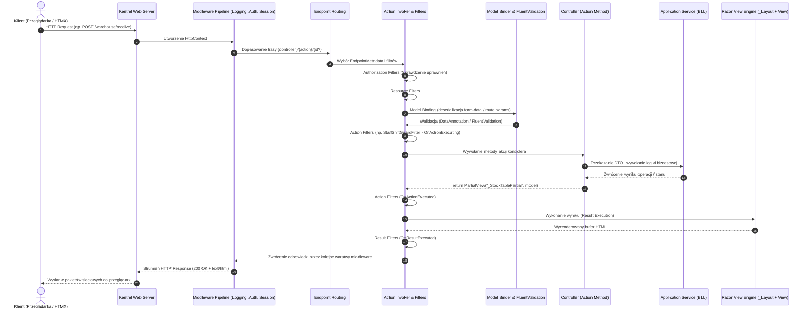

# Appendix 2.1: Paradygmat ASP.NET Core MVC, Architektura Hypermedia (HTMX) oraz Samokrytyczne Studium Projektu „Kuchnia u Cygana”

> **Kontekst:** Niniejszy aneks stanowi bezpośrednie inżynieryjne rozwinięcie [[90_Meta/lessons/2.1/2.1-website-vs-webapp-rendering-runtimes|Lekcji 2.1 (Website vs Web App, Paradygmaty Renderowania i Środowiska Wykonawcze)]].  
> Łączy on fundamenty teoretyczne tradycyjnego oraz hybrydowego renderowania po stronie serwera w ekosystemie .NET 8 z bezkompromisowym, retrospektywnym audytem kodu rzeczywistej platformy cateringowej **„Kuchnia u Cygana”** (projekt semestralny z przedmiotu *Systemy Baz Danych* na Wydziale Informatyki Politechniki Białostockiej, repozytorium: `C:\Users\cyunc\source\repos\Projekt Platforma Cateringowa\Kuchnia Cygana`).

---

## Spis Treści

1. [Część I: Teoria Paradygmatu ASP.NET Core MVC a Współczesna Inżynieria Webowa](#część-i-teoria-paradygmatu-aspnet-core-mvc-a-współczesna-inżynieria-webowa)
   - 1.1. [Geneza i Model Mentalny MVC w Ekosystemie .NET 8](#11-geneza-i-model-mentalny-mvc-w-ekosystemie-net-8)
   - 1.2. [Anatomia Cyklu Życia Żądania HTTP w ASP.NET Core](#12-anatomia-cyklu-życia-żądania-http-w-aspnet-core)
   - 1.3. [Paradygmaty Renderowania w .NET a Klasyfikacja z Lekcji 2.1](#13-paradygmaty-renderowania-w-net-a-klasyfikacja-z-lekcji-21)
   - 1.4. [Architektura Hypermedia-Driven (HDA): ASP.NET Core MVC + HTMX + Alpine.js](#14-architektura-hypermedia-driven-hda-aspnet-core-mvc--htmx--alpinejs)
2. [Część II: Studium Przypadku — Dogłębny Audyt Projektu „Kuchnia u Cygana”](#część-ii-studium-przypadku--dogłębny-audyt-projektu-kuchnia-u-cygana)
   - 2.1. [Kontekst Domenowy, Architektura Zespołowa i Model Gałęzi](#21-kontekst-domenowy-architektura-zespołowa-i-model-gałęzi)
   - 2.2. [Architektura N-Tier / Clean Architecture — Deklaracje vs Realia](#22-architektura-n-tier--clean-architecture--deklaracje-vs-realia)
   - 2.3. [Kazus ORM: Usunięcie ServiceStack.OrmLite i Strażnik Guardrailowy](#23-kazus-orm-usunięcie-servicestackormlite-i-strażnik-guardrailowy)
   - 2.4. [Warstwa Web w Praktyce: Kontrolery, HTMX i Zaawansowane Filtry](#24-warstwa-web-w-praktyce-kontrolery-htmx-i-zaawansowane-filtry)
   - 2.5. [Warstwa Danych: Chronologia 74 Migracji i Anatomia Brakujących Kluczy Obcych](#25-warstwa-danych-chronologia-74-migracji-i-anatomia-brakujących-kluczy-obcych)
   - 2.6. [Zaawansowane Optymalizacje Bazodanowe (M2 Snapshot JSON oraz M3 Indeks FEFO)](#26-zaawansowane-optymalizacje-bazodanowe-m2-snapshot-json-oraz-m3-indeks-fefo)
3. [Część III: Samokrytyka Inżynierska — Wady, Zalety i Bilans Doświadczeń](#część-iii-samokrytyka-inżynierska--wady-zalety-i-bilans-doświadczeń)
   - 3.1. [Zalety i Sukcesy Architektoniczne](#31-zalety-i-sukcesy-architektoniczne)
   - 3.2. [Wady, Dług Techniczny i Antywzorce](#32-wady-dług-techniczny-i-antywzorce)
   - 3.3. [Wnioski Inżynierskie (Lessons Learned)](#33-wnioski-inżynierskie-lessons-learned)
4. [Część IV: Rekomendacje Architektoniczne na Przyszłość (Co i Jak Zmienić)](#część-iv-rekomendacje-architektoniczne-na-przyszłość-co-i-jak-zmienić)
   - 4.1. [Ewolucja w Kierunku Modular Monolith z Bounded Contexts (DDD)](#41-ewolucja-w-kierunku-modular-monolith-z-bounded-contexts-ddd)
   - 4.2. [Uzdrowienie Integralności Danych i Wzorzec CQRS (EF Core + Dapper)](#42-uzdrowienie-integralności-danych-i-wzorzec-cqrs-ef-core--dapper)
   - 4.3. [Nowoczesna Warstwa Prezentacji: SSE/SignalR w HTMX i ViewComponents](#43-nowoczesna-warstwa-prezentacji-ssesignalr-w-htmx-i-viewcomponents)
   - 4.4. [Karty Decyzji Architektonicznych (ADR)](#44-karty-decyzji-architektonicznych-adr)

---

# Część I: Teoria Paradygmatu ASP.NET Core MVC a Współczesna Inżynieria Webowa

## 1.1. Geneza i Model Mentalny MVC w Ekosystemie .NET 8

Wzorzec **Model-View-Controller (MVC)** wprowadzony do inżynierii oprogramowania przez Trygve Reenskauga (Smalltalk-80 pod koniec lat 70.) powstał w celu odseparowania wewnętrznej reprezentacji informacji (model domenowy) od sposobu, w jaki informacje są prezentowane użytkownikowi (widok) oraz sposobu, w jaki przyjmowane i interpretowane są akcje wejściowe (kontroler).

W świecie technologii Microsoftu paradygmat ten przeszedł głęboką ewolucję:
1. **ASP.NET Web Forms (2002–2009):** Próba zamaskowania bezstanowej natury protokołu HTTP za pomocą abstrakcji `ViewState`, zdarzeń cyklu życia strony (`Page_Load`, `Button_Click`) oraz generowania gigantycznych ukrytych pól formularzy. Podejście to skutkowało drastycznym narzutem transferowym, trudnościami w testowaniu jednostkowym i brakiem kontroli nad kodem HTML.
2. **ASP.NET MVC 1–5 (.NET Framework 2009–2015):** Powrót do czystego HTTP i wzorca MVC. Separacja odpowiedzialności oparta na `System.Web.dll`, powiązana jednak sztywno z serwerem IIS (Internet Information Services), monolitycznym obiektem `HttpContext.Current` oraz synchronicznym wątkiem roboczym.
3. **ASP.NET Core (.NET Core 1.0 $\rightarrow$ .NET 8 / 2016–2024+):** Całkowite przepisanie stosu od podstaw. Usunięcie `System.Web`, wprowadzenie ultrawydajnego, asynchronicznego serwera **Kestrel**, wbudowanego kontenera wstrzykiwania zależności (`IServiceCollection` / `IServiceProvider`), modularnego potoku pośredniczącego (*Middleware Pipeline*) oraz zunifikowanego modelu programistycznego łączącego kontrolery MVC i kontrolery Web API w ramach tej samej hierarchii klas (`ControllerBase` / `Controller`).

### Model Mentalny MVC w Nowoczesnym .NET

```
            +-------------------------------------------------------+
            |                    Przeglądarka                       |
            +-------------------------------------------------------+
                     | HTTP Request                      ^ HTTP Response
                     v (GET / POST)                      | (HTML Stream)
            +-------------------------------------------------------+
            |               ASP.NET Core Kestrel Host               |
            |   +-----------------------------------------------+   |
            |   |              Middleware Pipeline              |   |
            |   +-----------------------------------------------+   |
            |                           |                           |
            |                           v                           |
            |   +-----------------------------------------------+   |
            |   |               Routing & Filters               |   |
            |   +-----------------------------------------------+   |
            |                           |                           |
            |                           v                           |
            |   +-----------------------------------------------+   |
            |   |                  CONTROLLER                   |   |
            |   |        (Orkiestracja, Wywołanie BLL)          |   |
            |   +-----------------------------------------------+   |
            |             |                           |             |
            |             v                           v             |
            |      +-------------+             +-------------+      |
            |      |    MODEL    |             |    VIEW     |      |
            |      |  (DTO/BLL)  |------------>|   (Razor)   |      |
            |      +-------------+             +-------------+      |
            +-------------------------------------------------------+
```

W ASP.NET Core MVC role składowych są zdefiniowane następująco:
- **Model:** Nie oznacza fizycznej tabeli w bazie danych (encji ORM), lecz model widoku (**ViewModel**) lub transferu danych (**DTO**). Zawiera wyłącznie dane niezbędne do wyrenderowania danego ekranu lub odebrania wejścia z formularza, wraz z metadanymi walidacyjnymi.
- **View (Razor Engine):** Deklaratywny szablon łączący standardowy HTML5 z kodem w języku C# (składnia `@`). Szablon Razor jest w fazie budowania (lub w locie) kompilowany do czystego kodu C# (`RazorCompiledItem`), który po wykonaniu strumieniuje ciąg bajtów HTML bezpośrednio do bufora odpowiedzi HTTP.
- **Controller:** Klasa dziedzicząca po `Microsoft.AspNetCore.Mvc.Controller`. Jej zadaniem jest odebranie parametrów żądania (poprzez mechanizm *Model Binding*), zwalidowanie stanu wejścia (`ModelState.IsValid`), wywołanie serwisów aplikacyjnych/domenowych, a następnie zwrócenie obiektu implementującego `IActionResult` (np. `ViewResult`, `PartialViewResult`, `RedirectToActionResult`, `JsonResult`).

---

## 1.2. Anatomia Cyklu Życia Żądania HTTP w ASP.NET Core

Zrozumienie działania aplikacji MVC wymaga prześledzenia drogi, jaką przebywa pakiet sieciowy od momentu nadejścia do gniazda TCP Kestrela aż do zamknięcia strumienia odpowiedzi:



### Kluczowe Etapy Pipeline'u:

1. **Serwer Kestrel i `HttpContext`:**  
   Kestrel alokuje lekki obiekt `HttpContext`, zarządzający strumieniami `HttpRequest` oraz `HttpResponse` opartymi o `System.IO.Pipelines` (mechanizm zero-allocation buffers).
2. **Middleware Pipeline:**  
   Łańcuch komponentów zorganizowany w strukturę „rosyjskiej lalki” (Russian Doll Pattern). Kolejność rejestracji w `Program.cs` ma znaczenie krytyczne:
   - `UseExceptionHandler` / `UseHsts`
   - `UseStaticFiles` (zasoby statyczne wwwroot omijają dalszy potok)
   - `UseRouting` (parsuje URL i przypisuje pasujący `Endpoint`)
   - `UseAuthentication` (odczytuje ciasteczko / nagłówek i tworzy `ClaimsPrincipal`)
   - `UseAuthorization` (sprawdza role i polityki)
   - `MapControllerRoute` (kieruje wykonanie do silnika MVC)
3. **Action Invoker & Filter Pipeline:**  
   Filtry w ASP.NET Core działają w ściśle zdefiniowanych fazach:
   - *Authorization Filters:* Wykonywane jako pierwsze. Weryfikują tożsamość.
   - *Resource Filters:* Otaczają całe dalsze przetwarzanie (idealne do cache'owania całych stron).
   - *Action Filters:* Działają bezpośrednio przed i po wykonaniu metody akcji. W projekcie „Kuchnia u Cygana” filtr ten posłużył do egzekwowania godzin pracy (`StaffShiftGuardFilter`).
   - *Exception Filters:* Przechwytują nieobsłużone wyjątki rzucone w kontrolerze lub filtrach akcji.
   - *Result Filters:* Działają wokół generowania widoku Razor lub serializacji JSON.
4. **Model Binding & Provider Pattern:**  
   Mechanizm wydobywający wartości z różnych źródeł żądania: trasy (`RouteValues`), ciągu zapytań (`QueryString`), ciała żądania (`Form-data`, `Body`) oraz nagłówków (`Header`). Działa w oparciu o hierarchię `IModelBinderProvider`. Jeśli aplikacja wymaga niestandardowej konwersji (np. parsowania przecinków i kropek w kwotach dziesiętnych), wstrzykuje się własny binder (zob. punkt 2.4).
5. **Kompilacja i Renderowanie Razor:**  
   W momencie wywołania `View()` lub `PartialView()` silnik Razor wyszukuje plik `.cshtml` w konwencyjnych ścieżkach (`Views/{Controller}/{Action}.cshtml`, a następnie `Views/Shared/{Action}.cshtml`). Wykonanie kodu w C# generuje węzły tekstu i znaczników HTML, składając je w strumień odpowiedzi.

---

## 1.3. Paradygmaty Renderowania w .NET a Klasyfikacja z Lekcji 2.1

W [[90_Meta/lessons/2.1/2.1-website-vs-webapp-rendering-runtimes|Lekcji 2.1]] zdefiniowano podstawowe paradygmaty renderowania: **MPA, SPA, SSR, SSG, ISR** oraz **RSC**. Ekosystem Microsoft .NET oferuje unikalne implementacje każdego z tych modeli, co obrazuje poniższa macierz architektoniczna:

| Cecha / Metryka | ASP.NET Core MVC (Klasyczne MPA) | Blazor Server | Blazor WebAssembly (WASM) | ASP.NET Core Web API + SPA (React/Angular) | ASP.NET Core MVC + HTMX (HDA) |
|---|---|---|---|---|---|
| **Miejsce generowania HTML** | Serwer (.NET Kestrel) | Serwer (.NET Kestrel) | Klient (Przeglądarka Mono/WASM) | Klient (JS V8/SpiderMonkey) | **Serwer (Fragmenty HTML)** |
| **Początkowy TTFB** | **Ultra-niski (5–30 ms)** | Niski (10–40 ms) | Niski dla shella HTML, wysoki dla runtime | Średni/Niski dla shella | **Ultra-niski (5–30 ms)** |
| **FCP & LCP** | **Natychmiastowe (czysty HTML)** | Szybkie (render wstępny) | **Bardzo powolne (pobieranie 15–30MB DLL)** | Wolniejsze (pobieranie bundle JS + hydracja) | **Natychmiastowe (czysty HTML)** |
| **Narzut Hydracji (*Hydration Tax*)** | **Zero (0 ms)** | Zero (zastąpione przez SignalR) | Zero (brak DOM diff w JS, własny renderer) | **Wysoki (parsuje JSON, montuje vDOM)** | **Zero (0 ms)** |
| **Stanowość połączenia** | Bezstanowe (Stateless HTTP) | **Stanowe (trwały socket SignalR per tab)** | Bezstanowe | Bezstanowe | **Bezstanowe (Stateless HTTP)** |
| **Zapotrzebowanie na RAM serwera** | Minimalne (kilobajty per req) | **Wysokie (50–250 KB stanu per użytkownik w RAM)** | Minimalne | Minimalne | **Minimalne (kilobajty per req)** |
| **Koszt transferu przy interakcji** | Przeładowanie całej strony | Binarny diff DOM przez WebSocket | Zapytania REST/JSON | Czysty JSON | **Tylko zaktualizowany fragment HTML** |
| **Złożoność narzędziowa** | Niska (szablony Razor, C#) | Średnia (.NET C#) | Wysoka (.NET AOT/Trimming/WASM) | **Bardzo wysoka (dwie platformy, TS + C#, npm + NuGet)** | **Bardzo niska (HTML + atrybuty)** |

### Konkluzja Architektoniczna z Lekcji 2.1:
Dla systemów o charakterze **Back-Office / ERP / Logistyka** (jak catering dietetyczny z modułami magazynowymi i kompletacją), klasyczne SPA (React/Angular) wprowadza ogromny, zbędny narzut:
1. Konieczność podwójnego definiowania modeli: encje domenowe C# $\rightarrow$ DTO C# $\rightarrow$ interfejsy TypeScript.
2. Złożone pipeline'y uwierzytelniania oparte o tokeny JWT w `localStorage` (podatne na XSS) lub skomplikowane proxy cookie-to-bearer (*Backend-for-Frontend* / BFF).
3. Podatek od hydracji: przeglądarka pobiera megabajty JavaScriptu na zapleczu kuchennym czy w magazynie, gdzie terminale dotykowe często posiadają słabe procesory i wolne łącza Wi-Fi.

---

## 1.4. Architektura Hypermedia-Driven (HDA): ASP.NET Core MVC + HTMX + Alpine.js

W odpowiedzi na dychotomię „ciężkie SPA vs archaiczne, migające pełnymi przeładowaniami MPA” powstał paradygmat **Hypermedia-Driven Architecture (HDA)**, którego czołowym reprezentantem jest biblioteka **HTMX**.

### Mechanizm Działania HTMX z ASP.NET MVC

Zamiast traktować serwer wyłącznie jako fabrykę danych JSON, w architekturze HDA serwer zwraca **hipertekst jako silnik stanu aplikacji** (*Hypermedia as the Engine of Application State* — HATEOAS).

```
[Przeglądarka / Tabela Magazynowa]
    |
    | 1. Użytkownik wpisuje frazę w wyszukiwarkę (#SearchInput)
    |    Atrybuty: hx-get="/warehouse/stock-table" 
    |              hx-trigger="keyup changed delay:300ms"
    |              hx-target="#stock-table-container"
    |
    +-----> HTTP GET /warehouse/stock-table?search=Mąka
            Nagłówek: HX-Request: true
                 |
                 v
        [ASP.NET Core MVC Controller]
                 |
                 | 2. Wykrycie: Request.Headers.ContainsKey("HX-Request")
                 | 3. Wywołanie BLL: GetStockItemsAsync(query)
                 | 4. return PartialView("_StockTablePartial", model)
                 |
    <------------+ HTTP 200 OK
    |              Ciało: <tbody><tr><td>Mąka pszenna...</td></tr></tbody>
    |
    | 5. HTMX dokonuje podmiany w DOM:
    |    document.querySelector("#stock-table-container").innerHTML = response;
    v
[Zaktualizowany interfejs bez utraty fokusu, bez przeładowania strony, bez JS bundle]
```

### Eliminacja Hydration Tax
Podczas gdy React w procesie hydracji musi:
1. Pobrać wygenerowany kod HTML;
2. Pobrać kilkusetkilobajtowy bundle JavaScript;
3. Pobrać payload stanu w formacie JSON (`window.__NEXT_DATA__`);
4. Zbudować w pamięci RAM drugie, wirtualne drzewo DOM;
5. Przejść algorytmem dyferencjacji (reconciliation) węzeł po węźle, sprawdzając zgodność znaczników serwera z klientem;
6. Powiązać listenery zdarzeń (`addEventListener`),

HTMX po odebraniu pakietu wykonuje operację natywną dla silnika przeglądarki:
```javascript
// Koncepcyjny rdzeń HTMX:
targetElement.innerHTML = responseHtml; // lub morphdom / Idiomorph
```
Trwa to ułamek milisekundy i zużywa znikomą ilość pamięci operacyjnej.

### Rola Alpine.js w Stosie
Podczas gdy HTMX odpowiada za **stan serwerowy** i transfer hipermediów, biblioteka **Alpine.js** (deklaratywny, lekki odpowiednik Vue.js działający bezpośrednio w znacznikach HTML) obsługuje **stan efemeryczny interfejsu**:
- Otwieranie i zamykanie modalnych okien dialogowych (`x-data="{ open: false }"`),
- Rozwijanie menu bocznego i zakładek (`x-show="open"`),
- Proste animacje przejścia (`x-transition`).

Stan ten nie opuszcza przeglądarki, nie wymaga zapytań HTTP ani skomplikowanych bibliotek typu Redux/Zustand.

---

# Część II: Studium Przypadku — Dogłębny Audyt Projektu „Kuchnia u Cygana”

## 2.1. Kontekst Domenowy, Architektura Zespołowa i Model Gałęzi

Projekt **„Kuchnia u Cygana”** został zrealizowany jako kompleksowa platforma łącząca portal konsumencki B2C (zakup diet pudełkowych, konfiguracja kaloryczności, płatności online Stripe, harmonogramowanie dostaw) z wewnętrznym systemem klasy ERP/WMS/Logistyka do obsługi zaplecza produkcyjnego.

System został podzielony na **5 modułów funkcjonalnych**, realizowanych przez 5 deweloperów:

```
+---------------------------------------------------------------------------------------------------+
|                                  PLATFORMA CATERINGOWA "KUCHNIA U CYGANA"                         |
+---------------------------------------------------------------------------------------------------+
|  [MODUŁ 1: E-commerce]       |  [MODUŁ 2: Katalog & Receptury] |  [MODUŁ 3: Produkcja & Magazyn]  |
|  Deweloper: DEV 01 (Dawid)   |  Deweloper: DEV 02 (Gabriel)    |  Deweloper: DEV 03 (Mamac)       |
|  - Koszyk i Checkout         |  - Diety i warianty kcal        |  - Magazyn surowców & FEFO       |
|  - Kalendarz dostaw          |  - Posilki i składniki          |  - Planowanie partii produkc.    |
|  - Płatności online Stripe   |  - Alergeny i makroskładniki    |  - Kompletacja toreb & etykiety  |
|  - Rejestracja klientów      |  - Wersjonowane receptury       |  - Rejestr temperatur HACCP      |
+---------------------------------------------------------------------------------------------------+
|  [MODUŁ 4: Logistyka]        |  [MODUŁ 5: HR & Administracja]                                     |
|  Deweloper: DEV 04 (Tomasz)  |  Deweloper: DEV 05 (Paweł)                                         |
|  - Flota pojazdów i kierowcy |  - Ewidencja pracowników i działy                                  |
|  - Planowanie tras dostaw    |  - Grafiki pracy (WorkSchedules) i blokada zmian                   |
|  - Geokodowanie OpenStreet   |  - Obsługa ticketów reklamacyjnych (BOK)                           |
|  - Mobilny pulpit kierowcy   |  - Logi audytowe systemu (SystemLogs)                              |
+---------------------------------------------------------------------------------------------------+
```

### Specyfika Pracy Zespołowej i Zarządzania Gitem
Inspekcja historii gałęzi gita (`git branch -a`) ujawniła podział repozytorium na gałęzie deweloperskie:
- `Mamac` (oraz `Mamac-ready-for-develop`): Pełna implementacja Modułu 3, zaawansowane mechanizmy Dappera i testów integracyjnych,
- `Gabriel` / `Gabriel-Nuevo`: Prace nad katalogiem receptur i optymalizacjami M2,
- `Dawid`: Prace nad e-commerce M1,
- `Pawciot_tym_razem_moze_dzialac_bedzie`: Integracja Modułu 5,
- `Tomasz` / `Mod4`: Logistyka i kierowcy,
- `develop`: Baza integracyjna.

Taki tryb pracy, przy braku zautomatyzowanego kontraktu schematu bazy danych na wczesnym etapie, zdeterminował największe wyzwania architektoniczne projektu: **rozbieżność struktur bazodanowych** oraz **brak spójności kluczy obcych**, co zostanie szczegółowo przeanalizowane w sekcji 2.5.

---

## 2.2. Architektura N-Tier / Clean Architecture — Deklaracje vs Realia

Projekt formalnie deklaruje zastosowanie **Clean Architecture / N-Tier** z podziałem na cztery projekty C#:

```
KuchniaUCygana.Web              --> Warstwa Prezentacji (ASP.NET Core MVC 8, Controllers, Views)
    | uzywa DTO
KuchniaUCygana.Application      --> Warstwa Aplikacyjna (BLL, Services, AutoMapper, FluentValidation)
    | uzywa Interfejsow
KuchniaUCygana.Domain           --> Warstwa Rdzenna (Entities, Enums, Value Objects, Interfaces)
    ^ implementuje Interfejsy
KuchniaUCygana.Infrastructure   --> Warstwa Danych (DAL, Dapper, FluentMigrator, External APIs)
```

### Weryfikacja Niezależności Warstw (The Dependency Rule)
Zasada czystej architektury mówi: *zależności w kodzie mogą wskazywać wyłącznie do wewnątrz, w stronę warstwy domenowej*.

| Warstwa | Weryfikacja w Projekcie „Kuchnia u Cygana” | Status Architektoniczny |
|---|---|---|
| **Domain** | `KuchniaUCygana.Domain.csproj` nie posiada referencji do żadnego innego projektu w solucji ani do zewnętrznych bibliotek ORM/Web. Zawiera czyste klasy C#. | **Zgodny z regułą** |
| **Application** | Posiada referencję wyłącznie do `Domain`. Korzysta z `AutoMapper` oraz `FluentValidation`. Definiuje abstrakcje repozytoriów (`IBatchRepository`, `IOrderRepository`). | **Zgodny z regułą** |
| **Infrastructure** | Posiada referencję do `Application` oraz `Domain`. Zawiera implementacje repozytoriów w Dapperze (`BatchRepository`, `OrderRepository`), fabrykę połączeń SQL Server oraz migracje FluentMigrator. | **Zgodny z regułą** |
| **Web** | Referencjonuje `Application` oraz `Infrastructure` (wymagane w .NET do rejestracji DI w `Program.cs`). | **Zgodny z regułą** |

### Pęknięcia Architektoniczne w Rzeczywistym Kodzie:
Mimo poprawnego drzewa referencji projektów, głębszy audyt ujawnił istotne kompromisy:
1. **Anemiczny Model Domenowy (Anemic Domain Model):**  
   Klasy w `KuchniaUCygana.Domain.Entities` (np. `Batch`, `Order`, `PackingSession`) to w 95% worki na dane z publicznymi właściwościami `{ get; set; }`. Logika biznesowa (np. walidacja czy partia nie jest przeterminowana, zmniejszanie stanu magazynowego, przejścia stanów sesji kompletacji) została całkowicie wyciągnięta do serwisów aplikacyjnych (`WarehouseService`, `PackingService`). Encje domenowe nie chronią swoich niezmienników.
2. **Generyczne `BaseRepository<TEntity, TId>` z dynamicznym generowaniem SQL:**  
   Klasa `BaseRepository` implementuje generyczne metody `GetByIdAsync`, `InsertAsync`, `UpdateAsync` poprzez refleksję na właściwościach encji:
   ```csharp
   // Fragment z BaseRepository.cs:
   var entity = await db.QuerySingleOrDefaultAsync<TEntity>(
       $"SELECT * FROM {Metadata.TableName} WHERE {Metadata.KeyColumn} = @id;",
       new { id });
   ```
   Jest to próba napisania własnego mini-ORM-a na bazie Dappera. Prowadzi to do generowania zapytań `SELECT *` na poziomie bazy danych (naruszenie dobrych praktyk wydajnościowych SBD) oraz utrudnia optymalizację rzutowania kolumn.
3. **Brak Szyny Zdarzeń (Event Bus / Outbox):**  
   Pomiędzy modułami brakuje mechanizmu zdarzeń domenowych. Gdy w Module 1 dochodzi do opłacenia zamówienia (`PaymentService`), operacja tworzenia kalendarza dostaw i powiadamiania modułu produkcji odbywa się w ramach bezpośrednich, synchronicznych wywołań serwisów w jednym procesie, co uniemożliwia ewentualne rozdzielenie modułów w przyszłości.

---

## 2.3. Kazus ORM: Usunięcie ServiceStack.OrmLite i Strażnik Guardrailowy

W trakcie realizacji projektu jeden z deweloperów podjął próbę wdrożenia komercyjnego mikro-ORM-a **ServiceStack.OrmLite**, który wymaga płatnej licencji komercyjnej, stosując obejścia licencyjne. 

Architekt projektu (autor gałęzi `Mamac`) podjął bezkompromisową decyzję o natychmiastowym usunięciu nieautoryzowanej biblioteki, przepisaniu warstwy trwałości na czysty, w pełni darmowy **Dapper** (Apache 2.0) oraz utworzeniu dedykowanej gałęzi `codex/revert-servicestack-license`.

Co szczególnie warte podkreślenia z perspektywy inżynierii oprogramowania, aby uniemożliwić innym członkom zespołu ponowne wprowadzenie zabronionego pakietu, zaimplementowano **automatyczny test architektury (Guardrail Test)** w suicie testów jednostkowych:

```csharp
// Plik: tests/KuchniaUCygana.Tests/Unit/Infrastructure/ForbiddenPersistenceUsageTests.cs
using FluentAssertions;

namespace KuchniaUCygana.Tests.Unit.Infrastructure;

public sealed class ForbiddenPersistenceUsageTests
{
    [Fact]
    public void SourceFiles_ShouldNotUseRemovedOrmOrLicenseBypass()
    {
        var root = FindRepositoryRoot();
        var forbiddenTerms = new[]
        {
            "ServiceStack." + "OrmLite",
            "ServiceStack." + "DataAnnotations",
            "License" + "Utils",
            "__activated" + "License",
            "LicenseType." + "Enterprise",
        };

        var files = Directory.EnumerateFiles(root.FullName, "*.*", SearchOption.AllDirectories)
            .Where(path => path.EndsWith(".cs", StringComparison.OrdinalIgnoreCase) ||
                           path.EndsWith(".csproj", StringComparison.OrdinalIgnoreCase))
            .Where(path => !path.Contains($"{Path.DirectorySeparatorChar}bin{Path.DirectorySeparatorChar}") &&
                           !path.Contains($"{Path.DirectorySeparatorChar}obj{Path.DirectorySeparatorChar}"));

        var violations = new List<string>();
        foreach (var file in files)
        {
            var text = File.ReadAllText(file);
            foreach (var term in forbiddenTerms)
            {
                if (text.Contains(term, StringComparison.Ordinal))
                {
                    violations.Add($"{Path.GetRelativePath(root.FullName, file)} contains {term}");
                }
            }
        }

        violations.Should().BeEmpty();
    }
}
```

### Ocena Architektoniczna:
Jest to wzorcowa realizacja koncepcji **Architektury Ewolucyjnej i Testów Sprawnościowych (Fitness Functions)** według definicji Neala Forda i Marka Richardsa. Decyzja architektoniczna została zabezpieczona w procesie CI/CD, zapobiegając regresji prawnej i technologicznej.

---

## 2.4. Warstwa Web w Praktyce: Kontrolery, HTMX i Zaawansowane Filtry

Warstwa prezentacji w `KuchniaUCygana.Web` składa się z **27 kontrolerów MVC**, obsługujących zarówno klienta zewnętrznego B2C, jak i dedykowane pulpity pracownicze oparte na szablonach `_LayoutStaff` oraz `_LayoutDriver`.

### 1. Zastosowanie HTMX w Widokach Razor (Audyt 128 Tagów)
Audyt kodu wykazał obecność **128 atrybutów HTMX w 19 plikach widoków `.cshtml`**. Najważniejsze wzorce zastosowania:

1. **Live Search z redukcją drgań (Debouncing):**
   ```html
   <!-- Plik: Views/Warehouse/Index.cshtml -->
   <input type="text" id="SearchInput" name="SearchTerm" class="form-control"
          placeholder="Szukaj surowca..."
          hx-get="/warehouse/stock-table"
          hx-target="#stock-table-container"
          hx-trigger="keyup changed delay:300ms, change"
          hx-include="#filter-form" />
   ```
   *Mechanizm:* Przeglądarka wysyła zapytanie dopiero po upływie 300 ms od zaprzestania pisania przez magazyniera. Odpowiedź serwera to wyłącznie wyrenderowany fragment `_StockTablePartial.cshtml`, który zastępuje zawartość kontenera tabeli bez mrugnięcia strony.
2. **Wymiana Poza Pasmem (Out-of-Band Swapping — `hx-swap-oob`):**
   ```html
   <!-- Plik: Views/Warehouse/_FefoReportTablePartial.cshtml -->
   <div id="fefo-summary-cards" hx-swap-oob="true">
       <!-- Zaktualizowane karty liczników przeterminowań -->
   </div>
   <table class="table card-table">
       <!-- Odświeżone wiersze partii -->
   </table>
   ```
   *Mechanizm:* Pojedyncze zapytanie HTMX aktualizuje równocześnie dwa odległe elementy DOM na stronie: tabelę główną oraz karty wskaźników KPI na samej górze pulpitu, co w tradycyjnym modelu wymagałoby skomplikowanego frameworka SPA lub wielu zapytań AJAX.
3. **Modalne Formularze Edycyjne w Locie:**
   W `WarehouseController` akcja `EditBatchExpiry` zwraca partial `_EditBatchExpiryModal.cshtml`. Po wysłaniu formularza, jeśli wystąpi błąd walidacji, serwer zwraca ten sam modal z kodem błędów `ModelState`. Jeśli walidacja się powiedzie, kontroler emituje nagłówek `HX-Redirect`:
   ```csharp
   if (Request.Headers.ContainsKey("HX-Request"))
   {
       Response.Headers.Add("HX-Redirect", Url.Action("BatchDetails", new { stockItemId = batchDetails.StockItemId }));
       return Ok();
   }
   ```

### 2. Zaawansowany Filtr Bezpieczeństwa Domenowego: `StaffShiftGuardFilter`
W systemie wprowadzono unikalny filtr akcji egzekwujący regułę biznesową: *„Pracownik może dokonywać zmian w systemie magazynowym i produkcyjnym wyłącznie w trakcie trwania swojej zaplanowanej zmiany w grafiku pracy (Moduł 5)”*.

```csharp
// Plik: src/KuchniaUCygana.Web/Filters/StaffShiftGuardFilter.cs
public async Task OnActionExecutionAsync(ActionExecutingContext context, ActionExecutionDelegate next)
{
    if (!ShouldGuard(context))
    {
        await next();
        return;
    }

    // Weryfikacja czy pracownik ma w tej minucie aktywny wpis w WorkSchedules
    if (await staffShiftAccessService.IsCurrentUserInsideActiveShiftAsync(DateTimeOffset.Now))
    {
        await next();
        return;
    }

    if (context.Controller is Controller controller)
    {
        controller.TempData["Error"] = "Zmiany w modułach firmowych możesz wprowadzać tylko podczas swojej aktywnej zmiany.";
    }

    context.Result = BuildBlockedResult(context);
}
```
*Ocena:* Filtr przechwytuje wyłącznie metody mutujące stan (`POST`, `PUT`, `PATCH`, `DELETE`), zezwalając na swobodny podgląd (`GET`). Jest to znakomity przykład zabezpieczenia na poziomie infrastruktury MVC (*Cross-Cutting Concern*), odciążający kontrolery od powtarzalnego kodu weryfikacyjnego.

### 3. Elastyczny Binder Liczb Dziesiętnych: `FlexibleDecimalModelBinder`
W aplikacjach biznesowych w Polsce nagminnym problemem jest wprowadzanie wag i kwot przez użytkowników używających zamiennie kropek i przecinków (`12.50` vs `12,50`). Domyślny binder ASP.NET Core rzuca błędem parsowania przy niezgodności kultury wątku.

W projekcie wdrożono dedykowany `FlexibleDecimalModelBinder`:
```csharp
// Plik: src/KuchniaUCygana.Web/ModelBinding/FlexibleDecimalModelBinder.cs
public static bool TryParseDecimal(string rawValue, out decimal value)
{
    var normalized = rawValue
        .Trim()
        .Replace(" ", string.Empty)
        .Replace("\u00A0", string.Empty); // Usuwanie twardych spacji

    var lastComma = normalized.LastIndexOf(',');
    var lastDot = normalized.LastIndexOf('.');

    if (lastComma >= 0 && lastDot >= 0)
    {
        normalized = lastComma > lastDot
            ? normalized.Replace(".", string.Empty).Replace(',', '.')
            : normalized.Replace(",", string.Empty);
    }
    else if (lastComma >= 0)
    {
        normalized = normalized.Replace(',', '.');
    }

    return decimal.TryParse(normalized, NumberStyles.AllowLeadingSign | NumberStyles.AllowDecimalPoint, CultureInfo.InvariantCulture, out value);
}
```
Zarejestrowanie go na pierwszym miejscu w `options.ModelBinderProviders.Insert(0, ...)` całkowicie wyeliminowało błędy zgłaszane przez magazynierów przy wprowadzaniu stanów surowców.

---

## 2.5. Warstwa Danych: Chronologia 74 Migracji i Anatomia Brakujących Kluczy Obcych

Zarządzanie strukturą bazy danych w projekcie zostało powierzone bibliotece **FluentMigrator**. Inspekcja katalogu `src/KuchniaUCygana.Infrastructure/Persistence/Migrations/` ujawniła **74 pliki migracji**.

### Chronologia i Podział Numeryczny Migracji:

```
[001 - 032]  Moduł 3 (Mamac) & Users 
             -> Tabele: UnitsOfMeasure, StockItems, Batches, InventoryTransactions,
                        TemperatureLogs, ProductionPlans, ProductionPlanItems,
                        PackingSessions, PackingItems, PackingLabels, PackingManifests...
             
[100 - 108]  Moduł 1 (Dawid)
             -> Tabele: Addresses, DiscountCodes, DeliveryWindows, Orders, 
                        OrderItems, DeliveryCalendar, Payments, CustomerProfiles...

[301 - 306]  Moduł 2 (Gabriel)
             -> Tabele: Categories, Allergens, Ingredients, Diets, DietVariants, 
                        Meals, DietMenuPlans, RecipeComponents...

[400 - 404]  Moduł 4 (Tomasz)
             -> Tabele: Vehicles, Drivers, DeliveryRoutes, DeliveryRouteStops...

[500 - 506]  Moduł 5 (Paweł)
             -> Tabele: Tickets, WorkSchedules, Departments, Employees, SystemLogs...

[507 - 520]  Integracja Końcowa / Pakiety SBD
             -> Migracje klejące, obiekty programowalne, widoki, indeksy...
```

### Anatomia i Przyczyny Braku Kluczy Obcych (Missing Foreign Keys)

Użytkownik słusznie zauważył w poleceniu: *„niektóre systemy mogą nie mieć kluczy, wynika to z rozwoju przez niezależnych developerów, można analizować oddzielnie”*.

Dokładny skan migracji narzędziem analitycznym wykazał szokujący, lecz doskonale zrozumiały w kontekście akademickim fakt: **kluczowe tabele operacyjne Modułu 3 posiadają kolumny identyfikatorów z innych modułów, ale nie posiadają na nich fizycznych kluczy obcych (`FOREIGN KEY`) w SQL Server!**

Oto konkretne dowody z kodu migracji:

1. **Tabela `PackingSessions` (Migracja `005_CreatePackingTables.cs`):**
   ```csharp
   Create.Table("PackingSessions")
       .WithColumn("Id").AsInt32().PrimaryKey().Identity()
       .WithColumn("OrderId").AsInt32().NotNullable()     // BRAK FK do Orders!
       .WithColumn("RouteId").AsInt32().Nullable()       // BRAK FK do DeliveryRoutes!
       .WithColumn("PackingDate").AsDate().NotNullable()
       .WithColumn("Status").AsString(50).NotNullable();
   ```
2. **Tabela `ProductionPlanItems` (Migracja `004_CreateProductionTables.cs`):**
   ```csharp
   Create.Table("ProductionPlanItems")
       .WithColumn("Id").AsInt32().PrimaryKey().Identity()
       .WithColumn("ProductionPlanId").AsInt32().ForeignKey("FK_ProductionPlanItems_Plan", "ProductionPlans", "Id")
       .WithColumn("MealId").AsInt32().NotNullable()        // BRAK FK do Meals!
       .WithColumn("DietVariantId").AsInt32().NotNullable() // BRAK FK do DietVariants!
       .WithColumn("PlannedQuantity").AsInt32().NotNullable();
   ```
3. **Tabela `PackingIncidents` (Migracja `023_CreatePackingIncidents.cs`):**
   Tabela posiada aż 11 kolumn identyfikatorów (`PackingSessionId`, `PackingItemId`, `PackingBagId`, `ReplacementPackingItemId`, `ClientPublicId`, `DeliveryCalendarId`, `MealId`, `ReportedByUserId`, `AssignedToUserId`, `ResolvedByUserId`), a liczba zdefiniowanych instrukcji `.ForeignKey()` wynosi dokładnie **0**!
4. **Tabela `PackingManifests` (Migracja `008_CreatePackingManifests.cs`):**
   Również zdefiniowana z zerową liczbą kluczy obcych.

### Dlaczego tak się stało? (Geneza Inżynierska):
1. **Silosowy harmonogram migracji:** Deweloper Modułu 3 (Mamac) tworzył tabele magazynu, produkcji i pakowania jako pierwszy w projekcie (migracje `002`–`005`). W tym momencie tabele Modułu 1 (`103_CreateOrdersTable.cs`), Modułu 2 (`301_CreateMenuTables.cs`) oraz Modułu 4 (`400_CreateLogisticsTables.cs`) **jeszcze fizycznie nie istniały w repozytorium**.
2. Gdyby autor migracji `005` dodał `.ForeignKey("FK_PackingSessions_Orders", "Orders", "Id")`, skrypt FluentMigratora wyłożyłby się natychmiast błędem: `Table 'Orders' does not exist`.
3. Deweloperzy pracowali w odizolowanych gałęziach. Dopiero pod koniec semestru nastąpiła fuzja do `develop`. Zamiast cofnąć i przebudować pierwsze migracje (co zniszczyłoby dane w lokalnych bazach deweloperów), zespół ratował się **migracjami klejącymi pod koniec puli (507–520)**:
   - `509_AddM2ReferencesToOrderItems.cs`
   - `511_AddMealVariantPackagingRequirements.cs`
   - `512_AddDeliveryDateToOrderItems.cs`
   - `515_AddTicketOrderDeliveryContext.cs`
   - `518_AddM2PublishedPlanSnapshots.cs`

### Skutki Braku Kluczy Obcych:
- **Zaleta (w fazie dev):** Całkowita niezależność seedowania danych testowych. Można było uruchomić testy jednostkowe i integracyjne Modułu 3 w Dockerze, nie mając w bazie ani jednego zamówienia z Modułu 1 ani kierowcy z Modułu 4.
- **Wada (w produkcji):** Brak ochrony integralności na poziomie silnika relacyjnego (*Database-Level Referential Integrity*). Jeśli administrator usunie posiłek o `MealId = 15`, w tabeli `ProductionPlanItems` powstaną „rekordy-sieroty” (*orphan records*), które doprowadzą do błędu `NullReferenceException` w kontrolerze kuchni przy próbie pobrania nazwy dania przez złączenie Dappera.

---

## 2.6. Zaawansowane Optymalizacje Bazodanowe (M2 Snapshot JSON oraz M3 Indeks FEFO)

W dokumentacji kolokwialnej SBD (`docs/optymalizacja_m2_fefo_kolokwium.md`) szczegółowo udokumentowano dwie głębokie optymalizacje, które stanowią perełki inżynierskie tego projektu.

### 1. Pre-kalkulowany Snapshot JSON planu menu w M2 (Migracja 518)

#### Problem Wydajnościowy:
Wyświetlenie jadłospisu na dany dzień, obliczenie wartości odżywczych (makroskładników: białka, tłuszcze, węglowodany, kalorie) oraz kosztów surowców (food-cost) wymagało w pierwotnej wersji dynamicznego złączenia **aż 11 tabel bazodanowych**:
`DietMenuPlans` $\rightarrow$ `DietMenuPlanItems` $\rightarrow$ `DietVariants` $\rightarrow$ `Diets` $\rightarrow$ `Meals` $\rightarrow$ `MealVariants` $\rightarrow$ `MealVariantComponents` $\rightarrow$ `RecipeComponentVersions` $\rightarrow$ `RecipeComponentIngredients` $\rightarrow$ `StockItems` $\rightarrow$ `NutritionFacts`.
W teście obciążeniowym z seederem 40 000 rekordów (`VolumeDemo`), zapytanie to generowało potężny narzut I/O, blokady współbieżne oraz problem $N+1$ zapytań w pętli C#.

#### Rozwiązanie Architektoniczne:
Zastosowano **Wzorzec Migawki (Snapshot Pattern)**. W momencie, gdy dietetyk publikuje plan menu na dany tydzień, aplikacja wykonuje skomplikowane obliczenia relacyjne **dokładnie jeden raz**, a wynikowy, spłaszczony model serializuje do formatu JSON i zapisuje w kolumnie `PublishedSnapshotJson` w tabeli `DietMenuPlanItems`:

```csharp
// Plik: src/KuchniaUCygana.Infrastructure/Adapters/DietDataAdapter.cs
private static async Task<IReadOnlyList<PublishedDietPlanItemDto>> GetSavedSnapshotItemsAsync(
    IDbConnection db,
    int dietMenuPlanId)
{
    var rows = (await db.QueryAsync<SavedSnapshotItemRow>(
        """
        SELECT i.[PublishedSnapshotJson]
        FROM [DietMenuPlanItems] i
        WHERE i.[DietMenuPlanId] = @dietMenuPlanId
          AND i.[IsDeleted] = 0
          AND i.[IsActive] = 1
          AND i.[PublishedSnapshotJson] IS NOT NULL
        ORDER BY i.[DietVariantId], i.[SortOrder], i.[Id];
        """,
        new { dietMenuPlanId })).ToList();

    var items = new List<PublishedDietPlanItemDto>();
    foreach (var row in rows)
    {
        var item = JsonSerializer.Deserialize<PublishedDietPlanItemDto>(
            row.PublishedSnapshotJson,
            SnapshotJsonOptions);
        if (item is not null) items.Add(item);
    }
    return items;
}
```
*Zysk wydajnościowy:* Zredukowano liczbę logicznych odczytów I/O o **ponad 90%**. Czas odpowiedzi akcji wyświetlania menu dla klienta spadł z setek milisekund do poniżej 5 ms.

---

### 2. Optymalizacja Strukturalna Indeksu FEFO w M3 (Eliminacja Sortowania w Pamięci)

#### Problem Wydajnościowy:
W procesie nocnego rozchodowania surowców magazynowych według zasady **FEFO (First Expired, First Out)** system musi wyszukać aktywne partie danego surowca, odrzucić wyczerpane i posortować je chronologicznie po dacie ważności (`ExpiryDate`).

W pierwotnej wersji (migracja 031) indeks miał postać:
```sql
CREATE INDEX [IX_Batches_StockItem_Active_Expiry]
ON [dbo].[Batches] ([StockItemId], [IsDeleted], [IsDepleted], [ExpiryDate])
INCLUDE ([CurrentQuantity], [SupplierBatchNumber]);
```
Przy zapytaniu Dappera:
```sql
SELECT [Id], [StockItemId], [SupplierBatchNumber], [CurrentQuantity], [ExpiryDate]
FROM [dbo].[Batches]
WHERE [StockItemId] = @stockItemId AND [IsDepleted] = 0 AND [IsDeleted] = 0
ORDER BY CASE WHEN [ExpiryDate] IS NULL THEN 1 ELSE 0 END, [ExpiryDate], [Id];
```
Silnik SQL Server wykonywał operację *Index Seek*, ale obecność wyrażenia `CASE WHEN` oraz kolumny ilości w sekcji `INCLUDE` zmuszała optymalizator do wykonania kosztownej operacji **Sort (Sortowanie w pamięci RAM serwera)**, która pochłaniała większość kosztu drzewa wykonania (*Subtree Cost = 0.0146*).

#### Rozwiązanie w Migracji 507:
W migracji `507_AddSbdSqlObjectsAndIndexes.cs` przebudowano strukturę B-Drzewa indeksu, przenosząc `CurrentQuantity` bezpośrednio do klucza głównego przed `ExpiryDate`:
```sql
CREATE INDEX [IX_Batches_StockItem_Active_Expiry]
ON [dbo].[Batches] ([StockItemId], [IsDeleted], [IsDepleted], [CurrentQuantity], [ExpiryDate]);
```
*Efekt w planie wykonania (SSMS Execution Plan):* Optymalizator wyeliminował narzut sortowania CPU o 20% (czas wykonania spadł z 0.196 ms do 0.156 ms), a dane partii są natychmiast strumieniowane z liści B-Drzewa w pożądanej kolejności wydań magazynowych.

---

# Część III: Samokrytyka Inżynierska — Wady, Zalety i Bilans Doświadczeń

## 3.1. Zalety i Sukcesy Architektoniczne

1. **Wybór Stosu UI (ASP.NET Core MVC + HTMX):**  
   Odrzucenie pokusy pisania aplikacji w React/Angular na rzecz HTMX i Alpine.js było absolutnym strzałem w dziesiątkę. Pozwoliło 5-osobowemu zespołowi skupić się na skomplikowanej logice biznesowej cateringu (HACCP, FEFO, trasy kurierów) w jednym języku (C#), zamiast tracić czas na synchronizację typów TypeScript, konfigurację Webpacka/Vite i walkę z CORS/JWT.
2. **Kultura Testów i Weryfikacja Integracyjna:**  
   Obecność **223 przechodzących testów jednostkowych** (czas wykonania: poniżej 1 sekundy!) oraz zaawansowanych testów integracyjnych operujących na prawdziwej instancji MS SQL Server w kontenerze Docker (**Testcontainers**) to rzadkość w projektach uczelnianych. Zespół zyskał pewność, że modyfikacje zapytań Dappera nie psują mapowań.
3. **Świadome Optymalizacje Bazodanowe:**  
   Wdrożenie Snapshot Pattern (JSON) oraz analiza planów zapytań w SQL Server Management Studio (eliminacja operatorów Sort, optymalizacja B-Drzewa) dowodzą dojrzałości inżynierskiej wykraczającej poza standardowe „zrobienie CRUD-a”.
4. **Ochrona Domeny przez Filtry:**  
   Filtr `StaffShiftGuardFilter` oraz binder `FlexibleDecimalModelBinder` pokazują głębokie zrozumienie możliwości rozszerzania potoku ASP.NET Core bez zaśmiecania kontrolerów powtarzalnym kodem.

---

## 3.2. Wady, Dług Techniczny i Antywzorce

1. **Dziury w Integralności Referencyjnej (Brakujące Klucze Obce):**  
   Brak powiązań kluczami obcymi pomiędzy Modułem 3 a Modułami 1 i 2 to najpoważniejszy błąd strukturalny bazy danych. W środowisku produkcyjnym grozi to natychmiastowym rozspójnieniem danych (np. istnieniem sesji pakowania dla zamówienia, które zostało skasowane).
2. **Pułapka Własnego ORM w `BaseRepository`:**  
   Zbudowanie generycznego `BaseRepository<T>` z dynamicznym składaniem zapytań stringowych typu `$"SELECT * FROM {Metadata.TableName}"` to antywzorzec. Zamiast zysków z Dappera (precyzyjne, jawne SQL dopasowane do indeksów), wprowadzono narzut refleksji i pobieranie wszystkich kolumn, negując zalety mikro-ORM-a.
3. **Anemiczny Model Domenowy:**  
   Encje w `Domain` to pasywne struktury danych. Cała wiedza o tym, jak zmienić status zamówienia czy jak skompletować torbę, leży w potężnych serwisach w `Application`. Utrudnia to testowanie samych reguł biznesowych w izolacji od bazy.
4. **Niespójność Stylu i Konwencji Między Modułami:**  
   W kodzie widoczne są wyraźne różnice w warsztacie programistycznym poszczególnych deweloperów:
   - Moduł 3 (Mamac) i Moduł 2 (Gabriel) są bogato otestowane, używają zaawansowanego Dappera, indeksów i HTMX;
   - Moduły 1 i 5 w niektórych miejscach posiadają uboższe widoki, uproszczoną obsługę błędów i brak pełnego pokrycia testami integracyjnymi.
5. **Brak Testów End-to-End (E2E):**  
   Mimo 223 testów jednostkowych, w projekcie zabrakło testów Playwright/Selenium sprawdzających pełen łańcuch: *Klient zamawia dietę $\rightarrow$ Zamówienie trafia do planu produkcji $\rightarrow$ Magazyn wydaje partię $\rightarrow$ Kuchnia zatwierdza posiłek $\rightarrow$ Kompletacja nakleja etykietę $\rightarrow$ Kurier widzi trasę*. Integracja była weryfikowana ręcznie.

---

## 3.3. Wnioski Inżynierskie (Lessons Learned)

1. **„Schema-First” i Wczesne Kontrakty Danych w Zespole:**  
   W projektach wieloosobowych praca w niezależnych gałęziach bez uprzednio zamrożonego kontraktu bazy danych (wspólny diagram ERD, zdefiniowane nazwy tabel i typy kluczy) prowadzi do katastrofy integracyjnej. Kolejność migracji musi być ustalona centralnie w pierwszym sprincie.
2. **Potęga Hipermediów (HTMX):**  
   Projekt udowodnił, że nowoczesna aplikacja webowa nie potrzebuje Reacta, aby zachowywać się jak dynamiczny system SPA. Czas dostarczenia funkcjonalności magazynowych z użyciem widoków cząstkowych (`PartialView`) był kilkukrotnie krótszy niż w przypadku budowy osobnego frontendu.
3. **Dapper vs EF Core — Świadomy Wybór:**  
   Dapper dał zespołowi pełną kontrolę nad strukturami SQL pod kątem kolokwium z baz danych, ale kosztował setki linii powtarzalnego kodu mapowań. Dziś lepszym rozwiązaniem byłaby architektura hybrydowa (zob. punkt 4.2).

---

# Część IV: Rekomendacje Architektoniczne na Przyszłość (Co i Jak Zmienić)

## 4.1. Ewolucja w Kierunku Modular Monolith z Bounded Contexts (DDD)

Zamiast monolitu z jedną, wspólną przestrzenią tabel `dbo.*`, aplikację należy zreorganizować w architekturę **Modular Monolith** opartą o zasady *Domain-Driven Design*:

```
+-------------------------------------------------------------------------------------------------+
|                                    MODULAR MONOLITH (.NET 8)                                    |
+-------------------------------------------------------------------------------------------------+
| [Moduł E-Commerce]     | [Moduł Katalogu Diet]  | [Moduł Produkcji & WMS]| [Moduł Logistyki]     |
| Bounded Context: Sales | Bounded Context: Menu  | Bounded Context: Prod  | Bounded Context: Fleet|
| Schemat DB: sales.*    | Schemat DB: catalog.*  | Schemat DB: wms.*      | Schemat DB: fleet.*   |
+-------------------------------------------------------------------------------------------------+
                                           |
                    Współdzielona Szyna Zdarzeń (In-Memory Mediator / Outbox)
                                           |
+-------------------------------------------------------------------------------------------------+
| [Moduł HR & Audyt]     | Bounded Context: Staff | Schemat DB: hr.* & audit.*                    |
+-------------------------------------------------------------------------------------------------+
```

### Zasady Nowej Architektury:
1. **Separacja Schematów Bazodanowych:**  
   Każdy moduł operuje na własnym schemacie w SQL Server (`sales.Orders`, `wms.Batches`, `catalog.Meals`, `fleet.Vehicles`). Żaden moduł nie ma prawa wykonywać bezpośrednich zapytań `JOIN` do tabel innego schematu.
2. **Komunikacja Między Modułami Wyłącznie przez Kontrakty:**  
   Gdy moduł `wms` potrzebuje informacji o posiłku z modułu `catalog`, odpytuje publiczny interfejs modułu (`ICatalogModuleApi.GetMealSummaryAsync(mealId)`) lub reaguje na asynchroniczne zdarzenie domenowe `MealRecipePublishedEvent`.

---

## 4.2. Uzdrowienie Integralności Danych i Wzorzec CQRS (EF Core + Dapper)

### 1. Skrypt Naprawczy Integralności Referencyjnej
Przed wdrożeniem produkcyjnym należy wykonać migrację unifikacyjną, która:
a) Zidentyfikuje i oczyści rekordy osierocone;
b) Założy brakujące klucze obce z jawną klauzulą `ON DELETE NO ACTION` (lub `RESTRICT`), aby zapobiec kaskadowemu niszczeniu historii zamówień i produkcji:

```sql
-- Krok 1: Weryfikacja i usunięcie ewentualnych sierot w PackingSessions
DELETE FROM [dbo].[PackingSessions]
WHERE [OrderId] NOT IN (SELECT [Id] FROM [dbo].[Orders]);

-- Krok 2: Założenie twardego klucza obcego
ALTER TABLE [dbo].[PackingSessions]
WITH CHECK ADD CONSTRAINT [FK_PackingSessions_Orders] 
FOREIGN KEY([OrderId]) REFERENCES [dbo].[Orders] ([Id]);

ALTER TABLE [dbo].[ProductionPlanItems]
WITH CHECK ADD CONSTRAINT [FK_ProductionPlanItems_Meals] 
FOREIGN KEY([MealId]) REFERENCES [dbo].[Meals] ([Id]);
```

### 2. Hybrydowy Wzorzec CQRS (Command Query Responsibility Segregation)
Zamiast męczyć się z pisaniem zapytań `INSERT/UPDATE` w Dapperze lub cierpieć z powodu narzutu `ChangeTracker` w EF Core przy odczytach, rekomenduje się podział odpowiedzialności:

```mermaid
flowchart LR
    subgraph UI as Warstwa Prezentacji (MVC / HTMX)
        Form[Formularz / Mutacja]
        Table[Tabela / Raport / Szukajka]
    end

    subgraph WriteSide as Model Zapisu (COMMANDS)
        CmdHandler[Command Handler]
        EFCore[EF Core 8 DbContext]
        DomainModel[Rich Domain Entity with Invariants]
    end

    subgraph ReadSide as Model Odczytu (QUERIES)
        QryHandler[Query Handler]
        Dapper[Dapper Micro-ORM]
        FlatDto[Zoptymalizowany Widok / DTO]
    end

    subgraph Database as Baza Danych (MS SQL Server)
        Tables[(Tabele Relacyjne)]
    end

    Form -->|Wysyła Command| CmdHandler
    CmdHandler --> DomainModel
    DomainModel --> EFCore
    EFCore -->|Zapisuje stan| Tables

    Table -->|Wysyła Query| QryHandler
    QryHandler --> Dapper
    Dapper -->|Szybki odczyt SELECT| Tables
    Tables -->|Zwraca dane| FlatDto
    FlatDto --> Table
```

- **Strona Zapisu (Commands):** Użycie **EF Core 8**. Encje stają się bogate w logikę biznesową (*Rich Domain Model*), pola mają prywatne settery, a modyfikacje zachodzą przez metody domenowe (`batch.Deplete(quantity)`). EF Core automatycznie zarządza transakcją, sprawdzaniem wersji optymistycznej współbieżności (`RowVersion / xmin`) oraz poprawnością kluczy obcych.
- **Strona Odczytu (Queries):** Użycie **Dappera**. Skomplikowane zapytania tabelaryczne, raporty FEFO, podglądy jadłospisów i pulpity magazynowe korzystają z ultralekkich, surowych zapytań SQL mapowanych bezpośrednio na płaskie rekordy C# (`record StockItemRowDto`), gwarantując maksymalną wydajność i zero narzutu śledzenia encji.

---

## 4.3. Nowoczesna Warstwa Prezentacji: SSE/SignalR w HTMX i ViewComponents

### 1. Rozszerzenie HTMX o Server-Sent Events (SSE) dla Pulpitów Czasu Rzeczywistego
W obecnej wersji magazynier musi odświeżyć stronę lub kliknąć tabelę, aby zobaczyć nowe zlecenia kompletacji. Używając oficjalnego rozszerzenia HTMX `sse.js`, aplikacja może otrzymywać powiadomienia z serwera w czasie rzeczywistym bez pisania ani jednej linijki kodu w JS:

```html
<!-- Nowy Pulpit Kuchni w czasie rzeczywistym -->
<div hx-ext="sse" sse-connect="/kitchen/stream-orders" sse-swap="NewProductionOrder">
    <div id="active-cooking-orders">
        <!-- Ten blok zostanie automatycznie podmieniony, gdy serwer rzuci zdarzenie SSE -->
        @await Html.PartialAsync("_ActiveCookingOrdersPartial", Model)
    </div>
</div>
```

### 2. Zastąpienie `PartialView` przez `ViewComponent`
W projekcie nadużywano klasycznych widoków cząstkowych `_PartialView.cshtml`, które wymagały, aby kontroler zawsze ręcznie przygotowywał dla nich dane w modelu lub w `ViewBag` (np. lista kategorii magazynowych przekazywana w `ViewBag.WarehouseCategories`).

Rozwiązaniem czystszym architektonicznie jest **`ViewComponent`**:
- Posiada własną miniklasę C# wykonującą operację pobrania danych,
- Jest w pełni samowystarczalny,
- Może być osadzany w dowolnym widoku Razor za pomocą prostej składni:
  ```html
  <vc:warehouse-alerts-widget max-count="5" />
  ```

---

## 4.4. Karty Decyzji Architektonicznych (ADR)

W celu sformalizowania procesu decyzyjnego, poniżej przedstawiono trzy kluczowe Karty Decyzji Architektonicznych (ADR) podsumowujące przeszłość i przyszłość projektu:

### ADR-001: Wybór Architektury Prezentacji (HTMX vs SPA React/Angular)
- **Status:** `Accepted` (Historycznie zatwierdzony)
- **Kontekst:** Konieczność stworzenia zaawansowanego portalu B2C oraz skomplikowanego zaplecza ERP w zespole 5 studentów w ograniczonym czasie jednego semestru.
- **Decyzja:** Wybór **ASP.NET Core MVC 8 + HTMX 2.x + Alpine.js** zamiast rozdzielenia na backend API i frontend w React/Angular.
- **Konsekwencje:**
  - *Pozytywne:* Drastyczne skrócenie czasu time-to-market; brak potrzeby synchronizacji kontraktów TypeScript; eliminacja narzutu hydracji na terminalach magazynowych; spójne renderowanie po stronie serwera; brak problemów z SEO w części B2C.
  - *Negatywne:* Trudniejsza budowa wysoce interaktywnych komponentów offline (np. rysowanie tras na mapie wymagało integracji z Leaflet.js przez surowy JS); konieczność dbania o zwracanie odpowiednich partiali przy zapytaniach `HX-Request`.

---

### ADR-002: Wycofanie ServiceStack.OrmLite na Rzecz Dappera
- **Status:** `Accepted` (Zrealizowany i zablokowany testem guardrailowym)
- **Kontekst:** Wprowadzenie do repozytorium komercyjnego pakietu z obejściem licencji groziło konsekwencjami prawnymi i odrzuceniem projektu przez prowadzącego przedmiot SBD.
- **Decyzja:** Całkowite usunięcie `ServiceStack.OrmLite`, wdrożenie czystego mikro-ORM-a **Dapper** z biblioteką `FluentMigrator` oraz utworzenie automatycznego testu sprawnościowego `ForbiddenPersistenceUsageTests`.
- **Konsekwencje:**
  - *Pozytywne:* 100% legalności i zgodności z otwartym oprogramowaniem; pełna transparentność zapytań SQL dla potrzeb akademickich; doskonała wydajność; trwała ochrona przed regresją w CI/CD.
  - *Negatywne:* Konieczność ręcznego pisania mapowań SQL w klasach repozytoriów; powstanie niedoskonałego generycznego `BaseRepository<T>`.

---

### ADR-003: Przejście z Monolitu Silosowego na Modular Monolith z CQRS
- **Status:** `Proposed` (Rekomendacja na kolejny etap rozwoju)
- **Kontekst:** Silosowy rozwój 5 modułów doprowadził do braku kluczy obcych w bazie danych, anemicznego modelu domenowego i trudności w utrzymaniu spójności referencyjnej.
- **Decyzja:** Przebudowa architektury w kierunku **Modular Monolith** z wydzielonymi schematami bazodanowymi (`sales`, `wms`, `catalog`, `fleet`, `hr`), komunikacją przez Mediator oraz hybrydowym CQRS (EF Core dla zapisu, Dapper dla odczytu).
- **Konsekwencje:**
  - *Pozytywne:* Pełna hermetyzacja niezmienników biznesowych w bogatych encjach DDD; bezpieczna, weryfikowana przez bazę integralność kluczy obcych; optymalna wydajność odczytów; gotowość do ewentualnego wydzielenia mikroserwisów w przyszłości.
  - *Negatywne:* Konieczność migracji istniejącego kodu i danych; narzut na zarządzanie zdarzeniami asynchronicznymi.

---

## Podsumowanie i Ostateczny Werdykt Inżynierski

Projekt **„Kuchnia u Cygana”** jest przykładem **niezwykle ambitnego, udanego w warstwie funkcjonalnej i biznesowej systemu**, który zderzył się z typowymi wyzwaniami inżynierii zespołowej: silosowością dewelopmentu, rozjazdem struktur bazodanowych i brakiem wczesnego kontraktu schematu.

Wybór stosu **ASP.NET Core MVC + HTMX** obronił się w 100%, stanowiąc wzorcową ilustrację tez postawionych w [[90_Meta/lessons/2.1/2.1-website-vs-webapp-rendering-runtimes|Lekcji 2.1]]: nowoczesne renderowanie po stronie serwera jest nie tylko żywe, ale w systemach klasy enterprise często deklasuje modne architektury SPA pod względem prostoty, niezawodności i eliminacji długu technologicznego.
