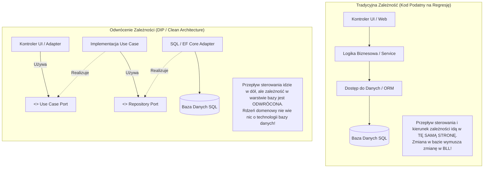
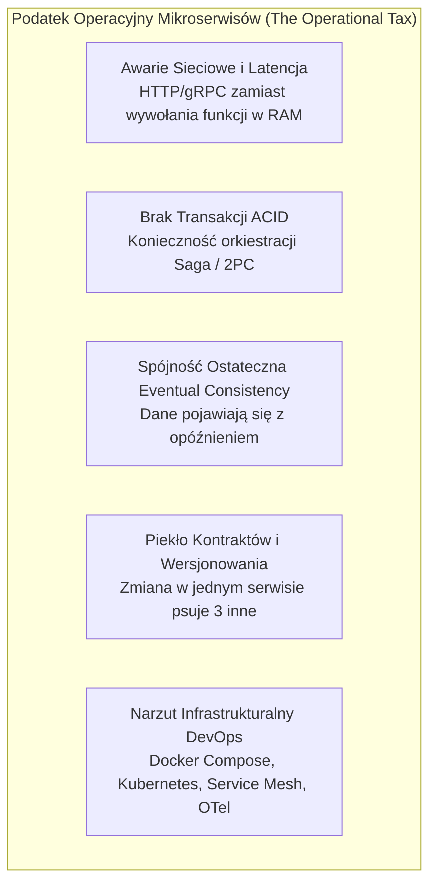

# Lekcja 2.2 — Paradygmaty Architektoniczne Systemów (Warstwowa, Hexagonalna, Onion/Clean, Modular Monolith vs Mikroserwisy)

> **Cel dydaktyczny:** Po tej lekcji potrafisz zaprojektować podział odpowiedzialności w aplikacji webowej, wyznaczyć granice Bounded Contexts, dobrać właściwy styl architektoniczny (N-Tier, Ports & Adapters / Hexagonal, Onion / Clean Architecture, Modular Monolith) pod realia projektu 2-semestralnego bez wpadania w antywzorzec Big Ball of Mud oraz uzasadnić, dlaczego Monolit Modułowy deklasuje przedwczesne mikroserwisy w zespole 3–5 osób. Zbudujesz schemat kolejności podejmowania decyzji architektonicznych i zabezpieczysz granice modułów za pomocą automatycznych testów sprawnościowych (Fitness Functions).
> **Pakiet dydaktyczny:** ta notatka + kanwa [[lesson-2.2-system-architecture.canvas]] + lab `labs/web-engineering/2.2/` + specyfikacja `90_Meta/lessons/2.2/spec.yaml`.
> **Wymagania wstępne:** [[1.1-ideation-fr-nfr|Lekcja 1.1 — Ideation, Feasibility & Scope (FR / NFR)]], [[2.1-website-vs-webapp-rendering-runtimes|Lekcja 2.1 — Website vs Web App, Paradygmaty Renderowania i Runtimes]] oraz aneks [[appendix-aspnet-mvc-kuchnia-cygana|Studium Przypadku Kuchnia u Cygana]].
> **Następna lekcja w roadmapie:** [[web-engineering-roadmap#2.3a — TypeScript / Node (niezależnie)|2.3a TypeScript / Node]] oraz [[web-engineering-roadmap#2.4 — Macierz wyboru stosu (projekt 2-semestralny)|2.4 Macierz Wyboru Stosu Technologicznego]].

---

## Spis Treści

1. [Wprowadzenie i Maszyna Pojęciowa (Notional Machine) Zależności](#1-wprowadzenie-i-maszyna-pojęciowa-notional-machine-zależności)
2. [Architektura Warstwowa (Layered / N-Tier) — Gdzie działa, a gdzie pęka](#2-architektura-warstwowa-layered--n-tier--gdzie-działa-a-gdzie-pęka)
3. [Architektura Hexagonalna (Ports & Adapters) — Anatomia Odwrócenia Kontroli](#3-architektura-hexagonalna-ports--adapters--anatomia-odwrócenia-kontroli)
4. [Onion Architecture i Clean Architecture — Współśrodkowe Pierścienie](#4-onion-architecture-i-clean-architecture--współśrodkowe-pierścienie)
5. [Modular Monolith — Złoty Standard Systemu 2-Semestralnego](#5-modular-monolith--złoty-standard-systemu-2-semestralnego)
6. [Mikroserwisy — Demistyfikacja i Podatek Operacyjny (The Operational Tax)](#6-mikroserwisy--demistyfikacja-i-podatek-operacyjny-the-operational-tax)
7. [Wyczerpująca Analiza Porównawcza (Vs Matrix)](#7-wyczerpująca-analiza-porównawcza-vs-matrix)
8. [Pełne Studium Przypadku (Worked Example): Refaktoryzacja Systemu Zamówień](#8-pełne-studium-przypadku-worked-example-refaktoryzacja-systemu-zamówień)
9. [Matryca Decyzyjna i Workflow: W Jakiej Kolejności Podejmować Decyzje?](#9-matryca-decyzyjna-i-workflow-w-jakiej-kolejności-podejmować-decyzje)
10. [Testy Sprawnościowe Architektury (Architectural Fitness Functions / ArchUnit)](#10-testy-sprawnościowe-architektury-architectural-fitness-functions--archunit)
11. [Chain of Action — Procedura Audytu i Wyboru Architektury](#11-chain-of-action--procedura-audytu-i-wyboru-architektury)
12. [Lab 2.2 — Wdrożenie Monolitu Modułowego z Portami i Testem Granic](#12-lab-22--wdrożenie-monolitu-modułowego-z-portami-i-testem-granic)
13. [Misconceptions i Typowe Antywzorce (Obalenie 6 Mitów)](#13-misconceptions-i-typowe-antywzorce-obalenie-6-mitów)
14. [Aktywność Generatywna (Predict Task)](#14-aktywność-generatywna-predict-task)
15. [Zadania Transferowe (Zastosowanie w Innym Kontekście)](#15-zadania-transferowe-zastosowanie-w-innym-kontekście)
16. [Blackbox Quiz V2.2](#16-blackbox-quiz-v22)
17. [Powiązane i Źródła Normatywne](#17-powiązane-i-źródła-normatywne)

---

## 1. Wprowadzenie i Maszyna Pojęciowa (Notional Machine) Zależności

Czym w istocie jest **architektura oprogramowania**?  
Wbrew powszechnemu wyobrażeniu studentów, architektura nie polega na rysowaniu kolorowych prostokątów w draw.io ani na wyborze najmodniejszych frameworków z Hacker News. 

> [!IMPORTANT]
> **Definicja Inżynierska:**  
> Architektura oprogramowania to **struktura podziału odpowiedzialności, ustalenie niezmienników systemu oraz zestaw decyzji, które są kosztowne i trudne do zmiany w przyszłości**. Jej nadrzędnym celem jest **kontrola kosztu zmiany oprogramowania w czasie** przy zachowaniu wymaganych atrybutów jakościowych (NFR: bezpieczeństwo, wydajność, testowalność, niezawodność).

W projektach semestralnych i inżynierskich zespoły najczęściej ponoszą porażkę z powodu **Prawa Conwaya**:
> *„Organizacje budują systemy, które są wierną kopią ich struktur komunikacji.”*

Gdy 4 deweloperów siada do projektu bez sztywno zdefiniowanych granic architektonicznych i kontraktów danych, w kodzie powstaje zjawisko znane jako **Big Ball of Mud (Wielka Kula Błota)**: każdy kontroler woła dowolne repozytorium, encje bazodanowe wyciekają do widoków, a baza danych staje się gigantycznym workiem tabel ze splątanymi relacjami (co szczegółowo zbadaliśmy w aneksie o *Kuchni u Cygana*).

### Maszyna Pojęciowa: Kierunek Zależności a Przepływ Sterowania

Kluczowym przełomem mentalnym, który odróżnia architekturę amatorską od inżynierskiej, jest zrozumienie **Zasady Odwrócenia Zależności (Dependency Inversion Principle — DIP)**:

1. **Wysokopoziomowe moduły (logika biznesowa / use case'y)** nie powinny zależeć od modułów niskopoziomowych (baza danych, protokół HTTP, biblioteki zewnętrzne). Oba powinny zależeć od abstrakcji (interfejsów).
2. **Abstrakcje** nie powinny zależeć od szczegółów implementacyjnych. To szczegóły muszą zależeć od abstrakcji.



### Rola Composition Root
Skoro logika biznesowa zależy wyłącznie od interfejsu `IOrderRepository`, kto decyduje, jaka konkretna klasa (`SqlOrderRepository` vs `InMemoryOrderRepository`) zostanie podstawiona w czasie działania programu?
Robi to **Composition Root (Punkt Kompozycji)** — jedyne miejsce w całej aplikacji (najczęściej `Program.cs` w .NET lub klasa konfiguracji `@Configuration` w Springu), w którym rejestrowane są zależności w kontenerze IoC (*Inversion of Control*). Cała reszta aplikacji operuje wyłącznie na czystych kontraktach.

---

## 2. Architektura Warstwowa (Layered / N-Tier) — Gdzie działa, a gdzie pęka

Architektura warstwowa to historycznie najpopularniejszy wzorzec organizacji kodu, stanowiący domyślny szablon większości samouczków:

```
+-------------------------------------------------------------+
|               1. Warstwa Prezentacji (UI / Web)             |
|                  Kontrolery, Widoki, DTO API                |
+-------------------------------------------------------------+
                              |
                              v (Zależy od)
+-------------------------------------------------------------+
|            2. Warstwa Logiki Biznesowej (BLL / Service)     |
|                  Serwisy, Walidacja procesowa               |
+-------------------------------------------------------------+
                              |
                              v (Zależy od)
+-------------------------------------------------------------+
|             3. Warstwa Dostępu do Danych (DAL)              |
|                  Repozytoria, ORM, Mapowania SQL            |
+-------------------------------------------------------------+
                              |
                              v (Zależy od)
+-------------------------------------------------------------+
|                      4. Baza Danych                         |
|                  Tabele, Indeksy, Widoki                    |
+-------------------------------------------------------------+
```

### Gdzie Architektura Warstwowa Działa Znakomicie?
- **Faza PoC / Prototypowania (Tydzień 1–2):** Zerowy narzut mentalny. Nowy programista w zespole natychmiast wie, gdzie dodać nowy formularz (Controller), gdzie zapisać dane (Service) i jak zdefiniować tabelę (DAL).
- **Proste systemy ewidencyjne (Czysty CRUD):** Jeżeli system polega w 90% na pobraniu wiersza z bazy, wyświetleniu go w tabeli i zaktualizowaniu dwóch kolumn (bez skomplikowanych reguł stanowych), narzucanie architektury hexagonalnej jest marnotrawstwem czasu (*Overengineering*).

### Dlaczego N-Tier Pęka w Długofalowym Projekcie? (Anatomia Porażki)
1. **Podejście zorientowane na bazę danych (Database-Driven Mindset):**  
   W klasycznym N-Tier wszystko zależy od bazy danych. Programista zaczyna pracę od projektowania tabel SQL, następnie generuje encje ORM, a potem przepycha te encje przez warstwę serwisów aż do kontrolerów. W rezultacie model bazodanowy staje się modelem biznesowym.
2. **Wyciek abstrakcji ORM w górę (Leaky Abstractions):**  
   Encje bazy danych zawierają atrybuty techniczne (np. `[Table("Orders")]`, `[ForeignKey]`, adnotacje `@Entity` czy wskaźniki leniwego ładowania `virtual / Lazy`). Gdy serwis biznesowy przekazuje taką encję wyżej, kontroler przypadkowo wywołuje właściwość nawigacyjną poza zakresem sesji bazy, powodując błędy typu `LazyInitializationException` lub generując kaskadę zapytań $N+1$.
3. **Anemiczny Model Domenowy (Anemic Domain Model):**  
   Encje stają się niemymi strukturami get/set, a cała logika rozrasta się w gigantycznych „serwisach-potworach” (`OrderService` po 3000 linii), które trudno przetestować jednostkowo bez postawienia pełnej instancji bazy danych.

---

## 3. Architektura Hexagonalna (Ports & Adapters) — Anatomia Odwrócenia Kontroli

Zaproponowana przez **Alistaira Cockburna** w 2005 roku architektura hexagonalna (formalnie: **Ports and Adapters Pattern**) powstała z myślą o rozwiązaniu fundamentalnego problemu: *jak sprawić, by aplikacja mogła być jednakowo napędzana przez użytkowników, testy automatyczne, skrypty wsadowe, i jak uniezależnić ją od wymiany bazy danych lub dostawcy usług zewnętrznych?*

Metafora sześciokąta nie oznacza, że system ma 6 komponentów — symbolizuje wielobok, do którego ścianek można podłączać rozmaite wtyczki (adaptery).

```
                            PORTY PIERWOTNE (Driving)
                         +-----------------------------+
   REST API Controller --|                             |
   CLI Command Runner  --|--> [Use Case / Input Port]  |
   Automated E2E Test  --|                             |
                         |                             |
                         |      APLIKACJA / CORE       |
                         |      ================       |
                         |    Encje Domenowe (Czyste)  |
                         |    Logika i Reguły Biznesu  |
                         |                             |
                         | [Driven / Output Port]      |-- Dapper / SQL Server Adapter
                         |          (Interface)        |-- PostgreSQL / EF Core Adapter
                         |                             |-- Stripe Payment Adapter
                         |                             |-- Fake InMemory Repo (Testy!)
                         +-----------------------------+
                            PORTY WTÓRNE (Driven)
```

### Kluczowe Elementy Architektury:

#### 1. Rdzeń Aplikacji (Application Core)
Zawiera czyste reguły biznesowe i logikę domenową. **Rdzeń nie zawiera żadnych referencji do zewnętrznych bibliotek, protokołów sieciowych, frameworków webowych ani sterowników baz danych**. Kod wewnątrz Core to 100% czysty język programowania (Vanilla C#, Java lub TypeScript).

#### 2. Porty Pierwotne (Driving / Inbound Ports)
Interfejsy definiujące przypadki użycia (*Use Cases*), czyli operacje, które świat zewnętrzny może zażądać od systemu:
```csharp
// Port Pierwotny (Wewnątrz Core):
public interface ICreateOrderUseCase
{
    Task<OrderResultDto> ExecuteAsync(CreateOrderCommand command);
}
```

#### 3. Adaptery Pierwotne (Driving Adapters)
Komponenty technologiczne, które odbierają bodziec z zewnątrz, tłumaczą go na obiekty domeny i wywołują Port Pierwotny:
- Kontroler ASP.NET Core MVC / Web API,
- Resolver GraphQL,
- Komenda konsolowa CLI,
- Konsument kolejki RabbitMQ / Kafka.

#### 4. Porty Wtórne (Driven / Outbound Ports)
Interfejsy definiujące operacje, których aplikacja potrzebuje od środowiska zewnętrznego do zrealizowania swojego zadania:
```csharp
// Port Wtórny (Wewnątrz Core):
public interface IPaymentGatewayPort
{
    Task<PaymentAuthorizationResult> AuthorizePaymentAsync(Money amount, CustomerId customerId);
}

public interface IOrderRepositoryPort
{
    Task SaveAsync(Order order);
    Task<Order?> GetByIdAsync(OrderId id);
}
```

#### 5. Adaptery Wtórne (Driven Adapters)
Konkretne implementacje technologiczne portów wtórnych znajdujące się w warstwie infrastruktury:
- `StripePaymentGatewayAdapter` (woła API Stripe przez HTTP),
- `PostgresOrderRepositoryAdapter` (wykonuje zapytania SQL za pomocą EF Core lub Dappera),
- `FakeInMemoryOrderRepository` (używany w testach jednostkowych — działa w RAM w 0.05 ms!).

### Największy Zysk Inżynierski: Hermetyczna Testowalność
W architekturze hexagonalnej testujesz 100% procesów biznesowych bez dotykania bazy danych:
```csharp
[Fact]
public async Task Should_Reject_Order_When_Payment_Fails()
{
    // Arrange: Podstawiamy proste adaptery pamięciowe (Fake / Mock)
    var fakePaymentGateway = new FakeDeclinedPaymentGateway();
    var fakeRepo = new InMemoryOrderRepository();
    var useCase = new CreateOrderUseCase(fakeRepo, fakePaymentGateway);

    // Act & Assert: Test wykonuje się w 2 milisekundy bez Dockera i bez bazy!
    await Assert.ThrowsAsync<PaymentRejectedException>(() => 
        useCase.ExecuteAsync(new CreateOrderCommand(...)));
}
```

---

## 4. Onion Architecture i Clean Architecture — Współśrodkowe Pierścienie

Zarówno **Onion Architecture** (Jeffrey Palermo, 2008), jak i **Clean Architecture** (Robert C. Martin / Uncle Bob, 2012) są bezpośrednimi ewolucjami architektury hexagonalnej. Wprowadzają one sformalizowany podział wnętrza sześcianu na **współśrodkowe pierścienie zależności**:

```
+---------------------------------------------------------------------------------+
| 4. FRAMEWORKS & DRIVERS (Zewnętrzny Świat)                                      |
|    ASP.NET Core / Spring, Kestrel, PostgreSQL, Redis, UI, Konsola, Docker       |
|  +---------------------------------------------------------------------------+  |
|  | 3. INTERFACE ADAPTERS                                                     |  |
|  |    Kontrolery, Presentery, Bramki (Gateways), Mapowania DTO/ViewModel   |  |
|  |  +---------------------------------------------------------------------+  |  |
|  |  | 2. APPLICATION BUSINESS RULES (Use Cases)                          |  |  |
|  |  |    Orkiestracja przepływów, Komendy, DTO wejścia/wyjścia            |  |  |
|  |  |  +---------------------------------------------------------------+  |  |  |
|  |  |  | 1. ENTERPRISE BUSINESS RULES (Entities / Core Domain)         |  |  |  |
|  |  |  |    Agregaty, Encje, Obiekty Wartości (Value Objects),         |  |  |  |
|  |  |  |    Niezmienniki Domenowe, Czysta Logika                       |  |  |  |
|  |  |  +---------------------------------------------------------------+  |  |  |
|  |  +---------------------------------------------------------------------+  |  |
|  +---------------------------------------------------------------------------+  |
+---------------------------------------------------------------------------------+
```

### Żelazna Reguła Zależności (The Dependency Rule):
> **Kod wewnątrz pierścienia wewnętrznego nie może wiedzieć absolutnie niczego o elementach znajdujących się w pierścieniach zewnętrznych.**  
> Nazwa żadnej klasy, funkcji, typu danych czy biblioteki zadeklarowanej w pierścieniu zewnętrznym nie ma prawa pojawić się w kodzie pierścienia wewnętrznego.

### Różnice Między Modelami:

| Cecha | Architektura Hexagonalna | Onion Architecture | Clean Architecture |
|---|---|---|---|
| **Główny nacisk** | Symetria wejścia/wyjścia (Porty i Adaptery) | Odwrócenie zależności wokół modelu domenowego | Ścisły podział na Use Cases i reguły encji |
| **Podział wnętrza** | Dowolny (byle odseparowany od adapterów) | Core podzielony na Domain Model i Domain Services | Ściśle: Entities $\rightarrow$ Use Cases |
| **Warstwa UI** | Traktowana jako jeden z wielu Driving Adapters | Pierścień zewnętrzny | Pierścień zewnętrzny z kontrolerami i prezenterami |
| **Stopień sformalizowania** | Średni (bardzo elastyczny) | Wysoki | **Bardzo wysoki (rygorystyczne reguły DTO)** |

### Ostrzeżenie Inżynierskie: Podatek od Przepisywania DTO (Boilerplate Tax)
W ortodoksyjnej wersji Clean Architecture dla pojedynczego pola `Name` tworzy się 4 oddzielne struktury danych:
`DatabaseTableRecord` $\rightarrow$ `DomainEntity` $\rightarrow$ `UseCaseResponseDto` $\rightarrow$ `ViewResponseModel`.
Dla 4-osobowego zespołu studenckiego budującego system o 30 tabelach, przepisywanie tych samych pól w 4 warstwach może pochłonąć 40% całego budżetu czasu!  
*Rekomendacja:* Stosuj rygorystyczny podział Clean Architecture **wyłącznie dla krytycznych, gęstych biznesowo modułów** (np. wyliczanie diet, kalkulator FEFO, płatności), a dla prostych modułów słownikowych stosuj lżejszy wariant warstwowy.

---

## 5. Modular Monolith — Złoty Standard Systemu 2-Semestralnego

Przez lata branża IT popadała w fałszywy dylemat: *„albo archaiczny, splątany monolit spaghetti, albo nowoczesne mikroserwisy”*. Odpowiedzią współczesnej inżynierii (2024–2026+) jest **Monolit Modułowy (Modular Monolith)**.

> [!NOTE]
> **Monolit Modułowy** to system wdrożony jako **pojedynczy proces / pojedyncza jednostka wdrożeniowa (Single Deployable Unit)**, ale wewnętrznie podzielony na **autonomiczne, silnie izolowane moduły biznesowe (Bounded Contexts)**, z których każdy posiada własną domenę, własne dane i komunikuje się z resztą wyłącznie przez publicznie udostępniony kontrakt.

```
+---------------------------------------------------------------------------------------------------+
|                               MODULAR MONOLITH (Jeden Proces / Jedna Aplikacja)                   |
+---------------------------------------------------------------------------------------------------+
|  [Moduł Zamówień (Orders)]    |  [Moduł Katalogu (Catalog)]   |  [Moduł Magazynu (Warehouse)]     |
|  - Własny BLL & Use Cases     |  - Własny BLL & Use Cases     |  - Własny BLL & Use Cases         |
|  - Własne Encje Domenowe      |  - Własne Encje Domenowe      |  - Własne Encje Domenowe          |
|  - Publiczny Kontrakt:        |  - Publiczny Kontrakt:        |  - Publiczny Kontrakt:            |
|    IOrdersModuleApi           |    ICatalogModuleApi          |    IWarehouseModuleApi            |
+---------------------------------------------------------------------------------------------------+
                                                  |
                     Szyna Zdarzeń w Pamięci (In-Memory Mediator / MediatR)
                                                  |
+---------------------------------------------------------------------------------------------------+
|                                  BAZA DANYCH (MS SQL / PostgreSQL)                                |
|  +--------------------------+  +--------------------------+  +---------------------------------+  |
|  | Schemat: [orders].*      |  | Schemat: [catalog].*     |  | Schemat: [warehouse].*          |  |
|  | Tabele, Klucze Obce,     |  | Tabele, Klucze Obce,     |  | Tabele, Klucze Obce,             |  |
|  | Migracje modułu Orders   |  | Migracje modułu Catalog  |  | Migracje modułu Warehouse       |  |
|  +--------------------------+  +--------------------------+  +---------------------------------+  |
|               ZAKAZ WYKONYWANIA ZŁĄCZEŃ SQL JOIN POMIĘDZY RÓŻNYMI SCHEMATAMI!                     |
+---------------------------------------------------------------------------------------------------+
```

### Trzy Żelazne Reguły Monolitu Modułowego:

#### Reguła 1: Hermetyzacja Kodu (Brak Dostępu do Wnętrza Modułu)
W językach takich jak C# lub Java wykorzystuje się modyfikatory widoczności (`internal` w C#, package-private w Javie):
- Tylko publiczny interfejs modułu (`IOrdersModuleApi`) oraz DTO kontraktowe są `public`.
- Wszystkie encje domenowe, repozytoria, klasy bazodanowe i serwisy wewnątrz modułu `Orders` są `internal`!
- Programista pracujący w module `Warehouse` fizycznie **nie może** utworzyć instancji encji `Order` ani wstrzyknąć repozytorium zamówień — kompilator mu na to nie pozwoli!

#### Reguła 2: Izolacja Danych na Poziomie Bazy (Schema Isolation)
To najważniejsza lekcja wyciągnięta z audytu *Kuchni u Cygana*:
- Wszystkie tabele modułu muszą znajdować się w dedykowanym schemacie bazy danych (`orders.Orders`, `orders.OrderItems`, `warehouse.Batches`).
- **Bezwzględny zakaz wykonywania złączeń SQL `JOIN` pomiędzy tabelami z różnych schematów!**
- Jeśli moduł magazynu potrzebuje sprawdzić nazwę posiłku, pobiera ją przez API modułu katalogu (`ICatalogModuleApi.GetMealSummaryAsync(id)`) lub nasłuchuje na zdarzenie asynchroniczne i zapisuje własną, spłaszczoną kopię danych.

#### Reguła 3: Komunikacja Asynchroniczna w Pamięci Procesu
Zamiast skomplikowanych brokerów wiadomości (Kafka/RabbitMQ), moduły w monolicie komunikują się przez **Zdarzenia Integracyjne w pamięci** (np. za pomocą biblioteki MediatR lub kanałów `System.Threading.Channels`):
```csharp
// Moduł Orders publikuje:
await eventBus.PublishAsync(new OrderPlacedIntegrationEvent(orderId, items));

// Moduł Warehouse w tym samym procesie odbiera zdarzenie i rezerwuje surowce:
public class OrderPlacedHandler : IIntegrationEventHandler<OrderPlacedIntegrationEvent>
{ ... }
```

---

## 6. Mikroserwisy — Demistyfikacja i Podatek Operacyjny (The Operational Tax)

Dlaczego w 2-semestralnym projekcie studenckim wybór mikroserwisów niemal zawsze kończy się katastrofą?

Gdy zespół decyduje się na mikroserwisy, wchodzi w obszar **Systemów Rozproszonych**, płacąc ogromny podatek technologiczny:



### Pułapka „Distributed Monolith” (Rozproszona Kula Błota)
Niedoświadczone zespoły najczęściej tworzą antywzorzec **Rozproszonego Monolitu**:
- Dzielą kod na 5 repozytoriów i 5 kontenerów z osobnymi procesami Web API;
- Wszystkie kontenery podłączają do **jednej wspólnej bazy danych**;
- Kontroler A wykonuje synchroniczne zapytanie HTTP do serwisu B, ten do C, a C do D.

**Konsekwencje:**
- Jeśli serwis C ma awarię lub laguje, cały łańcuch wywołań wisi i wyczerpuje pulę wątków serwera A (*Cascading Failure*).
- System posiada wszystkie wady wydajnościowe sieci i opóźnień, a jednocześnie żadnej zalety niezależnego wdrażania (zmiana schematu bazy danych wymusza zsynchronizowany deploy wszystkich 5 serwisów naraz!).

> [!CAUTION]
> **Werdykt dla Zespołu 3–5 Osób:**  
> Jeżeli Wasz zespół nie liczy co najmniej 30 inżynierów i nie posiada dedykowanego inżyniera SRE/DevOps dbającego o klastry i telemetrię, **wybór mikroserwisów jest błędem architektonicznym**. Wszystkie korzyści niezależności biznesowej uzyskacie w **Monolicie Modułowym** bez ponoszenia kosztów rozproszenia sieciowego.

---

## 7. Wyczerpująca Analiza Porównawcza (Vs Matrix)

Poniższa macierz stanowi podstawę do formułowania Kart Decyzji Architektonicznych (ADR):

| Kryterium Oceniające | Architektura Warstwowa (N-Tier) | Architektura Hexagonalna (Ports & Adapters) | Clean Architecture (Uncle Bob) | Monolit Modułowy (Modular Monolith) | Mikroserwisy (Microservices) |
|---|---|---|---|---|---|
| **Kierunek zależności** | W dół (ku bazie danych) | Do wewnątrz (ku portom rdzenia) | Ściśle do wewnątrz (ku encjom) | Do wewnątrz modułów + API | Osobne sieciowo per serwis |
| **Próg wejścia (Start tydzień 1)** | **Bardzo niski (Najszybszy)** | Średni | Wysoki (dużo klas DTO) | Średni (podział na Bounded Contexts) | **Ekstremalnie wysoki** |
| **Testowalność reguł biznesu** | Niska/Średnia (często wymaga DB) | **Ekstremalnie wysoka (100% w RAM)** | **Ekstremalnie wysoka** | Wysoka wewnątrz każdego modułu | Wymaga kontraktów i WireMock |
| **Szczelność granic domeny** | Słaba (częste wycieki encji ORM) | Bardzo wysoka | Bardzo wysoka | **Maksymalna (kontrola kompilatora)** | Maksymalna (izolacja procesowa) |
| **Narzut operacyjny (DevOps / CI)** | Minimalny (1 baza, 1 app) | Minimalny | Minimalny | **Minimalny (1 baza, 1 proces)** | **Ogromny (K8s, mesh, tracing)** |
| **Odporność na rozrost (Dług techniczny)**| Niska (zmienia się w spaghetti) | Wysoka | Bardzo wysoka | **Najwyższa (kod podzielony na domeny)** | Wysoka (ale kosztem złożoności sieci) |
| **Ryzyko awarii w 2 semestry** | Średnie (dług pod koniec) | Niskie | Niskie (ryzyko zmęczenia boilerplate) | **Najniższe (Złoty Standard Uczelni)**| **Ekstremalnie wysokie (pułapka sieci)** |

---

## 8. Pełne Studium Przypadku (Worked Example): Refaktoryzacja Systemu Zamówień

Prześledźmy konkretną refaktoryzację fragmentu systemu cateringu dietetycznego: przejście z wadliwego serwisu N-Tier do czystego modułu hexagonalnego.

### Krok 1: Stan Wyjściowy (Antywzorzec N-Tier ze splątanymi zależnościami)

```csharp
// WADLIWY KOD N-Tier: OrderService zależy bezpośrednio od Entity Framework i zewnętrznego Stripe
public class OrderService
{
    private readonly ApplicationDbContext _db;
    private readonly StripeClient _stripeClient; // Twarda zależność od zewnętrznego SDK!

    public OrderService(ApplicationDbContext db, StripeClient stripeClient)
    {
        _db = db;
        _stripeClient = stripeClient;
    }

    public async Task CheckoutAsync(int orderId, string creditCardToken)
    {
        var order = await _db.Orders.Include(o => o.Items).FirstOrDefaultAsync(o => o.Id == orderId);
        if (order == null) throw new Exception("Nie znaleziono");

        // Wywołanie zewnętrznego API bezpośrednio w logice biznesowej:
        var charge = await _stripeClient.Charges.CreateAsync(new ChargeCreateOptions {
            Amount = (long)(order.TotalPrice * 100),
            Currency = "pln",
            Source = creditCardToken
        });

        if (charge.Status == "succeeded") {
            order.Status = "Paid";
            order.PaymentTransactionId = charge.Id;
            // Bezpośrednia zmiana stanu w tabeli innego modułu (Magazyn):
            foreach (var item in order.Items) {
                var stock = await _db.StockItems.FindAsync(item.StockItemId);
                stock.Quantity -= item.Quantity; // Naruszenie granic domeny!
            }
            await _db.SaveChangesAsync();
        }
    }
}
```
*Dlaczego ten kod to tykająca bomba?*
1. Nie da się przetestować metody `CheckoutAsync` bez prawdziwego klucza Stripe API oraz bazy danych.
2. Bezpośrednia modyfikacja `StockItems` w serwisie zamówień uniemożliwia jakąkolwiek modularność i prowadzi do wyścigów danych (*Race Conditions*).

---

### Krok 2: Stan Docelowy (Architektura Hexagonalna z Portami i Zdarzeniem)

#### 1. Porty Wtórne (Definiowane wewnątrz Rdzenia Modułu Orders):
```csharp
// Port płatności:
public interface IPaymentGateway
{
    Task<PaymentResult> ProcessPaymentAsync(Money amount, PaymentToken token);
}

// Port repozytorium zamówień:
public interface IOrderRepository
{
    Task<Order?> GetByIdAsync(OrderId id);
    Task UpdateAsync(Order order);
}

// Port publikacji zdarzeń:
public interface IEventPublisher
{
    Task PublishAsync<TEvent>(TEvent domainEvent) where TEvent : class;
}
```

#### 2. Czysty Przypadek Użycia (Use Case wewnątrz Core):
```csharp
public class CheckoutOrderUseCase : ICheckoutOrderUseCase
{
    private readonly IOrderRepository _orderRepository;
    private readonly IPaymentGateway _paymentGateway;
    private readonly IEventPublisher _eventPublisher;

    public CheckoutOrderUseCase(
        IOrderRepository orderRepository,
        IPaymentGateway paymentGateway,
        IEventPublisher eventPublisher)
    {
        _orderRepository = orderRepository;
        _paymentGateway = paymentGateway;
        _eventPublisher = eventPublisher;
    }

    public async Task<Result> ExecuteAsync(CheckoutOrderCommand command)
    {
        var order = await _orderRepository.GetByIdAsync(command.OrderId);
        if (order is null) return Result.Failure("Zamówienie nie istnieje.");

        // Reguła biznesowa hermetyzowana w encji:
        if (!order.CanBePaid()) return Result.Failure("Nieprawidłowy stan zamówienia.");

        // Wywołanie portu płatności (brak pojęcia o Stripe!):
        var paymentResult = await _paymentGateway.ProcessPaymentAsync(order.TotalAmount, command.Token);
        if (!paymentResult.IsSuccess) return Result.Failure("Płatność odrzucona.");

        // Encja sama zarządza swoim stanem:
        order.MarkAsPaid(paymentResult.TransactionId);
        await _orderRepository.UpdateAsync(order);

        // Moduł Orders publikuje zdarzenie integracyjne. Magazyn zareaguje sam!
        await _eventPublisher.PublishAsync(new OrderPaidIntegrationEvent(order.Id, order.ExtractItemQuantities()));

        return Result.Success();
    }
}
```

#### 3. Adapter Infrastruktury (Na zewnątrz, w projekcie Infrastructure):
```csharp
public class StripePaymentAdapter : IPaymentGateway
{
    private readonly IStripeClient _stripeClient;
    public StripePaymentAdapter(IStripeClient stripeClient) => _stripeClient = stripeClient;

    public async Task<PaymentResult> ProcessPaymentAsync(Money amount, PaymentToken token)
    {
        // Tutaj żyje specyfika Stripe, mapowanie wyjątków sieciowych na PaymentResult
    }
}
```

---

## 9. Matryca Decyzyjna i Workflow: W Jakiej Kolejności Podejmować Decyzje?

Aby zespół nie obudził się w 6. tygodniu semestru z chaosem technologicznym, należy wdrożyć **Sekwencyjny Rurociąg Decyzji Architektonicznych (Architecture Decision Pipeline)**:

```
+---------------------------------------------------------------------------------------------------+
|                        SEKWENCJA DECYZJI ARCHITEKTONICZNYCH (TYDZIEŃ 1 - 4)                       |
+---------------------------------------------------------------------------------------------------+
| KROK 1: Kwalifikacja Problemu i Ograniczeń (Tydzień 1)                                            |
|   - Czy to Website (czytanie/SEO) czy Web App (transakcje/stan)? [Z Lekcji 2.1]                  |
|   - Wymagania niefunkcjonalne (NFR): budżet latencji p95, dostępność, profil użytkowników        |
+---------------------------------------------------------------------------------------------------+
                                                  |
                                                  v
+---------------------------------------------------------------------------------------------------+
| KROK 2: Wybór Stylu Makro-Architektury (Tydzień 1)                                                |
|   - DECYZJA: Zawsze zaczynaj od Monolitu Modułowego (Modular Monolith) jako defaultu.             |
|   - Kiedy mikroserwisy? Wyłącznie jeśli zespół ma twardy wymóg promotora ORAZ osobę dedykowaną    |
|     do CI/CD i Kubernetes. W przeciwnym razie: natychmiastowe odrzucenie mikroserwisów.           |
+---------------------------------------------------------------------------------------------------+
                                                  |
                                                  v
+---------------------------------------------------------------------------------------------------+
| KROK 3: Dekompozycja Domenowa i Kontrakt Bazy Danych (Tydzień 2)                                 |
|   - Identyfikacja 3–5 Bounded Contexts (np. Zamówienia, Katalog, Magazyn, Użytkownicy).           |
|   - Zdefiniowanie dedykowanych schematów w bazie danych ([sales], [catalog], [warehouse]).       |
|   - Uzgodnienie globalnych konwencji typów kluczy (np. GUID vs INT) i reguł migracji.            |
|   - PREWENCJA: Zakaz pisania kodu bez zamrożonego wstępnego schematu tabel i relacji!             |
+---------------------------------------------------------------------------------------------------+
                                                  |
                                                  v
+---------------------------------------------------------------------------------------------------+
| KROK 4: Dobór Wnętrza Modułów i Wzorców Trwałości (Tydzień 2–3)                                  |
|   - Rdzeń Biznesowy (Core): Ports & Adapters (Hexagonal) z czystym modelem domenowym.             |
|   - Moduły pomocnicze (CRUD / Słowniki): Lekki N-Tier, aby nie tracić czasu na boilerplate.      |
|   - Strategia Trwałości: EF Core / Hibernate (zapis i agregaty) + Dapper / Kysely (szybki odczyt) |
+---------------------------------------------------------------------------------------------------+
                                                  |
                                                  v
+---------------------------------------------------------------------------------------------------+
| KROK 5: Formalizacja w Kartach Decyzji (ADR) i Testy Strażnicze (Tydzień 3–4)                    |
|   - Zapisanie decyzji w ADR-001 (Styl architektury) i ADR-002 (Baza i schematy).                 |
|   - Wdrożenie automatycznych testów granic modułów w potoku CI (ArchUnit / Fitness Functions).   |
+---------------------------------------------------------------------------------------------------+
```

---

## 10. Testy Sprawnościowe Architektury (Architectural Fitness Functions / ArchUnit)

Większość zespołów deklaruje czystą architekturę w dokumentacji, ale po 2 miesiącach kod degeneruje się, ponieważ ktoś dla wygody zaimportował `DbContext` w kontrolerze lub wykonał `using ModulA.Internal` w module B.

Aby temu zapobiec, stosuje się **Testy Sprawnościowe (Architectural Fitness Functions)**, które sprawdzają architekturę tak samo, jak testy jednostkowe sprawdzają logikę biznesową.

### Przykład w .NET (Biblioteka NetArchTest / ArchUnitNET):

```csharp
public class ArchitectureTests
{
    private const string DomainNamespace = "MyApp.Domain";
    private const string ApplicationNamespace = "MyApp.Application";
    private const string InfrastructureNamespace = "MyApp.Infrastructure";
    private const string WebNamespace = "MyApp.Web";

    [Fact]
    public void Domain_Should_Not_Have_Dependency_On_Other_Projects()
    {
        // Reguła: Rdzeń domenowy nie może zależeć od aplikacji, bazy ani webu!
        var result = Types.InAssembly(typeof(Order).Assembly)
            .ShouldNot()
            .HaveDependencyOnAny(ApplicationNamespace, InfrastructureNamespace, WebNamespace)
            .GetResult();

        result.IsSuccessful.Should().BeTrue("Domena musi być w 100% czysta!");
    }

    [Fact]
    public void Module_Warehouse_Should_Not_Access_Internal_Classes_Of_Orders()
    {
        // Reguła: Magazyn może używać tylko kontraktu publicznego IOrdersModuleApi
        var result = Types.InNamespace("MyApp.Modules.Warehouse")
            .ShouldNot()
            .HaveDependencyOn("MyApp.Modules.Orders.Internal")
            .GetResult();

        result.IsSuccessful.Should().BeTrue("Naruszenie granic Bounded Context!");
    }
}
```
*Jeśli którykolwiek programista spróbuje złamać zasady architektury, pipeline CI na GitHub Actions natychmiast zablokuje Pull Request.*

---

## 11. Chain of Action — Procedura Audytu i Wyboru Architektury

Poniższa tabela stanowi algorytm postępowania inżynierskiego przy projektowaniu nowego systemu lub audycie istniejącego:

| Krok | Pytanie Diagnostyczne | Jeśli TAK $\rightarrow$ Akcja | Jeśli NIE $\rightarrow$ Akcja | Artefakt Wynikowy |
|:---:|---|---|---|---|
| **CoA-1** | Czy system tworzy zespół $\le 5$ osób na okres $\le 2$ semestrów? | **Wybierz Modular Monolith.** Zablokuj dyskusje o mikroserwisach. | Przejdź do analizy podziału domenowego microservices. | `ADR-001-Architecture-Style.md` |
| **CoA-2** | Czy dany moduł zawiera złożone reguły stanowe i kalkulacje (np. billing, FEFO)? | **Wdróż Ports & Adapters.** Odizoluj Core od bazy i frameworków. | Zastosuj prosty styl warstwowy (N-Tier) dla oszczędności czasu. | Schemat modułu w folderach projektu |
| **CoA-3** | Czy zdefiniowano dedykowany schemat bazy danych dla każdego modułu? | Sukces. Skonfiguruj uprawnienia i zakaz cross-schema JOIN. | **STOP! Wydziel schematy SQL.** Ryzyko rozpadu bazy danych. | Skrypty migracji DDL (schematy) |
| **CoA-4** | Czy komunikacja między modułami odbywa się wyłącznie przez interfejs API / zdarzenia? | Sukces. Zdarzenia przekazywane przez In-Memory Mediator. | **BŁĄD ARCHITEKTONICZNY.** Usuń bezpośrednie zależności klas. | Interfejsy `IModuleApi` i Events |
| **CoA-5** | Czy granice modułów są automatycznie testowane w CI/CD? | Sukces. Wdrożono NetArchTest / ArchUnit. | **Zaimplementuj testy fitness.** Bez nich granice runą w 4 tygodnie. | Testy `ArchitectureTests.cs` |

---

## 12. Lab 2.2 — Wdrożenie Monolitu Modułowego z Portami i Testem Granic

W ramach laboratorium `labs/web-engineering/2.2/` przygotowano praktyczny wzorzec referencyjny monolitu modułowego:
1. **Dwa odseparowane moduły biznesowe:** `CatalogModule` oraz `OrdersModule`.
2. **Architektura Ports & Adapters w module Orders:**
   - Port `IPaymentGateway` z dwoma wymiennymi adapterami (`FakeInMemoryPaymentAdapter` do błyskawicznych testów oraz adapter produkcyjny).
   - Port `IOrderRepository` w pełni odcięty od technologii bazodanowej.
3. **Izolacja schematów:** skrypty DDL z wydzielonymi schematami `catalog.*` oraz `orders.*`.
4. **Zestaw testów automatycznych:**
   - Testy use case'u w 100% w pamięci RAM (czas wykonania: < 5 ms),
   - Test sprawnościowy architektury sprawdzający, czy moduł `Catalog` nie odwołuje się do wnętrza modułu `Orders`.

Pełny kod i instrukcja uruchomienia znajdują się w `labs/web-engineering/2.2/README.md`.

---

## 13. Misconceptions i Typowe Antywzorce (Obalenie 6 Mitów)

### Mit 1: „Nowoczesna aplikacja webowa w 2026 roku musi być od razu podzielona na mikroserwisy”
**Rzeczywistość:**  
Najbardziej szanowane organizacje inżynierskie na świecie (Shopify, GitHub, Basecamp, Stack Overflow) operują na potężnych monolitach modułowych. Mikroserwisy nie są celem samym w sobie, lecz kosztownym narzędziem organizacyjnym, stosowanym gdy nad jednym systemem pracuje 200 programistów w 20 niezależnych zespołach. W zespole studenckim mikroserwisy to gwarancja utopienia projektu w problemach konfiguracyjnych.

### Mit 2: „Architektura warstwowa (N-Tier) to to samo co Clean Architecture”
**Rzeczywistość:**  
W architekturze warstwowej strzałka zależności wskazuje w dół — ku bazie danych. W Clean Architecture baza danych jest szczegółem na zewnątrz, a strzałka zależności wskazuje do wewnątrz — ku czystej domenie. To fundamentalna, diametralna różnica.

### Mit 3: „Monolit Modułowy to rozwiązanie przestarzałe i gorsze od mikroserwisów”
**Rzeczywistość:**  
Monolit modułowy to najbardziej zaawansowana forma monolitu, łącząca rygor architektoniczny Domain-Driven Design z zerowym narzutem sieciowym, natychmiastową spójnością transakcyjną ACID i banalnie prostym deploymentem.

### Mit 4: „Wystarczy dodać interfejs `IRepository`, by mieć architekturę hexagonalną”
**Rzeczywistość:**  
Jeśli interfejs `IOrderRepository` zwraca encję udekorowaną atrybutami Entity Frameworka (`[Column]`, `[ForeignKey]`), to baza danych nadal infekuje Twoją domenę. Port hexagonalny musi operować wyłącznie na czystych obiektach domeny.

### Mit 5: „W architekturze modułowej w jednej bazie można swobodnie robić SQL JOIN między modułami”
**Rzeczywistość:**  
Pojedynczy `JOIN` pomiędzy tabelą `Orders` a tabelą `Warehouse` natychmiast niszczy autonomię obu modułów. Od tej pory żadna zmiana w magazynie nie może nastąpić bez ryzyka wyłożenia modułu zamówień. Złączenia między modułami wykonuje się w pamięci na poziomie DTO lub za pomocą asynchronicznej replikacji danych.

### Mit 6: „Mikroserwisy naprawią złą organizację kodu w zespole”
**Rzeczywistość:**  
Jeśli zespół nie potrafi utrzymać czystych granic wewnątrz jednego projektu, to dzieląc go na mikroserwisy, stworzy po prostu **Rozproszoną Kulę Błota (Distributed Big Ball of Mud)**, w której błędy będą dodatkowo maskowane przez awarie sieciowe.

---

## 14. Aktywność Generatywna (Predict Task)

Przeanalizuj poniższy scenariusz:

> W 5-osobowym zespole budującym platformę aukcyjną deweloper modułu licytacji (`BiddingModule`) potrzebuje zablokować środki na koncie użytkownika w module portfela (`WalletModule`). 
> Deweloper proponuje:  
> *„Po prostu wstrzyknę `WalletDbContext` bezpośrednio do mojego `BiddingService` i w jednej transakcji wykonam `bidding.Save()` oraz `wallet.Balance -= amount`, to przecież ta sama baza SQL!”*

**Pytanie predykcyjne:**  
Jakie 3 krytyczne konsekwencje architektoniczne wystąpią w kolejnych tygodniach semestru, jeśli zespół zaakceptuje to rozwiązanie? Jak powinien wyglądać poprawny przepływ w Monolicie Modułowym?

*(Zapisz odpowiedź w notatniku przed przejściem do sekcji 16).*

---

## 15. Zadania Transferowe (Zastosowanie w Innym Kontekście)

### Scenariusz 1: System Rezerwacji Sal Operacyjnych w Szpitalu
System operuje na restrykcyjnych regułach kolizji terminów lekarzy i sprzętu medycznego, a jednocześnie wymaga integracji z 3 różnymi systemami NFZ przez przestarzałe protokoły SOAP/XML.
- *Zadanie:* Zaproponuj architekturę modułu rezerwacji. Gdzie umieścisz reguły kolizji, a gdzie integrację z NFZ, aby awaria serwerów NFZ nie uniemożliwiała planowania operacji lokalnie?

### Scenariusz 2: Sklep z Biletami na Koncerty (Flash Sale)
System przez 99% czasu ma ruch zerowy, ale w momencie otwarcia sprzedaży biletów na gwiazdę pop otrzymuje 50 000 zapytań na sekundę na jednym module rezerwacji miejsc.
- *Zadanie:* Czy w tym przypadku uzasadnione jest wydzielenie modułu rezerwacji do osobnego mikroserwisu? Jak zabezpieczysz resztę systemu (płatności, historię kont) przed awarią?

---

## 16. Blackbox Quiz V2.2

Sprawdź swoje opanowanie materiału lekcji:

1. **Pytanie 1:** Na czym polega Zasada Odwrócenia Zależności (DIP) i w jaki sposób odwraca ona tradycyjny kierunek zależności pomiędzy logiką biznesową a bazą danych?
2. **Pytanie 2:** Czym różni się Port Pierwotny (Driving) od Portu Wtórnego (Driven) w architekturze hexagonalnej? Podaj po jednym konkretnym przykładzie dla każdego z nich.
3. **Pytanie 3:** Dlaczego w Monolicie Modułowym bezwzględnie zabrania się wykonywania zapytań SQL `JOIN` pomiędzy tabelami należącymi do różnych modułów? Jak moduły powinny pozyskiwać powiązane dane?
4. **Pytanie 4:** Zdefiniuj pojęcie „Rozproszonego Monolitu” (Distributed Monolith). Podaj 2 powody, dlaczego jest on gorszy zarówno od tradycyjnego monolitu, jak i od poprawnych mikroserwisów.

---

### Rubryka Zaliczenia Quizu (Kryteria Oceny):
- **Próg zaliczenia:** Minimum 3 z 4 pytań zaliczone na poziomie inżynieryjnym (≥75%).
- **Kryteria merytoryczne:**
  - *Pytanie 1:* Odpowiedź musi precyzyjnie wyjaśnić, że logika biznesowa definiuje interfejs (kontrakt), a warstwa bazy danych go implementuje; zależność kodu wskazuje do środka, mimo że przepływ sterowania biegnie w dół ku bazie.
  - *Pytanie 2:* Odpowiedź musi wskazać, że port pierwotny definiuje przypadki użycia wywoływane przez świat zewnętrzny (np. interfejs `ICreateOrderUseCase`), a port wtórny definiuje usługi infrastrukturalne potrzebne domenie (np. `IPaymentGatewayPort` lub `IOrderRepositoryPort`).
  - *Pytanie 3:* Odpowiedź musi odwołać się do zniszczenia autonomii modułów, powiązania schematów bazy i ryzyka kaskadowych awarii; poprawny sposób to odpytanie publicznego API modułu lub asynchroniczna replikacja przez zdarzenia integracyjne.
  - *Pytanie 4:* Odpowiedź musi wskazać na architekturę podzieloną na procesy sieciowe, ale nadal sprzężoną wspólną bazą danych lub synchroniczną kaskadą HTTP; podać konsekwencje: narzut latencji sieciowej + kaskadowe awarie bez możliwości niezależnego wdrożenia.

---

## 17. Powiązane i Źródła Normatywne

### Powiązane artefakty w Vaultie:
- **Knowledge Spec:** `90_Meta/lessons/2.2/spec.yaml`
- **Kanwa Obsidian:** [[lesson-2.2-system-architecture.canvas]]
- **Laboratorium ćwiczeniowe:** `labs/web-engineering/2.2/`
- **Poprzednia lekcja:** [[2.1-website-vs-webapp-rendering-runtimes|Lekcja 2.1 — Website vs Web App, Paradygmaty Renderowania i Runtimes]]
- **Studium przypadku:** [[appendix-aspnet-mvc-kuchnia-cygana|Appendix 2.1 — Studium Architektury i Samokrytyka Projektu Kuchnia u Cygana]]
- **Kolejne lekcje:** [[web-engineering-roadmap#2.3a — TypeScript / Node (niezależnie)|2.3a TypeScript / Node]] oraz [[web-engineering-roadmap#2.4 — Macierz wyboru stosu (projekt 2-semestralny)|2.4 Macierz Wyboru Stosu]]

### Źródła normatywne i literatura:
- **Alistair Cockburn:** *Hexagonal Architecture (Ports and Adapters)* — oryginalny manifest wzorca ([alistair.cockburn.us/hexagonal-architecture](https://alistair.cockburn.us/hexagonal-architecture/)).
- **Robert C. Martin:** *Clean Architecture: A Craftsman's Guide to Software Structure and Design* (Prentice Hall, 2017).
- **Eric Evans:** *Domain-Driven Design: Tackling Complexity in the Heart of Software* (Addison-Wesley, 2003) — koncepcja Bounded Contexts i Context Mapping.
- **Kamil Grzybek:** *Modular Monolith: A Primer* — wzorcowa architektura i implementacja referencyjna ([github.com/kgrzybek/modular-monolith-with-ddd](https://github.com/kgrzybek/modular-monolith-with-ddd)).
- **Neal Ford, Mark Richards:** *Building Evolutionary Architectures* (O'Reilly) — koncepcja Architectural Fitness Functions.
- **Martin Fowler:** *MonolithFirst* — dlaczego systemy powinny zaczynać jako monolit ([martinfowler.com/bliki/MonolithFirst.html](https://martinfowler.com/bliki/MonolithFirst.html)).
