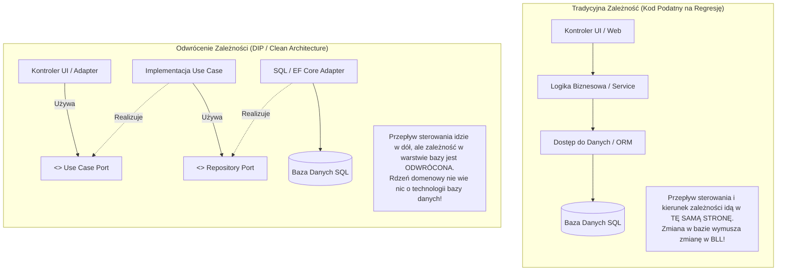
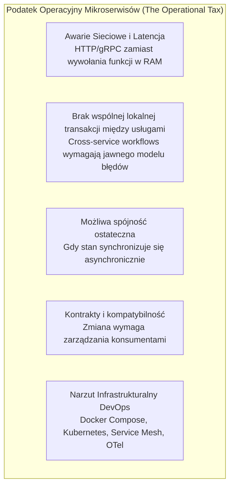

# Lekcja 2.2 — Paradygmaty Architektoniczne Systemów (Warstwowa, Hexagonalna, Onion/Clean, Modular Monolith vs Mikroserwisy)

> **Cel dydaktyczny:** Po tej lekcji potrafisz zaprojektować podział odpowiedzialności w aplikacji webowej, wyznaczyć granice Bounded Contexts, dobrać właściwy styl architektoniczny (N-Tier, Ports & Adapters / Hexagonal, Onion / Clean Architecture, Modular Monolith) pod realia projektu 2-semestralnego bez wpadania w antywzorzec Big Ball of Mud oraz wybrać i uzasadnić styl architektoniczny dla konkretnego kontekstu, porównując monolit warstwowy, monolit modułowy i mikroserwisy bez zakładania z góry zwycięzcy. Zbudujesz schemat kolejności podejmowania decyzji architektonicznych i zabezpieczysz granice modułów za pomocą automatycznych testów sprawnościowych (Fitness Functions).
> **Pakiet dydaktyczny:** ta notatka + kanwa [[lesson-2.2-system-architecture.canvas]] + lab `labs/web-engineering/2.2/` + specyfikacja `90_Meta/lessons/2.2/spec.yaml`.
> **Wymagania wstępne:** [[1.1-ideation-fr-nfr|Lekcja 1.1 — Ideation, Feasibility & Scope (FR / NFR)]], [[2.1-website-vs-webapp-rendering-runtimes|Lekcja 2.1 — Website vs Web App, Paradygmaty Renderowania i Runtimes]] oraz aneks [[appendix-aspnet-mvc-kuchnia-cygana|Studium Przypadku Kuchnia u Cygana]].
> **Następna lekcja w roadmapie:** [[web-engineering-roadmap#2.3a — TypeScript / Node (niezależnie)|2.3a TypeScript / Node]] oraz [[web-engineering-roadmap#2.4 — Macierz wyboru stosu (projekt 2-semestralny)|2.4 Macierz Wyboru Stosu Technologicznego]].

---

## Spis Treści

1. [Wprowadzenie i Maszyna Pojęciowa (Notional Machine) Zależności](#1-wprowadzenie-i-maszyna-pojęciowa-notional-machine-zależności)
2. [Architektura Warstwowa (Layered / N-Tier) — Zastosowania i ryzyka](#2-architektura-warstwowa-layered--n-tier--zastosowania-i-ryzyka)
3. [Architektura Hexagonalna (Ports & Adapters) — Anatomia Odwrócenia Kontroli](#3-architektura-hexagonalna-ports--adapters--anatomia-odwrócenia-kontroli)
4. [Onion Architecture i Clean Architecture — Współśrodkowe Pierścienie](#4-onion-architecture-i-clean-architecture--współśrodkowe-pierścienie)
5. [Modular Monolith — Granice Modułów a Jednostka Wdrożenia](#5-modular-monolith--granice-modułów-a-jednostka-wdrożenia)
6. [Mikroserwisy — Granice Sieciowe, Korzyści i Koszty Operacyjne](#6-mikroserwisy--granice-sieciowe-korzyści-i-koszty-operacyjne)
7. [Wyczerpująca Analiza Porównawcza (Vs Matrix)](#7-wyczerpująca-analiza-porównawcza-vs-matrix)
8. [Pełne Studium Przypadku (Worked Example): Refaktoryzacja Systemu Zamówień](#8-pełne-studium-przypadku-worked-example-refaktoryzacja-systemu-zamówień)
9. [Matryca Decyzyjna i Workflow: W Jakiej Kolejności Podejmować Decyzje?](#9-matryca-decyzyjna-i-workflow-w-jakiej-kolejności-podejmować-decyzje)
10. [Testy Sprawnościowe Architektury (Architectural Fitness Functions / ArchUnit)](#10-testy-sprawnościowe-architektury-architectural-fitness-functions--archunit)
11. [Chain of Action — Procedura Audytu i Wyboru Architektury](#11-chain-of-action--procedura-audytu-i-wyboru-architektury)
12. [Lab 2.2 — Wdrożenie Monolitu Modułowego z Portami i Testem Granic](#12-lab-22--wdrożenie-monolitu-modułowego-z-portami-i-testem-granic)
13. [Misconceptions i Typowe Antywzorce (Obalenie 6 Mitów)](#13-misconceptions-i-typowe-antywzorce-obalenie-6-mitów)
14. [Aktywność Generatywna (Predict Task)](#14-aktywność-generatywna-predict-task)
15. [Zadania Transferowe (Zastosowanie w Innym Kontekście)](#15-zadania-transferowe-zastosowanie-w-innym-kontekście)
16. [Blackbox Quiz V2.2](#16-blackbox-quiz-v22)
17. [Powiązane i Źródła Normatywne](#17-powiązane-i-źródła-normatywne)

---

## 1. Wprowadzenie i Maszyna Pojęciowa (Notional Machine) Zależności

Czym w istocie jest **architektura oprogramowania**?  
Wbrew powszechnemu wyobrażeniu studentów, architektura nie polega na rysowaniu kolorowych prostokątów w draw.io ani na wyborze najmodniejszych frameworków z Hacker News. 

> [!IMPORTANT]
> **Definicja Inżynierska:**  
> Architektura oprogramowania to **struktura podziału odpowiedzialności, ustalenie niezmienników systemu oraz zestaw decyzji, które są kosztowne i trudne do zmiany w przyszłości**. Jej nadrzędnym celem jest **kontrola kosztu zmiany oprogramowania w czasie** przy zachowaniu wymaganych atrybutów jakościowych (NFR: bezpieczeństwo, wydajność, testowalność, niezawodność).

W projektach semestralnych i inżynierskich zespoły najczęściej ponoszą porażkę z powodu **Prawa Conwaya**:
> *„Organizacje budują systemy, które są wierną kopią ich struktur komunikacji.”*

Gdy 4 deweloperów siada do projektu bez sztywno zdefiniowanych granic architektonicznych i kontraktów danych, w kodzie powstaje zjawisko znane jako **Big Ball of Mud (Wielka Kula Błota)**: każdy kontroler woła dowolne repozytorium, encje bazodanowe wyciekają do widoków, a baza danych staje się gigantycznym workiem tabel ze splątanymi relacjami (co szczegółowo zbadaliśmy w aneksie o *Kuchni u Cygana*).

### Maszyna Pojęciowa: Kierunek Zależności a Przepływ Sterowania

Kluczowym przełomem mentalnym, który odróżnia architekturę amatorską od inżynierskiej, jest zrozumienie **Zasady Odwrócenia Zależności (Dependency Inversion Principle — DIP)**:

1. **Wysokopoziomowe moduły (logika biznesowa / use case'y)** nie powinny zależeć od modułów niskopoziomowych (baza danych, protokół HTTP, biblioteki zewnętrzne). Oba powinny zależeć od abstrakcji (interfejsów).
2. **Abstrakcje** nie powinny zależeć od szczegółów implementacyjnych. To szczegóły muszą zależeć od abstrakcji.



### Rola Composition Root
Skoro logika biznesowa zależy wyłącznie od interfejsu `IOrderRepository`, kto decyduje, jaka konkretna klasa (`SqlOrderRepository` vs `InMemoryOrderRepository`) zostanie podstawiona w czasie działania programu?
Robi to **Composition Root (Punkt Kompozycji)** — miejsce, w którym składane są implementacje zależności. Często jest to punkt startowy lub konfiguracja frameworka; nie musi istnieć jako dokładnie jedna klasa ani oznaczać, że każda część systemu operuje wyłącznie na abstrakcjach.

---

## 2. Architektura Warstwowa (Layered / N-Tier) — Zastosowania i ryzyka

Architektura warstwowa to historycznie najpopularniejszy wzorzec organizacji kodu, stanowiący domyślny szablon większości samouczków:

```
+-------------------------------------------------------------+
|               1. Warstwa Prezentacji (UI / Web)             |
|                  Kontrolery, Widoki, DTO API                |
+-------------------------------------------------------------+
                              |
                              v (Zależy od)
+-------------------------------------------------------------+
|            2. Warstwa Logiki Biznesowej (BLL / Service)     |
|                  Serwisy, Walidacja procesowa               |
+-------------------------------------------------------------+
                              |
                              v (Zależy od)
+-------------------------------------------------------------+
|             3. Warstwa Dostępu do Danych (DAL)              |
|                  Repozytoria, ORM, Mapowania SQL            |
+-------------------------------------------------------------+
                              |
                              v (Zależy od)
+-------------------------------------------------------------+
|                      4. Baza Danych                         |
|                  Tabele, Indeksy, Widoki                    |
+-------------------------------------------------------------+
```

### Gdzie Architektura Warstwowa Działa Znakomicie?
- **Faza PoC / Prototypowania:** warstwy Controller / Service / Data Access są dla wielu zespołów łatwe do rozpoznania i pozwalają szybko dostarczyć prosty przepływ. Nie oznacza to braku kosztu ani tego, że taki układ będzie odpowiedni dla każdej domeny.
- **Proste systemy ewidencyjne (Czysty CRUD):** Jeżeli system polega w 90% na pobraniu wiersza z bazy, wyświetleniu go w tabeli i zaktualizowaniu dwóch kolumn (bez skomplikowanych reguł stanowych), narzucanie architektury hexagonalnej jest marnotrawstwem czasu (*Overengineering*).

### Typowe ryzyka warstwowego układu bez jawnych granic domeny
1. **Podejście zorientowane na bazę danych (Database-Driven Mindset):**  
   W klasycznym N-Tier wszystko zależy od bazy danych. Programista zaczyna pracę od projektowania tabel SQL, następnie generuje encje ORM, a potem przepycha te encje przez warstwę serwisów aż do kontrolerów. W rezultacie model bazodanowy staje się modelem biznesowym.
2. **Wyciek abstrakcji ORM w górę (Leaky Abstractions):**  
   Encje bazy danych zawierają atrybuty techniczne (np. `[Table("Orders")]`, `[ForeignKey]`, adnotacje `@Entity` czy wskaźniki leniwego ładowania `virtual / Lazy`). Gdy serwis biznesowy przekazuje taką encję wyżej, kontroler przypadkowo wywołuje właściwość nawigacyjną poza zakresem sesji bazy, powodując błędy typu `LazyInitializationException` lub generując kaskadę zapytań $N+1$.
3. **Anemiczny Model Domenowy (Anemic Domain Model):**  
   Encje stają się niemymi strukturami get/set, a cała logika rozrasta się w gigantycznych „serwisach-potworach” (`OrderService` po 3000 linii), które trudno przetestować jednostkowo bez postawienia pełnej instancji bazy danych.

---

## 3. Architektura Hexagonalna (Ports & Adapters) — Anatomia Odwrócenia Kontroli

Zaproponowana przez **Alistaira Cockburna** w 2005 roku architektura hexagonalna (formalnie: **Ports and Adapters Pattern**) powstała z myślą o rozwiązaniu fundamentalnego problemu: *jak sprawić, by aplikacja mogła być jednakowo napędzana przez użytkowników, testy automatyczne, skrypty wsadowe, i jak uniezależnić ją od wymiany bazy danych lub dostawcy usług zewnętrznych?*

Metafora sześciokąta nie oznacza, że system ma 6 komponentów — symbolizuje wielobok, do którego ścianek można podłączać rozmaite wtyczki (adaptery).

```
                            PORTY PIERWOTNE (Driving)
                         +-----------------------------+
   REST API Controller --|                             |
   CLI Command Runner  --|--> [Use Case / Input Port]  |
   Automated E2E Test  --|                             |
                         |                             |
                         |      APLIKACJA / CORE       |
                         |      ================       |
                         |    Encje Domenowe (Czyste)  |
                         |    Logika i Reguły Biznesu  |
                         |                             |
                         | [Driven / Output Port]      |-- Dapper / SQL Server Adapter
                         |          (Interface)        |-- PostgreSQL / EF Core Adapter
                         |                             |-- Stripe Payment Adapter
                         |                             |-- Fake InMemory Repo (Testy!)
                         +-----------------------------+
                            PORTY WTÓRNE (Driven)
```

### Kluczowe Elementy Architektury:

#### 1. Rdzeń Aplikacji (Application Core)
Zawiera czyste reguły biznesowe i logikę domenową. **Rdzeń nie zawiera żadnych referencji do zewnętrznych bibliotek, protokołów sieciowych, frameworków webowych ani sterowników baz danych**. W tym przykładzie Core nie importuje frameworka webowego ani sterownika bazy; konkretne granice zależą od użytych bibliotek i reguł projektu.

#### 2. Porty Pierwotne (Driving / Inbound Ports)
Interfejsy definiujące przypadki użycia (*Use Cases*), czyli operacje, które świat zewnętrzny może zażądać od systemu:
```csharp
// Port Pierwotny (Wewnątrz Core):
public interface ICreateOrderUseCase
{
    Task<OrderResultDto> ExecuteAsync(CreateOrderCommand command);
}
```

#### 3. Adaptery Pierwotne (Driving Adapters)
Komponenty technologiczne, które odbierają bodziec z zewnątrz, tłumaczą go na obiekty domeny i wywołują Port Pierwotny:
- Kontroler ASP.NET Core MVC / Web API,
- Resolver GraphQL,
- Komenda konsolowa CLI,
- Konsument kolejki RabbitMQ / Kafka.

#### 4. Porty Wtórne (Driven / Outbound Ports)
Interfejsy definiujące operacje, których aplikacja potrzebuje od środowiska zewnętrznego do zrealizowania swojego zadania:
```csharp
// Port Wtórny (Wewnątrz Core):
public interface IPaymentGatewayPort
{
    Task<PaymentAuthorizationResult> AuthorizePaymentAsync(Money amount, CustomerId customerId);
}

public interface IOrderRepositoryPort
{
    Task SaveAsync(Order order);
    Task<Order?> GetByIdAsync(OrderId id);
}
```

#### 5. Adaptery Wtórne (Driven Adapters)
Konkretne implementacje technologiczne portów wtórnych znajdujące się w warstwie infrastruktury:
- `StripePaymentGatewayAdapter` (woła API Stripe przez HTTP),
- `PostgresOrderRepositoryAdapter` (wykonuje zapytania SQL za pomocą EF Core lub Dappera),
- `FakeInMemoryOrderRepository` (testowy adapter do weryfikacji zachowania bez rzeczywistej bazy; czas należy mierzyć w swoim środowisku, jeśli jest istotny).

### Największy Zysk Inżynierski: Hermetyczna Testowalność
W architekturze portów i adapterów można testować wybrane reguły i przypadki użycia bez prawdziwej bazy, podstawiając testowe adaptery. Nie oznacza to, że każdy test ani cały system powinien działać wyłącznie w pamięci:
```csharp
[Fact]
public async Task Should_Reject_Order_When_Payment_Fails()
{
    // Arrange: Podstawiamy proste adaptery pamięciowe (Fake / Mock)
    var fakePaymentGateway = new FakeDeclinedPaymentGateway();
    var fakeRepo = new InMemoryOrderRepository();
    var useCase = new CreateOrderUseCase(fakeRepo, fakePaymentGateway);

    // Act & Assert: Test wykonuje się w 2 milisekundy bez Dockera i bez bazy!
    await Assert.ThrowsAsync<PaymentRejectedException>(() => 
        useCase.ExecuteAsync(new CreateOrderCommand(...)));
}
```

---

## 4. Onion Architecture i Clean Architecture — Współśrodkowe Pierścienie

**Onion Architecture** (Jeffrey Palermo, 2008) i **Clean Architecture** (Robert C. Martin, 2012) należą do pokrewnej rodziny podejść akcentujących kierunek zależności do wewnątrz. Nie należy traktować ich jako prostych, równoważnych wersji Hexagonal Architecture: różnią się słownikiem, strukturą i naciskiem. Diagram pierścieni jest modelem objaśniającym, a nie wymaganym układem folderów:

```
+---------------------------------------------------------------------------------+
| 4. FRAMEWORKS & DRIVERS (Zewnętrzny Świat)                                      |
|    ASP.NET Core / Spring, Kestrel, PostgreSQL, Redis, UI, Konsola, Docker       |
|  +---------------------------------------------------------------------------+  |
|  | 3. INTERFACE ADAPTERS                                                     |  |
|  |    Kontrolery, Presentery, Bramki (Gateways), Mapowania DTO/ViewModel   |  |
|  |  +---------------------------------------------------------------------+  |  |
|  |  | 2. APPLICATION BUSINESS RULES (Use Cases)                          |  |  |
|  |  |    Orkiestracja przepływów, Komendy, DTO wejścia/wyjścia            |  |  |
|  |  |  +---------------------------------------------------------------+  |  |  |
|  |  |  | 1. ENTERPRISE BUSINESS RULES (Entities / Core Domain)         |  |  |  |
|  |  |  |    Agregaty, Encje, Obiekty Wartości (Value Objects),         |  |  |  |
|  |  |  |    Niezmienniki Domenowe, Czysta Logika                       |  |  |  |
|  |  |  +---------------------------------------------------------------+  |  |  |
|  |  +---------------------------------------------------------------------+  |  |
|  +---------------------------------------------------------------------------+  |
+---------------------------------------------------------------------------------+
```

### Żelazna Reguła Zależności (The Dependency Rule):
> **Kod wewnątrz pierścienia wewnętrznego nie może wiedzieć absolutnie niczego o elementach znajdujących się w pierścieniach zewnętrznych.**  
> Nazwa żadnej klasy, funkcji, typu danych czy biblioteki zadeklarowanej w pierścieniu zewnętrznym nie ma prawa pojawić się w kodzie pierścienia wewnętrznego.

### Różnice Między Modelami:

| Cecha | Architektura Hexagonalna | Onion Architecture | Clean Architecture |
|---|---|---|---|
| **Główny nacisk** | Symetria wejścia/wyjścia (Porty i Adaptery) | Odwrócenie zależności wokół modelu domenowego | Ścisły podział na Use Cases i reguły encji |
| **Podział wnętrza** | Dowolny (byle odseparowany od adapterów) | Core podzielony na Domain Model i Domain Services | Ściśle: Entities $\rightarrow$ Use Cases |
| **Warstwa UI** | Traktowana jako jeden z wielu Driving Adapters | Pierścień zewnętrzny | Pierścień zewnętrzny z kontrolerami i prezenterami |
| **Stopień sformalizowania** | Średni (bardzo elastyczny) | Wysoki | **Bardzo wysoki (rygorystyczne reguły DTO)** |

### Ostrzeżenie Inżynierskie: Podatek od Przepisywania DTO (Boilerplate Tax)
W ortodoksyjnej wersji Clean Architecture dla pojedynczego pola `Name` tworzy się 4 oddzielne struktury danych:
`DatabaseTableRecord` $\rightarrow$ `DomainEntity` $\rightarrow$ `UseCaseResponseDto` $\rightarrow$ `ViewResponseModel`.
Mapowanie wielu modeli i DTO może zwiększyć ilość kodu, ale koszt zależy od granic, narzędzi i częstotliwości zmian; nie zakładaj stałego procentu bez pomiaru. *Heurystyka:* używaj jawnych granic tam, gdzie izolacja reguł, testowanie lub zmiana infrastruktury uzasadniają koszt. Dla prostych przepływów CRUD rozważ lżejszą warstwową organizację. W ramach ćwiczenia porównaj oba rozwiązania na jednym przypadku.

---

## 5. Modular Monolith — Granice Modułów a Jednostka Wdrożenia

Monolit modułowy jest jedną z opcji pomiędzy nieformalnie splecionym monolitem a systemem usług wdrażanych niezależnie. Może być dobrym wyborem, gdy granice domenowe są wciąż odkrywane, a jedna jednostka wdrożenia i współdzielony proces upraszczają operacje. Nie jest jednak uniwersalnie lepszy: niezależne skalowanie, wdrażanie, własność zespołów lub izolacja awarii mogą uzasadniać usługi. Podejście monolith-first jest rekomendacją pragmatyczną, nie prawem architektury; porównaj konkretne koszty i wymagania.

> [!NOTE]
> **Monolit modułowy** to zwykle jedna jednostka wdrożeniowa, w której kod jest podzielony na moduły z jawną odpowiedzialnością i granicami. Stopień izolacji danych, API modułów i styl komunikacji są decyzjami projektowymi — mogą być egzekwowane różnymi mechanizmami. Bounded Context i moduł wdrożeniowy są powiązanymi, ale nie automatycznie tożsamymi pojęciami.

```
+---------------------------------------------------------------------------------------------------+
|                               MODULAR MONOLITH (Jeden Proces / Jedna Aplikacja)                   |
+---------------------------------------------------------------------------------------------------+
|  [Moduł Zamówień (Orders)]    |  [Moduł Katalogu (Catalog)]   |  [Moduł Magazynu (Warehouse)]     |
|  - Własny BLL & Use Cases     |  - Własny BLL & Use Cases     |  - Własny BLL & Use Cases         |
|  - Własne Encje Domenowe      |  - Własne Encje Domenowe      |  - Własne Encje Domenowe          |
|  - Publiczny Kontrakt:        |  - Publiczny Kontrakt:        |  - Publiczny Kontrakt:            |
|    IOrdersModuleApi           |    ICatalogModuleApi          |    IWarehouseModuleApi            |
+---------------------------------------------------------------------------------------------------+
                                                  |
                     Szyna Zdarzeń w Pamięci (In-Memory Mediator / MediatR)
                                                  |
+---------------------------------------------------------------------------------------------------+
|                                  BAZA DANYCH (MS SQL / PostgreSQL)                                |
|  +--------------------------+  +--------------------------+  +---------------------------------+  |
|  | Schemat: [orders].*      |  | Schemat: [catalog].*     |  | Schemat: [warehouse].*          |  |
|  | Tabele, Klucze Obce,     |  | Tabele, Klucze Obce,     |  | Tabele, Klucze Obce,             |  |
|  | Migracje modułu Orders   |  | Migracje modułu Catalog  |  | Migracje modułu Warehouse       |  |
|  +--------------------------+  +--------------------------+  +---------------------------------+  |
|               ZAKAZ WYKONYWANIA ZŁĄCZEŃ SQL JOIN POMIĘDZY RÓŻNYMI SCHEMATAMI!                     |
+---------------------------------------------------------------------------------------------------+
```

### Trzy Żelazne Reguły Monolitu Modułowego:

#### Reguła 1: Hermetyzacja Kodu (Brak Dostępu do Wnętrza Modułu)
W językach takich jak C# lub Java wykorzystuje się modyfikatory widoczności (`internal` w C#, package-private w Javie):
- Tylko publiczny interfejs modułu (`IOrdersModuleApi`) oraz DTO kontraktowe są `public`.
- Wszystkie encje domenowe, repozytoria, klasy bazodanowe i serwisy wewnątrz modułu `Orders` są `internal`!
- Programista pracujący w module `Warehouse` fizycznie **nie może** utworzyć instancji encji `Order` ani wstrzyknąć repozytorium zamówień — kompilator mu na to nie pozwoli!

#### Reguła 2: Własność danych i kontrola dostępu
Każdy moduł powinien mieć jasno wskazanego właściciela zapisu i niezmienników danych. Osobny schemat, osobny `DbContext` i uprawnienia SQL mogą wspierać tę granicę, ale są środkami, nie definicją modularności. Bezpośredni odczyt tabel innego modułu — w tym `JOIN` — tworzy sprzężenie i może utrudnić zmianę schematu lub ekstrakcję usługi. Nie jest jednak z definicji „zakazany” w każdym systemie: decyzja zależy m.in. od własności danych, potrzeb raportowych, wymagań spójności i kosztu koordynacji. Rozważ publiczne API, projekcję/read model albo kontrolowany odczyt z testami i odpowiedzialnym właścicielem.

#### Reguła 3: Jawny kontrakt komunikacji
Moduły mogą komunikować się synchronicznie przez publiczną fasadę albo asynchronicznie przez zdarzenia in-process — wybór zależy od semantyki, kolejności, obsługi błędów i potrzeby odpowiedzi natychmiastowej. Zdarzenie w pamięci procesu nie jest trwałym brokerem ani transactional outbox: awaria procesu może zgubić nieutrwaloną wiadomość. W tym labie wybrano zdarzenie in-process jako demonstrację luźnego powiązania, nie jako regułę dla każdego modularnego monolitu.
```csharp
// Moduł Orders publikuje:
await eventBus.PublishAsync(new OrderPlacedIntegrationEvent(orderId, items));

// Moduł Warehouse w tym samym procesie odbiera zdarzenie i rezerwuje surowce:
public class OrderPlacedHandler : IIntegrationEventHandler<OrderPlacedIntegrationEvent>
{ ... }
```

---

## 6. Mikroserwisy — Granice Sieciowe, Korzyści i Koszty Operacyjne

Jakie dodatkowe koszty i zdolności operacyjne wprowadza podział systemu na mikroserwisy — i kiedy korzyści uzasadniają te koszty?

Mikroserwisy wprowadzają granice procesowe i sieciowe. Ich wpływ zależy od skali, wzorców ruchu, granic usług i dojrzałości zespołu; nie każdy system wymaga Kubernetes ani service mesh. Należy uwzględnić m.in.:



### Pułapka „Distributed Monolith” (Rozproszona Kula Błota)
Niedoświadczone zespoły najczęściej tworzą antywzorzec **Rozproszonego Monolitu**:
- Dzielą kod na 5 repozytoriów i 5 kontenerów z osobnymi procesami Web API;
- Wszystkie kontenery podłączają do **jednej wspólnej bazy danych**;
- Kontroler A wykonuje synchroniczne zapytanie HTTP do serwisu B, ten do C, a C do D.

**Konsekwencje:**
- Jeśli serwis C ma awarię lub laguje, cały łańcuch wywołań wisi i wyczerpuje pulę wątków serwera A (*Cascading Failure*).
- System posiada wszystkie wady wydajnościowe sieci i opóźnień, a jednocześnie żadnej zalety niezależnego wdrażania (zmiana schematu bazy danych wymusza zsynchronizowany deploy wszystkich 5 serwisów naraz!).

> [!CAUTION]
> **Werdykt dla Zespołu 3–5 Osób:**  
> Jeżeli Wasz zespół nie liczy co najmniej 30 inżynierów i nie posiada dedykowanego inżyniera SRE/DevOps dbającego o klastry i telemetrię, **wybór mikroserwisów jest błędem architektonicznym**. Wszystkie korzyści niezależności biznesowej uzyskacie w **Monolicie Modułowym** bez ponoszenia kosztów rozproszenia sieciowego.

---

## 7. Wyczerpująca Analiza Porównawcza (Vs Matrix)

**Uwaga: porównujemy tu dwa różne wymiary.** N-Tier, Ports & Adapters, Onion i Clean opisują głównie organizację kodu/dependency direction wewnątrz aplikacji lub modułu. Modular monolith i microservices dotyczą przede wszystkim granic procesu i wdrożenia. Nie są to pięć wzajemnie wykluczających się opcji: modularny monolit może zawierać warstwowe moduły, moduły ports-and-adapters albo ich świadome połączenie.

Poniższą macierz traktuj jako orientacyjny przegląd trade-offów, nie ranking jakości ani automatyczny wybór. Kryteria muszą być ocenione dla konkretnego projektu; kolumna nie gwarantuje właściwości opisanej jako „wysoka” bez testu lub praktycznej egzekucji.

| Kryterium Oceniające | Architektura Warstwowa (N-Tier) | Architektura Hexagonalna (Ports & Adapters) | Clean Architecture (Uncle Bob) | Monolit Modułowy (Modular Monolith) | Mikroserwisy (Microservices) |
|---|---|---|---|---|---|
| **Kierunek zależności** | Często przez kolejne warstwy; szczegóły zależą od wariantu | Do portów rdzenia | Do wewnątrz według Dependency Rule | Zależy od reguł zależności wewnątrz i między modułami | Wywołania między usługami przekraczają granicę procesu/sieci |
| **Narzut początkowy** | Niski | Średni | Średni–wysoki, zależnie od zastosowania | Średni: trzeba zaprojektować i utrzymać granice | Wysoki: wymaga platformy i procesów operacyjnych |
| **Testowanie logiki** | Zależy od separacji kodu i test doubles | Możliwa izolacja przez porty | Możliwa izolacja przez granice | Modułowe testy plus testy integracyjne | Wymaga również testów kontraktów i integracji rozproszonej |
| **Możliwość egzekwowania granic** | Zależy od podziału i reguł importów | Porty ułatwiają jawne granice | Reguła zależności do wewnątrz | Wymaga API modułów, kontroli widoczności i testów; język sam nie gwarantuje szczelności | Proces izoluje kod, ale nie gwarantuje dobrych kontraktów |
| **Narzut operacyjny** | Zwykle niski | Zwykle niski | Zwykle niski | Zwykle jedna jednostka wdrożeniowa; pozostaje koszt egzekwowania granic | Zwykle większy koszt deploymentu, sieci i obserwowalności per usługa |
| **Ryzyko przy zmianach** | Zależności mogą narastać, jeśli brak granic | Niepotrzebne porty i abstrakcje mogą komplikować zmiany | Nadmiar warstw i mapowań może spowolnić zmiany | Granice mogą erodować, jeśli nie są chronione | Rozproszona koordynacja i kontrakty mogą utrudnić zmianę |
| **Typowe ryzyko** | Granice mogą się rozmyć | Nadmierne abstrakcje lub niedopasowane porty | Nadmiar warstw/DTO | Erozja granic bez egzekwowania | Błędy sieciowe, koordynacja i złożoność operacyjna |

---

## 8. Pełne Studium Przypadku (Worked Example): Refaktoryzacja Systemu Zamówień

Prześledźmy konkretną refaktoryzację fragmentu systemu cateringu dietetycznego: przejście z wadliwego serwisu N-Tier do czystego modułu hexagonalnego.

### Krok 1: Stan Wyjściowy (Antywzorzec N-Tier ze splątanymi zależnościami)

```csharp
// WADLIWY KOD N-Tier: OrderService zależy bezpośrednio od Entity Framework i zewnętrznego Stripe
public class OrderService
{
    private readonly ApplicationDbContext _db;
    private readonly StripeClient _stripeClient; // Twarda zależność od zewnętrznego SDK!

    public OrderService(ApplicationDbContext db, StripeClient stripeClient)
    {
        _db = db;
        _stripeClient = stripeClient;
    }

    public async Task CheckoutAsync(int orderId, string creditCardToken)
    {
        var order = await _db.Orders.Include(o => o.Items).FirstOrDefaultAsync(o => o.Id == orderId);
        if (order == null) throw new Exception("Nie znaleziono");

        // Wywołanie zewnętrznego API bezpośrednio w logice biznesowej:
        var charge = await _stripeClient.Charges.CreateAsync(new ChargeCreateOptions {
            Amount = (long)(order.TotalPrice * 100),
            Currency = "pln",
            Source = creditCardToken
        });

        if (charge.Status == "succeeded") {
            order.Status = "Paid";
            order.PaymentTransactionId = charge.Id;
            // Bezpośrednia zmiana stanu w tabeli innego modułu (Magazyn):
            foreach (var item in order.Items) {
                var stock = await _db.StockItems.FindAsync(item.StockItemId);
                stock.Quantity -= item.Quantity; // Naruszenie granic domeny!
            }
            await _db.SaveChangesAsync();
        }
    }
}
```
*Dlaczego ten kod to tykająca bomba?*
1. Nie da się przetestować metody `CheckoutAsync` bez prawdziwego klucza Stripe API oraz bazy danych.
2. Bezpośrednia modyfikacja `StockItems` w serwisie zamówień uniemożliwia jakąkolwiek modularność i prowadzi do wyścigów danych (*Race Conditions*).

---

### Krok 2: Stan Docelowy (Architektura Hexagonalna z Portami i Zdarzeniem)

#### 1. Porty Wtórne (Definiowane wewnątrz Rdzenia Modułu Orders):
```csharp
// Port płatności:
public interface IPaymentGateway
{
    Task<PaymentResult> ProcessPaymentAsync(Money amount, PaymentToken token);
}

// Port repozytorium zamówień:
public interface IOrderRepository
{
    Task<Order?> GetByIdAsync(OrderId id);
    Task UpdateAsync(Order order);
}

// Port publikacji zdarzeń:
public interface IEventPublisher
{
    Task PublishAsync<TEvent>(TEvent domainEvent) where TEvent : class;
}
```

#### 2. Czysty Przypadek Użycia (Use Case wewnątrz Core):
```csharp
public class CheckoutOrderUseCase : ICheckoutOrderUseCase
{
    private readonly IOrderRepository _orderRepository;
    private readonly IPaymentGateway _paymentGateway;
    private readonly IEventPublisher _eventPublisher;

    public CheckoutOrderUseCase(
        IOrderRepository orderRepository,
        IPaymentGateway paymentGateway,
        IEventPublisher eventPublisher)
    {
        _orderRepository = orderRepository;
        _paymentGateway = paymentGateway;
        _eventPublisher = eventPublisher;
    }

    public async Task<Result> ExecuteAsync(CheckoutOrderCommand command)
    {
        var order = await _orderRepository.GetByIdAsync(command.OrderId);
        if (order is null) return Result.Failure("Zamówienie nie istnieje.");

        // Reguła biznesowa hermetyzowana w encji:
        if (!order.CanBePaid()) return Result.Failure("Nieprawidłowy stan zamówienia.");

        // Wywołanie portu płatności (brak pojęcia o Stripe!):
        var paymentResult = await _paymentGateway.ProcessPaymentAsync(order.TotalAmount, command.Token);
        if (!paymentResult.IsSuccess) return Result.Failure("Płatność odrzucona.");

        // Encja sama zarządza swoim stanem:
        order.MarkAsPaid(paymentResult.TransactionId);
        await _orderRepository.UpdateAsync(order);

        // Moduł Orders publikuje zdarzenie integracyjne. Magazyn zareaguje sam!
        await _eventPublisher.PublishAsync(new OrderPaidIntegrationEvent(order.Id, order.ExtractItemQuantities()));

        return Result.Success();
    }
}
```

#### 3. Adapter Infrastruktury (Na zewnątrz, w projekcie Infrastructure):
```csharp
public class StripePaymentAdapter : IPaymentGateway
{
    private readonly IStripeClient _stripeClient;
    public StripePaymentAdapter(IStripeClient stripeClient) => _stripeClient = stripeClient;

    public async Task<PaymentResult> ProcessPaymentAsync(Money amount, PaymentToken token)
    {
        // Tutaj żyje specyfika Stripe, mapowanie wyjątków sieciowych na PaymentResult
    }
}
```

---

## 9. Matryca Decyzyjna i Workflow: W Jakiej Kolejności Podejmować Decyzje?

Poniższa kolejność pomaga oddzielić decyzje, które w obecnej wersji materiału były zbyt łatwo sprowadzane do jednego „wybierz modularny monolit”. To heurystyka do weryfikacji z projektem, nie algorytm gwarantujący właściwy wynik.

### Przykład decyzji dla scenariusza dydaktycznego

**Kontekst:** czteroosobowy zespół, projekt dwóch semestrów, granice domenowe są jeszcze niepewne, pojedynczy wspólny cykl wdrożenia jest akceptowalny, a zespół nie ma wymogu niezależnego skalowania usług.

**Decyzja:** zaczynamy od modularnego monolitu z jawnymi granicami i fitness functions dla zależności. Wewnątrz modułów używamy ports & adapters tam, gdzie logika lub integracje uzasadniają koszt abstrakcji; prostsze CRUD-y pozostają warstwowe.

**Odrzucamy mikroserwisy na tym etapie**, bo nie wykazano jeszcze potrzeby niezależnego wdrażania ani skalowania, a dodatkowa granica sieciowa i operacyjna nie rozwiązuje niepewności granic domeny. Rozważymy wydzielenie usługi, gdy pojawią się stabilna granica, realna potrzeba niezależnego cyklu życia i zdolność zespołu do jej operowania. **Odrzucamy nieformalny, wspólny monolit bez granic**, bo scenariusz zakłada współpracę kilku osób i potrzebę kontrolowania zależności. **Odrzucamy Clean/Hexagonal narzucone każdemu modułowi**, bo dla prostego CRUD-u koszt struktur i mapowań może przewyższyć korzyść.

To uzasadnienie wynika z podanych założeń, nie z samej liczby osób. Jeśli wymagania niezależnych release’ów, izolacji awarii, skalowania lub regulacyjnej separacji okażą się rzeczywiste, decyzję trzeba ponownie ocenić. Fowler opisuje monolith-first jako pragmatyczną strategię przy niepewnych granicach, a nie uniwersalny zakaz mikroserwisów.

Aby podejmować te decyzje jawnie, poniższy **Architecture Decision Pipeline** rozdziela ich kolejność:

```
+---------------------------------------------------------------------------------------------------+
|                        SEKWENCJA DECYZJI ARCHITEKTONICZNYCH (TYDZIEŃ 1 - 4)                       |
+---------------------------------------------------------------------------------------------------+
| KROK 1: Kwalifikacja Problemu i Ograniczeń (Tydzień 1)                                            |
|   - Czy to Website (czytanie/SEO) czy Web App (transakcje/stan)? [Z Lekcji 2.1]                  |
|   - Wymagania niefunkcjonalne (NFR): budżet latencji p95, dostępność, profil użytkowników        |
+---------------------------------------------------------------------------------------------------+
                                                  |
                                                  v
+---------------------------------------------------------------------------------------------------+
| KROK 2: Wybór Stylu Makro-Architektury (Tydzień 1)                                                |
|   - Porównaj koszt jednej jednostki wdrożenia z wartością niezależnego release’u, skalowania,   |
|     izolacji awarii i własności zespołowej. Sprawdź dojrzałość operacyjną oraz stabilność granic. |
|   - Monolit modułowy jest rozsądnym punktem startu przy niepewnych granicach, ale nie dogmatem.  |
+---------------------------------------------------------------------------------------------------+
                                                  |
                                                  v
+---------------------------------------------------------------------------------------------------+
| KROK 3: Granice Domenowe i Własność Danych (Tydzień 2)                                           |
|   - Identyfikacja 3–5 Bounded Contexts (np. Zamówienia, Katalog, Magazyn, Użytkownicy).           |
|   - Zdecyduj, czy osobne schematy/uprawnienia są potrzebne do egzekwowania ownershipu danych.      |
|   - Uzgodnienie globalnych konwencji typów kluczy (np. GUID vs INT) i reguł migracji.            |
|   - Ustal dane krytyczne i niezmienniki; unikaj przedwczesnego zamrażania schematu.               |
+---------------------------------------------------------------------------------------------------+
                                                  |
                                                  v
+---------------------------------------------------------------------------------------------------+
| KROK 4: Dobór Wnętrza Modułów i Wzorców Trwałości (Tydzień 2–3)                                  |
|   - Rdzeń Biznesowy (Core): Ports & Adapters (Hexagonal) z czystym modelem domenowym.             |
|   - Moduły pomocnicze (CRUD / Słowniki): Lekki N-Tier, aby nie tracić czasu na boilerplate.      |
|   - Strategia Trwałości: EF Core / Hibernate (zapis i agregaty) + Dapper / Kysely (szybki odczyt) |
+---------------------------------------------------------------------------------------------------+
                                                  |
                                                  v
+---------------------------------------------------------------------------------------------------+
| KROK 5: Formalizacja w Kartach Decyzji (ADR) i Testy Strażnicze (Tydzień 3–4)                    |
|   - Zapisanie decyzji w ADR-001 (Styl architektury) i ADR-002 (Baza i schematy).                 |
|   - Wdrożenie automatycznych testów granic modułów w potoku CI (ArchUnit / Fitness Functions).   |
+---------------------------------------------------------------------------------------------------+
```

---

## 10. Testy Sprawnościowe Architektury (Architectural Fitness Functions / ArchUnit)

Większość zespołów deklaruje czystą architekturę w dokumentacji, ale po 2 miesiącach kod degeneruje się, ponieważ ktoś dla wygody zaimportował `DbContext` w kontrolerze lub wykonał `using ModulA.Internal` w module B.

Aby temu zapobiec, stosuje się **Testy Sprawnościowe (Architectural Fitness Functions)**, które sprawdzają architekturę tak samo, jak testy jednostkowe sprawdzają logikę biznesową.

### Przykład w .NET (Biblioteka NetArchTest / ArchUnitNET):

```csharp
public class ArchitectureTests
{
    private const string DomainNamespace = "MyApp.Domain";
    private const string ApplicationNamespace = "MyApp.Application";
    private const string InfrastructureNamespace = "MyApp.Infrastructure";
    private const string WebNamespace = "MyApp.Web";

    [Fact]
    public void Domain_Should_Not_Have_Dependency_On_Other_Projects()
    {
        // Reguła: Rdzeń domenowy nie może zależeć od aplikacji, bazy ani webu!
        var result = Types.InAssembly(typeof(Order).Assembly)
            .ShouldNot()
            .HaveDependencyOnAny(ApplicationNamespace, InfrastructureNamespace, WebNamespace)
            .GetResult();

        result.IsSuccessful.Should().BeTrue("Wykryto zależność domeny od namespace poza dozwoloną granicą.");
    }

    [Fact]
    public void Module_Warehouse_Should_Not_Access_Internal_Classes_Of_Orders()
    {
        // Reguła: Magazyn może używać tylko kontraktu publicznego IOrdersModuleApi
        var result = Types.InNamespace("MyApp.Modules.Warehouse")
            .ShouldNot()
            .HaveDependencyOn("MyApp.Modules.Orders.Internal")
            .GetResult();

        result.IsSuccessful.Should().BeTrue("Naruszenie granic Bounded Context!");
    }
}
```
*Jeśli dana reguła jest objęta testem fitness i test działa w wymaganej bramce CI, naruszenie może zablokować Pull Request. Reguły nieobjęte testem ani wyjątki wymagają innego mechanizmu przeglądu.*

---

## 11. Chain of Action — Procedura Audytu i Wyboru Architektury

Poniższa tabela stanowi algorytm postępowania inżynierskiego przy projektowaniu nowego systemu lub audycie istniejącego:

| Krok | Pytanie Diagnostyczne | Jeśli TAK $\rightarrow$ Akcja | Jeśli NIE $\rightarrow$ Akcja | Artefakt Wynikowy |
|:---:|---|---|---|---|
| **CoA-1** | Czy potrzebne są niezależne wdrożenia, skalowanie lub własność operacyjna? Czy granice domen są stabilne? | Porównaj ekstrakcję wybranej usługi z korzyścią niezależnego cyklu życia; sprawdź gotowość platformy. | Rozważ jedną jednostkę wdrożeniową; wybierz świadomie monolit modularny lub prostszy monolit. | ADR z kryteriami i odrzuconymi opcjami |
| **CoA-2** | Czy reguły biznesowe zmieniają się niezależnie od infrastruktury lub wymagają izolowanych testów? | Rozważ porty i adaptery dla tych granic, które dają mierzalną korzyść. | Użyj prostszej warstwowej organizacji i wprowadź abstrakcje dopiero przy potrzebie. | Przykład modułu i uzasadnienie narzutu |
| **CoA-3** | Czy właściciel zapisu, niezmienniki i dozwolone odczyty danych są jawne? | Zapisz kontrakt, dostęp i testy; schematy mogą być jedną z metod egzekwowania. | Ustal ownership i ryzyka wspólnych odczytów przed dalszą dekompozycją. | Mapa własności danych |
| **CoA-4** | Czy kontrakt komunikacji pasuje do wymagań odpowiedzi, kolejności i trwałości? | Użyj publicznej fasady lub zdarzenia dobranego do semantyki. | Uprość przepływ albo doprecyzuj kontrakt; sama asynchroniczność nie jest celem. | Kontrakt i testy integracyjne |
| **CoA-5** | Które cechy architektury chcemy chronić przed regresją? | Zautomatyzuj mierzalne reguły, a wyjątki dokumentuj. | Ustal ręczny przegląd lub dodaj test, gdy ryzyko uzasadnia koszt. | Fitness function powiązana z NFR/ADR |

---

## 12. Lab 2.2 — Wdrożenie Monolitu Modułowego z Portami i Testem Granic

W ramach laboratorium `labs/web-engineering/2.2/` przygotowano praktyczny wzorzec referencyjny monolitu modułowego:
1. **Dwa odseparowane moduły biznesowe:** `CatalogModule` oraz `OrdersModule`.
2. **Architektura Ports & Adapters w module Orders:**
   - Port `IPaymentGateway` z dwoma wymiennymi adapterami (`FakeInMemoryPaymentAdapter` do błyskawicznych testów oraz adapter produkcyjny).
   - Port `IOrderRepository` w pełni odcięty od technologii bazodanowej.
3. **Izolacja schematów:** skrypty DDL z wydzielonymi schematami `catalog.*` oraz `orders.*`.
4. **Zestaw testów automatycznych:**
   - Testy wybranych use case’ów z testowymi adapterami; zmierzony czas to właściwość tego środowiska, nie gwarancja architektury,
   - Test sprawnościowy architektury sprawdzający, czy moduł `Catalog` nie odwołuje się do wnętrza modułu `Orders`.

Pełny kod i instrukcja uruchomienia znajdują się w `labs/web-engineering/2.2/README.md`.

---

## 13. Misconceptions i Typowe Antywzorce (Obalenie 6 Mitów)

### Mit 1: „Nowoczesna aplikacja webowa w 2026 roku musi być od razu podzielona na mikroserwisy”
**Rzeczywistość:**  
Monolith-first może być pragmatycznym wyborem, gdy granice domen są niepewne i brak konkretnego wymagania na niezależne wdrożenia. Przykłady dużych monolitów dowodzą, że mikroserwisy nie są warunkiem skali; nie dowodzą, że monolit jest właściwy wszędzie. Mikroserwisy rozważ, gdy niezależne wdrażanie, skalowanie lub własność usług rozwiązuje realny problem, a zespół potrafi operować systemem rozproszonym. Rozmiar zespołu sam w sobie nie stanowi wystarczającego kryterium.

### Mit 2: „Architektura warstwowa (N-Tier) to to samo co Clean Architecture”
**Rzeczywistość:**  
W architekturze warstwowej strzałka zależności wskazuje w dół — ku bazie danych. W Clean Architecture baza danych jest szczegółem na zewnątrz, a strzałka zależności wskazuje do wewnątrz — ku czystej domenie. To fundamentalna, diametralna różnica.

### Mit 3: „Monolit Modułowy to rozwiązanie przestarzałe i gorsze od mikroserwisów”
**Rzeczywistość:**  
Monolit modułowy może zapewnić jawne granice domenowe w jednej jednostce wdrożeniowej. Komunikacja in-process unika sieciowego hopu między modułami, ale nie jest „zerowym kosztem”: pozostają koszty współdzielonego procesu, wdrożenia, danych i koordynacji. Transakcje ACID obejmują tylko granice faktycznie zarządzane przez tę samą bazę/transaction manager; ich dostępność nie wynika automatycznie z nazwy architektury.

### Mit 4: „Wystarczy dodać interfejs `IRepository`, by mieć architekturę hexagonalną”
**Rzeczywistość:**  
Jeśli interfejs `IOrderRepository` zwraca encję udekorowaną atrybutami Entity Frameworka (`[Column]`, `[ForeignKey]`), to baza danych nadal infekuje Twoją domenę. Port hexagonalny musi operować wyłącznie na czystych obiektach domeny.

### Mit 5: „W architekturze modułowej w jednej bazie można swobodnie robić SQL JOIN między modułami”
**Rzeczywistość:**  
Bezpośredni `JOIN` do danych, których właścicielem jest inny moduł, tworzy sprzężenie ze schematem i jego zmianami; w tej lekcji przyjmujemy „brak cross-module JOIN” jako regułę referencyjnego wariantu labu. Nie jest to uniwersalny zakaz SQL: dla raportów lub read modeli można świadomie dopuścić kontrolowany odczyt, jeśli właściciel danych, spójność, testy i koszt zmiany są jawne. Alternatywy to publiczne query API albo projekcja danych — każda ma inne koszty latencji, dostępności i aktualności.

### Mit 6: „Mikroserwisy naprawią złą organizację kodu w zespole”
**Rzeczywistość:**  
Mikroserwisy nie naprawiają niejasnych granic domenowych ani problemów współpracy. Jeśli te problemy pozostają, rozdzielenie procesu może zamienić sprzężenie kodowe w sprzężenie sieciowe, trudniejsze do diagnozowania. To ryzyko, nie pewny skutek: niezależna własność zespołów i stabilne granice mogą być właśnie powodem ich wyboru.

---

## 14. Aktywność Generatywna (Predict Task)

Przeanalizuj poniższy scenariusz:

> W 5-osobowym zespole budującym platformę aukcyjną deweloper modułu licytacji (`BiddingModule`) potrzebuje zablokować środki na koncie użytkownika w module portfela (`WalletModule`). 
> Deweloper proponuje:  
> *„Po prostu wstrzyknę `WalletDbContext` bezpośrednio do mojego `BiddingService` i w jednej transakcji wykonam `bidding.Save()` oraz `wallet.Balance -= amount`, to przecież ta sama baza SQL!”*

**Zadanie decyzyjne:**
Wskaż, czy ta propozycja przekracza granicę własności danych `Wallet`. Porównaj ją z publiczną fasadą portfela i rezerwacją środków przez kontrakt. Jakie warunki transakcyjne i niezmienniki musiałby spełniać bezpośredni zapis, żeby go dopuścić? Wybierz rozwiązanie dla podanego kontekstu, odrzuć pozostałe z konkretnym powodem i wskaż, jakie nowe wymaganie zmieniłoby wybór.

*(Zapisz odpowiedź w notatniku przed przejściem do sekcji 16).*

---

## 15. Zadania Transferowe (Zastosowanie w Innym Kontekście)

### Scenariusz 1: System Rezerwacji Sal Operacyjnych w Szpitalu
System operuje na restrykcyjnych regułach kolizji terminów lekarzy i sprzętu medycznego, a jednocześnie wymaga integracji z 3 różnymi systemami NFZ przez przestarzałe protokoły SOAP/XML.
- *Zadanie:* Zaproponuj architekturę modułu rezerwacji. Gdzie umieścisz reguły kolizji, a gdzie integrację z NFZ, aby awaria serwerów NFZ nie uniemożliwiała planowania operacji lokalnie?

### Scenariusz 2: Sklep z Biletami na Koncerty (Flash Sale)
System przez 99% czasu ma ruch zerowy, ale w momencie otwarcia sprzedaży biletów na gwiazdę pop otrzymuje 50 000 zapytań na sekundę na jednym module rezerwacji miejsc.
- *Zadanie:* Czy w tym przypadku uzasadnione jest wydzielenie modułu rezerwacji do osobnego mikroserwisu? Jak zabezpieczysz resztę systemu (płatności, historię kont) przed awarią?

---

## 16. Blackbox Quiz V2.2

Sprawdź swoje opanowanie materiału lekcji:

1. **Pytanie 1:** Na czym polega Zasada Odwrócenia Zależności (DIP) i w jaki sposób odwraca ona tradycyjny kierunek zależności pomiędzy logiką biznesową a bazą danych?
2. **Pytanie 2:** Czym różni się Port Pierwotny (Driving) od Portu Wtórnego (Driven) w architekturze hexagonalnej? Podaj po jednym konkretnym przykładzie dla każdego z nich.
3. **Pytanie 3:** Jakie sprzężenie powstaje, gdy moduł odczytuje przez `JOIN` tabele należące do innego modułu? Porównaj to z publicznym query API i read modelem. Jakie wymagania mogłyby uzasadnić kontrolowany cross-module read?
4. **Pytanie 4:** Zdefiniuj „rozproszony monolit”. W jakich wymiarach może łączyć koszty monolitu i systemu rozproszonego, a jakie dowody w konkretnym systemie wskazałyby, że ten termin jest trafny?

---

### Rubryka Zaliczenia Quizu (Kryteria Oceny):
- **Próg zaliczenia:** Minimum 3 z 4 pytań zaliczone na poziomie inżynieryjnym (≥75%).
- **Kryteria merytoryczne:**
  - *Pytanie 1:* Odpowiedź musi precyzyjnie wyjaśnić, że logika biznesowa definiuje interfejs (kontrakt), a warstwa bazy danych go implementuje; zależność kodu wskazuje do środka, mimo że przepływ sterowania biegnie w dół ku bazie.
  - *Pytanie 2:* Odpowiedź musi wskazać, że port pierwotny definiuje przypadki użycia wywoływane przez świat zewnętrzny (np. interfejs `ICreateOrderUseCase`), a port wtórny definiuje usługi infrastrukturalne potrzebne domenie (np. `IPaymentGatewayPort` lub `IOrderRepositoryPort`).
  - *Pytanie 3:* Odpowiedź wskazuje coupling do schematu/właściciela danych, ale nie uznaje każdego JOIN za z definicji błędny; porównuje latency i aktualność API, koszt utrzymania read modelu oraz kontrolowany odczyt z jawnymi regułami ownershipu.
  - *Pytanie 4:* Odpowiedź rozpoznaje sieciowo rozdzielone komponenty ze ścisłym sprzężeniem (np. skoordynowane zmiany/wdrożenia lub współdzielone dane) i uzasadnia koszty obserwowalne w scenariuszu; nie zakłada, że sama wspólna baza automatycznie czyni system distributed monolith.

---

## 17. Powiązane i Źródła Normatywne

### Miejsce lekcji w grafie wiedzy

Linki opisują relację merytoryczną, nie tylko sąsiedztwo tematu. Kierunek ścieżki kursu to 1.1 → 2.1 → 2.2 → 2.3/2.4; 2.2 zakłada wymagania i kontekst runtime, a wykorzystuje je do analizy granic kodu, danych i wdrożenia.

| Relacja | Materiał | Co jest przenoszone / sprawdzane |
|---|---|---|
| **Wymaga** | [[1.1-ideation-fr-nfr|1.1 — FR/NFR]] | Atrybuty jakościowe i ograniczenia, które uzasadniają architekturę. |
| **Wymaga / kontekst** | [[2.1-website-vs-webapp-rendering-runtimes|2.1 — rendering i runtime]] | Wybory środowiska aplikacji; nie determinuje automatycznie podziału modułów. |
| **Stosuje** | [[project-initiation-fr-nfr|Koncepcja FR/NFR]] | Przekłada wymagania projektu na kryteria decyzji i ADR. |
| **Studium przypadku** | [[appendix-aspnet-mvc-kuchnia-cygana|Kuchnia u Cygana]] | Materiał do analizy ograniczonego przypadku i wniosków; nie dowód, że każdy projekt powinien przyjąć ten sam styl. |
| **Implementuje — wariant** | `labs/web-engineering/2.2/` | Przykład Ports & Adapters w `Orders` i zdarzenia in-process; nie jest jedyną dopuszczalną architekturą. |
| **Weryfikuje — wariant** | `labs/web-engineering/2.2/src/tests/architecture-fitness.test.mjs` | Testuje jawnie wybrane granice importów i zachowanie zdarzenia w tym labie. |
| **Kontynuuje** | roadmapa [[web-engineering-roadmap#2.3a — TypeScript / Node (niezależnie)|2.3a]] i [[web-engineering-roadmap#2.4 — Macierz wyboru stosu (projekt 2-semestralny)|2.4]] | Przenosi kryteria architektury do doboru stosu i technologii. |
| **Może prowadzić do** | ADR projektu ucznia | Zapisuje decyzję, odrzucone alternatywy, dowody i warunki ponownej oceny. |

### Powiązane artefakty w Vaultie:
- **Knowledge Spec:** `90_Meta/lessons/2.2/spec.yaml`
- **Kanwa Obsidian:** [[lesson-2.2-system-architecture.canvas]]
- **Laboratorium ćwiczeniowe:** `labs/web-engineering/2.2/`
- **Poprzednia lekcja:** [[2.1-website-vs-webapp-rendering-runtimes|Lekcja 2.1 — Website vs Web App, Paradygmaty Renderowania i Runtimes]]
- **Studium przypadku:** [[appendix-aspnet-mvc-kuchnia-cygana|Appendix 2.1 — Studium Architektury i Samokrytyka Projektu Kuchnia u Cygana]]
- **Kolejne lekcje:** [[web-engineering-roadmap#2.3a — TypeScript / Node (niezależnie)|2.3a TypeScript / Node]] oraz [[web-engineering-roadmap#2.4 — Macierz wyboru stosu (projekt 2-semestralny)|2.4 Macierz Wyboru Stosu]]

### Źródła, zakres dowodu i ograniczenia

Poniższe materiały definiują podejścia albo przedstawiają doświadczenia i przykłady wdrożeń. **Nie stanowią wspólnego eksperymentalnego dowodu, że jeden styl architektury zawsze wygrywa.** Rekomendację należy wyprowadzić z kryteriów konkretnego projektu.

| Materiał | Wspiera w lekcji | Nie dowodzi sam w sobie |
|---|---|---|
| Alistair Cockburn, [Hexagonal Architecture / Ports and Adapters (2005)](https://alistair.cockburn.us/hexagonal-architecture/) | Cel portów/adapterów: izolowanie aplikacji od narzędzi, UI i bazy; testowanie w izolacji. | Że każda aplikacja potrzebuje portów dla każdego dependency albo zawsze uzyskuje tańsze testy. |
| Jeffrey Palermo, [The Onion Architecture, Part 1](https://jeffreypalermo.com/2008/07/the-onion-architecture-part-1/) i [Part 2](https://jeffreypalermo.com/2008/07/the-onion-architecture-part-2/) | Historyczne ujęcie Onion i kierunek zależności do rdzenia. | Że Onion jest prostą, formalną ewolucją Hexagonal albo wymaga jednego standardowego układu projektów. |
| Robert C. Martin, [The Clean Architecture (2012)](https://blog.cleancoder.com/uncle-bob/2012/08/13/the-clean-architecture.html) | Dependency Rule, kierunek zależności i data crossing boundaries. | Że istnieją tylko cztery warstwy albo że liczba DTO/warstw ma być wszędzie jednakowa. |
| Eric Evans, *Domain-Driven Design* (2003) | Bounded Contexts i mapowanie kontekstów domenowych. | Że Bounded Context musi być osobną usługą, schematem bazy lub modułem wdrożeniowym. |
| Kamil Grzybek, [Modular Monolith with DDD](https://github.com/kgrzybek/modular-monolith-with-ddd) | Konkretny wariant modularnego monolitu, jego reguły i implementację referencyjną. | Że asynchroniczne zdarzenia i oddzielne schematy są wymagane we wszystkich modular monoliths; repo opisuje własne jawne założenia. |
| Neal Ford i in., [Building Evolutionary Architectures](https://nealford.com/books/buildingevolutionaryarchitectures.html) | Fitness functions jako mechanizm oceny wybranych charakterystyk architektury. | Że test architektury sam rozstrzyga, czy charakterystyka jest właściwa dla produktu. |
| Martin Fowler, [Monolith First](https://martinfowler.com/bliki/MonolithFirst.html) i [Microservices](https://martinfowler.com/articles/microservices.html) | Argumenty za ostrożnym monolith-first, kosztami granic usług i warunkowym doborem mikroserwisów. | Uniwersalnej reguły wyboru ani kontrolowanego porównania empirycznego wszystkich architektur. |

Wnioski z artykułów i repozytoriów branżowych są oznaczane jako **praktyka / referencyjny przykład**, nie jako dowód naukowy. Mocne ilościowe twierdzenia wymagają własnego pomiaru lub źródła z metodą i danymi; w tej wersji usunięto nieudokumentowane wartości procentowe i czasy testów.
