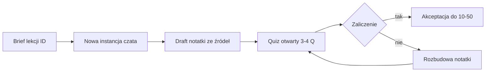

# Masterclass Inżynierii Webowej — Roadmapa v3.0.0

> **Wersja:** 3.0.0 | **Status:** Mapa lekcji z pełnymi sprawozdaniami (same lekcje realizowane po kolei)  
> **Kotwice stosu:** TypeScript/Node, Java/Spring, C#/.NET · Frontend: React i Angular · Baza: PostgreSQL (desktop → SQLite) · Go/Rust: tylko Vs / horyzont  
> **Pakiet docelowy:** Markdown + Obsidian Canvas + `labs/web-engineering/<id>/`  
> **Wzorzec głębokości Vs:** [[2026-08-06-diagramming-engine-react-flow-vs-jointjs]]

---

## Spis treści

1. [Guard-Rail Policy](#guard-rail-policy)
2. [Protokół Blackbox](#protokół-blackbox-verification)
3. [Szablon podpunktu lekcji](#szablon-podpunktu-lekcji)
4. [Spis ID lekcji i kolejność](#spis-id-lekcji-i-kolejność-realizacji)
5. [Etap 1 — Lifecycle](#etap-1-inicjacja-projektu-analiza-domenowa-i-zarządzanie)
6. [Etap 2 — Architektura i stos](#etap-2-fundamenty-architektury-webowej-i-decyzje-stosowe)
7. [Etap 3 — Pod maską](#etap-3-pod-maską--mechanika-systemów-webowych)
8. [Etap 4 — Warstwa danych](#etap-4-warstwa-danych-bazy-i-trwałość)
9. [Etap 5 — Bezpieczeństwo](#etap-5-bezpieczeństwo-webowe)
10. [Etap 6 — Frontend i wzorce wizualne](#etap-6-wzorce-wizualne-uiux-i-architektura-frontendowa)
11. [Etap 7 — CI/CD i wydajność](#etap-7-pipeline-cicd-devops-i-optymalizacja)
12. [Etap 8 — Capstone i AI](#etap-8-blueprint-2-semestralny-i-egzekucja-z-ai)
13. [Research Audit Trail](#research-audit-trail)
14. [Ograniczenia i zlecenia zewnętrzne](#ograniczenia-i-zlecenia-zewnętrzne)

---

## Guard-Rail Policy

1. **Brak skrótów (No Hand-Waving).** Każda lekcja schodzi do poziomu inżynieryjnego: protokoły, pamięć, plany zapytań, kody stanu, łańcuchy middleware, realny kod.
2. **Obowiązkowa recenzja porównawcza (Trade-off Analysis).** Żadnej technologii w izolacji. Każde rozwiązanie ma Vs z macierzą kryteriów i werdyktem „kiedy A / kiedy B / kiedy unikać”. Wzorzec: ADR React Flow vs JointJS.
3. **Niezależne omówienie przed Vs.** Najpierw osobna mini-sekcja na każdą technologię, dopiero potem porównanie.
4. **Blackbox Verification Protocol.** Draft lekcji powstaje w **nowej instancji czata** ze źródeł; zaliczenie quizu otwartego jest bramą do kolejnego ID.
5. **Zakaz w treści.** „m.in.” / „itd.” bez listy; „podobnie jak wyżej”; jednolinijkowe „recenzje”; pomijanie kotwic Java/C#/Angular gdy lekcja dotyczy stosu.
6. **Język nauczyciela.** Pełne sprawozdanie: cel, mechanika, kod, werdykt, quiz, źródła — nie streszczenie blogowe.

---

## Protokół Blackbox Verification

**Wariant operacyjny (Vaultie):** skill (propozycja) + zawsze nowa instancja czata + brama quizu.

### Kroki

1. W sesji masterclass agent przygotowuje **Brief Blackbox** dla danego ID: cele, lista źródeł z tej roadmapy, zakaz skracania, rubryka zaliczenia, ścieżka artefaktu.
2. Właściciel otwiera **nowy czat Cursor** i wkleja brief. Ta instancja pisze głęboką notatkę wyłącznie na podstawie podanych źródeł (+ oficjalna dokumentacja wskazana w briefie).
3. Po drafcie: **3–4 pytania otwarte** z rubryki. Odpowiedzi ocenia agent masterclass (lub ta sama sesja po wklejeniu odpowiedzi). Zaliczenie = ewidentne zrozumienie mechaniki, nie lista słów kluczowych.
4. **Bez zaliczenia:** brak przejścia do kolejnego ID; notatka wraca do rozbudowy w Blackboxie.
5. **Po zaliczeniu:** `00_Inbox/_proposals/` → akceptacja właściciela → `10_`–`50_` według typu artefaktu.

### Rubryka domyślna (próg zaliczenia)

- **Zaliczone:** odpowiedzi poprawnie opisują przepływ / trade-off / „kiedy użyć”, zawierają co najmniej jeden konkret techniczny z lekcji (np. nazwa wzorca, nagłówek, poziom izolacji, etap pipeline).
- **Do poprawy:** ogólniki, pomylone pojęcia (np. SSR = SPA), brak odpowiedzi na „dlaczego nie X”.
- **Próg:** minimum 3 z 4 pytań zaliczone; przy 2/4 — obowiązkowa rozbudowa notatki i retake.

### Artefakty procesu (późniejsza implementacja)

- Propozycja skillu: `00_Inbox/_proposals/skill-kb-blackbox.md` → przyszły `.agent/skills/kb-blackbox.md`
- Propozycja labs: `00_Inbox/_proposals/labs-web-engineering.md` → `labs/web-engineering/<lesson-id>/`

---

## Szablon podpunktu lekcji

Każde ID poniżej wypełnia te pola:

| Pole | Opis |
|---|---|
| **ID / tytuł / czas** | Identyfikator, nazwa, 60–180 min orientacyjnie |
| **Cel dydaktyczny** | Co umiesz wytłumaczyć i zastosować |
| **Wymagania wstępne** | Wcześniejsze ID |
| **Niezależne omówienia** | Osobna mini-sekcja na każdą technologię/pojęcie |
| **Analiza Vs** | Macierz + werdykt kiedy A/B/unikać |
| **Pod maską** | Mechanika (pakiety, AST, MVCC, Event Loop…) |
| **Kod / lab** | `labs/web-engineering/<id>/` — co napisać |
| **Artefakt Vaultie** | `concept` / `library` / `comparison` / `decision` / `snippet` |
| **Kanwa** | Co pokazać w `90_Meta/canvases/` |
| **Blackbox quiz** | 3–4 Q + rubryka |
| **Źródła** | Min. 2 zewnętrzne przy Vs + ślad |

---

## Spis ID lekcji i kolejność realizacji

| Kolejność | ID | Tytuł |
|---|---|---|
| 1 | 1.1 | Ideation, Feasibility, FR/NFR |
| 2 | 1.2 | WBS, metodyki, RACI |
| 3 | 1.3 | Repozytorium, monorepo, Git workflow |
| 4 | 1.4 | DoD, PR, Code Review |
| 5 | 2.1 | Website vs Web App, paradygmaty renderowania |
| 6 | 2.2 | Warstwowa / Hex / Onion / Modular Monolith / Mikroserwisy |
| 7 | 2.3a | TypeScript / Node (niezależnie) |
| 8 | 2.3b | Java / Spring (niezależnie) |
| 9 | 2.3c | C# / .NET (niezależnie) |
| 10 | 2.3d | React (niezależnie) |
| 11 | 2.3e | Angular (niezależnie) |
| 12 | 2.4 | Macierz wyboru stosu (uczelnia / 2 semestry) |
| 13 | 3.1 | HTTP/1.1–3, WS, SSE, gRPC |
| 14 | 3.2 | ORM: Active Record / Data Mapper / QB / Raw SQL |
| 15 | 3.3 | Auth pipeline: sessions vs JWT, RBAC vs ABAC |
| 16 | 4.1 | PostgreSQL głęboko |
| 17 | 4.2 | Redis, MongoDB, CAP, cache patterns |
| 18 | 4.3 | Migracje schematu |
| 19 | 4.4 | Modelowanie domenowe, ER, indeksy |
| 20 | 5.1 | OWASP Top 10 |
| 21 | 5.2 | Rate limiting |
| 22 | 5.3 | Sekrety, env, supply chain |
| 23 | 6.1 | Stan frontendowy (client vs server) |
| 24 | 6.2 | Design system, tokeny, WCAG |
| 25 | 6.3 | Architektura aplikacji React vs Angular |
| 26 | 6.4 | Wzorce wizualne / diagramming (case ADR) |
| 27 | 7.1 | CI/CD, kontenery |
| 28 | 7.2 | Performance, Core Web Vitals, OTel |
| 29 | 7.3 | Środowiska i feature flags |
| 30 | 8.1 | Docs-as-Code, ADR |
| 31 | 8.2 | AI-assisted engineering |
| 32 | 8.3 | Blueprint 2-semestralny (tydzień po tygodniu) |

**Domyślny blueprint (8.3):** Modular Monolith + PostgreSQL + jeden z {TS, Java, C#} + jeden z {React, Angular}. Bez przedwczesnych mikroserwisów.

---

# ETAP 1: Inicjacja Projektu, Analiza Domenowa i Zarządzanie

## 1.1 — Ideation, Feasibility & Scope (FR / NFR)

> **Pełna lekcja (v1):** [[1.1-ideation-fr-nfr]] · **Kanwa:** [[lesson-1.1-ideation-fr-nfr.canvas]] · **Szablony:** `90_Meta/lessons/1.1/`

- **Czas:** 90–120 min
- **Cel dydaktyczny:** Przekształcisz luźny pomysł w specyfikację z Functional Requirements (FR) i Non-Functional Requirements (NFR), z budżetami latencji i granicami MVP — zanim padnie pierwsza linia kodu.
- **Wymagania wstępne:** brak
- **Niezależne omówienia:**
  - **Proof of Concept (PoC):** weryfikuje jedną niewiadomą techniczną (algorytm, integracja, limity API). Kod PoC jest jednorazowy; nie jest fundamentem produkcji.
  - **Minimum Viable Product (MVP):** najmniejszy zestaw FR, który pozwala zweryfikować wartość dla użytkownika. MVP ma świadomie okrojone NFR (np. brak HA).
  - **Production-Ready:** komplet FR+NFR (bezpieczeństwo, obserwowalność, backup, SLA). Projekty uczelniane często mylą PoC z production — to antipattern *Prototype in Production*.
  - **FR vs NFR:** FR = „co system robi” (logowanie, CRUD zamówień). NFR = „jak dobrze” (p95 latency < 200 ms, dostępność 99.5%, RPO/RTO).
- **Analiza Vs:**

  | Kryterium | PoC | MVP | Production |
  |---|---|---|---|
  | Cel | Czy da się technicznie | Czy użytkownik chce | Czy przeżyje obciążenie i ataki |
  | Jakość kodu | Throwaway OK | Refaktorowalny | Testy, CI, security |
  | NFR | Minimalne | Częściowe | Pełne |
  | Czas (uczelnia) | 1–2 tyg. | 4–8 tyg. | cały semestr+ |

  **Werdykt:** PoC → tylko przy ryzyku technicznym. MVP → start semestru 1. Production-Ready checklist → cel końca semestru 2. Unikać traktowania PoC jako kodu bazowego bez rewrite.
- **Pod maską:** Latency budget (p50/p95/p99); Availability = MTBF / (MTBF + MTTR); szacunek RPS = użytkownicy_aktywni × akcje_na_minutę / 60; SLO vs SLA (wewnętrzny cel vs umowa).
- **Kod / lab:** `labs/web-engineering/1.1/` — szablon `spec-fr-nfr.md` + arkusz latency budget (tabela endpoint → budżet ms).
- **Artefakt Vaultie:** `00_Inbox/_proposals/spec-project-vision.md` (potem concept/decision)
- **Kanwa:** mapa Pomysł → FR → NFR → PoC/MVP/Prod z kolorami ryzyka
- **Blackbox quiz:**
  1. Podaj przykład FR i odpowiadającego NFR dla „lista zamówień”.
  2. Dlaczego kod PoC nie powinien iść na produkcję bez rewrite?
  3. Jak obliczysz p95 latency i po co osobno p99?
  4. Kiedy świadomie obniżysz NFR w MVP?
  - *Rubryka:* musi rozróżnić FR/NFR; nazwać Prototype in Production; powiązać p95 z budżetem UX.
- **Źródła:**
  - [roadmap.sh/full-stack](https://roadmap.sh/full-stack) — sekwencja fundamentów przed frameworkami
  - Google SRE / latency percentiles (pojęcia SLO/SLA — oficjalne materiały SRE Book)
  - Ślad: WebSearch `modern web architecture patterns fullstack roadmap 2025 2026` → priorytet NFR i change safety w curriculum 2026

---

## 1.2 — WBS, Metodyki i RACI

- **Czas:** 90–120 min
- **Cel dydaktyczny:** Zdekomponujesz projekt na zadania atomowe (WBS), dobierzesz metodykę do zespołu 3–5 osób i przypiszesz odpowiedzialności macierzą RACI.
- **Wymagania wstępne:** 1.1
- **Niezależne omówienia:**
  - **Scrum:** sprinty (zwykle 2 tyg.), ceremonie (standup, planning, review, retro). Silny rytm, duży narzut przy małym zespole.
  - **Kanban:** ciągły przepływ, WIP limit, brak fixed-length sprintów. Dobry przy nieregularnym czasie studentów.
  - **Shape Up (Basecamp):** cykle ~6 tyg. + cooldown; etap *Shaping* przed budową ogranicza scope creep.
  - **WBS:** drzewo deliverables → work packages → zadania; estymacja effort (nie „story points magiczne” bez kalibracji).
  - **RACI:** Responsible, Accountable (jedna osoba), Consulted, Informed — per epik/moduł.
- **Analiza Vs:**

  | Kryterium | Scrum | Kanban | Shape Up |
  |---|---|---|---|
  | Narzut ceremonii | Wysoki | Niski | Średni (shaping) |
  | Kontrola scope | Sprint backlog | WIP | Appetite + shaping |
  | Zespół 3–4 uczelniany | Często za ciężki | Dobry default | Dobry przy jasnym „co nie robimy” |
  | Harmonogram 2 semestry | Wymaga dyscypliny | Elastyczny | Naturalne cykle |

  **Werdykt:** Domyślnie Kanban + twarde WIP (np. 2 zadania/osoba) albo Shape Up w cyklach semestralnych. Scrum tylko gdy zespół chce ceremonie i ma stałe sloty. Unikać „Scrum bez DoD i bez WIP” (teatr statusów).
- **Pod maską:** GitHub Projects / Issues: etykiety `kind/*`, `area/*`, `effort/*`; critical path na WBS; dług techniczny jako osobny bucket z limitem % czasu sprintu/cyklu.
- **Kod / lab:** `labs/web-engineering/1.2/` — przykładowy board YAML (kolumny + WIP) + szablon RACI CSV.
- **Artefakt:** pattern `20_Patterns/wbs-raci-student-team.md` (propozycja)
- **Kanwa:** WBS drzewo + RACI heatmapa ról
- **Blackbox quiz:**
  1. Czym Accountable różni się od Responsible w RACI?
  2. Kiedy Shape Up bije Scrum w projekcie studenckim?
  3. Podaj przykład złego WBS (zbyt duże zadanie) i poprawionej dekompozycji.
  4. Po co WIP limit?
  - *Rubryka:* jedna osoba Accountable; powiązanie WIP z multitaskingiem; przykład dekompozycji ≤ 1–2 dni.
- **Źródła:**
  - Basecamp Shape Up (oficjalna książka online)
  - Atlassian / Scrum Guide (definicje ceremonii)
  - Ślad: synteza curriculum 2026 — małe zespoły preferują continuous flow nad heavy ceremony

---

## 1.3 — Repozytorium, Monorepo i Git Workflow

- **Czas:** 120–150 min
- **Cel dydaktyczny:** Skonfigurujesz repozytorium z deterministycznym buildem, hookami jakości i świadomym wyborem monorepo vs polyrepo oraz strategii gałęzi.
- **Wymagania wstępne:** 1.2
- **Niezależne omówienia:**
  - **Polyrepo:** osobne repo na frontend/backend/shared — izolacja, ale piekło wersji shared-types i multi-PR.
  - **Monorepo (pnpm workspaces / Turborepo / Nx):** jeden commit atomowy cross-package; cache tasków; jeden CI graph.
  - **GitFlow:** develop + release + hotfix — dużo długożyjących gałęzi, konflikty przy merge.
  - **Trunk-Based Development:** krótkie gałęzie do `main`, feature flags dla niedokończonych funkcji.
  - **Feature Branch + PR:** praktyczny kompromis uczelniany (branch → PR → review → main).
  - **Tooling:** Husky + lint-staged; Conventional Commits; Biome lub ESLint+Prettier; lockfile (pnpm-lock / package-lock).
- **Analiza Vs:**

  | Kryterium | Monorepo | Polyrepo |
  |---|---|---|
  | Atomowe zmiany FE+BE | Tak | Trudne |
  | CI complexity | Graph zależności | Prostsze per repo, trudniejsze e2e |
  | Onboarding | Jeden clone | Wiele clone + docs |
  | Projekt 2-sem. 3–5 osób | **Preferowany** | Tylko przy twardym wymogu org |

  | Kryterium | GitFlow | Trunk-Based | Feature Branch+PR |
  |---|---|---|---|
  | Konflikty merge | Częste | Rzadkie | Umiarkowane |
  | Nadaje się do sem. | Raczej nie | Idealny z flagami | **Default uczelniany** |

  **Werdykt:** Monorepo + Feature Branch+PR (+ trunk-based mindset: krótkie życie branchy). Unikać GitFlow i polyrepo „bo tak w firmie X” bez narzędzia synchronizacji.
- **Pod maską:** hook `pre-commit` (lint/format) vs `commit-msg` (conventional); dlaczego hook lokalny ≠ CI (obejście `--no-verify`); zawartość lockfile i reprodukowalność `ci`.
- **Kod / lab:** `labs/web-engineering/1.3/` — mini monorepo `apps/web` + `packages/shared` + Husky + przykładowy workflow lint.
- **Artefakt:** snippet + decision „monorepo-student-default”
- **Kanwa:** diagram pakietów monorepo + flow branch → PR → main → CI
- **Blackbox quiz:**
  1. Po co lockfile w CI?
  2. Dlaczego polyrepo boli przy zmianie shared DTO?
  3. Czym trunk-based różni się od GitFlow w praktyce merge?
  4. Co powinno być w pre-commit, a co wyłącznie w CI?
  - *Rubryka:* lockfile = reprodukowalność; atomowy commit monorepo; security tests w CI nie tylko lokalnie.
- **Źródła:**
  - Turborepo / pnpm workspaces docs
  - Conventional Commits spec
  - Trunk Based Development (trunkbaseddevelopment.com)

---

## 1.4 — Definition of Done, PR Templates, Code Review

- **Czas:** 60–90 min
- **Cel dydaktyczny:** Ustalicie Definition of Done (DoD) zespołu, szablon PR wymuszający checklistę i zasady review, które łapią regresje zanim trafią na `main`.
- **Wymagania wstępne:** 1.3
- **Niezależne omówienia:**
  - **Definition of Done:** binarna checklista (testy, lint, docs, migracja, security note) — bez „prawie gotowe”.
  - **PR template:** opis „dlaczego”, sposób testowania, screenshot/API sample, checklist DoD.
  - **Code Review:** cele (poprawność, czytelność, bezpieczeństwo, spójność architektury) vs antycele (gust stylu już łapany przez linter).
  - **Branch protection:** required checks, required review, zakaz force-push na main.
- **Analiza Vs:**

  | Kryterium | Review tylko „LGTM” | Review z checklistą DoD | Pair programming zamiast PR |
  |---|---|---|---|
  | Łapie bugi | Słabo | Dobrze | Dobrze lokalnie |
  | Audit trail | Słaby | PR jako dokument | Słaby |
  | Skala zespołu 4 | Ryzykowne | **Default** | Uzupełnienie, nie zamiennik |

  **Werdykt:** DoD + PR template + min. 1 review + CI green. Pairing jako dodatek przy trudnych PR. Unikać merge bez opisu i bez test planu.
- **Pod maską:** GitHub branch protection rules; required status checks z Actions; CODEOWNERS dla `area/backend`.
- **Kod / lab:** `labs/web-engineering/1.4/` — `.github/PULL_REQUEST_TEMPLATE.md` + `DOD.md` + przykładowy CODEOWNERS.
- **Artefakt:** pattern `code-review-dod-student`
- **Kanwa:** flowchart „PR opened → checks → review → merge”
- **Blackbox quiz:**
  1. Wymień 5 punktów sensownego DoD dla API + migracji DB.
  2. Dlaczego linter nie zastępuje review bezpieczeństwa?
  3. Po co test plan w opisie PR?
  4. Co daje branch protection czego nie da sama dyscyplina zespołu?
  - *Rubryka:* DoD obejmuje migracje/rollback; review ≠ formatowanie; protection = egzekwowalne reguły.
- **Źródła:**
  - GitHub Docs: branch protection / pull request templates
  - Google Engineering Practices — Code Review guidelines

---

# ETAP 2: Fundamenty Architektury Webowej i Decyzje Stosowe

## 2.1 — Website vs Web App & Paradygmaty Renderowania

- **Czas:** 120–150 min
- **Cel dydaktyczny:** Dobierzesz paradygmat renderowania do SEO, interaktywności i kosztu serwera; wyjaśnisz hydrację i TTFB.
- **Wymagania wstępne:** 1.1
- **Niezależne omówienia:**
  - **MPA:** pełny reload, HTML z serwera per nawigacja (klasyczny Rails/Django templates, PHP).
  - **SPA:** jeden shell HTML, routing w JS (Vite+React CSR). Szybka nawigacja, SEO trudniejsze bez SSR.
  - **SSR:** HTML generowany per request (Next.js Node). Lepsze SEO/TTFB treści, koszt CPU serwera.
  - **SSG:** HTML w build time (blog, docs). Najtańszy edge/CDN.
  - **ISR:** SSG z rewalidacją tła (stale-while-revalidate na poziomie frameworka).
  - **RSC (React Server Components):** komponenty serwerowe bez JS w bundle klienta; granica server/client.
- **Analiza Vs:**

  | Kryterium | MPA | SPA | SSR | SSG | ISR | RSC |
  |---|---|---|---|---|---|---|
  | SEO | + | − (bez SSR) | + | + | + | + |
  | Interaktywność app | − | + | + | −/+ | + | + |
  | Koszt serwera | śr. | niski (static+API) | wysoki | niski | śr. | śr./wys. |
  | Złożoność DX | niska | śr. | wys. | niska | śr. | wys. |

  **Werdykt:** Landing/docs → SSG. Dashboard zalogowany → SPA/CSR lub SSR+auth. Marketing+app → hybrydowo (SSG marketing, CSR app). RSC gdy zespół rozumie granicę serwer/klient. Unikać „wszystko SSR” bez potrzeby SEO.
- **Pod maską:** Hydration — serwerowy HTML + payload stanu → React przykleja listenery; mismatch hydration; TTFB vs LCP; streaming SSR.
- **Kod / lab:** `labs/web-engineering/2.1/` — ta sama strona w wariancie static vs CSR vs prosty SSR (Node) + pomiar TTFB.
- **Artefakt:** comparison `rendering-paradigms` + decision matrix per moduł
- **Kanwa:** timeline request → HTML → JS → hydrate → interactive
- **Blackbox quiz:**
  1. Czym hydracja różni się od zwykłego CSR mount?
  2. Kiedy SSG jest lepszy niż SSR dla bloga?
  3. Jaki problem SEO ma czyste SPA?
  4. Podaj przykładową macierz: landing / dashboard / blog.
  - *Rubryka:* hydracja = reconcilacja z istniejącym DOM; SSG = build-time; SPA SEO = brak treści w pierwszym HTML.
- **Źródła:**
  - Next.js docs: Rendering / RSC
  - web.dev: hydration / TTFB / LCP
  - Bytepane / Scrimba roadmaps 2026 — Next.js jako warstwa integracji fullstack

---

## 2.2 — Paradygmaty Architektoniczne Systemów

- **Czas:** 150–180 min
- **Cel dydaktyczny:** Zaprojektujesz podział odpowiedzialności (warstwy / porty / moduły) i wybierzesz architekturę pod 2 semestry bez Big Ball of Mud i bez przedwczesnych mikroserwisów.
- **Wymagania wstępne:** 2.1, 1.1
- **Niezależne omówienia:**
  - **Layered / N-Tier:** UI → Application/Service → Domain → Infrastructure/DB. Prosty start; ryzyko wycieku szczegółów ORM w górę.
  - **Hexagonal (Ports & Adapters):** rdzeń aplikacji zależy od portów (interfejsów); adaptery HTTP/DB na zewnątrz. Wysoka testowalność.
  - **Onion:** pierścienie (domain → application → infrastructure); zależności tylko do środka.
  - **Clean Architecture:** podobna dyscyplina zależności co Onion/Hex; nacisk na use case’y.
  - **Modular Monolith:** jeden deployable, wiele Bounded Contexts z wyraźnymi API modułów; brak shared DB tables cross-module jako norma.
  - **Mikroserwisy:** osobne procesy/deploy; sieć, eventual consistency, distributed tracing — koszt operacyjny.
- **Analiza Vs:**

  | Kryterium | Layered | Hex/Onion/Clean | Modular Monolith | Mikroserwisy |
  |---|---|---|---|---|
  | Start (tydzień 1) | Najszybszy | Wolniejszy (boilerplate) | Śr. (granice domeny) | Najwolniejszy |
  | Testowalność domeny | Śr. | Wysoka | Wysoka w module | Wysoka + kontrakty |
  | Ops burden | Niski | Niski | Niski | Wysoki |
  | Projekt uczelniany 3–5 os. | OK na start | Hex **wewnątrz** kluczowych modułów | **Gold standard systemu** | Zwykle premature |

  **Werdykt:** System = Modular Monolith. Wewnątrz krytycznych modułów = Ports & Adapters. Layered OK na PoC/MVP week 1, potem egzekwuj granice. Mikroserwisy — tylko gdy wymóg niezależnego skalowania/deploy i zespół ma ops. Unikać „mikroserwisów na 3 osoby”.
- **Pod maską:** DIP/IoC — domain zależy od `OrderRepository` (port), nie od Prisma/EF; Composition Root; anti-corruption layer między modułami; integration events in-process vs message bus.
- **Kod / lab:** `labs/web-engineering/2.2/` — szkielet 2 modułów (`billing`, `catalog`) z portami i fake adapterami + test use case bez DB.
- **Artefakt:** ADR `30_Decisions/...-system-architecture.md`
- **Kanwa:** diagram pierścieni Onion obok Modular Monolith boxes + strzałki tylko przez public API
- **Blackbox quiz:**
  1. Co jest portem, a co adapterem w logowaniu użytkownika?
  2. Dlaczego shared tabela między modułami psuje Modular Monolith?
  3. Kiedy layered wystarczy, a kiedy przejść na hex w module?
  4. Podaj 3 koszty mikroserwisów nieobecne w monolicie.
  - *Rubryka:* DIP; granica modułu = kontrakt; koszty sieci/consistency/ops.
- **Źródła:**
  - [DevIQ Modular Monolith](https://deviq.com/architecture/modular-monolith/)
  - [Combining Modular Monolith and Hexagonal](https://notes.softwarearchitect.id/p/combining-modular-monolith-and-hexagonal)
  - [Cogent: Clean vs Hexagonal vs Layered](https://cogentinfo.com/resources/designing-scalable-secure-applications-choosing-between-clean-hexagonal-and-layered-architectures)
  - Przykłady OSS: NestJS modular monolith + DDD; Go hexagonal modular monolith (bxcodec)

---

## 2.3a — TypeScript / Node (niezależnie)

- **Czas:** 120–150 min
- **Cel dydaktyczny:** Wyjaśnisz model wykonawczy Node (Event Loop), rolę TypeScript w kontrakcie typów shared FE/BE oraz kiedy Express/Hono/Nest/Next API wystarczą.
- **Wymagania wstępne:** 2.2 (równolegle OK z 2.3b/c)
- **Niezależne omówienia:**
  - **JavaScript runtime Node.js:** jednowątkowy Event Loop + libuv (I/O); worker threads dla CPU-bound.
  - **TypeScript:** typy wymazywane w runtime; wartość = kontrakty, refaktor, IDE; `strict` jako norma.
  - **Express:** minimalny middleware stack; ogromny ekosystem; mało struktury.
  - **Hono:** lekki, edge-friendly, dobre DX TypeScript.
  - **NestJS:** struktura Angular-like (moduły, DI) na Node — bliżej enterprise.
  - **Bun/Deno:** alternatywne runtime (Vs horyzont, nie kotwica).
- **Analiza Vs (wewnątrz ekosystemu Node):**

  | Kryterium | Express | Hono | NestJS |
  |---|---|---|---|
  | Struktura | Luźna | Lekka | Silna (DI/moduły) |
  | Learning curve | Niska | Niska | Wyższa |
  | Modular Monolith DX | Ręcznie | Ręcznie | Naturalne moduły |
  | Projekt uczelniany | MVP OK | API-first OK | **Gdy chcesz DI jak w Spring** |

  **Werdykt vs inne języki (zapowiedź 2.4):** Node/TS wygrywa shared types i tempo prototypu; przegrywa przy ciężkim CPU i przy zespołach już osadzonych w JVM/.NET.
- **Pod maską:** fazy Event Loop (timers, poll, check); non-blocking I/O; dlaczego `fs.readFileSync` blokuje; erozja typów przy `any` i złym ORM typing.
- **Kod / lab:** `labs/web-engineering/2.3a/` — serwer Hono lub Express z Zod validation + shared type package.
- **Artefakt:** library note `typescript-node-runtime`
- **Kanwa:** Event Loop phases + request lifecycle
- **Blackbox quiz:**
  1. Co się stanie gdy w handlerze zrobisz ciężką pętlę CPU?
  2. Dlaczego TypeScript nie chroni przed złym JSON z sieci bez walidacji runtime?
  3. Kiedy Nest zamiast Express?
  4. Po co `strict` w tsconfig?
  - *Rubryka:* Event Loop blokowany przez sync CPU; Zod/walidacja ≠ typy TS; Nest = struktura/DI.
- **Źródła:**
  - Node.js docs: Event Loop
  - TypeScript Handbook: strictness
  - Stack Overflow Survey (udział JS/TS) — kontekst popularności, nie dowód jakości

---

## 2.3b — Java / Spring (niezależnie)

- **Czas:** 120–150 min
- **Cel dydaktyczny:** Opiszesz model wątków JVM, IoC Springa, warstwy Spring MVC/WebFlux (świadomie) i typowy stack JPA + Security pod projekt uczelniany.
- **Wymagania wstępne:** 2.2
- **Niezależne omówienia:**
  - **JVM / Java:** bytecode, JIT HotSpot, thread-per-request (tradycyjny servlet) vs virtual threads (nowsze Java).
  - **Spring Boot:** auto-config, startery, Actuator.
  - **Spring MVC:** synchroniczny model servlet.
  - **Spring WebFlux:** reaktywny (tylko gdy naprawdę potrzeba backpressure — nie default uczelniany).
  - **Spring Data JPA / Hibernate:** Data Mapper + Unit of Work.
  - **Spring Security:** filtr chain authn/authz.
- **Analiza Vs (wewnątrz Java):**

  | Kryterium | Czysty Jakarta EE | Spring Boot | Quarkus/Micronaut |
  |---|---|---|---|
  | Tempo startu projektu | Wolniejsze | **Najszybsze w JV** | Szybkie, mniejszy share market uczelniany |
  | Dokumentacja/community | Duże | Największe | Mniejsze |
  | Modular Monolith | Możliwy | **Naturalny (moduły/pakiety)** | Naturalny |

  **Werdykt:** Spring Boot = kotwica Java dla uczelni. WebFlux nie jako first choice. Quarkus — Vs gdy liczy się native/startup.
- **Pod maską:** DispatcherServlet; FilterChain; proxy Spring AOP przy `@Transactional`; persistence context Hibernate; N+1 i `join fetch`.
- **Kod / lab:** `labs/web-engineering/2.3b/` — Spring Boot module `catalog` z controller → service → repository interface + H2/Postgres test.
- **Artefakt:** library `spring-boot-modular-basics`
- **Kanwa:** request → filters → controller → service → JPA → SQL
- **Blackbox quiz:**
  1. Co robi IoC container przy `@Autowired` / constructor injection?
  2. Dlaczego `@Transactional` na kontrolerze to zwykle zły pomysł?
  3. Czym EntityManager persistence context chroni spójność w pamięci?
  4. Kiedy NIE wybierać WebFlux?
  - *Rubryka:* DI konstruktorowe; transakcja na use case; WebFlux = złożoność reaktywna.
- **Źródła:**
  - Spring Boot reference docs
  - Hibernate ORM documentation (persistence context)
  - Baeldung (jako indeks tematów — weryfikować względem oficjalnych docs)

---

## 2.3c — C# / .NET (niezależnie)

- **Czas:** 120–150 min
- **Cel dydaktyczny:** Wyjaśnisz pipeline ASP.NET Core (middleware), DI wbudowane, EF Core jako Data Mapper i minimal APIs vs Controllers.
- **Wymagania wstępne:** 2.2
- **Niezależne omówienia:**
  - **CLR / .NET:** zarządzana pamięć, async/await + thread pool.
  - **ASP.NET Core:** middleware pipeline (odpowiednik filtrów Spring / middleware Express).
  - **Minimal APIs vs Controllers:** zwięzłość vs struktura.
  - **EF Core:** DbContext = Unit of Work + Identity Map; LINQ → SQL.
  - **Clean Architecture templates** w ekosystemie .NET (częsty wybór uczelniany).
- **Analiza Vs (wewnątrz .NET):**

  | Kryterium | Minimal APIs | MVC Controllers | Vertically sliced features |
  |---|---|---|---|
  | Prostota startu | + | śr. | śr. |
  | Skala rozwiązania | − przy wzroście | + | + (modular) |
  | Uczelnia | Demo | **Solidny default** | Idealny przy Modular Monolith |

  **Werdykt:** ASP.NET Core + EF Core + vertical slices/modules = silna kotwica obok Spring/TS. Wybór gdy zespół zna C# lub wymóg wydziału.
- **Pod maską:** `RequestDelegate` pipeline; `IHost`; scoped DbContext lifetime (dlaczego singleton DbContext jest bugiem); change tracker EF.
- **Kod / lab:** `labs/web-engineering/2.3c/` — Minimal API + jeden Controller feature + EF Core migration sample.
- **Artefakt:** library `aspnet-core-pipeline`
- **Kanwa:** middleware onion → endpoint → DbContext SaveChanges
- **Blackbox quiz:**
  1. Dlaczego DbContext jest zwykle Scoped, nie Singleton?
  2. Co robi Change Tracker przy `SaveChanges`?
  3. Czym middleware różni się od filtra akcji?
  4. Kiedy Minimal API przestaje wystarczać?
  - *Rubryka:* lifetime = request; DetectChanges/SQL batch; kolejność middleware.
- **Źródła:**
  - Microsoft Learn: ASP.NET Core middleware, EF Core
  - Official .NET foundational C# / ASP.NET tutorials

---

## 2.3d — React (niezależnie)

- **Czas:** 120 min
- **Cel dydaktyczny:** Opiszesz model komponentów React, jednokierunkowy przepływ danych, rolę VDOM/reconciliation i ekosystem (Vite/Next) bez mieszania z Angular.
- **Wymagania wstępne:** 2.1
- **Niezależne omówienia:**
  - **React:** biblioteka UI (nie full framework); deklaratywny render; hooks.
  - **Vite + React:** CSR SPA tooling.
  - **Next.js:** framework meta (routing, SSR/RSC) wokół React.
  - **Stan lokalny:** `useState`/`useReducer`; lifting state.
  - **Efekty:** `useEffect` — synchronizacja ze światem zewnętrznym, nie „na mount zawsze”.
- **Analiza Vs (wewnątrz React ecosytem):** Vite SPA vs Next — SEO/SSR potrzebne → Next; czysty dashboard za VPN → Vite często wystarczy.
- **Pod maską:** render phase vs commit phase; reconciliation keys; batching state updates; dlaczego mutacja state bez setState nie odświeża UI.
- **Kod / lab:** `labs/web-engineering/2.3d/` — lista + formularz z kontrolowanym inputem i lifting state; bez Redux.
- **Artefakt:** library `react-core-model`
- **Kanwa:** UI = f(state); drzewo komponentów i przepływ props w dół / eventów w górę
- **Blackbox quiz:**
  1. Co robi reconciliation gdy zmienia się `key` listy?
  2. Kiedy `useEffect` jest zły wybór na „oblicz wartość pochodną”?
  3. Czym React różni się od „frameworka z DI i routerem w pudełku”?
  4. Po co kontrolowany input?
  - *Rubryka:* key = tożsamość; derived state bez effect; React = view library.
- **Źródła:**
  - react.dev (oficjalne)
  - Next.js docs (gdy meta-framework)

---

## 2.3e — Angular (niezależnie)

- **Czas:** 120–150 min
- **Cel dydaktyczny:** Opiszesz opiniowany framework Angular: moduły/standalone components, DI, RxJS w HTTP, router i change detection — niezależnie od React.
- **Wymagania wstępne:** 2.1
- **Niezależne omówienia:**
  - **Angular:** pełny framework (CLI, router, forms, HTTP, DI).
  - **Standalone components vs NgModules:** nowoczesny default standalone.
  - **Dependency Injection:** hierarchical injectors.
  - **RxJS:** Observable streams; `async` pipe; unsubscribe discipline.
  - **Change detection:** Zone.js (tradycyjnie) vs signals (nowszy model) — świadomość ewolucji.
- **Analiza Vs (wewnątrz Angular):** template-driven vs reactive forms — reactive dla złożonej walidacji; Signals zmniejszają boilerplate Zone w nowych appkach.
- **Pod maską:** injector tree; cold vs hot Observable; HTTP client + interceptors (auth header); CD cycle.
- **Kod / lab:** `labs/web-engineering/2.3e/` — standalone component + service injectable + HttpClient mock + reactive form.
- **Artefakt:** library `angular-core-model`
- **Kanwa:** Component → Service (DI) → HttpClient → Interceptor → API
- **Blackbox quiz:**
  1. Po co hierarchical DI w Angular?
  2. Co się stanie gdy nie odsubskrybujesz nieskończonego Observable?
  3. Czym interceptor przypomina middleware backendu?
  4. Kiedy reactive forms > template-driven?
  - *Rubryka:* DI scope; memory leak subscriptions; interceptor = cross-cutting.
- **Źródła:**
  - angular.dev oficjalne docs
  - RxJS documentation (core concepts)

---

## 2.4 — Macierz wyboru stosu (projekt 2-semestralny)

- **Czas:** 90–120 min
- **Cel dydaktyczny:** Na podstawie 2.3a–e i 2.2 wybierzesz jeden backend kotwiczny i jeden frontend kotwiczny z uzasadnieniem ADR; Go/Rust tylko jako świadome „nie teraz”.
- **Wymagania wstępne:** 2.3a, 2.3b, 2.3c, 2.3d, 2.3e, 2.2, 4.1 (może być soft-deps: Postgres jako założenie)
- **Niezależne omówienia:** kryteria wyboru — kompetencje zespołu, wymogi promotora, shared types, ekosystem ORM, hosting, czas onboarding.
- **Analiza Vs (kotwice):**

  | Kryterium | TS/Node | Java/Spring | C#/.NET | Go | Rust |
  |---|---|---|---|---|---|
  | Shared types z FE | Najlepsze | Śr. (OpenAPI) | Śr. (OpenAPI) | OpenAPI | OpenAPI |
  | Tempo MVP | Wysokie | Śr. | Śr. | Śr. | Niskie |
  | Struktura enterprise | Nest | Natywna | Natywna | Ręczna | Ręczna |
  | CPU-bound | Słabe | Silne | Silne | Silne | Najsilniejsze |
  | Cel masterclass | **Kotwica** | **Kotwica** | **Kotwica** | Horyzont | Horyzont |

  | Kryterium | React | Angular |
  |---|---|---|
  | Elastyczność UI | Wysoka | Opiniowana |
  | Batteries included | Niska (dokładasz) | Wysoka |
  | Rynek junior/uczelnia | Bardzo szeroki | Silny w enterprise/edu |

  **Baza:** PostgreSQL default; SQLite gdy desktop/offline/single-user.

  **Werdykt procedury:** (1) wymogi uczelni → (2) skills zespołu → (3) Modular Monolith + Postgres → (4) jeden BE z {TS, Java, C#} → (5) jeden FE z {React, Angular}. Nie mieszaj dwóch BE „dla nauki” w jednym capstone.
- **Pod maską:** koszt przełączania kontekstu wielostosu; OpenAPI jako kontrakt gdy BE≠TS; generowanie klientów.
- **Kod / lab:** `labs/web-engineering/2.4/` — wypełniona macierz scoring (0–5) + szablon ADR wyboru stosu.
- **Artefakt:** decision ADR stack
- **Kanwa:** decision tree wyboru stosu
- **Blackbox quiz:**
  1. Kiedy Angular wygra z React w zespole studenckim?
  2. Dlaczego Go nie jest kotwicą tego masterclass mimo wydajności?
  3. Jak OpenAPI łata brak shared types Java↔React?
  4. Kiedy SQLite zamiast Postgres?
  - *Rubryka:* Angular = opiniowany onboarding; Go = horyzont ops/learning; SQLite = single writer / embedded.
- **Źródła:**
  - roadmap.sh full-stack + Bytepane 2026 (TS+Postgres jako high-ROI path)
  - Oficjalne comparison pages frameworków (świadomie tendencyjne — krzyżuj z ADR kryteriami)

---

# ETAP 3: Pod Maską — Mechanika Systemów Webowych

## 3.1 — Protokoły: HTTP/1.1–3, WebSockets, SSE, gRPC

- **Czas:** 120–150 min
- **Cel dydaktyczny:** Prześledzisz bajt od kliknięcia do handlera; dobierzesz transport do chat/stream/RPC.
- **Wymagania wstępne:** 2.1
- **Niezależne omówienia:**
  - **HTTP/1.1:** tekstowe, keep-alive, HoL blocking na połączeniu.
  - **HTTP/2:** multiplexing strumieni, HPACK, nadal TCP HoL.
  - **HTTP/3 / QUIC:** UDP, unikanie TCP HoL, 0/1-RTT.
  - **WebSockets:** pełny duplex po upgrade; stanowe połączenia.
  - **SSE:** jednokierunkowy stream serwer→klient po HTTP.
  - **gRPC:** HTTP/2 + Protobuf; kontrakty `.proto`; świetne service-to-service.
- **Analiza Vs:**

  | Use case | Preferencja | Unikać |
  |---|---|---|
  | CRUD przeglądarka | HTTP/JSON REST lub HTTP+OpenAPI | gRPC-web bez potrzeby |
  | Chat live | WebSocket | SSE (jedna strona) jako jedyny kanał uplink |
  | Stream tokenów AI | SSE lub fetch stream | ciężki WS bez potrzeby |
  | Wewnętrzne mikroserwisy | gRPC | JSON-over-HTTP przy ogromnym ruchu RPC |

  **Werdykt:** Browser app default = HTTPS + JSON; realtime dwukierunkowy = WS; one-way push = SSE; backend mesh = gRPC.
- **Pod maską:** DNS → TCP/QUIC → TLS 1.3 → HTTP frames; status codes; idempotencja GET/PUT; sticky sessions przy WS.
- **Kod / lab:** `labs/web-engineering/3.1/` — mini serwer: REST + SSE endpoint + WS echo; klient przeglądarkowy.
- **Artefakt:** concept `network-protocols-under-the-hood`
- **Kanwa:** sequence diagram handshake TLS + porównanie WS vs SSE
- **Blackbox quiz:**
  1. Na czym polega HoL w HTTP/1.1?
  2. Dlaczego SSE nie zastąpi WS w grze multiplayer?
  3. Co daje Protobuf względem JSON w gRPC?
  4. Po co idempotencja metod HTTP?
  - *Rubryka:* HoL = kolejka na połączeniu; SSE = unidirection; Protobuf = schemat+binarnie.
- **Źródła:**
  - MDN: HTTP, WebSockets, SSE
  - gRPC.io docs
  - Cloudflare/QUIC primers (HTTP/3)

---

## 3.2 — ORM: Active Record, Data Mapper, Query Builder, Raw SQL

- **Czas:** 150–180 min
- **Cel dydaktyczny:** Wyjaśnisz co robi ORM (AST→SQL, Identity Map, Unit of Work), porównasz Prisma/EF/Hibernate/Django ORM/TypeORM i kiedy zejść do SQL.
- **Wymagania wstępne:** 2.3a–c (przynajmniej jeden), 4.1 równolegle OK
- **Niezależne omówienia:**
  - **Active Record:** obiekt = wiersz + metody persistence (Django ORM, ActiveRecord Rails, TypeORM AR-style).
  - **Data Mapper:** encja czysta; mapper/ORM osobno (EF Core, Hibernate, Prisma client jako warstwa dostępu).
  - **Query Builder:** typowane budowanie SQL bez pełnego UoW (Kysely, Knex, jOOQ).
  - **Raw SQL:** pełna kontrola; Ty odpowiadasz za mapping i injection safety (`$1` params).
  - **Prisma:** schema-first, generowany client, migracje.
  - **EF Core:** LINQ, change tracker, migrations.
  - **Hibernate/JPA:** persistence context, cache L1/L2.
  - **Django ORM:** AR + migracje; szybki CRUD.
- **Analiza Vs:**

  | Kryterium | Active Record | Data Mapper | Query Builder | Raw SQL |
  |---|---|---|---|---|
  | Czystość domeny | − | + | + | + |
  | Tempo CRUD | + | śr. | śr. | − |
  | Kontrola SQL | − | śr. | + | ++ |
  | Ryzyko N+1 | Wysokie | Wysokie | Niższe (jawne) | Twoje |

  **Werdykt:** Modular Monolith + czysta domena → Data Mapper lub QB. Proste CRUD MVP → AR OK. Raporty/analityka → Raw SQL/QB. Unikać magii lazy-load bez budżetu zapytań.
- **Pod maską:** budowa AST zapytania; connection pool (PgBouncer, HikariCP); Identity Map; Unit of Work; prepared statements vs string concat (SQLi).
- **Kod / lab:** `labs/web-engineering/3.2/` — to samo zapytanie w Prisma (lub EF) + Kysely/SQL; demonstracja N+1 i fix.
- **Artefakt:** comparison `orm-patterns` + snippet mini-mapper concept
- **Kanwa:** Entity → UoW → SQL → rows → Identity Map
- **Blackbox quiz:**
  1. Co ORM robi „pod maską” gdy zmieniasz pole i commit/save?
  2. Dlaczego Active Record utrudnia hexagonal?
  3. Jak powstaje N+1 i jak je wykryć?
  4. Kiedy Query Builder > pełny ORM?
  - *Rubryka:* UoW/flush; AR miesza domenę z I/O; N+1 = pętla + lazy; QB = jawny SQL z typami.
- **Źródła:**
  - Prisma / EF Core / Hibernate oficjalne docs
  - Martin Fowler: Patterns of Enterprise Application Architecture (AR vs DM — pojęcia)

---

## 3.3 — Auth Pipeline: Sessions vs JWT, RBAC vs ABAC

- **Czas:** 150–180 min
- **Cel dydaktyczny:** Prześledzisz pipeline od formularza logowania do decyzji authorize; zaprojektujesz bezpieczny model tokenów i ról.
- **Wymagania wstępne:** 3.1, 5.1 soft
- **Niezależne omówienia:**
  - **Session cookies:** server-side session store (Redis/DB); cookie `HttpOnly` `Secure` `SameSite`.
  - **JWT access token:** stateless claims + podpis; problem revoke.
  - **Refresh token:** długożyjący, rotacja, przechowywanie HttpOnly.
  - **RBAC:** role → permissions.
  - **ABAC:** atrybuty (user.ownerId == resource.ownerId, time, clearence).
  - **Password hashing:** Argon2id vs bcrypt (koszt CPU/RAM).
- **Analiza Vs:**

  | Kryterium | Sessions | JWT access-only | Access JWT + Refresh |
  |---|---|---|---|
  | Revocation | Łatwa (store) | Trudna do expiry | Refresh revoke + krótkie access |
  | Skalowanie API | Sticky/store shared | Łatwe | Łatwe |
  | XSS impact | Cookie HttpOnly chroni JS theft | Bearer w JS ryzykowny | Access w pamięci + refresh cookie |

  | | RBAC | ABAC |
  |---|---|---|
  | Prostota | + | − |
  | Fine-grained | − | + |
  | Uczelnia default | **RBAC + ownership checks** | Gdy polityki złożone |

  **Werdykt:** Domyślnie krótkie access (15 min) + refresh HttpOnly + rotacja; RBAC + reguły ownership. Unikać długiego JWT w `localStorage`.
- **Pod maską:** HMAC vs asymetryczne JWT; middleware/filter chain: parse → verify → load principal → authorize; timing-safe compare.
- **Kod / lab:** `labs/web-engineering/3.3/` — login → hash → session lub JWT+refresh mock Redis → guard na trasie.
- **Artefakt:** concept + sequence Mermaid auth pipeline
- **Kanwa:** sequence diagram pełnego logowania i odświeżenia tokena
- **Blackbox quiz:**
  1. Dlaczego sam JWT bez revoke jest ryzykowny po kradzieży?
  2. Po co SameSite=Strict/Lax przy cookies?
  3. Czym RBAC różni się od sprawdzenia `ownerId`?
  4. Dlaczego plain SHA-256 hasła to błąd?
  - *Rubryka:* revoke/expiry; CSRF vs XSS cookie flags; ownership ≠ rola; salt+KDF (Argon2/bcrypt).
- **Źródła:**
  - OWASP Authentication Cheat Sheet / Session Management
  - RFC 7519 (JWT) — świadomość claims
  - Argon2 / password storage cheat sheet OWASP

---

# ETAP 4: Warstwa Danych, Bazy i Trwałość

## 4.1 — PostgreSQL głęboko

- **Czas:** 150–180 min
- **Cel dydaktyczny:** Zaprojektujesz schemat, przeczytasz `EXPLAIN (ANALYZE, BUFFERS)`, dobierzesz indeksy i poziom izolacji transakcji.
- **Wymagania wstępne:** 3.2 soft, 1.1
- **Niezależne omówienia:**
  - **PostgreSQL:** RDBMS, ACID, JSONB, rozszerzenia (pgvector, PostGIS).
  - **MySQL/MariaDB:** Vs — inny silnik locków/replikacji; nadal RDBMS.
  - **SQLite:** plik lokalny; świetny embedded/test/desktop; słaby przy wielu writerach.
- **Analiza Vs:**

  | Kryterium | PostgreSQL | MySQL | SQLite |
  |---|---|---|---|
  | JSONB + relacje | + | śr. | ograniczone |
  | Concurrent writes | Silne | Silne | Słabe |
  | Uczelniany web default | **Tak** | OK | Test/desktop |

  **Werdykt:** Postgres = kotwica. SQLite = lab/desktop. MySQL tylko przy wymogu dziedzictwa.
- **Pod maską:** B-Tree / GIN / GiST; MVCC; vacuum; isolation levels (Read Committed default, RR, Serializable); seq scan vs index scan.
- **Kod / lab:** `labs/web-engineering/4.1/` — docker Postgres + skrypt seed + `EXPLAIN ANALYZE` przed/po indeksie.
- **Artefakt:** library `postgresql`
- **Kanwa:** MVCC wersje wierszy + drzewo indeksu B-Tree
- **Blackbox quiz:**
  1. Co pokazuje `EXPLAIN ANALYZE` czego nie ma sam `EXPLAIN`?
  2. Po co GIN na JSONB/tablicach?
  3. Jak MVCC wpływa na czytelników podczas update?
  4. Kiedy SQLite jest świadomym wyborem?
  - *Rubryka:* ANALYZE = real timing; GIN = inverted; MVCC = wersje; SQLite = low concurrency writes.
- **Źródła:**
  - PostgreSQL official docs: indexes, MVCC, EXPLAIN
  - Use The Index, Luke (koncepty indeksowania)

---

## 4.2 — Redis, MongoDB, CAP, wzorce cache

- **Czas:** 120 min
- **Cel dydaktyczny:** Dobierzesz cache i świadomie odrzucisz „Mongo na wszystko”; zaimplementujesz Cache-Aside.
- **Wymagania wstępne:** 4.1
- **Niezależne omówienia:**
  - **Redis:** in-memory struktury (string, hash, zset), pub/sub, rate limit, session store.
  - **MongoDB:** dokumentowy; elastyczny schemat; ryzyko braku spójności bez dyscypliny.
  - **Cassandra/DynamoDB:** wide-column / managed key-value — Vs skali globalnej.
  - **CAP:** w partycji wybierasz C lub A (uproszczenie edukacyjne + krytyka).
- **Analiza Vs:**

  | Rola | Narzędzie | Unikać |
  |---|---|---|
  | System of record relacyjny | Postgres | Mongo „bo JSON” |
  | Cache / locks / rate limit | Redis | Postgres jako jedyny rate limiter przy wysokim RPS |
  | Document workflows | Mongo lub JSONB w PG | Dwuewolucja bez powodu |

  **Werdykt:** Postgres + Redis. Mongo tylko przy udokumentowanym modelu dokumentów i query patterns.
- **Pod maską:** Cache-Aside, Write-Through, Write-Back; TTL; stampede; Redis `INCR`+`EXPIRE`.
- **Kod / lab:** `labs/web-engineering/4.2/` — Cache-Aside wokół zapytania listy + TTL.
- **Artefakt:** pattern `cache-aside-pattern`
- **Kanwa:** request → cache hit/miss → DB → set cache
- **Blackbox quiz:**
  1. Opisz Cache-Aside krok po kroku przy miss.
  2. Co to cache stampede i jak łagodzić?
  3. Dlaczego Mongo jako jedyna baza CRUD użytkowników bywa błędem?
  4. Podaj use case Redis Sorted Set.
  - *Rubryka:* miss→DB→set; lock/probabilistic early expire; relacje/transakcje; leaderboard/zset.
- **Źródła:**
  - Redis docs data types
  - MongoDB docs + krytyczne case studies schematu
  - Hawkins/Brewer CAP dyskusje (edukacyjnie)

---

## 4.3 — Migracje schematu

- **Czas:** 90–120 min
- **Cel dydaktyczny:** Wersjonujesz schemat bez downtime mentalnego; stosujesz Expand/Contract.
- **Wymagania wstępne:** 4.1, 3.2
- **Niezależne omówienia:**
  - **Migracje imperatywne:** Flyway, Liquibase, ręczne SQL up/down.
  - **Migracje deklaratywne:** Prisma migrate, Atlas — diff schematu.
  - **Expand/Contract:** najpierw dodaj kolumnę i pisz dual-read/write, potem usuń stare.
- **Analiza Vs:**

  | Kryterium | Imperatywne SQL | Deklaratywne |
  |---|---|---|
  | Kontrola | Pełna | Zależna od generatora |
  | Ryzyko drop column | Świadome | Łatwo wygenerować niebezpieczny diff |
  | Uczelnia | **Uczyć obu; prod discipline = review SQL** | Szybki DX |

  **Werdykt:** Generuj deklaratywnie, **zawsze review SQL**. Nie usuwaj kolumn w tym samym release co kod, który jeszcze czyta.
- **Pod maską:** locki `ALTER TABLE`; concurrent index w Postgres; backward-compatible changes.
- **Kod / lab:** `labs/web-engineering/4.3/` — migracja expand (add nullable) → backfill → contract.
- **Artefakt:** pattern `expand-contract-migrations`
- **Kanwa:** timeline v1→v2 expand→contract
- **Blackbox quiz:**
  1. Opisz Expand/Contract na rename kolumny.
  2. Dlaczego auto-drop z deklaratywnego diff jest groźny?
  3. Po co osobne migracje up i down (gdy używane)?
  4. Jak `CREATE INDEX CONCURRENTLY` pomaga?
  - *Rubryka:* rename = add+copy+switch+drop; review SQL; concurrent = mniej blokad.
- **Źródła:**
  - Prisma Migrate / Flyway docs
  - Parallel Change / Expand-Contract articles (industrials)

---

## 4.4 — Modelowanie domenowe, ER, indeksy pod case studencki

- **Czas:** 120 min
- **Cel dydaktyczny:** Z ERD przejdziesz do tabel, kluczy, indeksów pod realne query paths aplikacji uczelnianej.
- **Wymagania wstępne:** 4.1, 2.2
- **Niezależne omówienia:**
  - **ERD:** encje, relacje 1:N, N:M (tabela łącząca), atrybuty.
  - **Normalizacja (1NF–3NF):** redukcja anomalii vs denormalizacja pod read models.
  - **Indeksy pod zapytania:** najpierw zmierz zapytania z UI/API, potem indeksuj.
- **Analiza Vs:** znormalizowany OLTP vs denormalizowany read model (CQRS light) — uczelnia: zaczynaj od 3NF, denormalizuj gdy EXPLAIN boli.
- **Pod maską:** FK indexes; covering indexes; selektywność; anti-pattern indeks na low-cardinality alone.
- **Kod / lab:** `labs/web-engineering/4.4/` — ERD Mermaid → SQL DDL → 3 zapytania UI + indeksy.
- **Artefakt:** concept `erd-to-postgres-student`
- **Kanwa:** ERD + mapowanie na tabele + strzałki query→index
- **Blackbox quiz:**
  1. Jak zrealizujesz N:M student↔kurs w SQL?
  2. Kiedy świadoma denormalizacja jest OK?
  3. Dlaczego indeks na boolean `is_active` sam często nie pomaga?
  4. Jak wybierzesz kolumny do indeksu złożonego?
  - *Rubryka:* junction table; read pressure; low selectivity; leftmost prefix.
- **Źródła:**
  - PostgreSQL docs constraints/indexes
  - Database design primers (np. Use The Index, Luke — query-driven indexing)

---

# ETAP 5: Bezpieczeństwo Webowe

## 5.1 — OWASP Top 10

- **Czas:** 150–180 min
- **Cel dydaktyczny:** Rozpoznasz i zabezpieczysz XSS, CSRF, SQLi, złe CORS, broken access control — na poziomie kodu i nagłówków.
- **Wymagania wstępne:** 3.1, 3.3 soft
- **Niezależne omówienia:**
  - **XSS:** Stored / Reflected / DOM; CSP jako tama.
  - **CSRF:** cookie session + cross-site POST; SameSite + CSRF token.
  - **SQLi:** parametryzacja; ORM nie zawsze chroni przy raw.
  - **CORS:** biała lista origin; nigdy `*` z credentials.
  - **Broken Access Control:** IDOR — sprawdzaj ownership po stronie serwera.
- **Analiza Vs:**

  | Zagrożenie | Kontrola A | Kontrola B | Werdykt |
  |---|---|---|---|
  | CSRF | SameSite cookies | CSRF tokens | Oba w session auth |
  | XSS | Escape/framework | CSP | Defense in depth |
  | SQLi | Prepared statements | ORM | Prepared zawsze przy raw |

  **Werdykt:** Checklist OWASP w DoD (1.4). Uczelniane `Access-Control-Allow-Origin: *` + credentials = fail.
- **Pod maską:** preflight OPTIONS; CSP `script-src`; encoding context (HTML vs attr vs JS); parameterized queries.
- **Kod / lab:** `labs/web-engineering/5.1/` — celowo dziurowa apka + patch (XSS/CSRF/CORS/IDOR).
- **Artefakt:** checklist security headers + concept OWASP
- **Kanwa:** attack → missing control → fix control
- **Blackbox quiz:**
  1. Dlaczego `CORS *` + `credentials: true` jest niespójne/niebezpieczne?
  2. Jak CSP ogranicza skutki XSS?
  3. Podaj przykład IDOR i serwerowy fix.
  4. Kiedy SameSite=Lax nie wystarczy?
  - *Rubryka:* credentials wymagają konkretnego origin; CSP = allowlist skryptów; IDOR = authz na zasobie.
- **Źródła:**
  - OWASP Top 10 (oficjalny)
  - OWASP Cheat Sheets: XSS, CSRF, SQL Injection, CORS
  - MDN: CSP, CORS

---

## 5.2 — Rate Limiting

- **Czas:** 90–120 min
- **Cel dydaktyczny:** Zabezpieczysz login i public API przed brute-force/DoS logicznym algorytmem limitu.
- **Wymagania wstępne:** 4.2, 5.1
- **Niezależne omówienia:**
  - **Fixed Window**
  - **Sliding Window Log**
  - **Sliding Window Counter**
  - **Token Bucket**
  - **Leaky Bucket**
- **Analiza Vs:**

  | Algorytm | Dokładność | Pamięć | Burst na granicy okna |
  |---|---|---|---|
  | Fixed Window | śr. | niska | Tak (2×) |
  | Sliding Log | wysoka | wysoka | Nie |
  | Sliding Counter | dobra | niska | Ograniczony |
  | Token Bucket | dobra | niska | Kontrolowany burst |

  **Werdykt:** Redis + Sliding Counter lub Token Bucket na login/IP+user. Unikać Fixed Window samotnie na auth.
- **Pod maską:** atomowość `INCR`/`EXPIRE` lub Lua w Redis przy wielu instancjach API.
- **Kod / lab:** `labs/web-engineering/5.2/` — middleware rate limit (TS lub pseudokod Java/C#) + test burst.
- **Artefakt:** snippet rate-limiter
- **Kanwa:** porównanie okien czasowych algorytmów
- **Blackbox quiz:**
  1. Na czym polega podwójny burst Fixed Window?
  2. Dlaczego limity tylko w pamięci procesu zawodzą przy 2 replikach?
  3. Jakie klucze Redis na limit logowania?
  4. Token Bucket vs Leaky Bucket — różnica intuicyjna?
  - *Rubryka:* granica okna; shared store; key=user+IP+route; bucket pozwala burst.
- **Źródła:**
  - Cloudflare/Stripe engineering blogi o rate limiting (koncepty)
  - Redis rate limiting patterns docs/recipes

---

## 5.3 — Sekrety, env, supply chain

- **Czas:** 90 min
- **Cel dydaktyczny:** Zarządzisz sekretami bez commitowania `.env`, zamrozisz zależności lockfilem i włączysz skan podatności.
- **Wymagania wstępne:** 1.3, 7.1 soft
- **Niezależne omówienia:**
  - **Env vs secret manager:** lokalne `.env` (gitignored) vs Vault/GH Secrets w CI.
  - **Lockfile:** deterministyczne wersje transitive.
  - **Dependabot/Renovate + npm audit / OSVs**
  - **SBOM** (pojęcie) — świadomość supply chain.
- **Analiza Vs:** sekrety w repo (zakaz) vs GH Secrets vs cloud secret manager — uczelnia: GH Secrets + lokalne `.env.example` bez wartości.
- **Pod maską:** jak wyciek klucza API w historii gita wygląda (rotate!); różnica `dependencies` vs `devDependencies` w ataku CI.
- **Kod / lab:** `labs/web-engineering/5.3/` — `.env.example`, pre-commit secret scan config (gitleaks sample), CI audit step.
- **Artefakt:** pattern `secrets-and-lockfiles`
- **Kanwa:** secret flow local→CI→runtime
- **Blackbox quiz:**
  1. Co robić gdy sekret trafił do gita?
  2. Po co lockfile dla bezpieczeństwa, nie tylko DX?
  3. Czym `.env.example` różni się od `.env`?
  4. Po co oddzielać sekrety CI od sekretów runtime prod?
  - *Rubryka:* rotate+purge history; pin transitive; example bez wartości; least privilege.
- **Źródła:**
  - GitHub Docs: encrypted secrets
  - OWASP Secrets Management
  - npm/pnpm audit docs

---

# ETAP 6: Wzorce Wizualne, UI/UX i Architektura Frontendowa

## 6.1 — Stan frontendowy: client vs server

- **Czas:** 120–150 min
- **Cel dydaktyczny:** Rozdzielisz Server State (TanStack Query/SWR) od Client UI State (Zustand/context) i stanu formularzy.
- **Wymagania wstępne:** 2.3d lub 2.3e, 3.1
- **Niezależne omówienia:**
  - **Local state:** useState / signals / component field.
  - **Global client state:** Zustand, Redux Toolkit, Angular services+signals.
  - **Server state:** TanStack Query, SWR, Angular query libs — cache, revalidate, optimistic.
  - **Form state:** React Hook Form + Zod; Angular Reactive Forms.
- **Analiza Vs:**

  | Dane | Gdzie | Unikać |
  |---|---|---|
  | Lista z API | TanStack Query / odpowiednik | Redux jako „cache HTTP” |
  | Sidebar open | Zustand/context/service | Server cache |
  | Form draft | Form library | Global store dump |

  **Werdykt:** Server state ≠ UI state. Optimistic updates tylko z rollbackiem (patrz istniejące notatki Vaultie).
- **Pod maską:** stale-while-revalidate; query keys; invalidation po mutacji; prop drilling vs composition.
- **Kod / lab:** `labs/web-engineering/6.1/` — lista z Query + mutacja optimistic; osobny store UI.
- **Artefakt:** link [[tanstack-query]] / pattern optimistic
- **Kanwa:** trzy pudełka state + strzałki danych
- **Blackbox quiz:**
  1. Dlaczego wrzucanie odpowiedzi API do Redux to antipattern w 2026?
  2. Po co query key?
  3. Co musi być w optimistic update obok „podmień UI”?
  4. Kiedy global store jest uzasadniony?
  - *Rubryka:* revalidate/cache; klucz = cache identity; rollback/onError; UI ephemeral.
- **Źródła:**
  - TanStack Query docs
  - Istniejące ADR Vaultie: state-management-tanstack-query

---

## 6.2 — Design system, tokeny, WCAG

- **Czas:** 120 min
- **Cel dydaktyczny:** Zbudujesz tokeny (kolor, typografia, spacing) i komponenty dostępne klawiaturą/ARIA.
- **Wymagania wstępne:** 2.3d lub 2.3e
- **Niezależne omówienia:**
  - **CSS variables / OKLCH tokens**
  - **Tailwind v4** vs **CSS Modules** vs **vanilla tokens**
  - **Radix + shadcn** vs **Ant Design** vs **Angular Material**
  - **WCAG:** kontrast, focus, semantyka, SR
- **Analiza Vs:**

  | Podejście | Elastyczność | A11y out-of-box | Ownership kodu |
  |---|---|---|---|
  | Ant Design / Material | − (opinia wizualna) | + | niski |
  | shadcn + Radix | + | + | **wysoki** |
  | Angular Material | śr. | + | śr. |
  | Sam Tailwind bez headless | + | ręcznie | wysoki |

  **Werdykt:** Preferuj headless + własne tokeny (shadcn/Radix lub CDK+Material ostrożnie). Unikać walki z Ant Design theming w projekcie „własny brand”.
- **Pod maską:** Accessibility Tree; focus order; `aria-*` vs native semantics.
- **Kod / lab:** `labs/web-engineering/6.2/` — button/input z tokenami + test klawiatury Tab/Enter.
- **Artefakt:** snippet design tokens
- **Kanwa:** token → komponent → strona
- **Blackbox quiz:**
  1. Po co design tokens zamiast hardcodowanych hex w komponentach?
  2. Dlaczego `div onclick` jest gorszy niż `button`?
  3. Co daje Radix/headless czego nie da sam CSS?
  4. Podaj 3 kryteria WCAG praktyczne do DoD UI.
  - *Rubryka:* single source theme; semantyka+keyboard; behavior a11y; kontrast/focus/labels.
- **Źródła:**
  - WAI-ARIA practices
  - shadcn/ui + Radix docs
  - WCAG 2.2 quickref

---

## 6.3 — Architektura aplikacji React vs Angular

- **Czas:** 120–150 min
- **Cel dydaktyczny:** Porównasz strukturę folderów, DI vs composition, routing i granice feature modules — na poziomie ADR.
- **Wymagania wstępne:** 2.3d, 2.3e, 6.1
- **Niezależne omówienia:** (krótkie przypomnienie modeli z 2.3d/e) feature-based folders; public API feature; lazy routes.
- **Analiza Vs:**

  | Kryterium | React | Angular |
  |---|---|---|
  | DI framework | Opcjonalne (kontekst/libs) | Wbudowane |
  | Routing | react-router / Next | @angular/router |
  | Struktura domyślna | Konwencje społeczności | CLI + style guide |
  | Duży zespół / enterprise forms | Elastyczny chaos bez dyscypliny | Silniejsze szyny |

  **Werdykt:** Wybór z 2.4 egzekwuj strukturą feature-first. React wymaga dyscypliny konwencji; Angular daje szyny — obie mogą zbudować Modular FE.
- **Pod maską:** lazy loading chunks; circular imports między feature; barrel files trade-offs.
- **Kod / lab:** `labs/web-engineering/6.3/` — dwa szkielety folderów (React i Angular) dla tych samych 3 features.
- **Artefakt:** comparison `react-vs-angular-app-architecture`
- **Kanwa:** dwa drzewa katalogów side-by-side
- **Blackbox quiz:**
  1. Co to feature-first i czemu lepsze niż `components/` dump?
  2. Jak Angular DI pomaga testować serwis HTTP?
  3. Jak w React osiągniesz podobną izolację bez DI kontenera?
  4. Po co lazy routes w projekcie 2-semestralnym?
  - *Rubryka:* bounded UI features; mock injectors; composition+ports; mniejszy initial bundle.
- **Źródła:**
  - Angular Style Guide
  - React community feature-sliced / bulletproof-react (jako wzorce — krytycznie)

---

## 6.4 — Wzorce wizualne / diagramming (case ADR)

- **Czas:** 120–150 min
- **Cel dydaktyczny:** Przeprowadzisz analizę Vs na poziomie ADR React Flow vs JointJS (i świadomość Konva/tldraw/GoJS) i wyciągniesz ogólny proces wyboru silnika wizualnego.
- **Wymagania wstępne:** 2.3d, 6.2
- **Niezależne omówienia:**
  - **React Flow (@xyflow/react):** DOM/JSX nodes — DX UI.
  - **JointJS:** SVG engine MVC — routing/diagramy.
  - **Konva / tldraw:** Canvas 2D scene graph.
  - **GoJS:** komercyjny engine enterprise.
- **Analiza Vs:** pełna macierz jak w [[2026-08-06-diagramming-engine-react-flow-vs-jointjs]] (DX, 10k nodes, zoom LOD, UML routing, a11y, licencja).
  **Werdykt (z ADR):** Faza 1 do ~2k obiektów — React Flow + LOD; przy UML routing/skali rozważyć JointJS/Canvas. Proces: wymagania → kryteria → macierz → hybrid plan.
- **Pod maską:** DOM paint vs canvas raster; virtualization; LOD przy zoom-out.
- **Kod / lab:** `labs/web-engineering/6.4/` — 2–3 nody React Flow + custom node; notatka pomiarowa FPS (ręczna).
- **Artefakt:** już istnieją library notes + ADR; deep-analysis odświeżenie po Blackbox
- **Kanwa:** trzy podejścia renderowania z ADR (RF / JointJS / Canvas)
- **Blackbox quiz:**
  1. Dlaczego DOM nodes w React Flow ułatwiają bogate UML UI?
  2. Kiedy Canvas bije DOM na 10k obiektach?
  3. Co to LOD i po co przy zoom-out?
  4. Jak licencja JointJS/Rappid wpływa na wybór uczelniany?
  - *Rubryka:* JSX/DOM = UI bogate; canvas = throughput; LOD = uproszczenie detalu; MIT vs commercial.
- **Źródła:**
  - Lokalne: ADR + `00_Inbox/_raw/2026-08-06-react-flow-vs-jointjs-article.md` + [[react-flow]] [[jointjs]]
  - Oficjalne docs xyflow / JointJS

---

# ETAP 7: Pipeline CI/CD, DevOps i Optymalizacja

## 7.1 — CI/CD i konteneryzacja

- **Czas:** 150–180 min
- **Cel dydaktyczny:** Zbudujesz pipeline PR→lint→test→build→image i porównasz Actions/GitLab/Jenkins oraz PaaS vs VPS+Docker.
- **Wymagania wstępne:** 1.3, 1.4, 5.3
- **Niezależne omówienia:**
  - **GitHub Actions:** YAML workflows, marketplace, świetny z GH.
  - **GitLab CI:** `.gitlab-ci.yml`, wbudowane w GitLab.
  - **Jenkins:** self-hosted, elastyczny, cięższy ops.
  - **Docker multi-stage:** build stage ≠ runtime distroless/alpine.
  - **PaaS (Vercel/Render/Railway)** vs **VPS+Compose** vs **K8s** (horyzont).
- **Analiza Vs:**

  | Kryterium | Actions | GitLab CI | Jenkins |
  |---|---|---|---|
  | Setup uczelniany | Najprostszy przy GitHub | Gdy GitLab uczelni | Overkill |
  | Ops | SaaS | SaaS/self | Self |

  | Deploy | PaaS | Docker VPS | K8s |
  |---|---|---|---|
  | Nauka sieci/proxy | Niska | Wysoka | Najwyższa |
  | Czas do demo | Najkrótszy | Śr. | Długi |

  **Werdykt:** CI = Actions (lub GitLab jeśli wymóg). Deploy sem.1 = PaaS OK; sem.2 = Compose na VPS dla nauki. K8s nie default.
- **Pod maską:** layer caching Docker; non-root user; Trivy scan; artifact vs image.
- **Kod / lab:** `labs/web-engineering/7.1/` — `Dockerfile` multi-stage + `ci.yml` lint/test.
- **Artefakt:** snippet CI + Dockerfile
- **Kanwa:** PR pipeline flowchart
- **Blackbox quiz:**
  1. Po co multi-stage build?
  2. Co powinno blokować merge w required checks?
  3. Kiedy PaaS ukrywa zbyt dużo na naukę DevOps?
  4. Dlaczego root w kontenerze to zły default?
  - *Rubryka:* mniejszy image/secrets; lint+test+audit; PaaS vs understanding; attack surface.
- **Źródła:**
  - GitHub Actions docs
  - Docker multi-stage best practices
  - Traefik/Caddy/Nginx intro (proxy)

---

## 7.2 — Performance, Core Web Vitals, OpenTelemetry

- **Czas:** 120–150 min
- **Cel dydaktyczny:** Zmierzysz LCP/INP/CLS, ustawisz structured logs z `trace_id` i podłączysz podstawowy APM (Sentry/OTel).
- **Wymagania wstępne:** 2.1, 7.1 soft
- **Niezależne omówienia:**
  - **LCP, INP, CLS** (Core Web Vitals)
  - **Structured JSON logging** vs `console.log`
  - **OpenTelemetry:** traces/metrics/logs
  - **Sentry** (errors) vs pełny Datadog (koszt)
- **Analiza Vs:** logi tekstowe vs JSON+trace; RUM vs syntetyki Lighthouse — obu używać.
- **Pod maską:** Cache-Control / CDN / SWR; V8/CLR metrics; correlation id przez middleware.
- **Kod / lab:** `labs/web-engineering/7.2/` — middleware request id + JSON log + Lighthouse CI step (opcjonalnie).
- **Artefakt:** pattern `structured-logging-trace-id`
- **Kanwa:** request z trace przez FE→BE→DB
- **Blackbox quiz:**
  1. Co oznacza słabe INP?
  2. Po co `trace_id` w każdym logu?
  3. Czym Lighthouse lab różni się od RUM?
  4. Kiedy `stale-while-revalidate` pomaga LCP/UX?
  - *Rubryka:* responsywność input; korelacja; lab≠field; cache świeżości.
- **Źródła:**
  - web.dev Core Web Vitals
  - OpenTelemetry docs
  - Sentry docs (error monitoring)

---

## 7.3 — Środowiska i feature flags

- **Czas:** 90–120 min
- **Cel dydaktyczny:** Rozdzielisz dev/stage/prod (dane, sekrety, URL) i wprowadzisz feature flags zamiast długożyjących branchy.
- **Wymagania wstępne:** 1.3, 5.3, 7.1
- **Niezależne omówienia:**
  - **dev / stage / prod** — izolacja DB i sekretów
  - **Feature flags:** LaunchDarkly Vs open-source Unleash Vs homegrown boolean w DB
  - **Preview deploys** (Vercel/GH Environments)
- **Analiza Vs:** długi feature branch vs flag + trunk — flag wygrywa przy współpracy 2 semestrów.
- **Pod maską:** misconfiguration prod credentials na stage; seed data vs prod data; flag cleanup debt.
- **Kod / lab:** `labs/web-engineering/7.3/` — config per env + prosta flaga w kodzie z env `FEATURE_X`.
- **Artefakt:** pattern `env-and-feature-flags`
- **Kanwa:** trzy środowiska + przepływ promocji artefaktu
- **Blackbox quiz:**
  1. Dlaczego wspólna DB dev/prod to katastrofa?
  2. Jak flagi wspierają trunk-based?
  3. Po co stage skoro jest preview PR?
  4. Co się dzieje gdy flagi nigdy nie są usuwane?
  - *Rubryka:* izolacja danych; dark launch; stage = prod-like integration; flag debt.
- **Źródła:**
  - Martin Fowler: Feature Toggles
  - GitHub Environments docs

---

# ETAP 8: Blueprint 2-Semestralny i Egzekucja z AI

## 8.1 — Docs-as-Code i ADR

- **Czas:** 90–120 min
- **Cel dydaktyczny:** Utrzymasz dokumentację w repo (`docs/adr`, Mermaid, C4) recenzowaną w PR — zamiast martwego Worda.
- **Wymagania wstępne:** 1.4, 2.2, 2.4
- **Niezależne omówienia:**
  - **ADR Nygard format:** Context / Decision / Consequences
  - **C4:** Context, Container, Component, Code
  - **Mermaid w Markdown**
  - **Word/PDF** jako eksport końcowy dla promotora, nie source of truth
- **Analiza Vs:** Docs-as-Code wygrywa aktualnością; PDF = snapshot na oddanie. Unikać tylko PDF bez repo docs.
- **Pod maską:** ADR numeracja; status accepted/superseded; linkowanie do 10/20 w Vaultie.
- **Kod / lab:** `labs/web-engineering/8.1/` — szablony `docs/adr/0001-record-architecture-decisions.md` + C4 context Mermaid.
- **Artefakt:** decision templates
- **Kanwa:** C4 poziom 1–2 projektu capstone
- **Blackbox quiz:**
  1. Jakie 3 sekcje musi mieć ADR?
  2. Po co status `superseded`?
  3. Czym C4 Context różni się od Component?
  4. Jak docs w PR zmniejsza drift dokumentacji?
  - *Rubryka:* context/decision/consequences; historia decyzji; aktorzy systemu vs klasy; review docs wraz z kodem.
- **Źródła:**
  - Quinn Nygard ADR
  - C4 model (Simon Brown)
  - Mermaid docs

---

## 8.2 — AI-assisted engineering (plany egzekucji)

- **Czas:** 90–120 min
- **Cel dydaktyczny:** Użyjesz AI jako pair programmera: Spec/Contracts first, potem implementacja; unikniesz „napisz całą apkę” bez reguł.
- **Wymagania wstępne:** 1.4, 8.1, Blackbox protocol
- **Niezależne omówienia:**
  - **Spec-first / types-first**
  - **AI Execution Plan** (kroki, pliki, testy, DoD)
  - **AGENTS.md / rules** jako system instructions repo
  - **Weryfikacja:** testy + lint + Blackbox na konceptach
- **Analiza Vs:** chaos prompt vs Context-Driven — drugi jest obowiązkowy w tym masterclass (spójny z Guard-Rail).
- **Pod maską:** okno kontekstu; utrata spójności przy dużych diffach; obowiązek małych PR.
- **Kod / lab:** `labs/web-engineering/8.2/` — szablon `AI_EXECUTION_PLAN.md` + przykładowy prompt „zaimplementuj port X + test”.
- **Artefakt:** `docs/ai-engineering-prompts.md` (propozycja)
- **Kanwa:** człowiek spec → AI implement → CI → review → quiz konceptów
- **Blackbox quiz:**
  1. Dlaczego „zbuduj aplikację” bez kontraktów produkuje dług?
  2. Co musi zawierać dobry plan egzekucji AI?
  3. Jak Guard-Rail Blackbox chroni przed skracaniem teorii?
  4. Po co ograniczać scope PR przy AI?
  - *Rubryka:* contracts/tests first; pliki+DoD+testy; nowa instancja+źródła; reviewability.
- **Źródła:**
  - Cursor/AGENTS praktyki (lokalny vault `.agent/AGENTS.md`)
  - vibe-learn / LearnKit — inspiracja quiz/SRS (adaptacja, nie zamiennik)

---

## 8.3 — Blueprint 2-semestralny (tydzień po tygodniu)

- **Czas:** 120 min (planowanie) + egzekucja w czasie rzeczywistym semestrów
- **Cel dydaktyczny:** Ułożysz harmonogram 2×15 tygodni: discovery → architecture → vertical slices → hardening → oddanie.
- **Wymagania wstępne:** wszystkie etapy 1–7 przynajmniej jako mapa; ADR stosu 2.4
- **Niezależne omówienia:** semestry jako fazy; milestony demo; bufor ryzyka 20%.
- **Analiza Vs:** Big Bang delivery vs vertical slices co 2 tyg. — slices wygrywają feedback promotora.
- **Pod maską:** critical path; dependency lekcji masterclass → tygodnie build.
- **Kod / lab:** `labs/web-engineering/8.3/` — `PLAN-2-SEMESTERS.md` wypełniony pod wybrany stos.
- **Artefakt:** moc capstone plan
- **Kanwa:** timeline Gantt-like 30 tygodni
- **Proponowany szkielet (domyślny):**

  | Faza | Tygodnie | Fokus |
  |---|---|---|
  | S1 Discovery | 1–2 | 1.1–1.4, wizja, repo, DoD |
  | S1 Architecture | 3–4 | 2.x ADR, ERD 4.4, C4 |
  | S1 Vertical slice Auth | 5–7 | 3.3, 5.1, pierwszy deploy 7.1 |
  | S1 Core features | 8–12 | CRUD domeny, 3.2, 4.x |
  | S1 Hardening lite | 13–15 | testy, docs, demo S1 |
  | S2 Features advanced | 1–6 | realtime/files/raporty wg wizji |
  | S2 Quality | 7–10 | 5.x, 6.x a11y, 7.2 OTel |
  | S2 Polish & thesis | 11–15 | 8.1 docs, performance, oddanie |

  **Domyślny stos blueprintu:** Modular Monolith + PostgreSQL + {TS \| Java \| C#} + {React \| Angular} (wybór z ADR 2.4).
- **Blackbox quiz:**
  1. Dlaczego auth jako pierwszy vertical slice?
  2. Co wrzucisz do buforu ryzyka 20%?
  3. Jak uniknąć mikroserwisów w tym planie mimo „skali”?
  4. Które milestony pokazujesz promotorowi?
  - *Rubryka:* odblokowuje resztę; nieznane tech/choroby; modular monolith; demo końce faz.
- **Źródła:**
  - Synteza curriculum 2026 (Scrimba/Bytepane/Scaler/roadmap.sh) — fazowanie skills
  - Shape Up cycles — mapowanie na semestry
  - DevIQ Modular Monolith — decyzja systemowa

---

# Research Audit Trail

## Metoda

1. WebSearch (2026-08-06) pod kątem curricula fullstack, architektury, edu tooling.
2. Synteza luk: publiczne roadmapy uczą ścieżki narzędziowej, rzadko głębokich Vs architektury/ORM/security „pod maską”.
3. Mapowanie wniosków → ID lekcji w tej roadmapie.
4. Lokalny wzorzec jakości Vs: ADR React Flow vs JointJS + `kb-compare`.

## Odwiedzone / wykorzystane źródła (sweep)

| Źródło | Jak użyte | Mapowanie |
|---|---|---|
| [roadmap.sh/full-stack](https://roadmap.sh/full-stack) | Sekwencja fundamentów | 1.x, 2.1, 7.x |
| Scrimba „Full Stack 2026” article | Fazy HTML→CI→AI | 8.3 fazowanie |
| [Bytepane Web Roadmap 2026](https://bytepane.com/blog/web-development-roadmap-2026/) | TS→Postgres→Docker→CI | 2.3a, 4.1, 7.1 |
| [Scaler Web Syllabus 2026](https://www.scaler.com/blog/web-developer-syllabus/) | Moduły auth/db | 3.3, 4.x, 5.x |
| [DevIQ Modular Monolith](https://deviq.com/architecture/modular-monolith/) | Werdykt systemowy | 2.2, 8.3 |
| [notes.softwarearchitect.id Modular+Hex](https://notes.softwarearchitect.id/p/combining-modular-monolith-and-hexagonal) | Hex w module | 2.2 |
| [Cogent Clean vs Hex vs Layered](https://cogentinfo.com/resources/designing-scalable-secure-applications-choosing-between-clean-hexagonal-and-layered-architectures) | Trade-offy | 2.2 |
| NestJS / Go hexagonal OSS examples | Referencje struktury labs | 2.2 lab |
| [vibe-learn](https://github.com/jmilne22/vibe-learn) | MD+YAML+SRS inspiracja quiz | Blackbox / 8.2 |
| [LearnKit](https://github.com/ctrlaltwill/LearnKit) | Quiz w Obsidian | Opcja właściciela |
| [learn-something](https://github.com/adamaiken89/learn-something) | Feynman explain-back | Rubryka Blackbox |
| OWASP Top 10 + Cheat Sheets | Security etapy | 5.x, 3.3 |
| MDN HTTP/WS/SSE; gRPC.io; web.dev CWV | Under the hood | 3.1, 7.2 |
| Lokalny ADR + raw clip React Flow vs JointJS | Standard Vs | 6.4 |

## Luka vs publiczne curricula (nasza przewaga)

Publiczne ścieżki = „czego się nauczyć”. Ta roadmapa = **jak porównać, kiedy odrzucić, co siedzi pod maską, jak zweryfikować zrozumienie (Blackbox) i jak złożyć 2 semestry**.

---

# Ograniczenia i zlecenia zewnętrzne

| Potrzeba | Ograniczenie agenta | Co zrobić Ty / kogo zlecić | Co wpisać |
|---|---|---|---|
| Benchmarki Postgres vs Mongo @100k | Brak długotrwałego load w sesji chat | Uruchom `k6` / `autocannon` lokalnie | Wyniki wklej do `00_Inbox/_raw/` |
| Skan obrazów Docker | Może wymagać dockerd | `trivy image ...` na CI runnerze | Raport do lekcji 7.1 |
| Wymogi promotora / sylabus | Nieznane a priori | Wklej PDF/sylabus | Agent wplotnie w 8.1/8.3 |
| Quiz SRS w Obsidian | LearnKit to osobna wtyczka | Zainstaluj LearnKit jeśli chcesz FSRS | Mapuj pytania Blackbox → fiszki |
| Kurs static MD+YAML | vibe-learn to osobny stack | Fork tylko jeśli chcesz portal poza Vaultie | Nie zastępuje `50_Concepts` |
| Skill `kb-blackbox` w `.agent/` | Wymaga Twojego polecenia | Zaakceptuj proposal | „zaimplementuj skill kb-blackbox” |
| Katalog `labs/` | Nowa struktura vaulta | Zaakceptuj proposal | „utwórz labs/web-engineering” |

---

## Instrukcja realizacji (po tej roadmapie)

1. Start od **ID 1.1**: przygotuj Brief Blackbox → nowy czat → draft → quiz → zaliczenie → artefakt.
2. Nie przeskakuj bramy Blackbox.
3. Labs i kanwy twórz przy realizacji lekcji, nie wcześniej hurtowo.
4. Po ADR 2.4 zamroź kotwice capstone; Go/Rust zostają w Vs.

*Następny krok operacyjny: Lekcja 1.1 + Brief Blackbox.*
